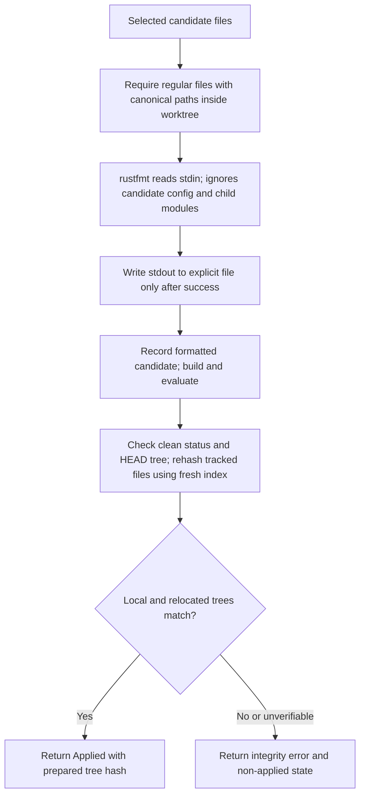
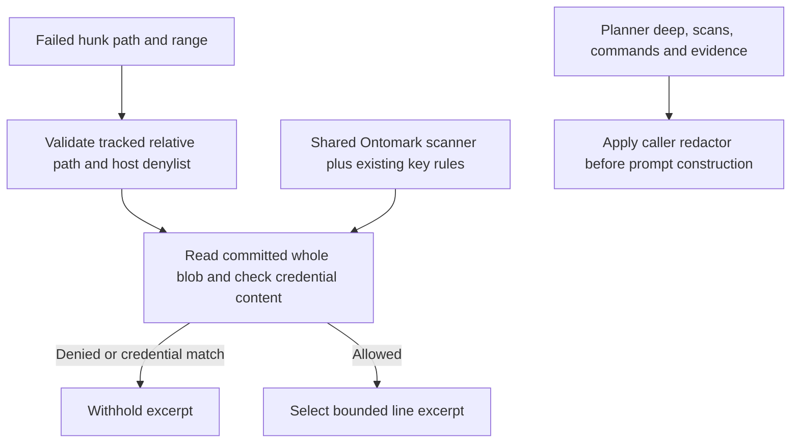

## For developers

These scoped repairs supersede the formatter and final-state observations in DE-02.2 and the repair-excerpt supply gap. They do not turn the evaluator host into a sandbox or reverify the other gate, replay and persistence panels.

## For the business

Formatting no longer follows a candidate's module declarations to other files. A changed final candidate cannot receive the earlier tree's successful identity receipt. The reliability of tests and isolation of their execution remain separate.

## DE-06.1 Explicit-file formatting and final tree identity

**What it shows:** A spaced path attribute cannot make the formatter traverse an external module. A fresh index prevents assume-unchanged or skip-worktree flags from hiding final tracked-file changes. Archive-based hosts must establish a clean Git snapshot with the expected tree before evaluation.

**Why it is this way:** ADR-DE-003/009 require the tested candidate to match the published one. Tests reproduce the former external-file write and evaluator mutations. This detects final-state drift; shared Git metadata, transient writes restored before checking and arbitrary evaluator commands require host isolation.

## DE-06.2 Repair supply uses the same withholding rules

**What it shows:** A harmless-looking requested range cannot hide a credential elsewhere in the committed file. Publication and prompt supply share known token shapes through the Ontomark compiler crate with optional reasoning disabled.

**Why it is this way:** ADR-DE-008 bounds source supply consistently across the initial and repair stages. Tests cover denied names, traversal, out-of-range key material, provider tokens and a valid public excerpt. Token detection does not classify all confidential information.
