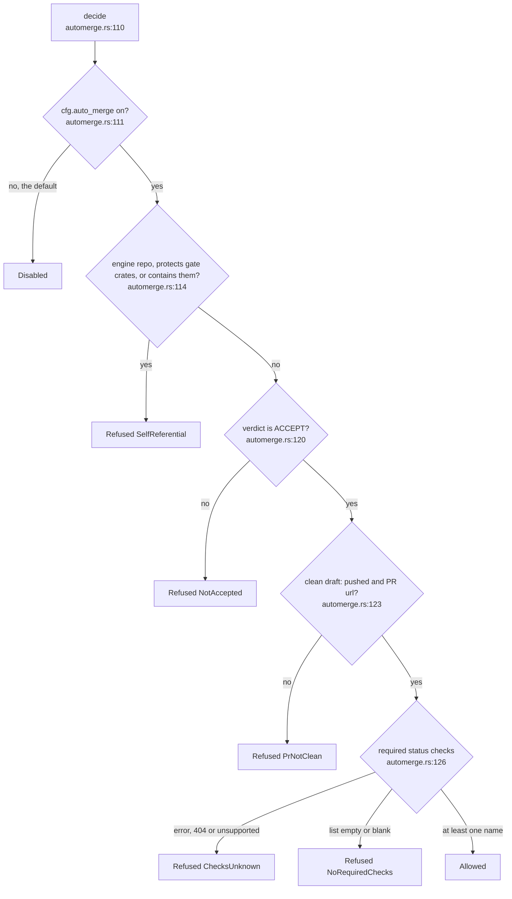
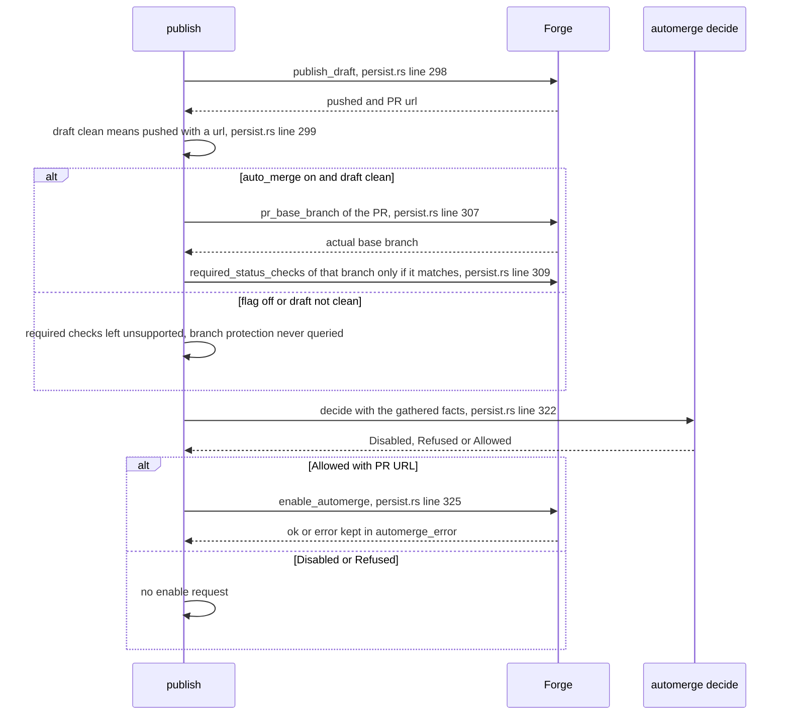

## For developers

An ACCEPT says the repository's evaluators did not object, not that the
change is wanted, so the default is a draft pull request a human merges
(`crates/dream-core/src/automerge.rs:3`). `automerge::decide` is a pure
function that turns facts the caller gathered into `Disabled`, `Refused` or
`Allowed` (`crates/dream-core/src/automerge.rs:110`). `persist::publish`
gathers the facts, calls it, and only then asks the forge to enable
automerge (`crates/dream-core/src/persist.rs:291`).

## For the business

Automerge defaults off. A host may publish a draft and opt in to requesting automerge when the policy accepts its supplied facts. The policy refuses unknown or empty required-check lists and recognised engine repositories. It does not establish that checks passed, the PR head matches the evaluated tree, or every renamed engine fork is recognised.

## DE-09.1 The decision tree

**What it shows.** Five refusal reasons in a fixed order, ahead of the one
`Allowed` leaf. The order matters for what is reported, not for the outcome.
**Why it is this way.** `gh pr merge --auto` merges at once when nothing is
required, so an empty list, a 404 and any API error are refusals
(`crates/dream-core/src/automerge.rs:13`). The self-referential test has
three heuristics for recognising engine targets: the slug, a config
whose protected set covers the gate crates, and a checkout that contains them
(`crates/dream-core/src/automerge.rs:136`, `crates/dream-core/src/automerge.rs:144`).
The flag lives in the protected config, so a candidate patch cannot switch it
on (`docs/adr/ADR-DE-006-automerge-is-an-option.md:30`).
**Invariant:** `Disabled` is returned before any other fact is consulted
(`crates/dream-core/src/automerge.rs:111`).

## DE-09.2 Gathering the facts in publish

**What it shows.** With the flag off no protection query is made at all
(`crates/dream-core/src/persist.rs:304`). With it on, protection is read for
the branch the PR really targets, and a mismatch with the expected base is a
refusal (`crates/dream-core/src/persist.rs:311`).
**Why it is this way.** A forge that cannot say what protects a branch never
gets automerge: the trait defaults return `Unsupported`, which the policy
treats as a refusal (`crates/dream-core/src/seams.rs:377`).
**Tension:** the forge step is untested against live GitHub. The only test
touching `GhForge` is a dyn-safety check (`crates/dream-core/src/seams.rs:647`),
so the protection parsing, the draft-to-ready transition and the squash
request have only been exercised against fakes.
**Debt:** the publish outcome is not reconciled. The host contract requires journalling `Persisted` before the forge request and nothing records the push, the pull request URL or
the ledger commit afterwards, so the delivery guarantee is at-most-once: a
crash after `Persisted` can lose a publish, whether before the pull request
exists or after it exists but before its URL or ledger row is recorded, and the
restart finalises the night to `Complete` without asking the forge
(`crates/dream-core/src/runstate.rs:615`, `crates/dream-core/src/persist.rs:298`).
Recovery is the operator's `reset_night`, which archives the journal so the
night runs again; the night key `(repo, date, night_id)` is the idempotency key
for any future reconciliation (`crates/dream-core/src/runstate.rs:441`).
**Debt:** `GhForge` runs `gh pr ready` before `gh pr merge --auto --squash`. If the second command fails, the PR can remain ready while `automerge_error` reports failure; no rollback or retry restores draft state (`crates/dream-core/src/seams.rs:469`).
**Debt:** `draft_clean` means only `pushed && pr_url.is_some()`. It does not validate an empty URL, remote head or PR identity; required-check names do not prove check success (`crates/dream-core/src/persist.rs:299`).
