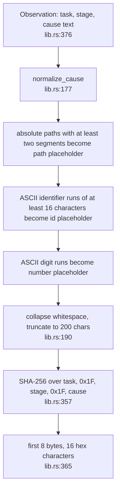
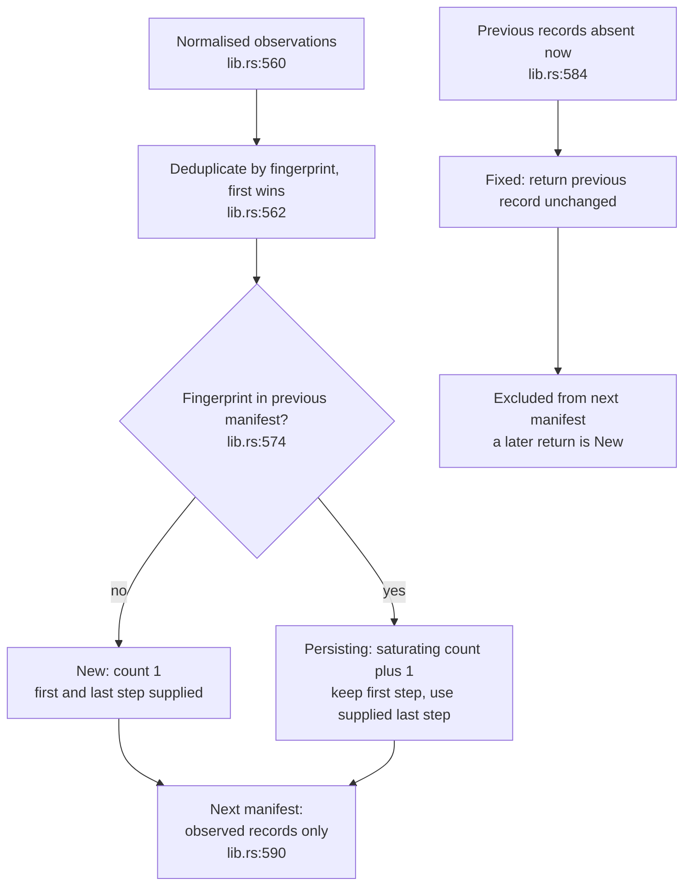
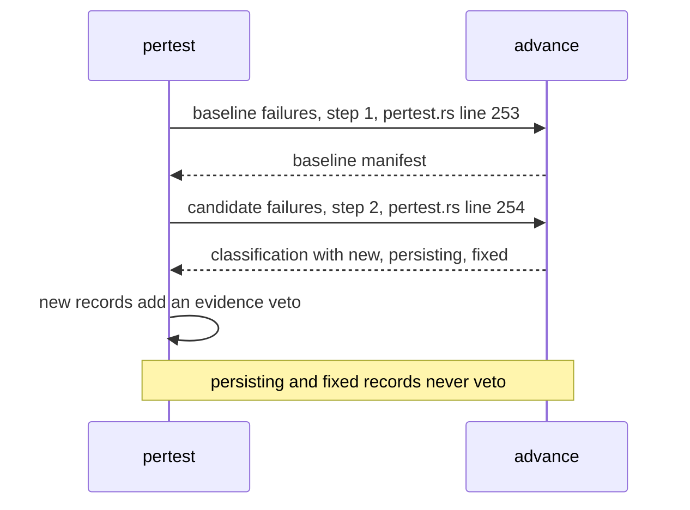
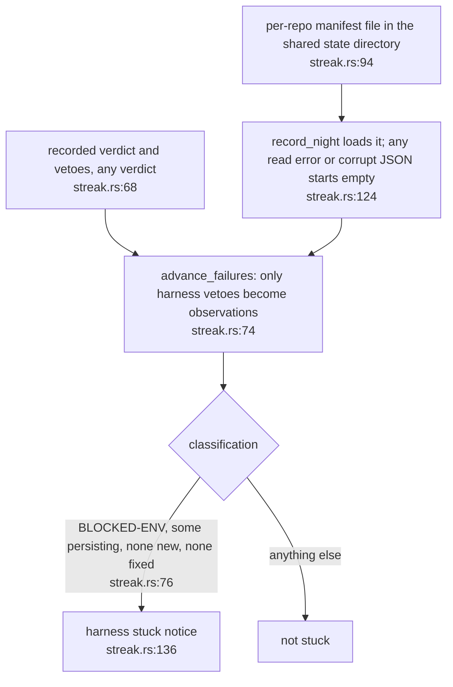

## For developers

`failure-fingerprint` gives a failure a stable identity that survives volatile
text such as temp paths, line numbers and request ids, and classifies each step's
failures against the previous manifest as `New`, `Persisting` or `Fixed`
(`crates/failure-fingerprint/src/lib.rs:1`). The identity is the first 8
bytes of SHA-256 over task, stage and the normalised cause, joined by the unit
separator (`crates/failure-fingerprint/src/lib.rs:13`). In the gate, a baseline
manifest and a candidate step are classified, and any `New` record raises an
evidence veto (`crates/dream-gate/src/pertest.rs:253`).

## For the business

The question the nightly engine needs to answer is not "is anything red" but
"did this change cause a new kind of red". A suite may already be failing on
a known problem. Normalised names help group recurring failures. They are heuristic identities: different causes can collapse to the same name, so this alone cannot prove which change caused a failure.

## DE-14.1 From text to identity

**What it shows.** Normalisation order is paths, ids, digits, whitespace, then
truncation (`crates/failure-fingerprint/src/lib.rs:190`).
**Why it is this way.** Separators distinguish ordinary concatenations and normalisation removes selected volatile text (`crates/failure-fingerprint/src/lib.rs:357`). Neither operation validates caller-supplied names or sanitises arbitrary credentials.
**Debt:** the unit separator is accepted inside task and stage names. `alpha + separator + beta / gamma` and `alpha / beta + separator + gamma` hash identical bytes; this deterministic alias does not require a SHA-256 collision (`crates/failure-fingerprint/src/lib.rs:229`, `crates/failure-fingerprint/src/lib.rs:357`).
**Debt:** short or punctuation-separated credential-shaped strings survive. Numeric causes and suffixes beyond 200 characters also deliberately collapse. Normalisation is neither a secret filter nor a semantic root-cause identifier (`crates/failure-fingerprint/src/lib.rs:190`).
**Tension:** the identity is 64 bits (`crates/failure-fingerprint/src/lib.rs:263`).
Accidental digest collision risk grows with the number of identities. Encoding aliases and normalisation merges are separate risks that do not require a random digest collision. A match against a baseline failure suppresses this particular new-fingerprint veto; other gate checks can still reject the candidate. ADR-DE-004 lists a collision seen in practice as its review trigger.

## DE-14.2 New, persisting, fixed

**What it shows.** The lifecycle `advance` implements
(`crates/failure-fingerprint/src/lib.rs:550`). A persisting record keeps its
`first_seen_step` and increments its count
(`crates/failure-fingerprint/src/lib.rs:576`). A fixed record is a previous
record returned unchanged and absent from the next manifest
(`crates/failure-fingerprint/src/lib.rs:584`).
**Why it is this way.** Observations with the same fingerprint in one step are
de-duplicated, first wins (`crates/failure-fingerprint/src/lib.rs:562`). A
failure that disappears and returns is `New` again with its count reset
(`crates/failure-fingerprint/src/lib.rs:782`).
**Invariant:** records produced by `advance` normalise the observation cause (`crates/failure-fingerprint/src/lib.rs:560`).
**Debt:** public record fields and `Manifest::from_json` permit unnormalised causes, inconsistent fingerprints and arbitrary step values. The reader checks the kind and JSON shape, not these semantic invariants (`crates/failure-fingerprint/src/lib.rs:467`, `crates/failure-fingerprint/src/lib.rs:514`).
**Debt:** `count` is the previous count plus one and not a strict consecutive
count; callers who need strictness check `prev.step + 1 == step`
(`crates/failure-fingerprint/src/lib.rs:539`).

## DE-14.3 How the gate uses two steps

**What it shows.** The gate runs the lifecycle for exactly two steps inside a
single evaluator, with the stage set to the evaluator's name
(`crates/dream-gate/src/pertest.rs:247`).
**Why it is this way.** The question is only whether the candidate introduces a
failure shape the baseline did not have, so a suite that was already red is
not penalised for its known failures (`crates/dream-gate/src/pertest.rs:6`).
## DE-14.4 The cross-night use: harness stall detection

**What it shows.** The same crate used a second way: across nights, to notice
that the same environment fault has come back, so a broken testbed is
escalated to a person and does not just look like a quiet night.
**Why it is this way.** Only harness-class vetoes are fingerprinted, so ordinary
evidence against a candidate cannot look like a stuck harness
(`crates/dream-core/src/streak.rs:236`). A corrupt manifest fails open to an
empty one (`crates/dream-core/src/streak.rs:261`).
**Debt:** `record_night` has no night identifier or lock: duplicate calls count twice and can raise a stall notice during one actual night. Any read error starts empty; concurrent writers are not serialised here (`crates/dream-core/src/streak.rs:117`). `advance_failures` adds one to an unchecked `u64` step, which panics on overflow in debug builds (`crates/dream-core/src/streak.rs:75`).
**Open:** the evidence-gate use in DE-14.3 compares two trees, while the cross-night use retains a failure for as long as it persists. Neither usage validates that a matching fingerprint represents the same underlying cause (`crates/failure-fingerprint/src/lib.rs:574`).
