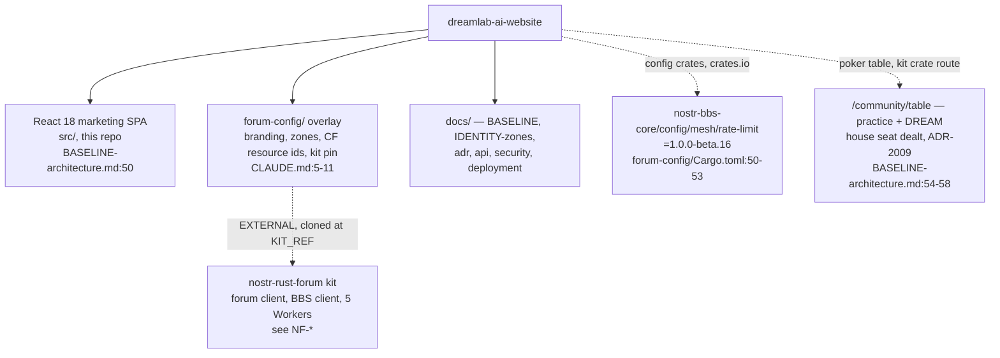
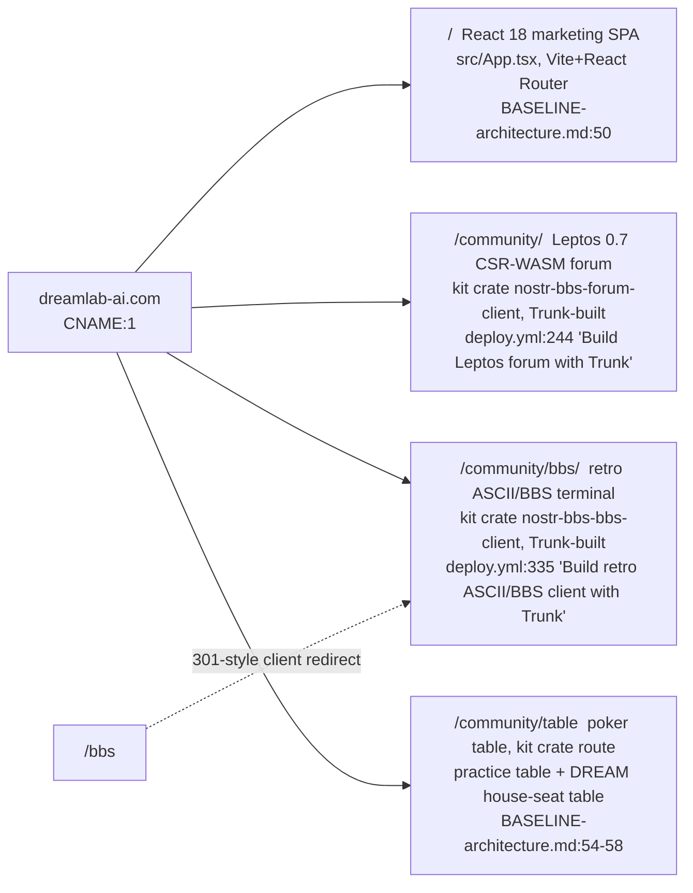
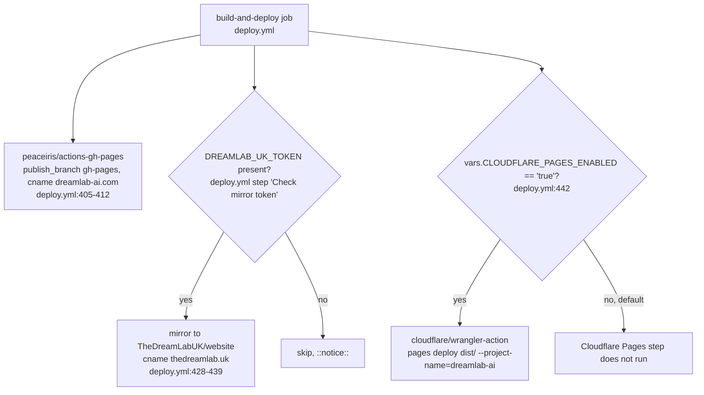
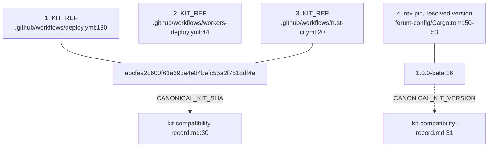
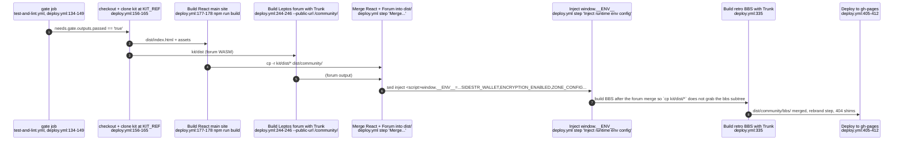
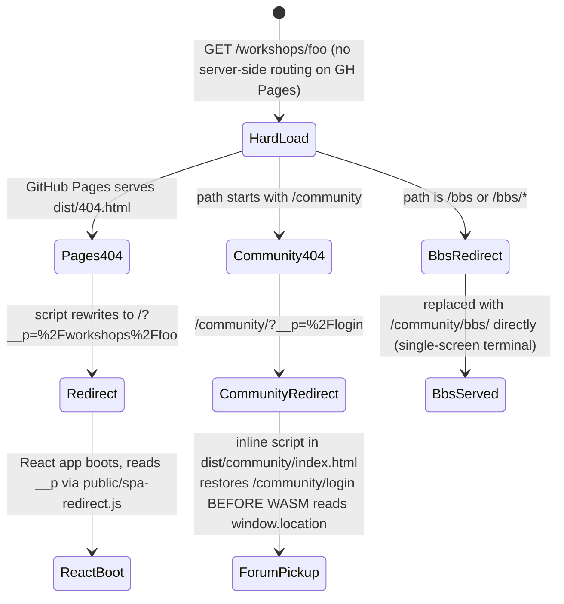
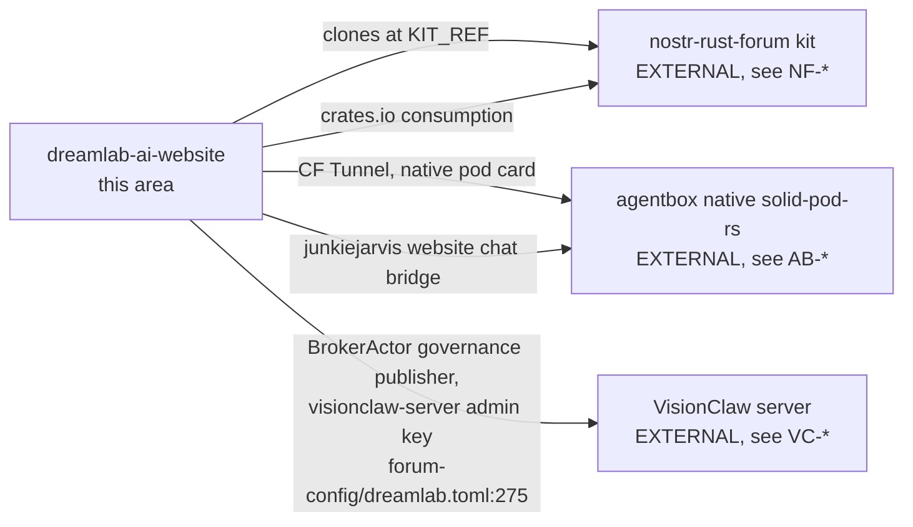

## DW-01.1 Repo composition — thin operator overlay, not a protocol owner

- "What this repo is" (BASELINE-architecture.md:35-41): a thin operator overlay — the forum source, Nostr crates, and five Workers all live upstream; this repo carries only the React site, `forum-config/`, and docs.
- INVARIANT: `forum-config/Cargo.toml` license is `AGPL-3.0-only` (Cargo.toml:9) because it statically links the AGPL kit crates — the package comment (Cargo.toml:6-8) explicitly corrects an earlier "Proprietary" framing as "legally incoherent".

## DW-01.2 Three frontends, one origin

- **Drift:** `BASELINE-architecture.md:140-142` records that the README says "Two SPAs, one origin" while the deploy ships a third client at `/community/bbs/` (`deploy.yml:335`); the README has since been rewritten and now states "three independently built frontends" (`README.md:54`), so that divergence entry describes a README that no longer exists, and `CLAUDE.md:14` still reads "static dual-SPA".
- The forum client also carries the poker table at `/community/table` (ADR-2009, kit ADR-2020): a practice table plus a DREAM table dealt by the `nostr-bbs-poker-citizen` house seat in the agentbox (BASELINE-architecture.md:54-58).
- All three are static assets after build; React gets Vite build variables, forum/BBS get a `window.__ENV__` block injected by `sed` at deploy time (BASELINE-architecture.md:66-70).

## DW-01.3 Deploy topology — GitHub Pages primary, Cloudflare Pages gated off

- **Drift:** the baseline's first divergence says `README.md` frames the site as a "dual-SPA Cloudflare-edge deployment" (`BASELINE-architecture.md:135-139`); the README now says "GitHub Pages: one origin" (`README.md:43`) and the only surviving "dual-SPA" wording is `CLAUDE.md:14`. The origin is GitHub Pages, Cloudflare only hosts the backend Workers (five: auth, pod, relay, search, preview — `forum-config/src/workers.rs:155-172`), and Cloudflare Pages is opt-in behind an explicit repo variable (`BASELINE-architecture.md:82`).
- INVARIANT: GitHub Pages is the origin of record for `dreamlab-ai.com` until DNS is re-cut; the Cloudflare Pages step must stay gated behind that repo variable (BASELINE-architecture.md:173-175, Invariant 4).
- The branded custom domains for those Workers (`relay./api./pods./search./preview.dreamlab-ai.com`) are the documented end-state but are **not provisioned in DNS** — the client instead talks to raw `*.workers.dev` hosts baked into the build env (`deploy.yml:49-61`; verified 2026-06-09 `ERR_NAME_NOT_RESOLVED`, not re-checked as of 2026-08-31) — shipping the branded domains baked in previously severed every client API call (BASELINE-architecture.md:91-97).

## DW-01.5 The dual-pin rule — four locations that must move together

- `workers-deploy.yml` fires on `forum-config/Cargo.lock` and `KIT_REF` changes precisely so a kit re-pin never ships a new client against old workers — the client/worker skew that "wiped the forum on 2026-06-15" (BASELINE-architecture.md:121-124).
- **Drift:** `BASELINE-architecture.md:117` records `KIT_REF = ea7d95e7ca70833217ab543fee91b8344304a32d` ("the kit commit that released 1.0.0-beta.16") while the live pins (`deploy.yml:130`, `workers-deploy.yml:44`, `rust-ci.yml:20`, `kit-compatibility-record.md:30`) are `ebcfaa2c600f61a69ca4e84befc55a2f7518df4a`, a different commit whose compatibility-record row is "`main` at ebcfaa2" with the change set listed there (`kit-compatibility-record.md:26`), at the same crate version `1.0.0-beta.16` (`forum-config/Cargo.toml:50-53`, `kit-compatibility-record.md:31`). The governing doc's crate-version line (`BASELINE-architecture.md:110`) is current at `=1.0.0-beta.16`; only its SHA is a repin behind. All four pin sites and the compatibility record agree with each other.
- The README has been rewritten since the previous stamp: the "Live pin `2d693ed2…` (beta.6)" sentence that this topic recorded as a third, older value no longer exists, and `README.md` carries no kit pin at all, so the earlier README pin drift is closed at the source.
- The pin-site comments do not restate release notes or the kit version: `rust-ci.yml:18-19`, `deploy.yml:126-129` and `workers-deploy.yml:41-43` defer provenance to the compatibility record, which pin-parity checks against the exact SHA, and `deploy.yml:129` records that the prose rots on every repin.
- **Drift:** the deployment row's SHA column and the machine-readable field agree at `ebcfaa2c` with a "Kit branch/tag at pin" column reading "`main` at ebcfaa2" and notes describing the change set (`kit-compatibility-record.md:26,30`). The History table, however, still marks `931898a` (tag `v1.0.0-beta.10`) as "Current (canonical — matches `CANONICAL_KIT_SHA` above and the `KIT_REF` pins)" (`kit-compatibility-record.md:347`), six releases behind. pin-parity compares only the SHA, so this does not fail the gate.
- INVARIANT: the machine-readable pin lives in exactly one place the gate reads — `CANONICAL_KIT_SHA` / `CANONICAL_KIT_VERSION` in `kit-compatibility-record.md:30-31` — and every other site is compared against it, which is why the surrounding comments can rot without the gate noticing.

## DW-01.6 Deploy job sequence — clone kit, build three frontends, merge, inject, deploy

- Since `d3ecd05` (2026-10-02) the deploy also fires on a lockfile-only change: `package-lock.json` joined the push path filter (`deploy.yml:13-28`), so a dependency bump that touches nothing else still republishes the site. The same filter now carries `scripts/**` (`deploy.yml:27`, comment `deploy.yml:21-26`) since the postbuild prerender and discovery check (DW-02.3) and the content generators run in the build, so a generator-only commit rebuilds and ships; the checkout also takes full history (`fetch-depth: 0`, `deploy.yml:156-160`) because the sitemap `<lastmod>` is each page's last commit.
- Supply-chain hardening: every tool the deploy job downloads (Trunk, binaryen/`wasm-opt`, Tailwind CLI) is pinned to an exact version **and** SHA256-verified before use, because this job carries the Cloudflare API token (BASELINE-architecture.md:128-130, `deploy.yml:41-48`).
- The injected payload has grown since ADR-2015/ADR-2016 shipped: `SIDESTR_WALLET:'on'` (deploy.yml:90) gates the testnet4 wallet nav/tip UI, `SIDESTR_CHAINS_JSON` (deploy.yml:95) lists the two sidestr chains (kit ADR-2021), `ENCRYPTION_ENABLED:'true'` (deploy.yml:106) is the zone E2EE master switch, `ZONE_CONFIG_JSON` (deploy.yml:107) marks zones 2-4 `encrypted:true` with zone4 carrying `agent_keys:true`, and `POKER:'on'` + `POKER_CONFIG_JSON` (deploy.yml:101-102) gate and parameterise the poker table — see DW-03/DW-04 for the zone model and encryption detail this step only injects.

- The React build gained one more public input, `VITE_MONITOR_PUBKEY` (`deploy.yml:80`, passed to the React build at `deploy.yml:187`): the nightly inbox-watch co-recipient to whom every contact, signup and chat message is also wrapped, because the relay serves a kind-1059 wrap only to its addressee (`deploy.yml:75-79`); ADR-2011 names that key the `website-info` identity (DW-04). It is another hand-synced mirror (DW-03). `workers-deploy.yml` now retries its post-deploy `/health` probe three times because a worker's Durable Object is cold straight after a deploy (`workers-deploy.yml:353-356`).
## DW-01.7 SPA deep-link 404 shim — load-bearing, not incidental

- "SPA deep links depend on a 404-redirect shim" is called out as load-bearing in the Known-divergences section, not incidental (BASELINE-architecture.md:156-159, `deploy.yml:367-397`, `291-301`).
- The React pickup script is deliberately external (`public/spa-redirect.js`), not an inline `<script>`, because `index.html`'s CSP (`script-src 'self'`, no `'unsafe-inline'`) would block an injected inline script — exactly the bug class that broke `/workshops` deep links (`deploy.yml:399-402`, the comment above the "Deploy" step).

## DW-01.8 EXTERNAL — estate authority map beyond this repo

- `visionclaw-server` is a governance publisher pubkey shared with the forum's primary admin pubkey — see DW-03/DW-04 for the identity implications and IDENTITY-zones.md. The `[governance].agent_pubkeys` list this repo authors is at `forum-config/dreamlab.toml:264,275-277`; the ecosystem statement itself is at `CLAUDE.md:17`.
