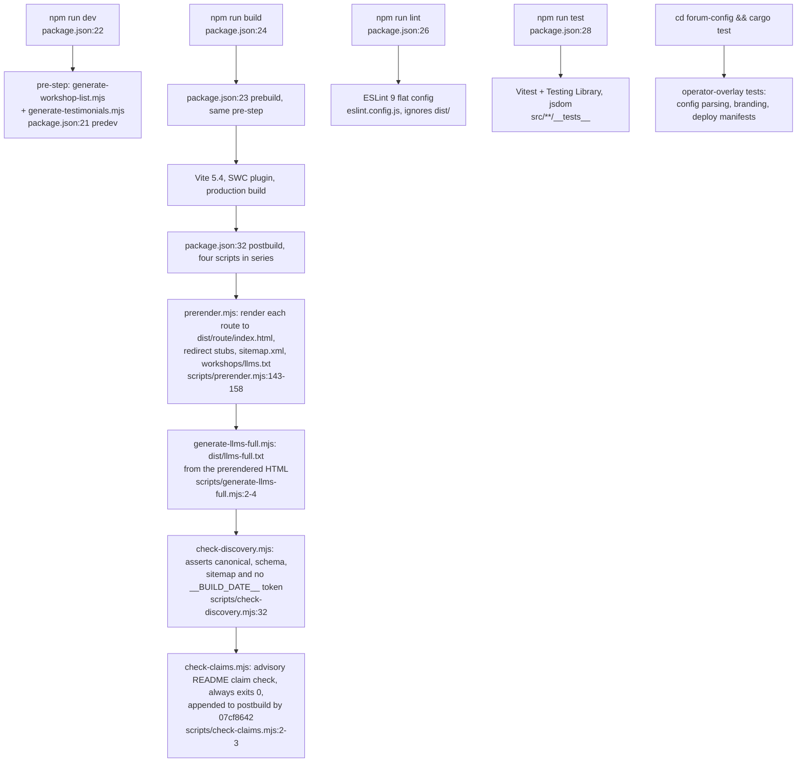
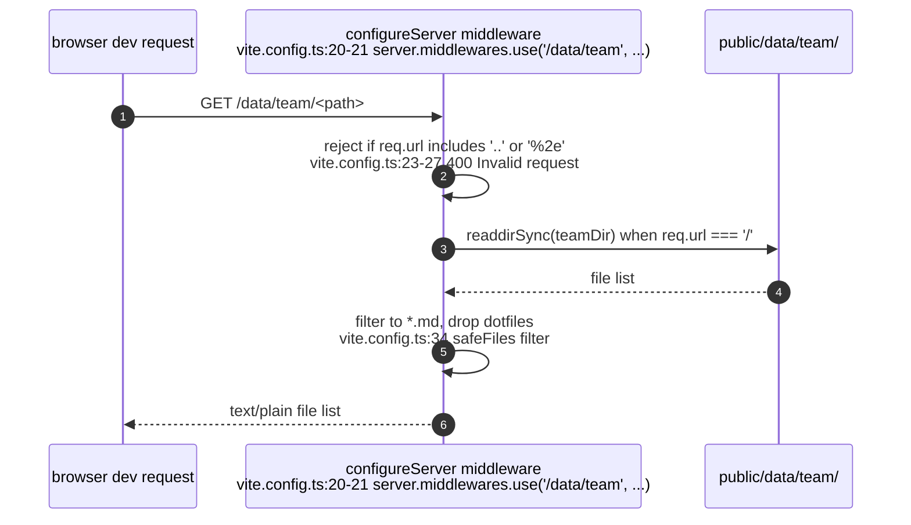
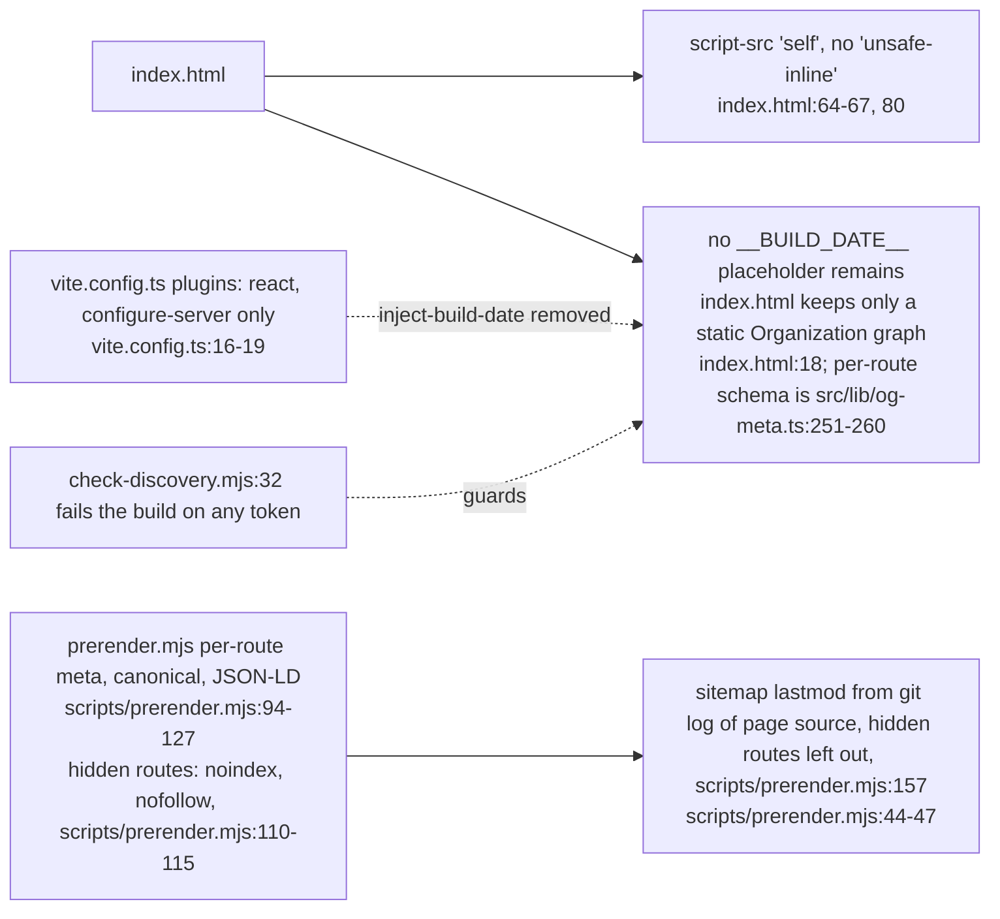
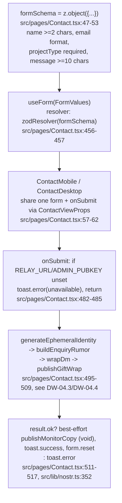

## DW-02.1 Route table — lazy-loaded, code-split

```mermaid
flowchart TB
    APP["App.tsx:31 <App>"] --> BR["BrowserRouter<br/>v7_startTransition, v7_relativeSplatPath<br/>src/App.tsx:41-43"]
    BR --> IDX["/ -> Index<br/>src/App.tsx:49"]
    BR --> PRG["/programmes -> Programmes<br/>src/App.tsx:50"]
    BR --> CC["/co-create -> CoCreate<br/>src/App.tsx:51"]
    BR --> RES["/research -> Research<br/>src/App.tsx:52"]
    BR --> ECO["/ecosystem -> Ecosystem<br/>src/App.tsx:53"]
    BR --> TEAM["/team -> Team<br/>src/App.tsx:54"]
    BR --> WSI["/workshops -> WorkshopIndex<br/>src/App.tsx:57"]
    BR --> WSP["/workshops/:workshopId(/:pageSlug) -> WorkshopPage<br/>src/App.tsx:58-59"]
    BR --> TST["/testimonials -> Testimonials<br/>src/App.tsx:62"]
    BR --> VEN["/ventures -> Ventures, unlinked direct-URL only<br/>src/App.tsx:64-65"]
    BR --> CHN["/chain -> ChainMirror<br/>src/App.tsx:66"]
    BR --> CNT["/contact -> Contact<br/>src/App.tsx:70"]
    BR --> PRIV["/privacy -> Privacy<br/>src/App.tsx:71"]
    BR --> CLK["/clickthrough -> ClickThrough, hidden: noindex, absent from the sitemap<br/>src/App.tsx:67-68, src/prerender.tsx:34"]
    BR --> NF["* -> NotFound<br/>src/App.tsx:81"]
```

- All route components are `lazy()`-loaded (src/App.tsx:10-24); `RouteErrorBoundary` (src/App.tsx:46) contains a failed lazy chunk so it does not white-screen the whole SPA (Sprint v9 D3, src/App.tsx:44-45 comment).
- `v7_relativeSplatPath` is audited as a no-op here (the sole splat route's links are all absolute); `v7_startTransition` only changes how a navigation to a not-yet-loaded chunk holds the outgoing page (src/App.tsx:34-40).
- Route-level lazy loading is supplemented by Rollup manual chunks (`vendor`, `nostr`, `ui`) grouping React/router, `nostr-tools` and Radix primitives into separate bundles (vite.config.ts:61-70).

## DW-02.3 Build & test commands

- The postbuild step is new since the freshness plugin left vite.config.ts: `prerender.mjs` reads the built `dist/index.html` as its template (scripts/prerender.mjs:51) and renders every route through Vite's SSR loader (scripts/prerender.mjs:62), so the deploy ships static HTML per route; `deploy.yml` now triggers on all of `scripts/**` (`.github/workflows/deploy.yml:27`) because of it.
- CLAUDE.md's Behavioral Rules require `npm run build` and `npm run lint` before committing.
- TypeScript strict mode is **partial**: `noImplicitAny: false`, `strictNullChecks: true` (CLAUDE.md:199).

## DW-02.4 Dev-server hardening — `/data/team` path-traversal guard

- This middleware exists only in the Vite dev server (`configureServer`); the production static build serves `public/data/team/` as plain files with no equivalent runtime guard.

## DW-02.5 `index.html` — CSP, and where build-date handling went

- The CSP is why the React `__p` deep-link pickup lives in the external `public/spa-redirect.js` rather than an inline script injected at deploy time (see DW-01.7; `index.html:85-88`); an inline script would be blocked.
- **Drift:** the earlier reading of this topic (and the archived ADR-043, `docs/archive/adr/043-ai-search-visibility-aeo.md:5-6`) that a Vite `inject-build-date` plugin replaces `__BUILD_DATE__` in `index.html` is false at HEAD: the plugin and every placeholder are gone, `dateModified` is no longer stamped with the build date, and freshness is the per-page git commit date in the sitemap `<lastmod>` (`scripts/prerender.mjs:44-47`), omitted rather than faked on a shallow clone (`scripts/prerender.mjs:43`), which is why `deploy.yml` checks out with `fetch-depth: 0` (`.github/workflows/deploy.yml:159-160`).
- OG/social-card image URLs (src/lib/og-meta.ts:42-51) must point at files that already exist under `public/`; there is no OG-image generation pipeline, so meta and imagery are hand-kept in sync.

## DW-02.7 Contact form — RHF + Zod boundary, no database write

- No REST endpoint and no database row: validated form data is packaged straight into the NIP-17 gift-wrap DM ingress that DW-04 diagrams; success is gated strictly on the relay's OK-true (src/pages/Contact.tsx:489-491 comment, ADR-041 D4).
