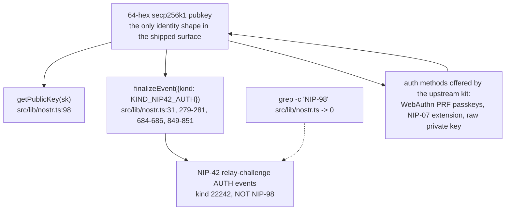
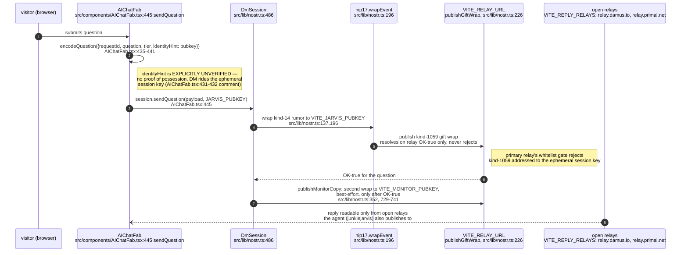
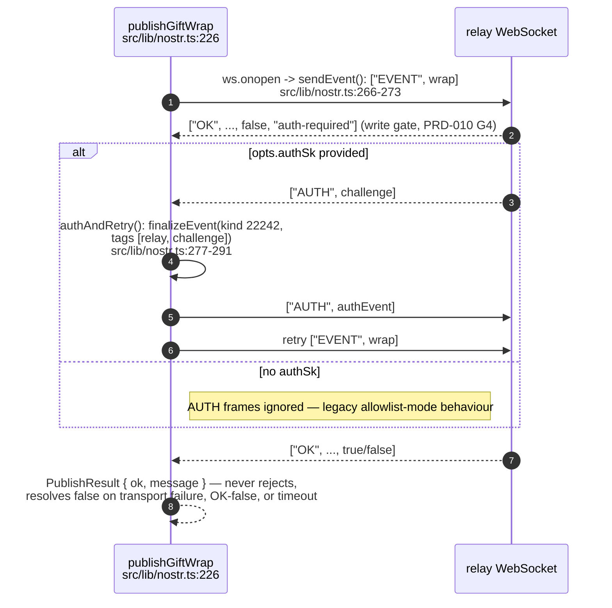
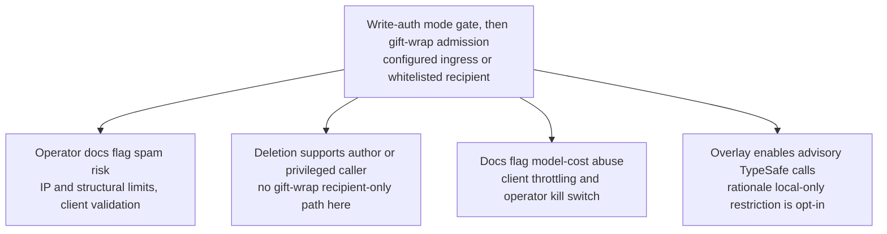
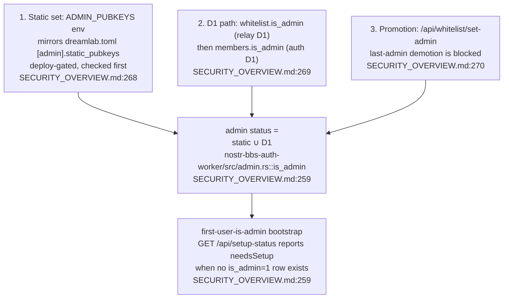
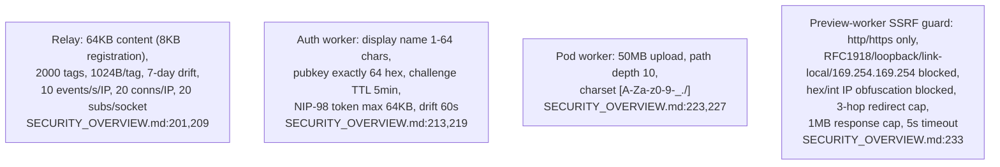
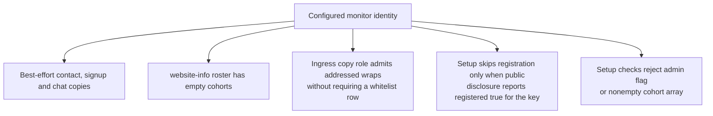

## DW-04.1 Identity is raw-hex Schnorr, not a DID document

- INVARIANT (`IDENTITY-zones.md:175-177`): identity in the shipped surface is the raw 64-hex secp256k1 pubkey; any move to emit or require a Multikey/DID document is a code change and a new ADR, not a docs edit.
- DOC-DRIFT within this repo's OWN docs: `docs/security/AUTHENTICATION.md` (`## NIP-98 HTTP Authentication`, line 200) documents NIP-98 as the upstream kit auth-worker's HTTP-API scheme (passkey/session auth to REST endpoints) — a genuinely different protocol from the NIP-42 relay-challenge flow this repo's own `src/lib/nostr.ts` implements for DM transport. `IDENTITY-zones.md:34-35`'s claim that "the string NIP-98 appears nowhere in nostr.ts" is true and specific to that one file; it does not mean NIP-98 is absent from the deployed system.
- DIVERGENCE: legacy ADR-027's `did:nostr`/Multikey document form is docs-only — `fe70102` is not a commit hash, it is the Multikey encoding prefix itself (base16-multibase `f` + secp256k1-pub multicodec varint `e701` + compressed-point `02`, `IDENTITY-zones.md:46-49`); the two commits that landed it (`d62ab40`, `8d942d7`) touched only docs and JSON-LD, and the binding spec they cite (`ADR-125-did-nostr-multikey-convergence.md`) does not exist in this repo — it is kit-owned. ADR-027 is archived as "Deferred — kit-owned" (`IDENTITY-zones.md:56`); treat any claim that this repo emits `did:nostr` Multikey documents as false until a code path produces one (`IDENTITY-zones.md:162-164`).

## DW-04.3 Talk-to-AI — client-side Nostr DM, not an HTTP chat endpoint

- INVARIANT (`IDENTITY-zones.md:182-183`): the Talk-to-AI reply-relay set must remain a subset of the agent's own publish fan-out, or replies are never seen.
- **Drift (corrected):** an earlier reading said request/reply correlation was not yet built. The DM transport still carries no protocol-level correlation (the agent's reply rumor has no `e` tag), but the client now mints its own request id per question and binds replies to it, so a late or out-of-order reply resolves the turn it names or none (`AIChatFab.tsx:51-56`; `requestId` at `AIChatFab.tsx:435-441`); `ChatMessage.lateForQuestion` labels a late answer (`AIChatFab.tsx:9-19`). The estate closeout note still asks to "Preserve sender verification while adding request/reply correlation and verifying real agent fan-out" (`IDENTITY-zones.md:208`); agent-side correlation is outside this repo.

## DW-04.4 NIP-42 AUTH — lazy challenge-response on publish

- The challenge is answered lazily — only after a rejection — "so allowlist-mode relays keep the zero-round-trip fast path" (`src/lib/nostr.ts:260-263` comment).
- `authSk` is minted per submission and discarded, exactly as for the wrap signature — anonymity is preserved even though the publish now requires proof of key possession (`src/lib/nostr.ts:207-213`).

## DW-04.5 Anonymous website ingress — threat register

- Admission is mode-dependent: the consumed kit checks session authentication before recipient admission, requiring AUTH in `nip42` mode; configured ingress or a whitelist row can admit the recipient. The operator document's unconditional no-AUTH/whitelist-only wording is stale. The prior panel recorded successful Worker deploy run `41028875471` on 30 October, with credential checks for search and relay but no auth-secret receipt. That observation remains historical; this pass reads configuration and does not redeploy or recheck Worker secrets.
- Federation posture: single relay today; kind 1059 is already in `dreamlab.toml [mesh].federated_kinds` (see DW-03), so this surface is "federation-ready by construction" though the mesh transport itself is designed, not shipped.

## DW-04.6 Admin identity resolution — three layers

- Known gap: the search-worker honours only its own `ADMIN_PUBKEYS` `[vars]` value — D1-promoted admins are not visible to it (`SECURITY_OVERVIEW.md:272`, "see the forum-flow cartography Gap 2"); its own separate copy is `search-worker.wrangler.toml:46` (see DW-03.10).
- `workers-deploy.yml` blocks the auth-worker deploy if the `ADMIN_PUBKEYS` secret is unset; the block is that workflow's bash step, not the Rust `validate_required_secrets`, which no workflow calls (see DW-03.8).

## DW-04.8 Rate/size limits relevant to the identity surface

- Source: `docs/security/SECURITY_OVERVIEW.md` Relay/Auth-worker/Pod-worker Limits tables (`:197-231`) and SSRF Protection section (`:233`) — these limits are enforced in the upstream kit's worker source (cloned at `KIT_REF`, not vendored in this repo), so this diagram documents the operator-visible contract rather than code this repo owns.

## DW-04.9 The website-info identity — labelled, never privileged (ADR-2011)

- ADR-2011 decides the key is named but unprivileged because the `agent` cohort would receive the zone4 key (`docs/adr/ADR-2011-website-information-identity.md:54-56`); the relay reads only wraps addressed to the viewer, which is why a co-recipient copy exists rather than a second look at the admin's (`src/lib/nostr.ts:342-347`).
- **Open:** the registry's `registered_by` is the agentbox operator key that signs the registration while the roster says `operator-jjohare`; ADR-2011 leaves that gap open until the kit exports config to the registry (`docs/adr/ADR-2011-website-information-identity.md:75-76`).
- **Drift (repaired at source 2026-11-03, adoption not evidenced):** at the previous stamp (`0e15728`) ADR-2011 said the watch reports missing registry/whitelist rows, but configuration-backed ingress and merged disclosure could keep its checks green after row loss, and the provisioner skipped registration whenever the merged response merely listed the key. The website now requires the disclosure's explicit `registered` flag in both the nightly check and the provisioner (`scripts/lib/website-info.mjs:83`, `scripts/lib/website-info.mjs:89`, `scripts/seed/provision-website-info.mjs:97`, `scripts/seed/provision-website-info.mjs:119`), and the forum disclosure marks a registry row `registered: true` and a config-merged ingress entry `registered: false` (`../nostr-rust-forum/crates/nostr-bbs-relay-worker/src/agent_disclosure.rs:57`, `../nostr-rust-forum/crates/nostr-bbs-relay-worker/src/agent_disclosure.rs:88`). ADR-2011's 2026-11-03 repair evidence records that the fix needs the matching forum response deployed, that an older response now fails the registry check, and that no provisioning or live messaging was performed (`docs/adr/ADR-2011-website-information-identity.md:26-37`). DW-09 and the [dated review](../../estate-review/2026-11-01-website-information-and-inbox.md) trace the consumed kit and reproduce the earlier consumer behaviour.
- **Open:** ADR-2011 now points at a 2026-11-02 dated source reconciliation of the external review that supplements the decision without changing its status (`docs/adr/ADR-2011-website-information-identity.md:20-24`); ADR-2011 records no deployment of a forum revision that serves the `registered` field, so the repair is source-complete and adoption-pending.
- The old cryptographic-impossibility wording in DW-04.5 was too broad: current NIP-59 recommends recipient-authorised deletion, whereas the inspected kit deletion handler permits author matching or privileged deletion. The dated review separates protocol capability from this implementation; no deletion was executed.
