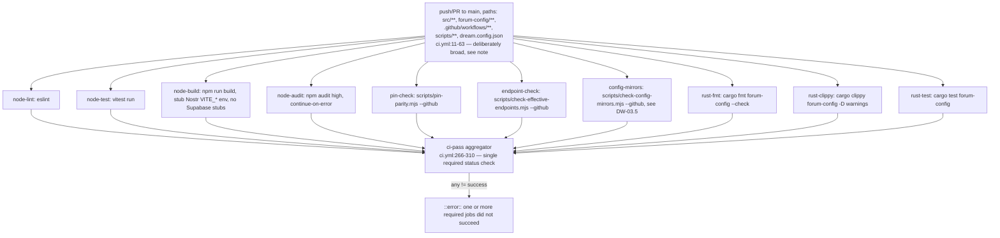
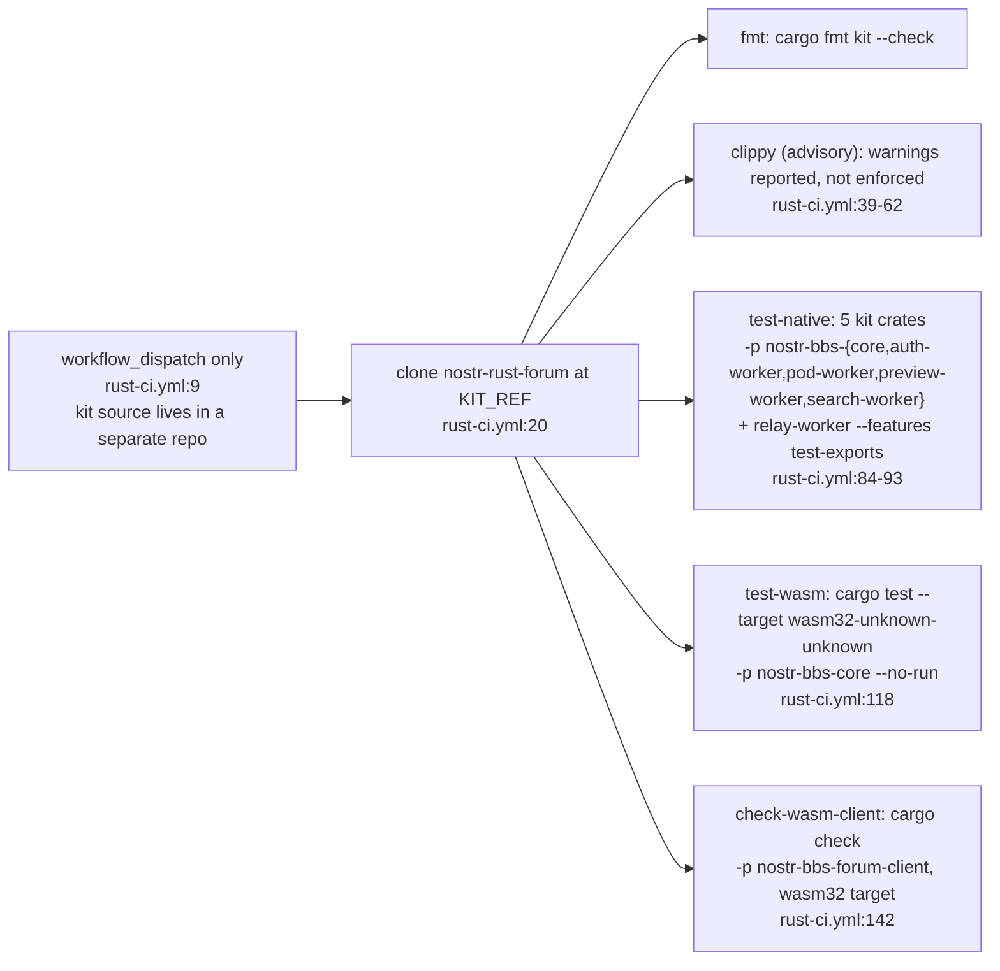
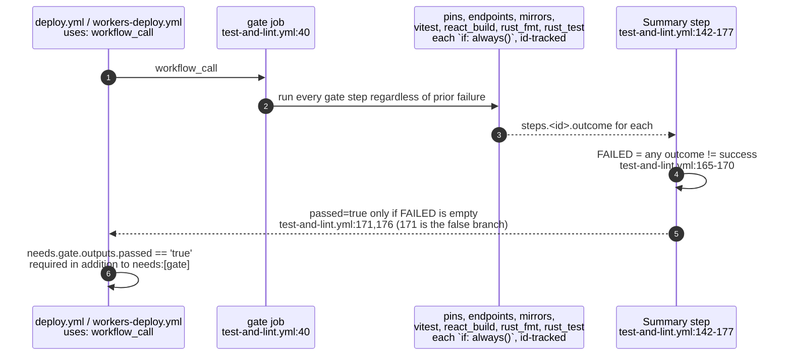
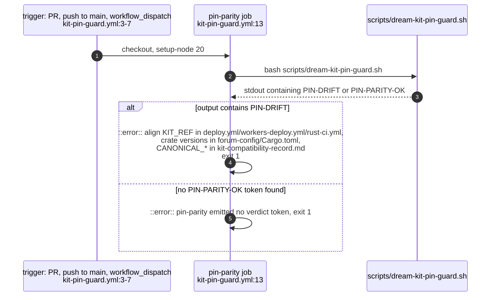
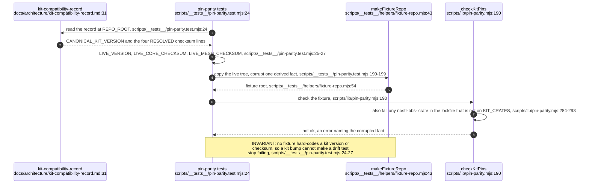

## DW-05.1 `ci.yml` — the ten-job PR/push gate and its aggregator

- `ci.yml:14-37` (push) and its mirror `ci.yml:40-62` (pull_request) deliberately enumerate `.github/workflows/**` and `scripts/**` as trigger paths, not just the three `KIT_REF` pin sites: pin-check sweeps ALL workflow files for tag-pinned actions, so any workflow edit can break it — narrower path filters previously let `kit-pin-guard.yml` carry an unpinned `actions/checkout@v4` without re-running the gate that rejects it (2026-09-06 incident, `ci.yml:26-30` comment).
- `rust-clippy` here is `-D warnings` (blocking, `ci.yml:169-186`) — unlike `rust-ci.yml`'s clippy job against the kit, which is explicitly advisory (DW-05.2).
- Playwright/E2E specs (`playwright.config.ts`, `tests/forum-smoke.spec.ts`) are deliberately NOT wired into `ci.yml`, `test-and-lint.yml` or any gate job in this tree — `CLAUDE.md:63-64` documents `npx playwright test` as a manual command requiring a running deployment; `forum-smoke.spec.ts:404-410` is the only spec asserting workers return scoped CORS, cited by `BASELINE-architecture.md:100`.
- `set-worker-secrets.yml` (`workflow_dispatch` only, `set-worker-secrets.yml:12-13`) is a one-shot operator push of secrets via the CF Workers Secrets API: `NATIVE_POD_URL`, `NATIVE_POD_ADMIN_KEY`, `PRF_SERVER_SECRET` and `ADMIN_PUBKEYS` to `dreamlab-auth-api` (`set-worker-secrets.yml:3-10`), in a second job `VAPID_PRIVATE_KEY` to `dreamlab-nostr-relay` for content-free Web Push (`set-worker-secrets.yml:108-133`), and, in a third job added since this topic's previous stamp, `TYPESAFE_API_KEY` (the SubQ key it replaced is gone) to `dreamlab-search-api`, `dreamlab-nostr-relay` and, since 2026-10-30, `dreamlab-auth-api` through a three-entry matrix (`set-worker-secrets.yml:143-146`) that waits for the other two secret jobs and does not fail fast (`set-worker-secrets.yml:136-144`), failing the job when the GH secret is empty (`set-worker-secrets.yml:156-159`), reading the value from the environment rather than argv and retrying a Cloudflare 409 up to five times (`set-worker-secrets.yml:160-173`); the pipeline never generates these values and the `PUT` is idempotent. The auth-worker four are validated at deploy time by `workers-deploy.yml`'s "Validate required auth-worker secrets are set" step (`workers-deploy.yml:301`); the new System One credential has its own presence-only step, "Validate public System One credential", which runs for the `search-worker` and `relay-worker` matrix entries only (`workers-deploy.yml:287-288`) and fails the deploy when `wrangler secret list` does not name `TYPESAFE_API_KEY` (`workers-deploy.yml:296-299`), so the auth worker, which now needs the same secret for its rationale check, is provisioned but not checked at deploy time (**Debt:** a missing key there degrades silently to an unavailable result). **Drift:** the `set-worker-secrets.yml` header still describes the whole workflow as writing four secrets to the `dreamlab-auth-api` Worker (`set-worker-secrets.yml:3-10`), while the file now provisions a different secret to three Workers (`set-worker-secrets.yml:135-173`); the VAPID job already outgrew that header, and the System One job widens the gap.
- `docs-update.yml` is the one workflow with `contents: write` in this tree: a Sunday 22:00 UTC cron (`docs-update.yml:4-6`) that only ever proposes changes — `update-timestamps` opens a PR on `docs/auto-update-timestamps` rather than committing to `main` (`docs-update.yml:59-72`), and a second `check-outdated` job flags docs with `last_updated` >90 days old into a deduplicated rolling issue rather than spamming new ones (`docs-update.yml:126-128` names prior duplicate issues #35/#37/#39/#40 as the reason).

## DW-05.2 `rust-ci.yml` — manual-only gate against the upstream kit

- `rust-ci.yml:4-6` states the division of labour explicitly: "Triggered by workflow_dispatch (manual) since kit source lives in a separate repo. The test-and-lint.yml workflow covers forum-config/ on every push/PR automatically" — `forum-config/` gets automatic gating (DW-05.3); the kit itself only gets this manual, advisory-clippy check. **Drift:** "on every push/PR" is no longer literal: `test-and-lint.yml` has no `push` trigger (`test-and-lint.yml:20-21,23-30`), so it runs on pull requests (`test-and-lint.yml:29-30`) and, for main, only as the `workflow_call` gate inside `deploy.yml` and `workers-deploy.yml` (`deploy.yml:134-137`), whose own path filters decide whether it runs at all.

## DW-05.3 `test-and-lint.yml` — the reusable pre-deploy gate, fixed 2026-09-05

- INVARIANT: `test-and-lint.yml:1-17` documents two closed defects (ADR-2002/2003 closeout, 2026-09-05): (1) it previously ran no unit tests at all — Vitest lived only in the separate `ci.yml`, which `deploy.yml` does not depend on, so a red suite never blocked a deploy; (2) the final step wrote `passed=true` unconditionally under `if: always()`, so the output was true even when an earlier step had failed.
- `deploy.yml:147-149` and `workers-deploy.yml:64-66` (the `provision-kv` job; the deploy job repeats it at `workers-deploy.yml:110`) both check `needs.gate.outputs.passed == 'true'` explicitly, not merely `needs: [gate]` — the comment notes this is deliberate: requiring the gate's own verdict means a future change that makes a gate step non-blocking cannot quietly re-open the publication path.
- DOC-DRIFT: `docs/BASELINE-architecture.md:191` (estate closeout, dated 2026-09-04) claims "CI has a Vitest/pin/admin aggregator, while deployment uses a separate reusable gate without Vitest" — that description predates the fix `test-and-lint.yml`'s own header documents as landing 2026-09-05 (one day later); as of this verified commit, `test-and-lint.yml` DOES run Vitest (`id: vitest`, `test-and-lint.yml:88-91`) and its `passed` output is a real aggregation, not a constant.

## DW-05.4 `kit-pin-guard.yml` — pin-parity as its own gate

- This is a narrower, faster check than `ci.yml`'s `pin-check` job (which runs the fuller `scripts/pin-parity.mjs --github`, also covering Action SHA pinning across all workflows) — `kit-pin-guard.yml` delegates to a plain-ESM shell+node script with no deps, pinned to Node 20 specifically because it "delegates to scripts/pin-parity.mjs" (kit-pin-guard.yml:18-19 comment).

## DW-05.8 Pin-parity fixtures derive the pin from the live record

- `checkKitPins` also counts `[[package]]` blocks per kit crate (`countKitPackageBlocks`, `scripts/lib/pin-parity.mjs:118`; the error `is resolved N times`, `scripts/lib/pin-parity.mjs:299-307`), because `parseLockfileResolved` keeps only the last block per name (`scripts/lib/pin-parity.mjs:103`) and a stale transitive requirement can resolve a second, older beta beside the pin; a fixture appends a `beta.8` block and expects drift (`scripts/__tests__/pin-parity.test.mjs:270-277`). The record side has the same twin: `countRecordResolvedLines` (`scripts/lib/pin-parity.mjs:174`) makes `checkKitPins` reject a record that carries two `RESOLVED` lines for one crate (`scripts/lib/pin-parity.mjs:370-378`), because `parseRecord` keeps only the last (`scripts/lib/pin-parity.mjs:161-163`; fixture `scripts/__tests__/pin-parity.test.mjs:306-315`). `scripts/__tests__/deploy-subset-of-ci.test.mjs:1-8` adds a static guard that every `deploy.yml` path filter is covered by a `ci.yml` filter.
- New since the previous stamp, a third sweep covers what both counts miss: `findKitFamilyPackages` (`scripts/lib/pin-parity.mjs:138`) collects every lockfile `[[package]]` whose name starts with `nostr-bbs-` (`scripts/lib/pin-parity.mjs:47,144`), and `checkKitPins` fails any such crate that is not on `KIT_CRATES` (`scripts/lib/pin-parity.mjs:284-293`). It is needed because `parseLockfileResolved` and `countKitPackageBlocks` both skip names outside `KIT_CRATES` (`scripts/lib/pin-parity.mjs:99,124`), so a kit crate arriving only transitively, never named in the manifest, was invisible to every exact-pin, checksum and record comparison. The sweep reads package blocks, not text, so a name that only appears in another package's `dependencies` list is not family drift (`scripts/__tests__/pin-parity.test.mjs:129-155`); the fixture inserts a `nostr-bbs-agent-tools` block and expects `kit-family crate nostr-bbs-agent-tools` (`scripts/__tests__/pin-parity.test.mjs:337-355`). The kit pin itself moved again on 2026-10-30: `KIT_REF` is now `9c36b6032640c89879ae52fe25da99493979a0b6` in all three pin sites (`.github/workflows/deploy.yml:130`, `.github/workflows/workers-deploy.yml:44`, `.github/workflows/rust-ci.yml:20`) and `CANONICAL_KIT_SHA` matches it (`docs/architecture/kit-compatibility-record.md:30`); library crates stay at `CANONICAL_KIT_VERSION=1.0.0-beta.16` (`docs/architecture/kit-compatibility-record.md:31`). The record says the pin makes each Jev consumer's local-only switch env-driven and off by default, so the auth worker's rationale check runs on TypeSafe, that the consumers are built from kit source by the Worker workflow rather than linked as library crates, and that "this pin update is not a deployment receipt" (`docs/architecture/kit-compatibility-record.md:38-44`). The earlier drift, a branch/tag column left at "`main` at ebcfaa2", is closed: the row now reads "`main` at 9c36b60" beside the SHA (`docs/architecture/kit-compatibility-record.md:26`); pin-parity still compares only `CANONICAL_KIT_SHA` (`docs/architecture/kit-compatibility-record.md:30`), so such a column could drift again unseen.
- The wrapper suite derives the same two facts independently (`scripts/__tests__/dream-kit-pin-guard.test.mjs:23-24`) and drives them through `scripts/dream-kit-pin-guard.sh`, so the thin wrapper and the gate it delegates to are both exercised against the live record rather than against a snapshot of it.
- **Debt:** `scripts/dream-kit-pin-guard.sh:9-18` records the cost already paid for the previous shape — a verbatim shell transcription of the evaluator reported `PIN-DRIFT-RECORD-VER` against a correctly pinned repository once the manifest moved to exact `=` pins, and never opened `forum-config/Cargo.lock` at all.
- **Invariant:** the guard prints `PIN-PARITY-OK` or `PIN-DRIFT` and always exits 0 (`scripts/dream-kit-pin-guard.sh:20-22`); enforcement lives in `kit-pin-guard.yml`, so changing the exit code here silently disarms the gate.
