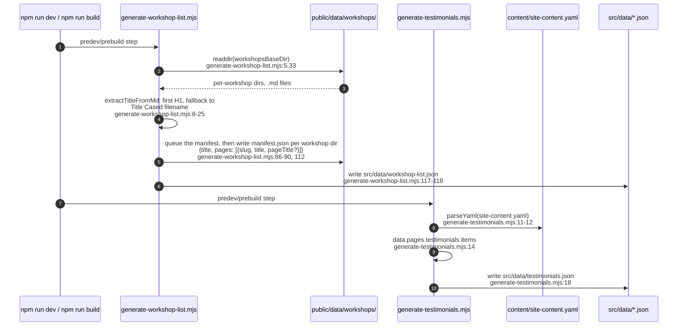
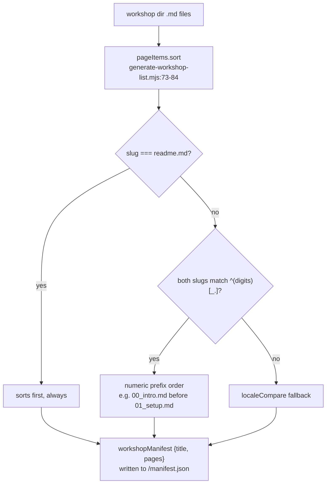
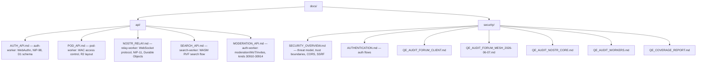
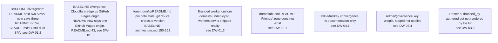
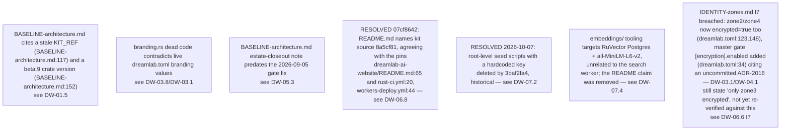
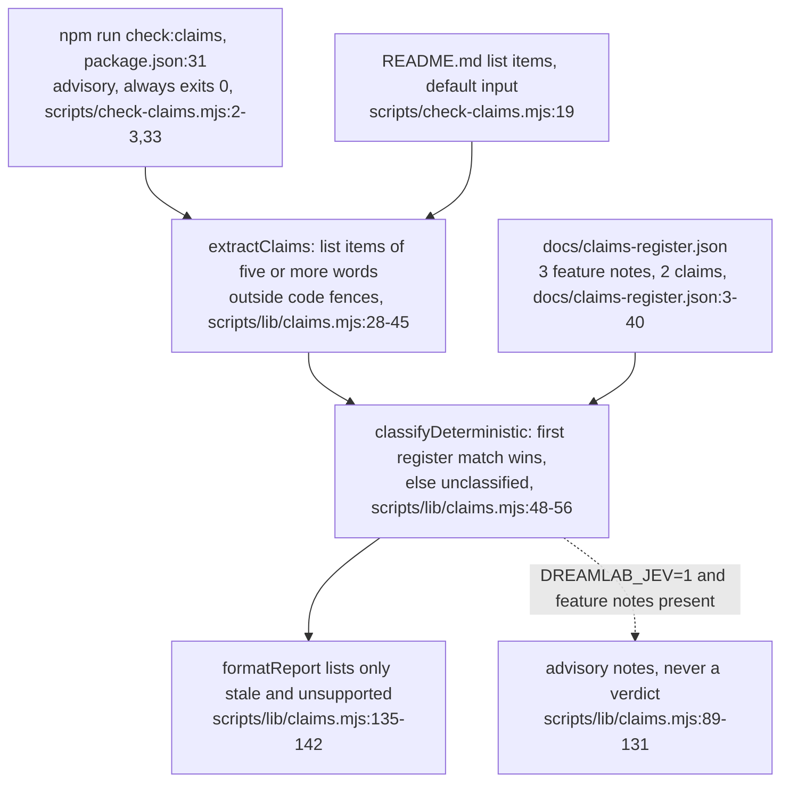

## DW-06.1 Pre-build content pipeline — two generators, run before every dev/build

- Both generators fail soft: a missing `public/data/workshops/` writes an empty `workshop-list.json` instead of failing the build (`generate-workshop-list.mjs:121-124`), and a YAML parse error writes an empty `testimonials.json` (`generate-testimonials.mjs:22-25`) — CLAUDE.md's Data directory note explicitly marks these two JSON files as GENERATED, do-not-hand-edit.

## DW-06.2 Workshop manifest generation — page ordering rules

- The workshop id itself is reformatted for display: `workshop-01-foo` becomes `01 - Foo` via a regex that splits the leading number from the rest and title-cases each word (`generate-workshop-list.mjs:40-46`).
- Manifests are now written in a second pass: every workshop's manifest is queued first (`generate-workshop-list.mjs:86-90`), then lessons whose title duplicates another lesson's, or repeats their own workshop's title, gain a `pageTitle` (`generate-workshop-list.mjs:98-110`) before the write (`generate-workshop-list.mjs:112`). The ordering rules above are unchanged. Content correctness is also checked by `scripts/lib/content-generators.mjs`, which re-derives counts from the generators' inputs (`scripts/lib/content-generators.mjs:7-11`), because both JSON artefacts are committed yet rebuilt by `prebuild`; it also now fails when a workshop's `path` is not `/workshops/<id>` (`scripts/lib/content-generators.mjs:88-99`), since prerender and the discovery check both re-read that field.

## DW-06.5 API and security documentation inventory

- `MODERATION_API.md`'s four endpoint families are backed by Nostr parameterised-replaceable event kinds **30910-30914** (`docs/api/MODERATION_API.md:15`), with D1 projections into `moderation_actions`/`reports` for fast querying; every mutating endpoint requires a NIP-98 header binding method, URL and body-SHA256 to prevent replay (`docs/api/MODERATION_API.md:9`).

## DW-06.6 Invariants register — consolidated from both governing docs

```mermaid
flowchart TB
    I1["1. KIT_REF + Cargo pin lockstep<br/>BASELINE-architecture.md:163-166 — see DW-01.5"]
    I2["2. Privileged deploy downloads nothing unverified<br/>BASELINE-architecture.md:167-169 — see DW-01.6"]
    I3["3. window.__ENV__ vs Vite build vars, validate every endpoint<br/>BASELINE-architecture.md:170-172"]
    I4["4. GitHub Pages is origin of record until DNS re-cut<br/>BASELINE-architecture.md:173-175 — see DW-01.3"]
    I5["5. Identity stays raw 64-hex pubkey, no silent DID move<br/>IDENTITY-zones.md:175-177 — see DW-04.1"]
    I6["6. Zone required_cohorts stays dual-accept<br/>IDENTITY-zones.md:178-179 — see DW-03.1"]
    I7["7. BREACHED at HEAD: doc says only zone3 is encrypted<br/>IDENTITY-zones.md:180-181, but dreamlab.toml has zone2/3/4<br/>encrypted=true (dreamlab.toml:123,137,148); the toml's own<br/>[encryption] gate + zone4.agent_keys cite 'ADR-2016'<br/>(dreamlab.toml:34,149) but no ADR-2016-*.md exists in<br/>docs/adr/ at HEAD — the record was never written<br/>see DW-03.1"]
    I8["8. Talk-to-AI reply relays subset of of agent publish fan-out<br/>IDENTITY-zones.md:182-183 — see DW-04.3"]
    I9["9. Admin/Jarvis pubkeys + ZONE_CONFIG hand-mirrored, rotation touches every mirror<br/>IDENTITY-zones.md:184-186 — see DW-03.3/DW-03.5"]
    I10["10. website-info holds no cohort, never agent, no admin or zone key;<br/>monitor key and [[ingress]] entries equal across mirrors<br/>IDENTITY-zones.md:187-191 — see DW-04.9"]
```

- These ten invariants are the compliance surface for this area: any change touching them requires a governing-doc update plus a thin ADR under `docs/adr/`, per each doc's own Change-process section — the pack itself is a **thin ledger** amending `BASELINE-architecture.md` / `IDENTITY-zones.md` (the living docs are normative); the pre-2026-08-31 legacy corpus (numbered 013+) is frozen under `docs/archive/adr/` as evidence, not authority (`CLAUDE.md:21-23`). Its ADR-2xxx numbering overlaps VisionFlow/agentbox's own ADR-2xxx space by design — each area's ids are area-scoped, resolved by directory, not globally unique across repos.

## DW-06.7 Known divergences / DOC-DRIFT register — this area's open items

## DW-06.9 Known divergences / DOC-DRIFT register — continued (D9-D15)

- D9 and D11 are findings from this diagram-authoring pass, not pre-existing entries in either governing doc's own Known-divergences section — both are consequences of the governing docs' `verified_commit: d852f61` being older than this repo's HEAD at this topic's stamp (`3afa374f`) and the estate-closeout note's own explicit 2026-09-04 dating.
- D12/D13/D14 are Wave 2 findings, closing the material gaps the estate audit (`reports/audit-web.md`) identified for this area; D15 is a Wave 3 finding — see DW-06.6/DW-06.6 for the full evidence.

## DW-06.8 README feature claims — checked against a claims register, not a feature list

- The earlier nine-bullet README feature list this diagram once classified is gone with the README rewrite; the register is seeded only with README claims that cite a concrete in-repo `file:line` (web push in the operator overlay, declared recipients and an inbox-watch path), so uncited README claims report `unclassified` by design (`docs/claims-register.json:2`).
- **Tension (closed):** the README no longer says "no register file"; it now says the source-grounded register ships in this repository, that its evidence paths are checked in the test suite, and that the checker runs at the end of `postbuild` (`README.md:125`). `docs/claims-register.json` carries two claims and three feature notes, each now with an `evidence` path (`docs/claims-register.json:3-40`), and `checkClaims` still skips Jev only when no feature notes exist (`scripts/lib/claims.mjs:98-101`).
- **Drift (closed):** `README.md:65` used to state kit source `631c09f…`; it now states `8a5cf81…`, matching the pin sites that carry `8a5cf817e81b20e2b761899eab753768c0cb4988` (`.github/workflows/rust-ci.yml:20`, `.github/workflows/workers-deploy.yml:44`).
