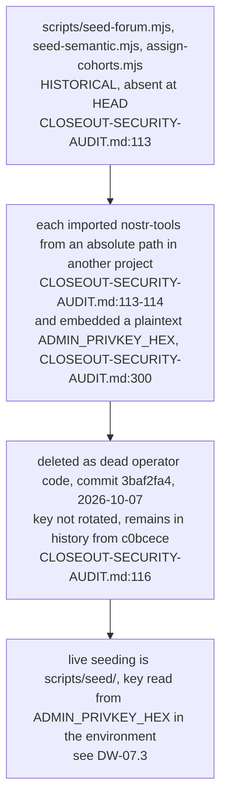
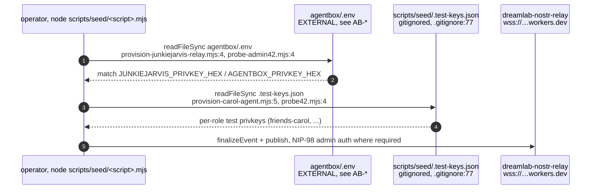
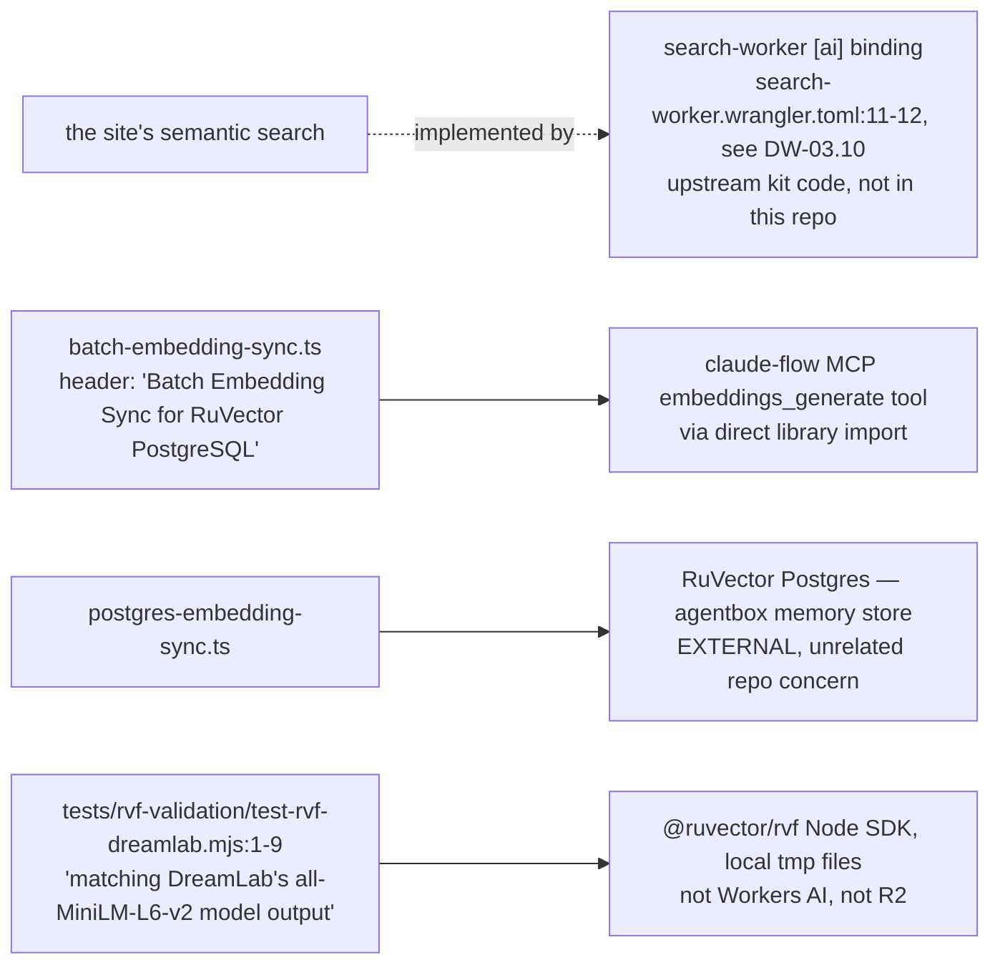
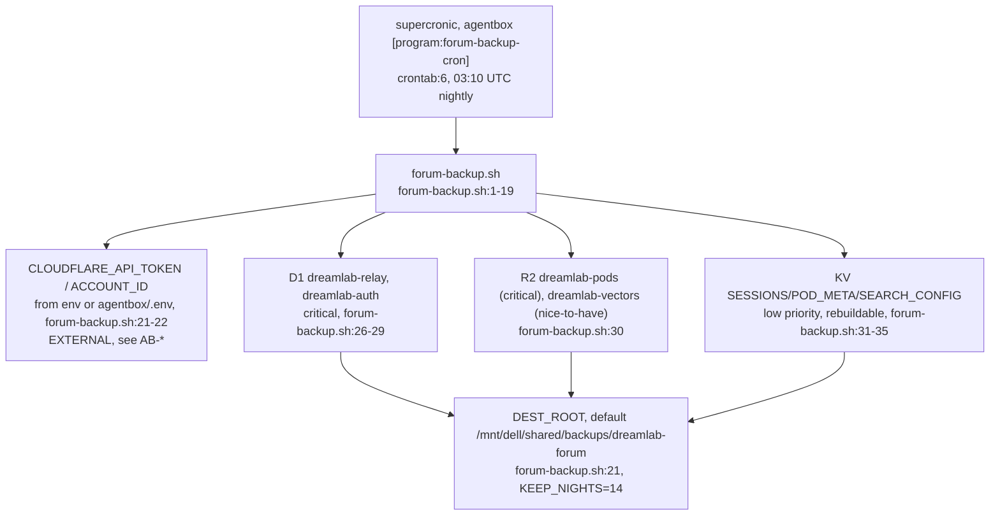
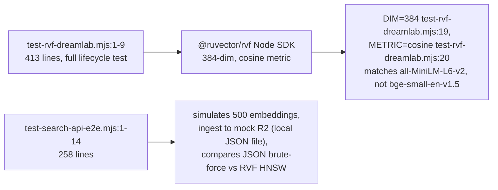
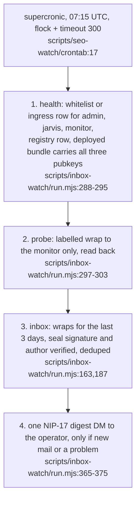

## DW-07.2 Root-level seeders — deleted 2026-10-07 (historical)

- **Drift:** this topic previously described the three root-level seeders as live code (stamp `ebaf16c`); `scripts/seed-forum.mjs`, `scripts/seed-semantic.mjs` and `scripts/assign-cohorts.mjs` were deleted by `3baf2fa4` (2026-10-07, "delete the three dead seed scripts carrying a hard-coded admin key"). Their original line anchors resolve only at `ebaf16c`, so they are no longer cited. The seeding they once did is not relocated one-for-one: live seeding is `scripts/seed/` (`CLOSEOUT-SECURITY-AUDIT.md:116`), and nothing there replaces the semantic-seed or cohort-assignment scripts by name.
- **Debt:** the plaintext private key stays in git history from `c0bcece`; the owner judges it unused or already replaced, so no rotation followed (`CLOSEOUT-SECURITY-AUDIT.md:116`). Whether it is live cannot be decided from this repo; the `CLAUDE.md` rule against hardcoded credentials was breached for as long as the files existed.
- Contrast with `scripts/seed/` (DW-07.3): every script there reads its signing key from the environment or an external `.env`, never embeds one. `scripts/seed/` holds **37** tracked files at the stamped revision (`git ls-tree -r --name-only 3afa374f scripts/seed`; 36 at the previous stamp, the addition being `provision-website-info.mjs`, ADR-2011).

## DW-07.3 `scripts/seed/` — keys sourced externally, not embedded

- `scripts/seed/probes/` is also gitignored (`.gitignore:78`) — ad hoc probe output/scratch state never lands in the tree. `whitelist-admin-recipient.mjs:1-6` documents its own no-op status as of 2026-07-14: the interim contact-DM recipient is already whitelisted, so the script is a safety check pending ADR-041 Decision 5's key-split cutover (cross-reference DW-03.4); a header note now adds that a recipient declared under `[[ingress]]` is admitted without this row and survives `reset-db`, so the script is only for an undeclared recipient (`whitelist-admin-recipient.mjs:19-21`, DW-04.9). `provision-website-info.mjs:1-20` is the newest seeder: idempotent, it publishes a kind-0 profile and registers the identity without cohorts, reading its keys and never printing them.
- `reseed-minimoonoir.mjs:1-6` records an in-repo migration note: the `friends`→`minimoonoir` zone-id rename orphaned `friends-*` channels (kind-40 section tags are immutable), requiring a delete-and-recreate rather than an in-place rename — direct evidence for the "Friends zone does not exist" DOC-DRIFT already flagged in DW-03.1.
- Contrast with the standalone `scripts/keybase-migration/` tool (`server.mjs:7-10`): the keybase paper key and relay admin key it handles live in process memory for a request/job's duration and are never logged or written to disk, but the generated per-user output keys it produces ARE deliberately persisted to `work/keys.json` (gitignored) — that persisted file is the tool's actual deliverable, handed to the friend being migrated.

## DW-07.4 `scripts/embeddings/*` — a different pipeline than the site's search worker

- Nothing in `scripts/embeddings/*` or `tests/rvf-validation/*` builds the site's search index: `batch-embedding-sync.ts` and `mcp-embedding-sync.ts` sync **RuVector Postgres memory entries** via the **claude-flow MCP** toolchain (agentbox's own memory system), and the two `tests/rvf-validation/*` suites validate the `@ruvector/rvf` Node SDK against a **384-dim `all-MiniLM-L6-v2`** model over local JSON/tmp files, a different model and store from the search worker's Workers AI binding (`forum-config/deploy/search-worker.wrangler.toml:11-12`), which now also carries an advisory Jev rerank switched on by `JEV_SEARCH_RERANK` (`forum-config/deploy/search-worker.wrangler.toml:33`; errors retain the existing result). The earlier README claim of `bge-small-en-v1.5` over R2 (a feature bullet in the README at the previous stamp) is gone: the rewritten README makes no semantic-search claim, so that divergence is closed at its source, while the build and index path stays upstream-kit code this repo does not vendor.
- This resolves the audit's "index-build path has no home" gap: the path exists upstream, and the tooling in this repo is a separate concern that happens to share the word "embedding".

## DW-07.5 Nightly Cloudflare-to-NAS backup

- INVARIANT: missing Cloudflare credentials exit the script with code 2 rather than silently succeeding, "so the cron surface shows the gap instead of silently succeeding" (`forum-backup.sh:14`).
- Content-sensitivity note in the script header: kind-1059 DMs are E2E encrypted at rest, but kind-40/42/0 events are signed plaintext, so "the NAS copy is readable content — keep it on the trusted segment only" (`forum-backup.sh:16-18`).
- This is the only backup/restore path for the forum found in this repo — there is no corresponding restore script, only the raw D1/R2/KV export.

## DW-07.7 `tests/rvf-validation/` — RVF library validation, not a forum test

- Both suites run as plain Node scripts (`node test-rvf-dreamlab.mjs`), not through Playwright or Vitest — they are not wired into `playwright.config.ts`'s `testDir` discovery (DW-05) or any `npm test` script (DW-02.3), and are absent from every CI workflow (DW-05.1-05.4). They validate the `@ruvector/rvf` library itself against a simulated workload, not this repo's live search-worker.
- Together with DW-07.4, these confirm the audit's "MISSING" finding was really two gaps in one: the site's search feature has no in-repo build path (it's upstream-kit code), and the *tests* named after it validate unrelated tooling.
- `scripts/keybase-migration/` (own `package.json:1-4`) is likewise a fully standalone Node app nested inside the main repo's `scripts/` tree, not wired into any CI workflow or the main `npm` scripts (DW-02.3) — a local-only Keybase-to-Nostr identity importer (`http.createServer`, binds `127.0.0.1` only, `server.mjs:1-5`), operator-run and out-of-band, the same shape of untested/unintegrated tooling as the RVF suites above.

## DW-07.8 Nightly inbox watch — the monitor key reads its own copies

- It exists because the relay rewrites every kind-1059 read to the viewer's own `#p`, so the admin inbox is unreadable to anyone else; each submission is therefore also wrapped to the monitor key (`scripts/inbox-watch/run.mjs:4-11`, DW-04.9). The digest is written to the operator and, when the DM never reached the relay, state is deliberately not persisted so the same messages surface again next run (`scripts/inbox-watch/run.mjs:376-380`).
- It judges channel health with `ingressProblem` and `disclosureProblem` from `scripts/lib/website-info.mjs` (`scripts/inbox-watch/run.mjs:35`), so a `reset-db` that drops the whitelist or registry row is reported the next morning, not by a visitor (`docs/adr/ADR-2011-website-information-identity.md:58`).
