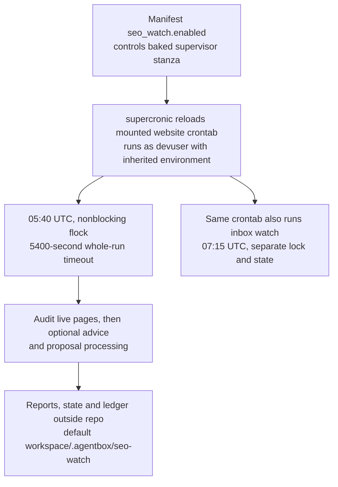
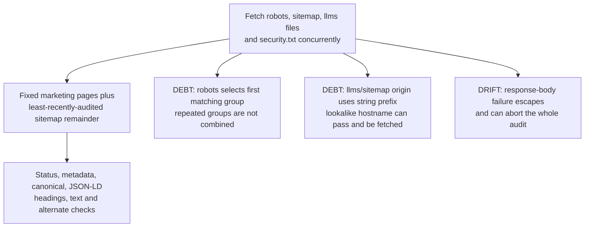
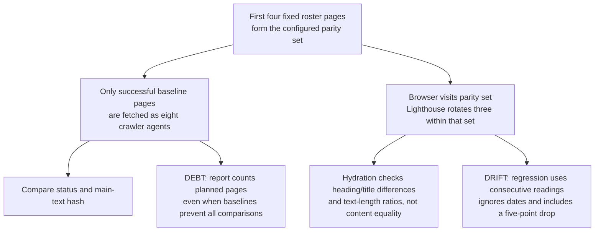
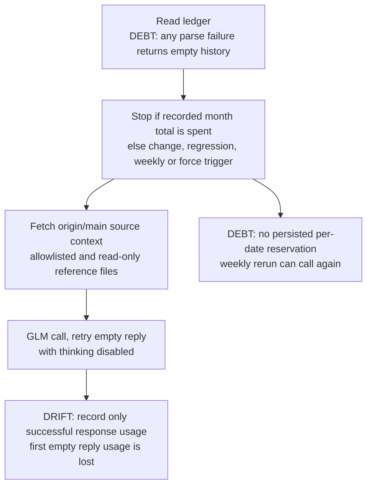
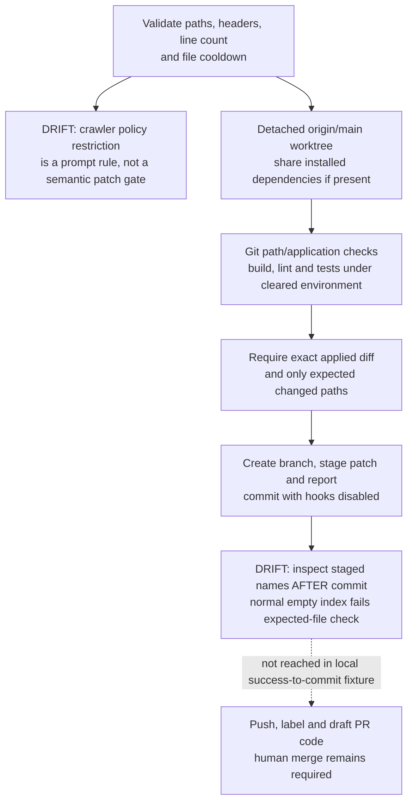
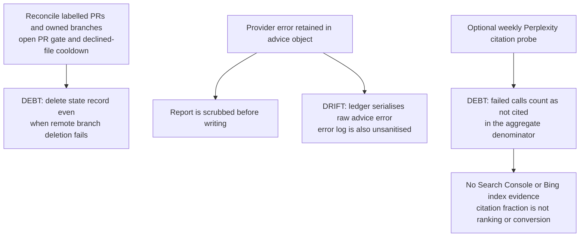

## For developers

**Repair follow-up, 2026-11-03:** [DW-11](11-watch-publication-and-inbox-repairs.md)
records the publisher, line-cap and error-scrubbing repairs at their new source
revision. This topic retains the historical observations and anchors below.

Follow the mounted cron through deterministic receipts, optional model advice and the publication gate. The dated estate review reproduces the publisher, accounting, policy and evidence gaps with local fixtures.

## For the business

The running watch gives the site owner nightly discovery checks. Its clean audit rows do not prove search ranking, full-page coverage or a working route from suggested changes to draft pull requests.

## DW-08.1 Supervisor, schedule and state

**What it shows:** The scheduler is baked while the job and schedule are mounted source. The separate inbox job shares the scheduler switch.
**Why it is this way:** ADR-2010 places this watch alongside the dream engine; overlap locking is not a once-per-date model-call limit.

## DW-08.2 Fetching and deterministic receipts

**What it shows:** These are local fetch and content predicates, with narrower RFC and failure handling than the decision claims.
**Why it is this way:** ADR-2010 asks for deterministic live-site evidence before advice; the code separates transport from pure checks but leaves these boundaries open.

## DW-08.3 User-agent, browser and Lighthouse coverage

**What it shows:** Raw-agent equality and hydration similarity are different tests. A zero parity finding count does not establish that planned comparisons ran.
**Why it is this way:** ADR-2010 limits nightly browser work, but its consecutive-night language is stronger than the stored-reading comparison.

## DW-08.4 Advice triggers and cost accounting

**What it shows:** The token budget is a pre-call history check; retries and reruns weaken the one-call and monthly-cap claims.
**Why it is this way:** ADR-2010 trades quiet-night cost for optional advice, but the transport and ledger do not enforce a hard spend ceiling.

## DW-08.5 Patch verification and blocked publication

**What it shows:** Non-executable text and exact-tree checks bound the model patch, but the normal publisher path rejects after committing.
**Why it is this way:** ADR-2010 requires tested, human-reviewed proposals; the local fixture demonstrates a publication defect without contacting GitHub.

## DW-08.6 Reconciliation, receipts and outcome limits

**What it shows:** Review state and retained receipts have failure cases distinct from the live audit. A synthetic provider-key echo reaches the ledger and stderr but not the report.
**Why it is this way:** ADR-2010 requires scrubbing and an outcome metric; the current error and aggregate paths only partly implement those obligations.
