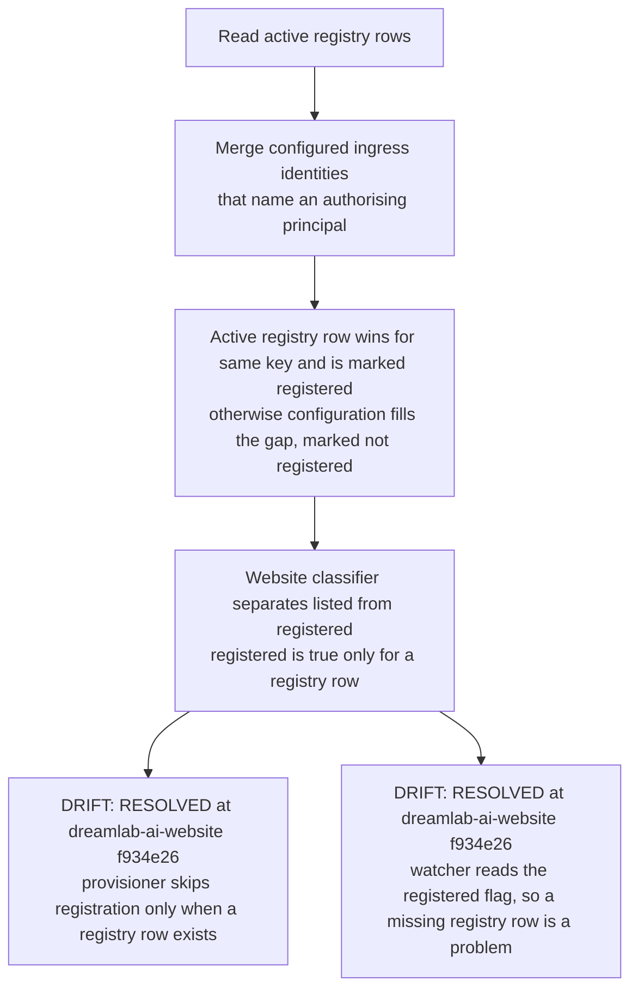
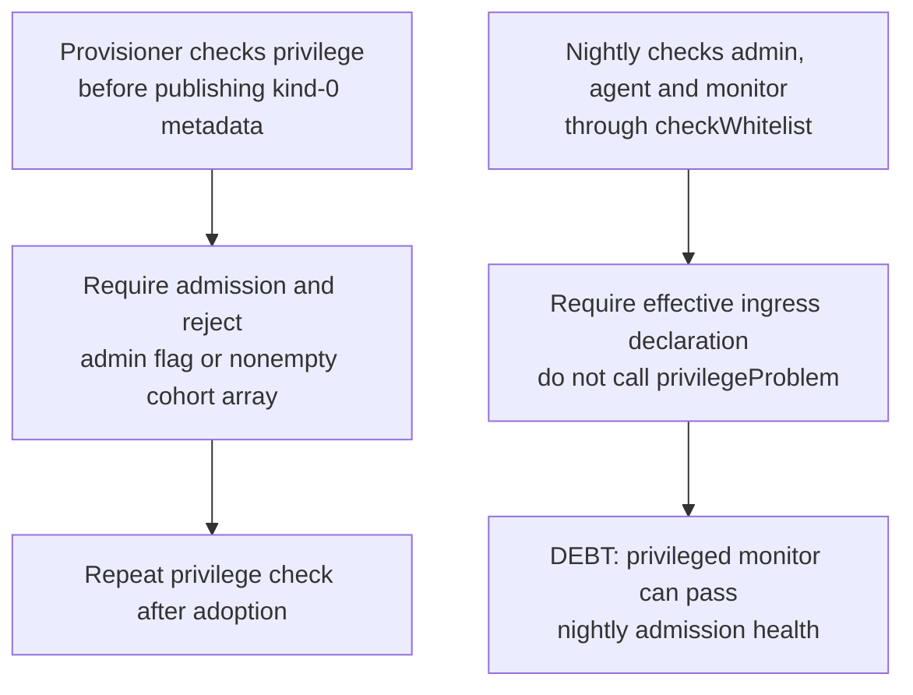
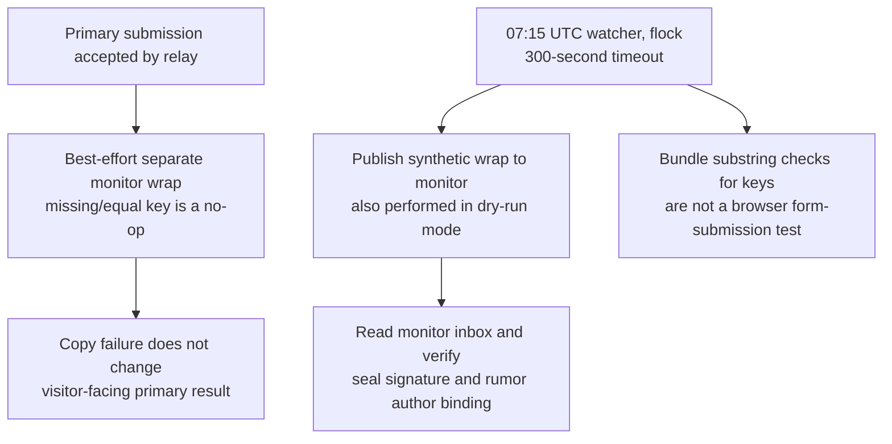
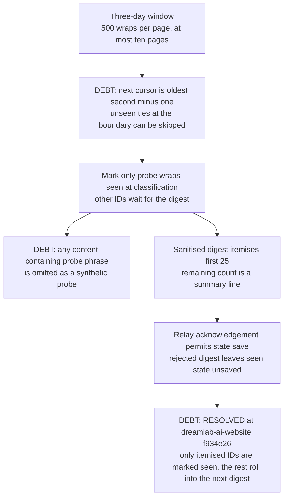
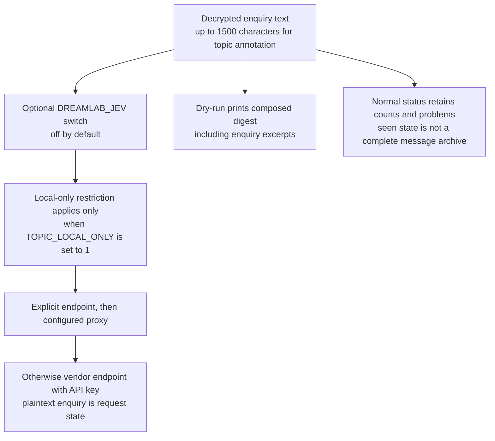

## For developers

**Repair follow-up, 2026-11-03:** [DW-11](11-watch-publication-and-inbox-repairs.md)
records registry-presence, privilege-health and seen/display accounting repairs.
The source stamp below remains historical and unrelated findings remain open.

Separate configured admission, public disclosure, stored registration and delivery acknowledgement. The dated estate audit exercises the actual watcher and provisioner with synthetic encrypted messages and fully mocked transport.

## For the business

The monitor can summarise received enquiry copies without joining private forum zones. Its current health checks and bounded digest do not establish complete enquiry capture, durable registration or that every sender's message was shown to the operator.

## DW-09.1 Configuration disclosure is not a registry receipt

**What it shows:** Public naming still survives a missing database row, but the relay now marks it `registered: false` and both consumers require `registered: true`.
**Why it is this way:** ADR-2011 adopted configuration-backed ingress, and the earlier registry-presence check was repaired by adding the registered flag to the shared response.

## DW-09.2 Provisioning privilege guard versus nightly health

**What it shows:** The setup guard and recurring health predicate are different. A healthy nightly receipt does not certify the monitor's lack of privilege.
**Why it is this way:** ADR-2011 requires a labelled identity with no cohorts or admin rights; the current watcher verifies routing admission rather than that full invariant.

## DW-09.3 Enquiry copies and the scope of the probe

**What it shows:** The synthetic probe tests the monitor path, while actual visitor copies remain best effort. A dry run suppresses digest delivery and state writes, not the probe.
**Why it is this way:** The relay isolates each recipient's inbox, so ADR-2011 relies on extra encrypted copies rather than reading the admin's copy.

## DW-09.4 Pagination, classification and digest retirement

**What it shows:** Bounds prevent unbounded processing, and messages past the 25-item cap stay unseen so the next digest carries them.
**Why it is this way:** The watcher deduplicates received wraps and bounds one digest; its state now marks only itemised messages seen after an acknowledged delivery.

## DW-09.5 Plaintext topic annotation and retained evidence

**What it shows:** Recipient encryption ends where the monitor decrypts. Optional annotation and dry-run output have their own plaintext destinations.
**Why it is this way:** The topic feature annotates operator mail without changing delivery; its executable default is broader than the module's old local-only header comment.
