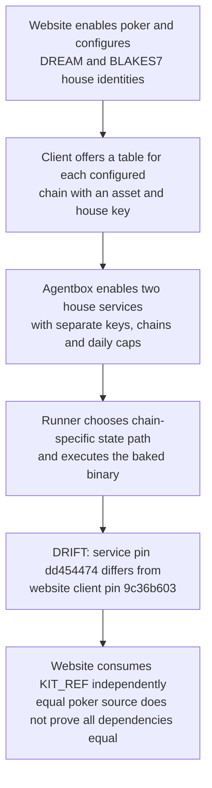
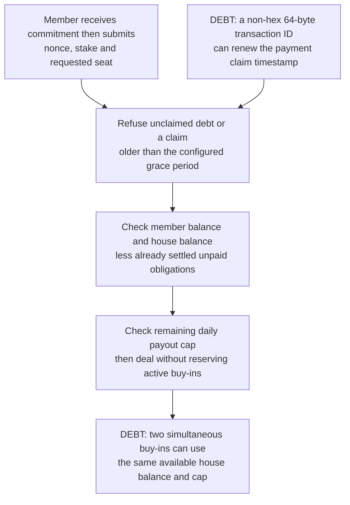
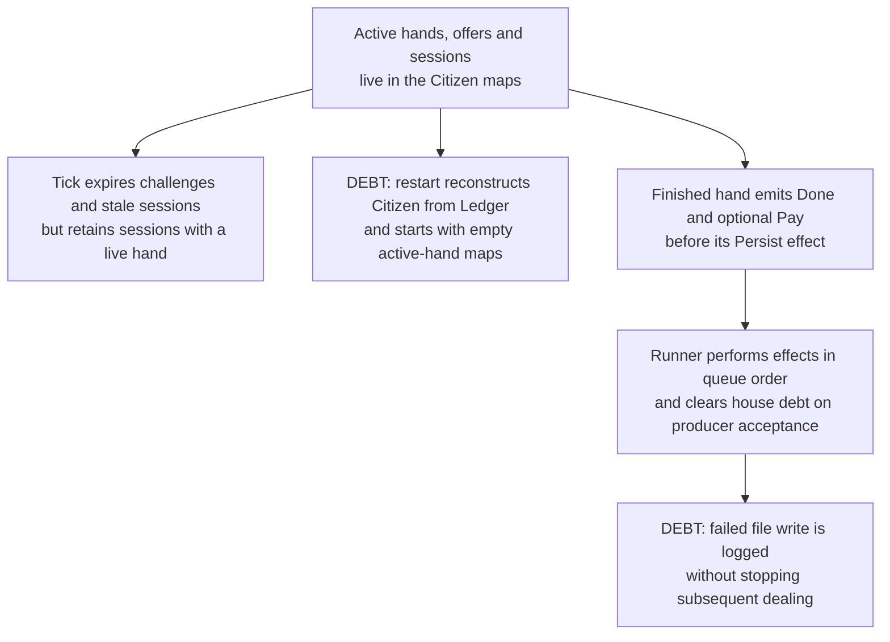
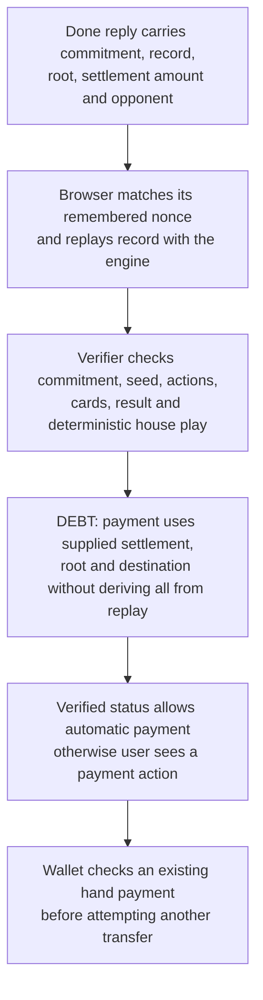
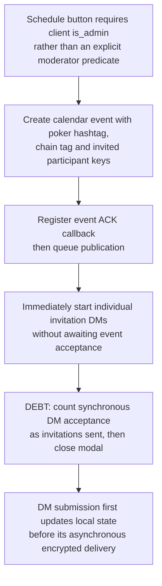
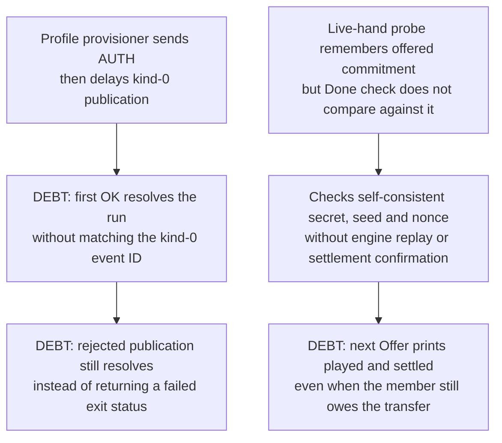

## For developers

Follow the website overlay into the consumed kit's house state machine and browser settlement path. The associated estate review separates native counterexamples, mocked script results, source-only findings and process observations. The kit sources here are the website's consumed revision; 42 poker files are byte-identical at the agentbox service pin.

## For the business

Members have practice chips and two configured asset tables, with the house acting as a trusted dealer. A completed hand, an accepted transfer and a recoverable record are separate outcomes. The current receipts and recovery behaviour leave gaps between them.

## DW-10.1 Deployment selects separate house seats

**What it shows:** Configuration has expanded beyond the single DREAM seat described by ADR-2009. The source comparison found no changes in the 42 poker files across the two pins; it did not certify the complete dependency graph or running binary provenance.
**Why it is this way:** ADR-2009 places forum behaviour in the kit and service custody in agentbox. Its exact-commit lockstep wording is stronger than the current separately pinned deployment.

## DW-10.2 Admission grants unsecured play credit

**What it shows:** The native fixtures renew a false payment claim and admit two 200-unit hands against 200 units of house balance and a 200-unit cap. They show exposure without reservation, not a demonstrated breach of the payout cap.
**Why it is this way:** ADR-2009 funds the house from treasury. The kit implements balance checks and post-hand debt rather than escrow; its grace mechanism trusts the member temporarily.

## DW-10.3 Recovery persists the book but not the active game

**What it shows:** An idle active hand survives a simulated month of ticks but disappears after reconstruction from the saved ledger. The source also exposes a send/pay-before-save crash window; no production crash or duplicate payment was induced.
**Why it is this way:** The service separates its pure state machine from network effects. Its persisted book covers settled obligations, while the in-progress game and held transaction inputs remain in memory.

## DW-10.4 Replay verification and payment fields have different coverage

**What it shows:** The verifier is substantial, but its Claim has no settlement amount, destination or supplied root. The source-only finding is the missing binding between replay and payment instructions; this review did not execute a malicious browser payout.
**Why it is this way:** ADR-2009 delegates the game to the kit. Verifiable dealing and safe settlement require different checks even when both messages come from the configured house.

## DW-10.5 Scheduling and invitation delivery are separate

**What it shows:** Queued work can be labelled sent before the calendar event or invitation is accepted. These are source findings; no live invitation was sent.
**Why it is this way:** ADR-2009 reuses NIP-52 events and NIP-17 invitations. Reuse supplies the transports but does not make their acknowledgements atomic.

## DW-10.6 Operational probes can certify too much

**What it shows:** Mocked execution reproduces early profile success, a zero exit on rejection, and a hand-probe pass with a substituted commitment and no transfer. All keys and transport responses in these tests were synthetic.
**Why it is this way:** ADR-2009 lists operational probes as verification. A useful receipt must state precisely whether it proved authentication, publication, a completed game, verification or settlement.
