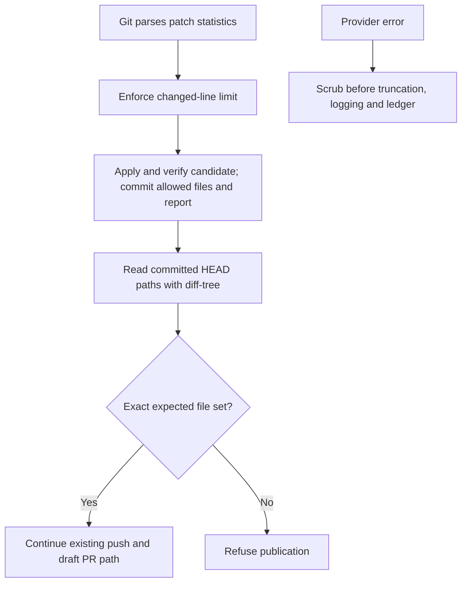
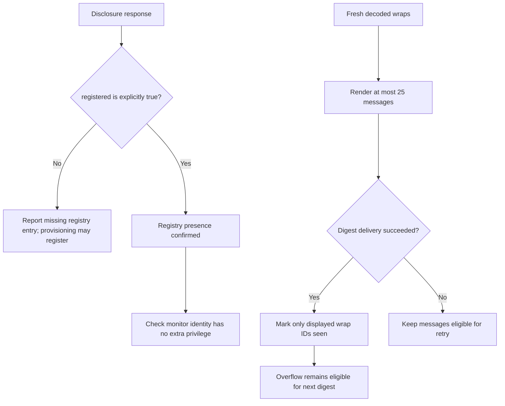

## For developers

This successor records the 3 November repairs to DW-08.5/08.6 and the registry, privilege and seen-accounting boundaries in DW-09. Historical panels remain evidence about their declared revisions; unrelated debt is not closed here.

## For the business

A verified website suggestion can reach the draft-publication step again. Inbox messages beyond the digest limit remain eligible for a later digest. Source tests do not establish delivery by the deployed nightly jobs.

## DW-11.1 Verify the committed change before publication

**What it shows:** Publication inspects committed paths after commit. Git's parsed statistics independently enforce the line cap, including hunk content that resembles a diff header. Error sinks receive the scrubbed value.

**Why it is this way:** ADR-2010 requires bounded proposals with retained evidence. The regression uses a scratch repository and local bare remote with a fake GitHub CLI; it sends no real pull request. Other audit, cost and crawler-policy findings in DW-08 remain outside this repair.

## DW-11.2 Confirm registry state and account for displayed messages

**What it shows:** Configuration disclosure alone does not prove a D1 registration. Seen state advances after successful delivery for the displayed subset.

**Why it is this way:** ADR-2011's low-privilege identity must survive database resets without confusing ingress configuration with registration. The additive forum `registered` field and this consumer need deployment together. Tests include a 30-message input split over successive digests; live encrypted delivery is separate.