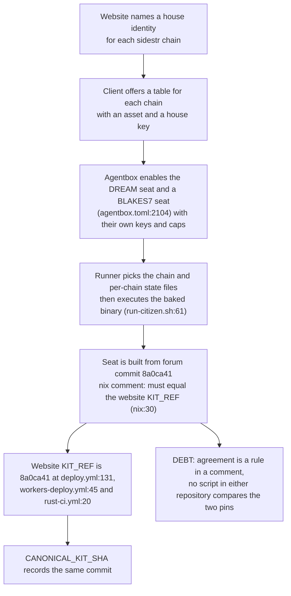
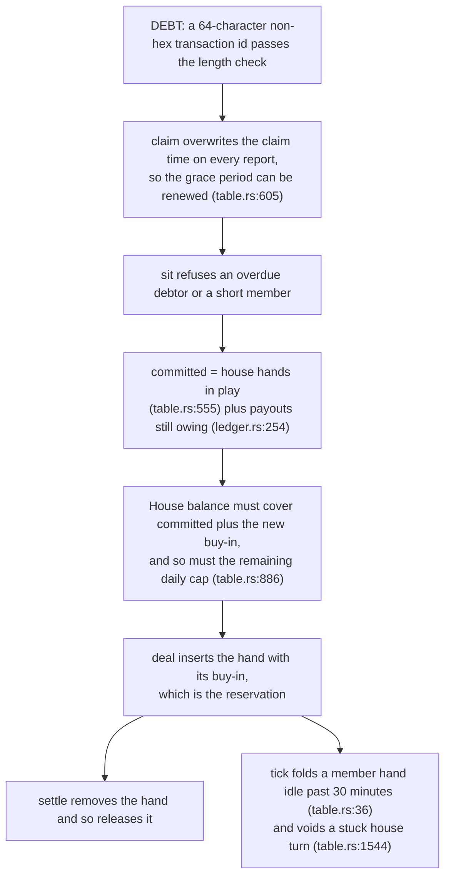
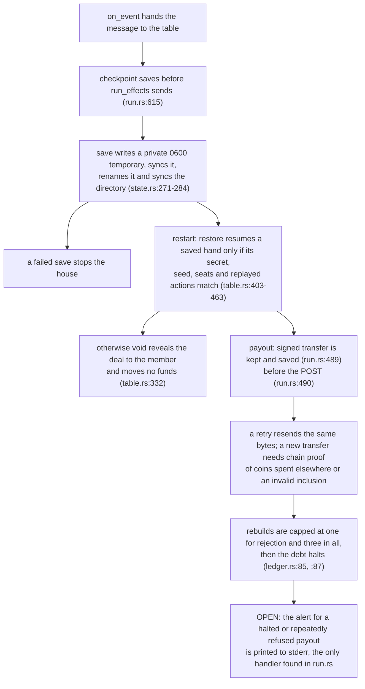
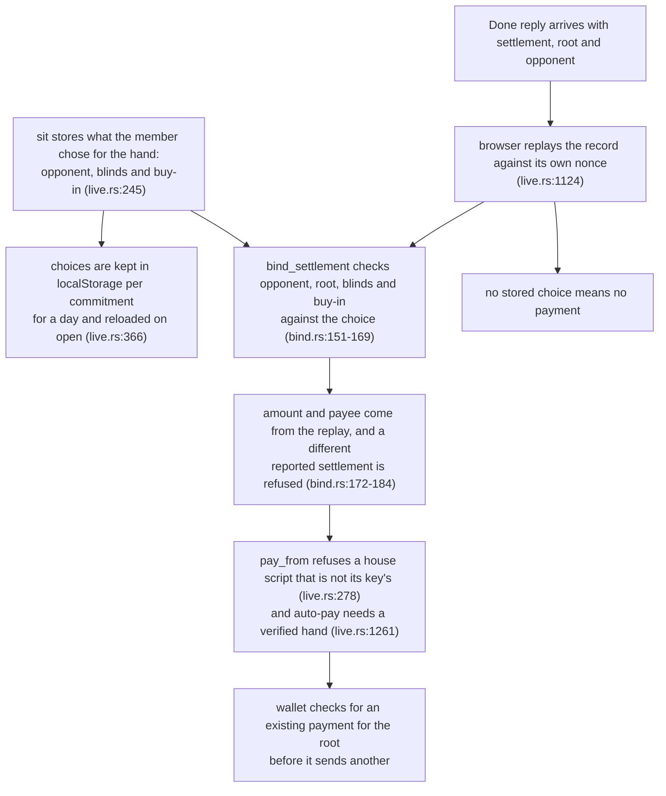

## For developers

This is the successor to DW-10.1 to DW-10.4, which stay frozen at the revisions they were verified at because their citations span three repositories. It records the kit commit `8a0ca41` (buy-in reservation, persisted hands, idempotent payouts, replay-bound client payment), the agentbox house-seat pin that follows it and the website `KIT_REF` that matches. DW-10.5 and DW-10.6 are not repaired and remain valid in DW-10. The panels below come from reading source; the native tests they name were not run for this revision.

## For the business

The house no longer promises the same chips twice: each hand held against the house is set aside from its bankroll and its daily limit when the hand is accepted. A restart resumes a hand only if it proves itself, and a member's browser pays only what the verified hand and the member's own table choice support. The payment-claim timestamp can still be renewed by a malformed transaction id.

## DW-12.1 The house seat and the website build the same kit commit

**What it shows:** The house service and the website client now name the same kit commit, so both speak the same poker protocol. The earlier DRIFT between the service pin and the client pin is gone; the unchanged exposure is that nothing but a comment enforces it. Equal pins do not certify the dependency graph either.
**Why it is this way:** ADR-2009 puts game behaviour in the kit and service custody in agentbox. The website's pin-parity gate covers the workflow sites and the compatibility record (DW-05.10) and does not read agentbox.

## DW-12.2 Acceptance reserves the buy-in against the bankroll and the daily cap

**What it shows:** The reservation is derived from the hands the house holds, so two buy-ins answered from one chain read cannot claim the same coins, and an abandoned hand releases its share. Hands between two members reserve nothing because the house moves no funds (table.rs:551-554). The native tests named `concurrent_buy_ins_cannot_overdraw_the_house_bankroll` (table.rs:1880) and `concurrent_buy_ins_cannot_exceed_the_daily_cap` (table.rs:1903) pin both limits.
**Why it is this way:** ADR-2009 funds the house from treasury, so its worst loss in a hand is the buy-in. **Debt:** the claim-timestamp weakness of DW-10.2 is unchanged at this revision by source reading; no probe was run.

## DW-12.3 Hands, the book and payouts are saved before anything leaves

**What it shows:** Live hands, the ledger and the processed message ids are one saved document, written whole, so a restart sees a hand either in play or settled. An accepted payout stays a debt until the chain shows the payment (ledger.rs:360 keeps the debt, ledger.rs:308 clears it). The tests `a_restart_mid_hand_resumes_it_and_no_funds_are_lost_or_counted_twice` (table.rs:2028) and `a_rejected_payout_is_replaced_once_through_the_cap_and_then_the_debt_halts` (table.rs:2404) cover the paths.
**Why it is this way:** ADR-2009's house is a trusted dealer, so a crash must never lose a debt or pay one twice. **Open:** whether an operator sees a halted debt depends on who reads the process's standard error; no other alert path was found.

## DW-12.4 The member's payment is bound to the replay and the table they chose

**What it shows:** The Done message is no longer a payment instruction. Opponent, kind of hand, blinds, buy-in, root, amount and payee are each held to the member's own choice or to the verified replay, and a member who lost the stored choice is not asked to pay. The tests in bind.rs from line 290 (tampered amount, destination, hand kind, stakes) and `a_hand_that_did_not_bind_is_never_paid` (live.rs:1365) cover the refusals.
**Why it is this way:** ADR-2009 delegates the game to the kit, and a wallet transfer is irreversible, so the amount and the payee are derived from what was verified. The protocol keeps `VERSION` at 1 (protocol.rs:51), adds an optional `log_len` to Act (protocol.rs:126) and a Voided reply (protocol.rs:282).
