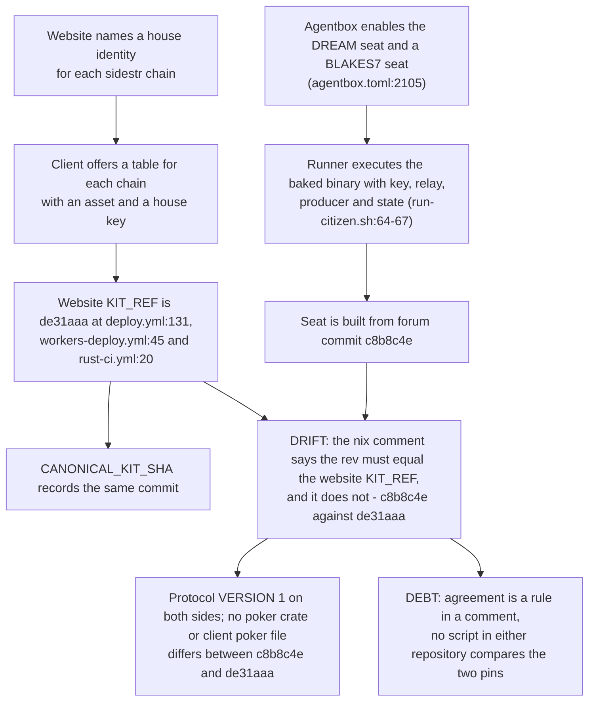
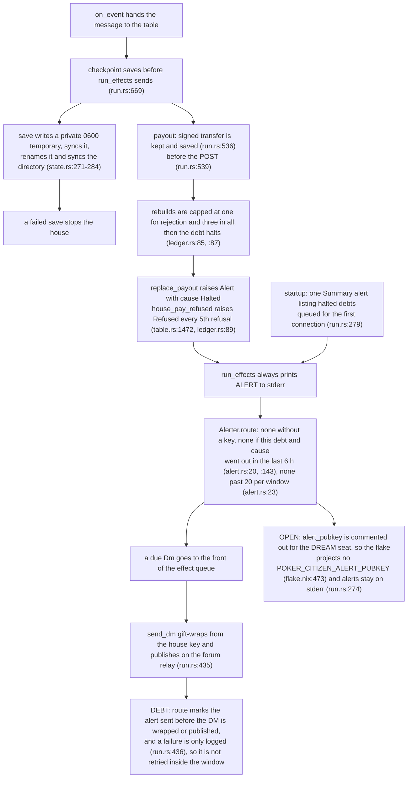

## For developers

Successor to DW-12.1 and DW-12.3, which stay frozen at the revisions they were verified at. It records kit `c8b8c4e` (the house seat turns `Effect::Alert` into a rate-limited, gift-wrapped DM to an operator) and the website repin to kit `de31aaa` (website PR #101, `5dc4c64`). DW-12.2 and DW-12.4 are unchanged in substance: no poker crate or client poker file differs between `8a0ca41` and `de31aaa` except the house seat's alert work. The agentbox pin is read at `ca07b59`; no native test was run.

## For the business

When the house cannot settle a payout by itself (a debt halted after repeated rebuilds, or the block producer refusing the same payout again and again) it can now message an operator directly on the forum, at most once per debt and cause every six hours. On this deployment that message is not switched on: the operator key is commented out, so the alert still lands only in the service log. The house seat also now runs one kit commit behind the website; the poker code is identical between the two, so play is unaffected.

## DW-13.1 The website and the house seat name different kit commits again

**What it shows:** The website moved to kit `de31aaa` while the agentbox house seat stayed at `c8b8c4e`, so the DRIFT that DW-12.1 recorded as gone has reopened. The two commits carry the same poker code (checked with `git diff --stat c8b8c4e de31aaa` over the poker crates and the client's poker module, empty), so the exposure is the unenforced rule, not a protocol mismatch today.
**Why it is this way:** ADR-2009 puts game behaviour in the kit and service custody in agentbox; the website's pin-parity gate covers its own workflow sites and record (DW-05.11) and does not read agentbox. **Debt:** unchanged from DW-12.1, nothing but a comment ties the two pins.

## DW-13.2 Hands and payouts are saved before anything leaves, and alerts can reach an operator by DM

**What it shows:** Persistence is as DW-12.3 drew it; what changed is the end of the chain. An alert carries its debt and cause (alert.rs:50), the runner still logs it, and with an operator key set it also sends one gift-wrapped NIP-17 DM per debt and cause per six-hour window. The DM recipient must be admitted by the relay's gift-wrap gate (run.rs:93), and the dedupe map is in memory only (alert.rs:100), so a restart can repeat an alert inside the window.
**Why it is this way:** ADR-2009's house is a trusted dealer whose halted debts need a human, so c8b8c4e closed DW-12.3's OPEN by giving alerts a destination beyond stderr. **Open:** this deployment has not set the key, so whether an operator sees a halted debt still depends on who reads the service log.
