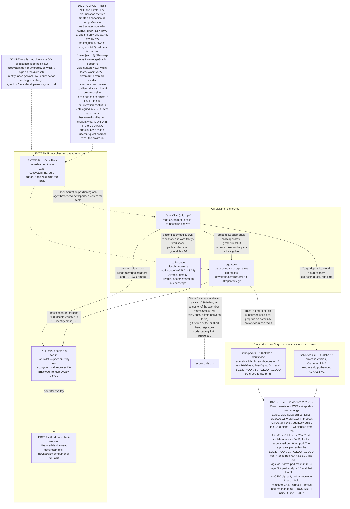
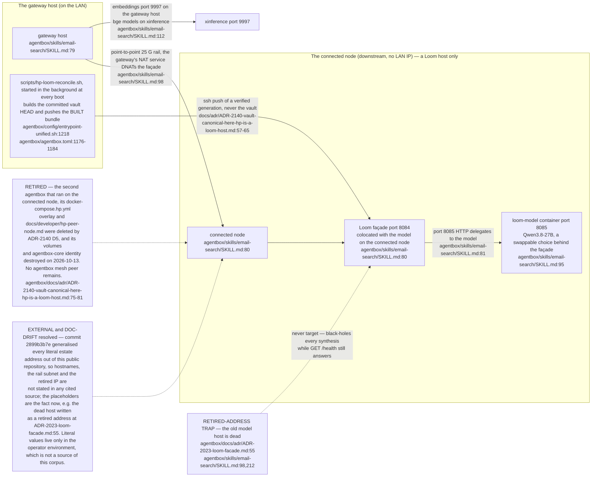
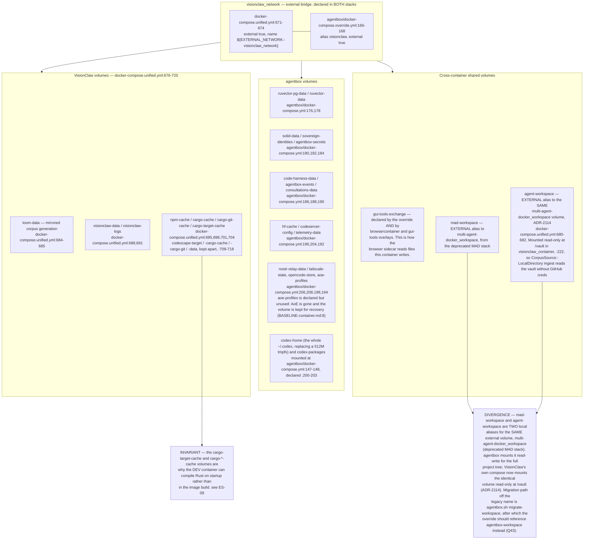
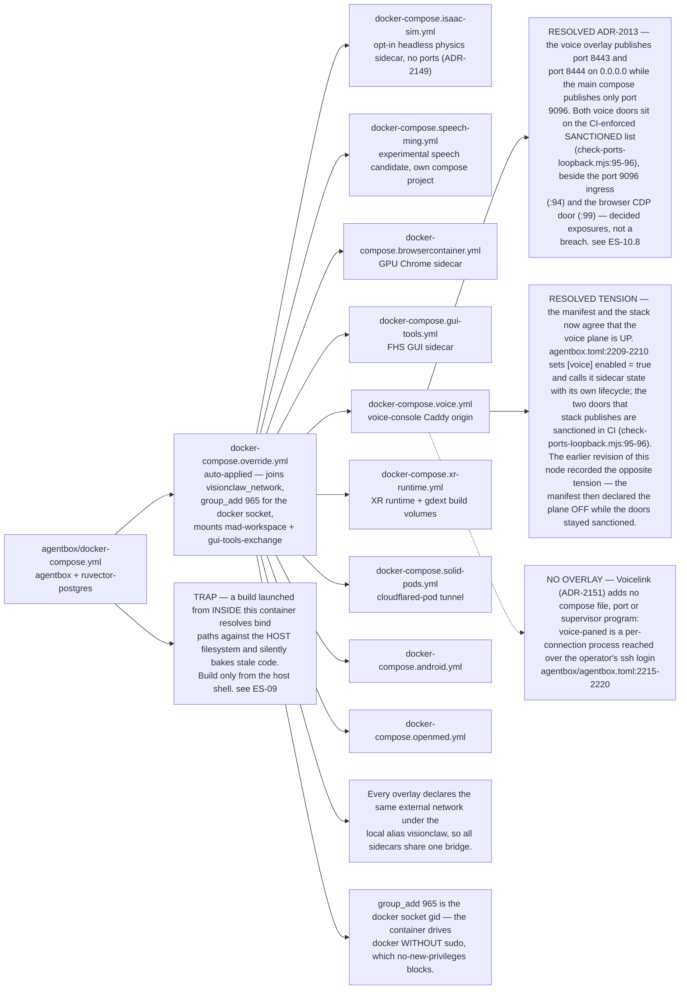
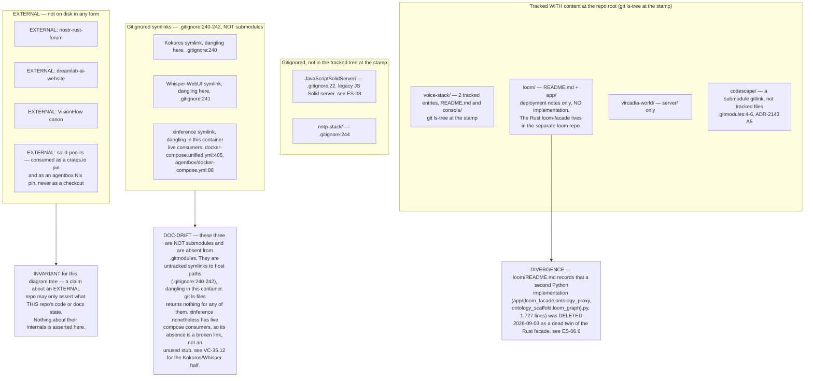
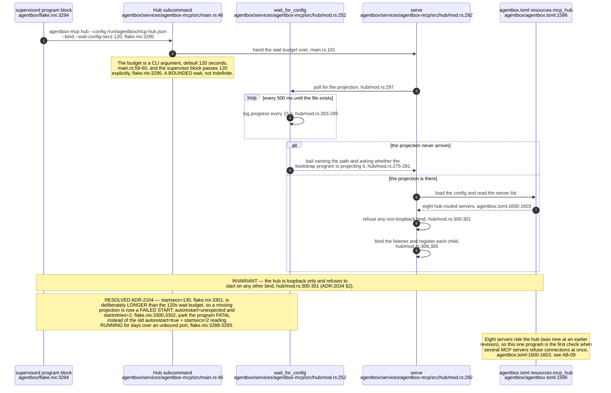
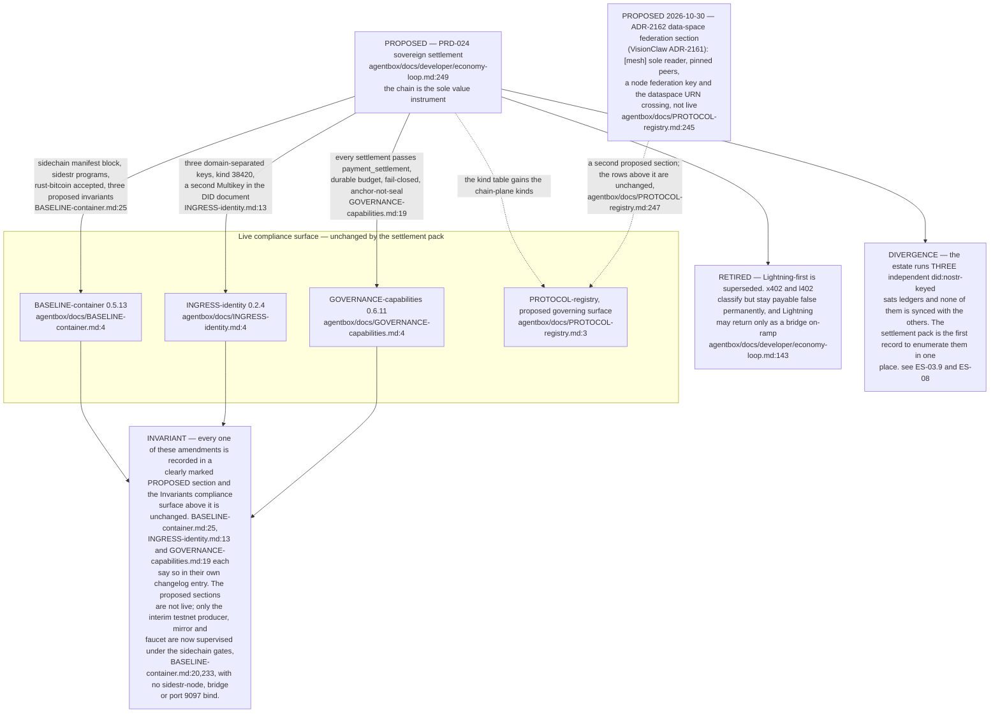

## ES-01.1 Substrate map — the VisionClaw checkout's neighbourhood, not the whole estate

## ES-01.2 Network / compute fabric — gateway host, Loom-only connected node, retired-address trap

**What it shows:** the gateway host and the connected node after the node was cut back to a single role, serving the Loom. The model container sits behind the façade, a boot-time reconcile pushes a built vault generation to it, and the dead model address stays the trap.

**Why it is this way:** ADR-2140 keeps the vault canonical on the gateway host and lets the connected node hold only a built generation, so nothing there can drift from the vault (`../project/agentbox/docs/adr/ADR-2140-vault-canonical-here-hp-is-a-loom-host.md:57-60`). The earlier second agentbox, with its own `did:nostr` identity, is gone.

## ES-01.3 Service and port map — every published surface in the estate

```mermaid
flowchart TB
    subgraph vcstack["VisionClaw stack — docker-compose.unified.yml"]
        VCD["visionclaw_container<br/>profiles development, dev<br/>docker-compose.unified.yml:70,243-245"]
        VCP["visionclaw_prod_container<br/>profiles production, prod<br/>docker-compose.unified.yml:249,332-334"]
        LOOMB["loom-sidecar<br/>profile loom, docker-compose.unified.yml:383,453-454"]
        CFT["cloudflared-tunnel<br/>profile tunnel ONLY (ADR-2119)<br/>docker-compose.unified.yml:340,358-359"]
        CSV["codescape (ADR-2143 A5, standalone repository)<br/>profile codescape, opt-in with CODESCAPE=1<br/>docker-compose.unified.yml:464,659-660"]
    end
    subgraph abstack["agentbox stack — agentbox/docker-compose.yml"]
        ABC["agentbox container<br/>agentbox/docker-compose.yml:32"]
        RPG["ruvector-postgres<br/>agentbox/docker-compose.yml:12"]
    end
    subgraph sidecars["agentbox sidecar overlays"]
        BC["browsercontainer"]
        GT["gui-tools-service"]
        VCON["voice-console"]
        XRR["xr-runtime"]
        AND["agentbox-android"]
        OM["openmed"]
        ISA["isaac-sim (ADR-2149, staged)<br/>agentbox/docker-compose.isaac-sim.yml:10"]
        MING["ming-tts / ming-asr (experimental)<br/>agentbox/docker-compose.speech-ming.yml:41,75"]
    end

    VCD -->|"port 3001 nginx<br/>docker-compose.unified.yml:225"| EXT1["host"]
    VCD -->|"port 4000 Rust backend<br/>docker-compose.unified.yml:226"| EXT1
    VCP -->|"port 3001 only<br/>docker-compose.unified.yml:308"| EXT1
    LOOMB -->|"host port 8090 to container port 8080<br/>docker-compose.unified.yml:438"| EXT1
    CSV -->|"host loopback 127.0.0.1 port 4100 by default; port 4101 hook ingest stays on the compose network<br/>docker-compose.unified.yml:637-641"| LOOPBACK
    ABC -->|"port 9096 LAN — the ONLY 0.0.0.0 publish<br/>agentbox/docker-compose.yml:47"| EXT1
    ABC -->|"loopback ports 9090 9700 9091 8484 8888 5901 8080<br/>agentbox/docker-compose.yml:48-54"| LOOPBACK["loopback only"]
    RPG -->|"5432 internal"| ABC
    BC -->|"0.0.0.0 5903 VNC / 8931 MCP SSE<br/>host 9222 to container 9223 CDP"| EXT1
    GT -->|"0.0.0.0 5905 / 9876 / 9877, plus port 9881 DCC gateway on the container network only<br/>agentbox/docker-compose.gui-tools.yml:46-55"| EXT1
    VCON -->|"0.0.0.0 8443 / 8444"| EXT1
    XRR -->|"0.0.0.0 5904"| EXT1
    ISA -->|"no ports: block, port 9890 expose only<br/>agentbox/docker-compose.isaac-sim.yml:42-43"| LOOPBACK
    MING -->|"127.0.0.1 8911 and 127.0.0.1 8912<br/>agentbox/docker-compose.speech-ming.yml:47,81"| LOOPBACK
    AND -->|"127.0.0.1 5555"| LOOPBACK
    OM -->|"127.0.0.1 9093"| LOOPBACK

    INV["INVARIANT ADR-2013 — every compose publish binds 127.0.0.1<br/>unless it is on the SANCTIONED list. In the main agentbox<br/>compose only port 9096 is a LAN door. The System One proxy binds<br/>0.0.0.0:8094 inside the container for the docker networks and<br/>publishes nothing (agentbox.toml:893-894, sanctioned at<br/>check-ports-loopback.mjs:740-745). see ES-10.8"]
    D1["NOT A DEFECT — browsercontainer maps host 9222 to container 9223<br/>by design (docker-compose.browsercontainer.yml:51-53, CDP proxy<br/>host:9222 to socat:9223 to Chrome:9222). The ADR-2013 sanctioned<br/>entry names 9222 (host side) and agentbox/CLAUDE.md names 9223<br/>(container side) — both correct, easy to misread as a conflict."]
    D2["EXTERNAL — Loom port 8084 façade and loom-model port 8085 run on<br/>HP-Desktop, NOT in either compose file. xinference port 9997 and<br/>email-mcp-gateway port 8765 are likewise separate services on<br/>visionclaw_network, while the System One route is the agentbox proxy on port 8094, never published: the shared<br/>x-system-one-environment anchor gives VisionClaw, Loom and Codescape agentbox:8094 with<br/>JEV_ALLOW_CLOUD=1 (docker-compose.unified.yml:9,14,387,395,505) and the laya systemone:8097 pins are gone.<br/>CONFIGURED: it takes effect when the new agentbox image is activated and those services are recreated. see ES-01.2 and ES-06.1"]

    LOOPBACK --> INV
    BC --> D1
    LOOMB --> D2
```

**Open:** the System One proxy bind (`0.0.0.0:8094`, `network = true`) is configured in the manifest (`../project/agentbox/agentbox.toml:893-894`) and the host services are pointed at it (`../project/docker-compose.unified.yml:9,387,475`), but it takes effect only when the new agentbox image is activated and those services are recreated; the running container still dials loopback.

## ES-01.4 Docker networks and volumes — one external bridge joins both stacks

## ES-01.5 Compose overlay composition — which file adds what

**Tension:** ADR-2151 is `decision_status: proposed`, `implementation_status: none`, `activation_status: inactive` (`../project/agentbox/docs/adr/ADR-2151-voicelink-edge-voice.md:5-7`), yet the running manifest sets `[voicelink] enabled = true` and `record_events = true` (`../project/agentbox/agentbox.toml:2226,2233`).

**Open:** Isaac Sim (ADR-2149) is `proposed`, `partial`, `staged`: the overlay exists but publishes no port and is gated by environment variables, not by the manifest (`../project/agentbox/docs/adr/ADR-2149-isaac-sim-sidecar.md:5-7,29`).

## ES-01.6 Repositories on disk — what is a checkout, what is a stub, what is external

## ES-01.7 The MCP hub is a boot-order dependency, and ADR-2104 closed the false-RUNNING gap

## ES-01.8 The four governing documents and the proposed settlement sections they now carry

