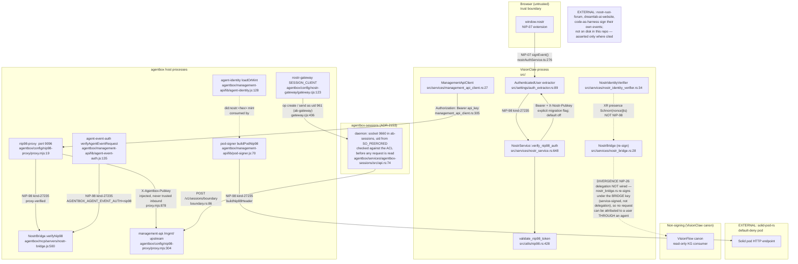
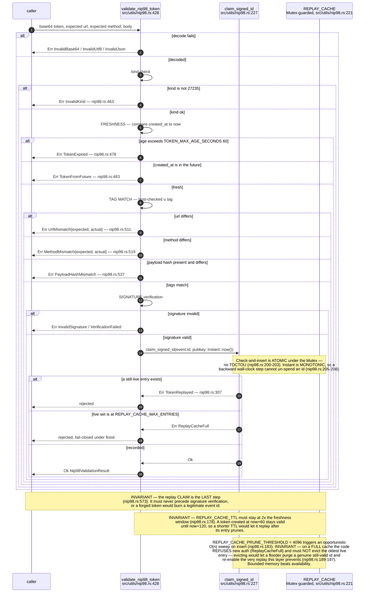
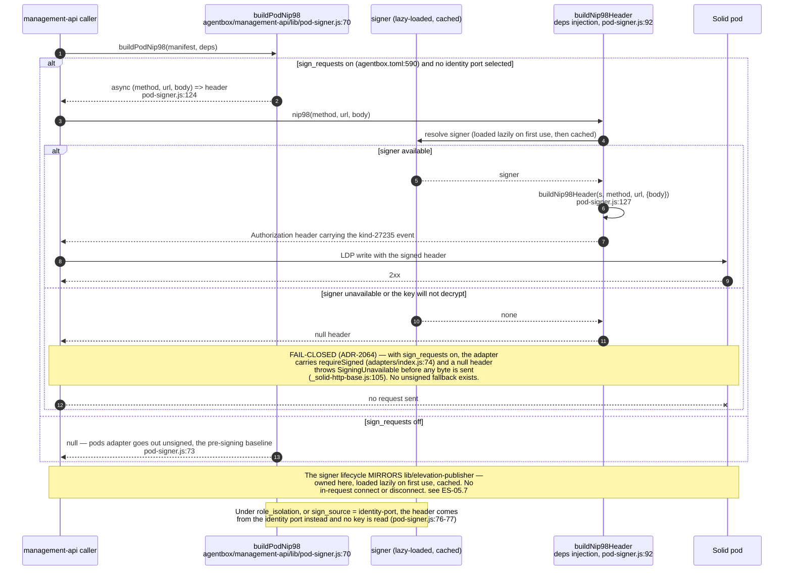
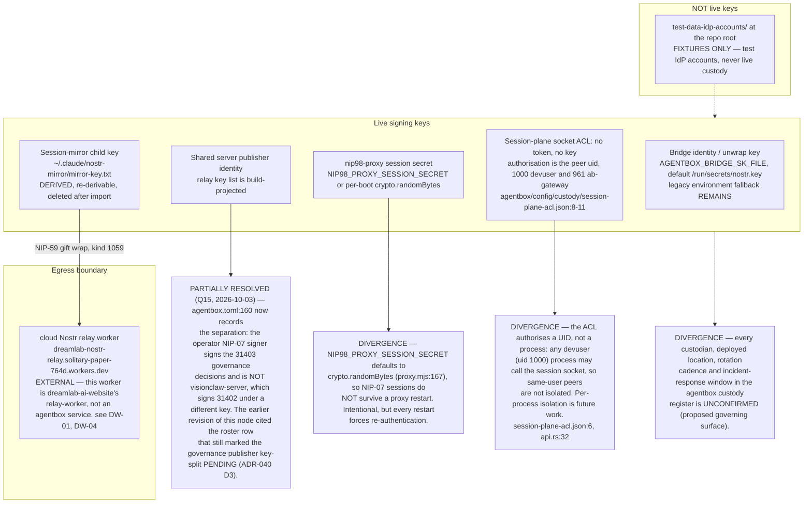
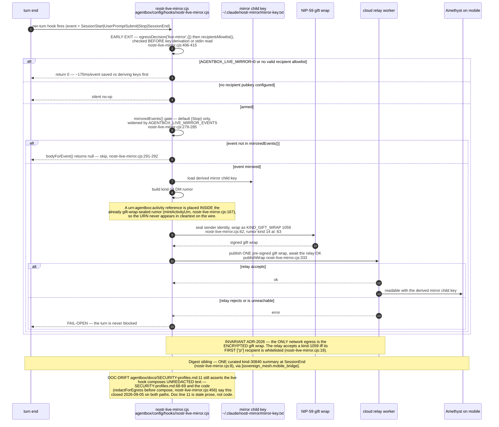
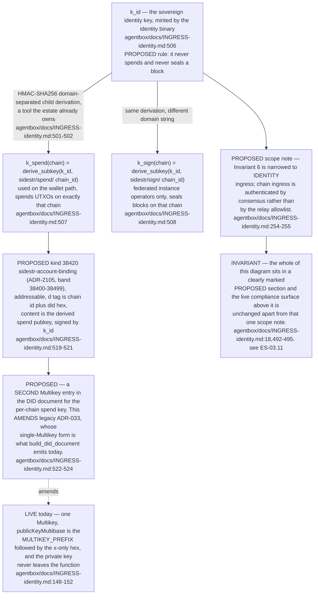

## ES-04.1 verification mesh — who signs, who verifies whom

**Drift (resolved by agentbox 6500582, still holds at c57d9c0):** the edge from `AEA` to `NBB` is path 1 only. Path 2 of `verifyAgentEventRequest` accepts the proxy-stamped `X-Agentbox-Pubkey` without a signature (`agentbox/management-api/lib/agent-event-auth.js:192-194`). Before the fix any `MANAGEMENT_API_KEY` holder on the docker network could forge it, because management-api binds `0.0.0.0`. Now the header is honoured only from a loopback TCP peer (`peerIsProxy`, `AGENTBOX_PROXY_PEERS` overrides) in both `agent-event-auth` and `action-plane` `resolveAgentDid` (`agentbox/management-api/lib/agent-event-auth.js:98-106,117`, `agentbox/management-api/lib/action-plane.js:228-232`), so the `did:nostr` carried into agent-events and the task journal cannot be asserted from another container.

**Drift (new at agentbox c57d9c0, ADR-2164):** a third credential now reaches `verifyAgentEventRequest` ahead of both paths: a per-task action token, already checked by the global auth gate, is accepted under every policy and returns `did: null` with the task id, so a task's own agent-action posts carry no `did:nostr` at all (`agentbox/management-api/lib/agent-event-auth.js:143-145`, `agentbox/docs/INGRESS-identity.md:338-344`). The mesh above draws only the two identity-bearing paths.

**Debt:** the stamp's strength is the same-UID boundary of the agentbox container, because any process inside it reaches management-api over loopback (TODO-unified X-1; `agentbox/management-api/lib/agent-event-auth.js:36-39`).

**Drift (resolved at this stamp):** ADR-2153 is live (`decision_status: accepted`, `implementation_status: partial`, `activation_status: live`; `../project/agentbox/docs/adr/ADR-2153-session-plane-replaces-aoe.md:5-7`). Agent of Empires, its port 9095 listener, its bearer token and the proxy hop to it are gone; session control is a 0660 `ab-sessions` unix socket authorised by `SO_PEERCRED` against uids 1000 and 961 (`../project/agentbox/services/agentbox-sessions/src/api.rs:74`, `../project/agentbox/config/custody/session-plane-acl.json:8-11`), and port 9096 forwards named routes only (`../project/agentbox/docs/INGRESS-identity.md:69-71,244-247`). The 2026-10-30 close-out re-checks the running image and leaves the axes unchanged: `command -v aoe` finds nothing and nothing listens on port 9095 (`../project/agentbox/docs/adr/ADR-2153-session-plane-replaces-aoe.md:259`); `partial` stays because the all-seed acceptance gap remains open (`:262`).

**Open (PROPOSED 2026-10-30, not implemented):** VisionClaw's identity-authority record now carries a Proposed room-admission section (ADR-2157, ADR-2160, ADR-2161): a `RoomAdmission` port after the presence handshake, fed by the home relay's signed NIP-29 39002 member list, and a single agentbox-held node federation key that VisionClaw never holds (`docs/IDENTITY-authority-chain.md`, section "Proposed"). Today the handshake alone admits a DID to any room, and the diagrams here describe only that shipped path.

## ES-04.3 validate_nip98_token — the fixed check order, replay claimed LAST

## ES-04.4 agentbox pod-signer — an agent signing a write to a Solid pod

**Drift (corrected at agentbox c57d9c0):** this panel used to show a degraded signer falling back to an UNSIGNED write and a boot that could keep the `did:nostr:local` placeholder. Neither holds at the pin, and neither held at 6500582 either (pod-signer.js is byte-identical between the two, and the entrypoint already aborted on a failed mint there): `buildPodNip98` returns `null` only when `sign_requests` is off (`../project/agentbox/management-api/lib/pod-signer.js:73`); when it is on, the adapter is built with `requireSigned` (`../project/agentbox/management-api/adapters/index.js:74`) and a null header throws `SigningUnavailable` (`../project/agentbox/management-api/adapters/pods/_solid-http-base.js:105`); and the entrypoint now aborts boot when the mint fails (`../project/agentbox/config/entrypoint-unified.sh:1429-1438`).

**Drift (source comment):** `agent-identity.js` still says the entrypoint's `did:nostr:local` fallback "runs unconditionally" (`../project/agentbox/management-api/lib/agent-identity.js:41-43`); the entrypoint it describes now exits 1 on a failed or inconsistent mint (`../project/agentbox/config/entrypoint-unified.sh:1429-1438`). The comment is stale, not the code.

## ES-04.5 Key custody — where every signing key actually lives

## ES-04.6 Session mirror — derive, gift-wrap, publish, fail open

Encrypted forum zones (ADR-2016, INGRESS-identity.md item 10): zone-key grants (rumor kind 21453) and signed NIP-171 epoch tickets (kind 1014, `../project/agentbox/management-api/lib/zone-keys.js:54-56`, `../project/agentbox/docs/INGRESS-identity.md:295-299`), gating and
admin-relay retry live in AB-12.11 and AB-13.5 (`zone-keys.js`, `../project/agentbox/config/nostr-gateway/gateway.cjs:689`), not here.

The 2026-09-07 source closeout makes opaque session issuance, lookup and refresh
conditional on `VISIONCLAW_LEGACY_SESSIONS=1/true`, default off. Browser REST signs
per request; graph WebSocket upgrades now carry a fresh signed NIP-98 event in a
base64url subprotocol and negotiate only a public protocol. Missing/declined signers
fail before connection. These changes do not prove remaining MCP clients or the
actual proxy/reconnect deployment have migrated. See VC-03.17 and the
[execution report](../../estate-review/closeout/2026-09-07-execution-visionclaw.md).

## ES-04.7 PROPOSED key separation — one identity key, two derived families, a second Multikey

