## ES-06.1 Topology — the gateway holds a façade, never a model port
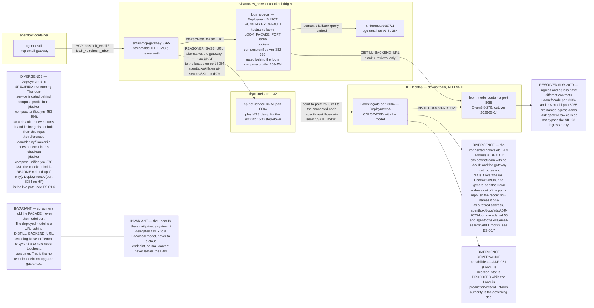

## ES-06.2 ask_email — tier 1, egress filter applied
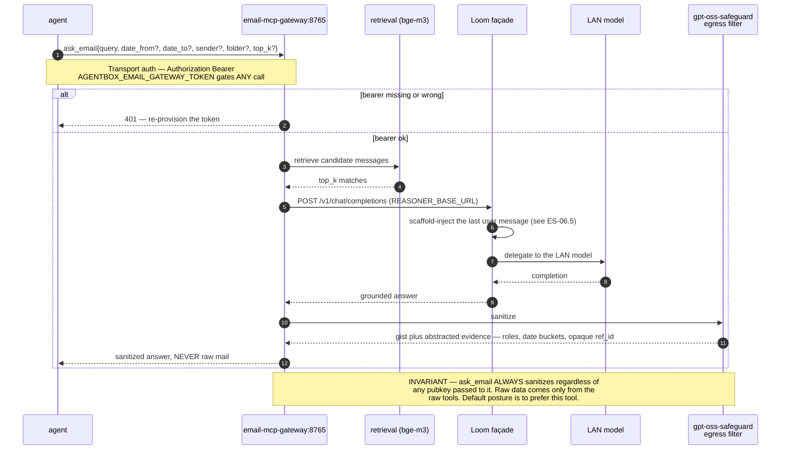

## ES-06.3 Break-glass tier — raw tools behind a second, capability gate
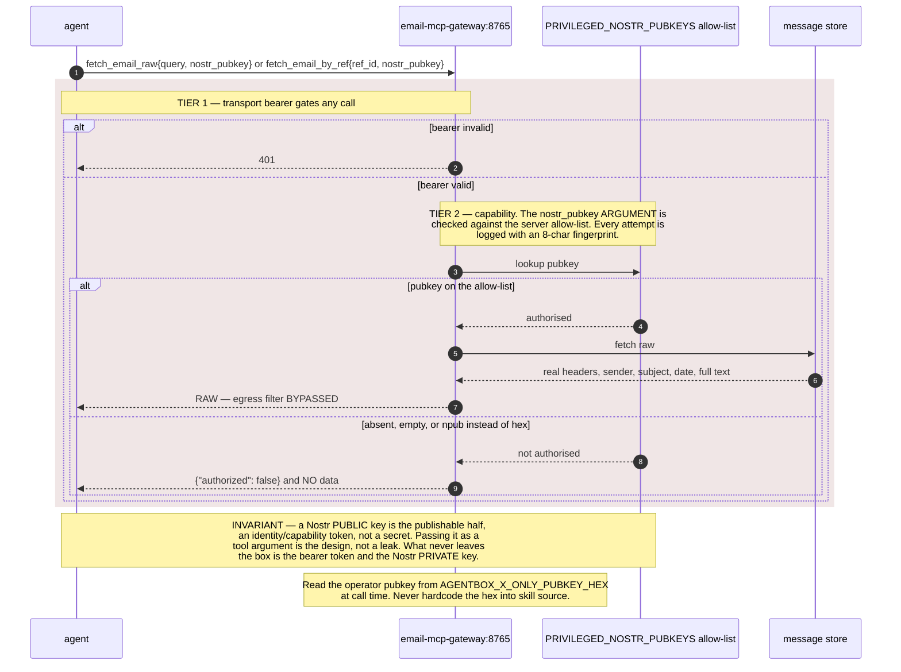

## ES-06.4 refresh_inbox — on-demand ingest across two Proton accounts
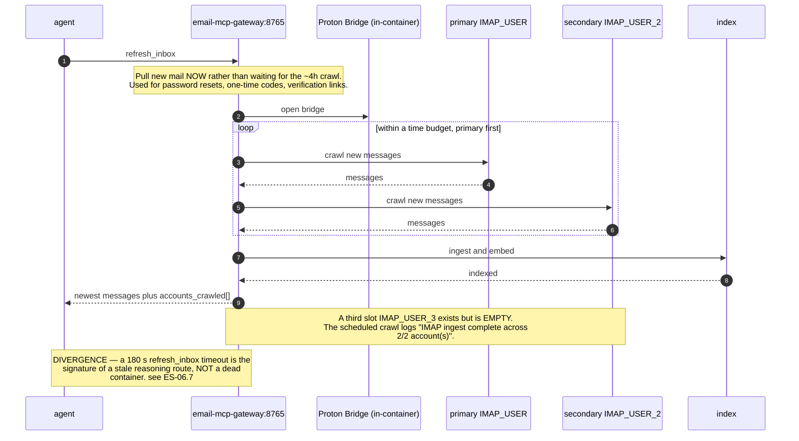

## ES-06.5 Loom scaffold-inject — grounding, budget clamp and the confidence gate
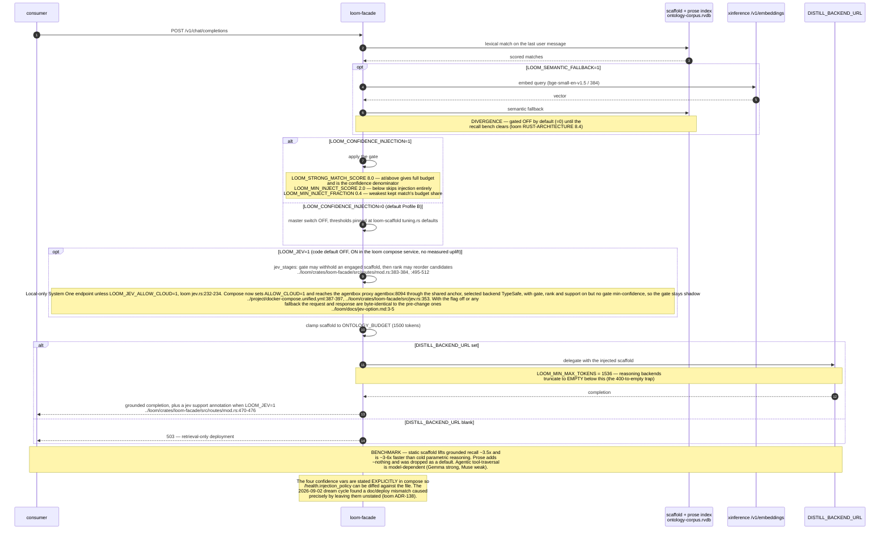

## ES-06.6 Loom endpoint map — what needs a model and what does not
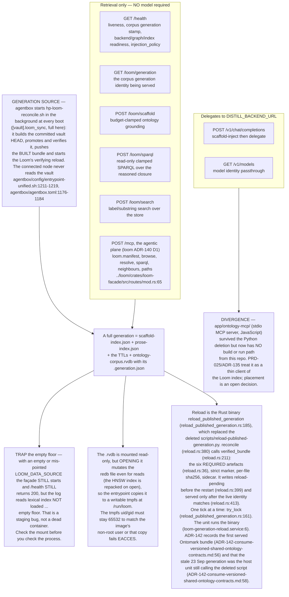

**Tension:** loom ADR-140 is `Status: Proposed` (`../loom/docs/design/ADR-140-loom-v2-agent-drivable-grounding.md:3`), yet its P0 is in service: the façade routes `/mcp` (`../loom/crates/loom-facade/src/routes/mod.rs:65`) and the note records that agentbox's `ontology-augment` grounds through it, with P1 onward not started (`../loom/docs/design/ADR-140-loom-v2-agent-drivable-grounding.md:632-634`).

**Open:** the Jev option inside the façade is a proposed research candidate with no measured uplift; the code default is off (`LOOM_JEV=1` to enable, `../loom/docs/jev-option.md:3-6`) but the unified compose arms it (`../project/docker-compose.unified.yml:391-397`) and, since 2026-10-30, lets it reach the cloud-backed agentbox proxy instead of the laya façade (`LOOM_JEV_ALLOW_CLOUD` default 1, `:395`), although the façade's own header still justifies local-only by private corpus content (`../loom/crates/loom-facade/src/jev.rs:30-34`); CONFIGURED, taking effect when the new agentbox image is activated and the loom service is recreated (`../project/docs/BASELINE-architecture.md:42-53`).

## ES-06.7 The black-hole hang — health green, every reasoning call stalls
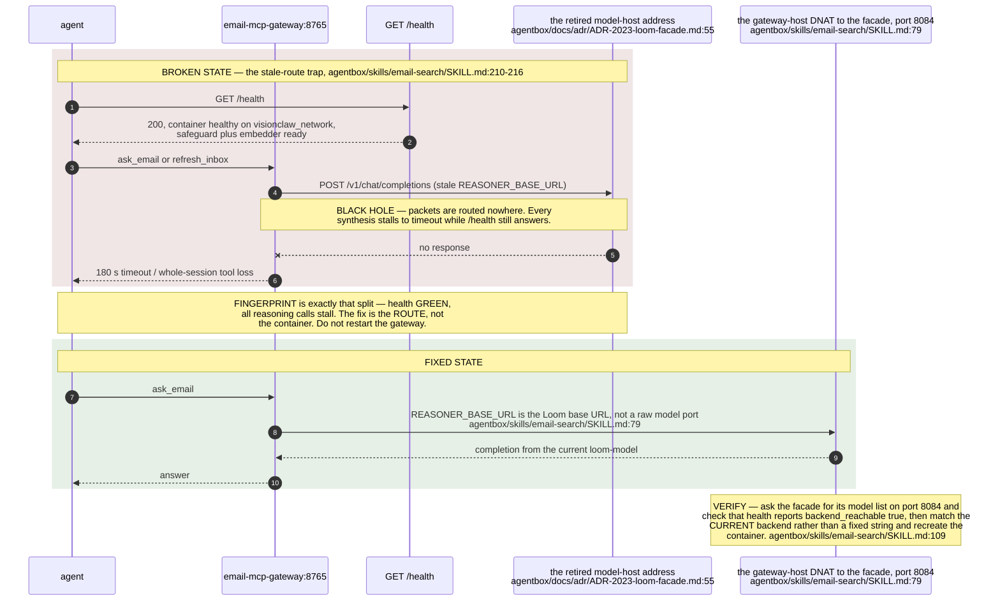

## ES-06.8 MCP client link loss and the mid-session JSON-RPC recovery
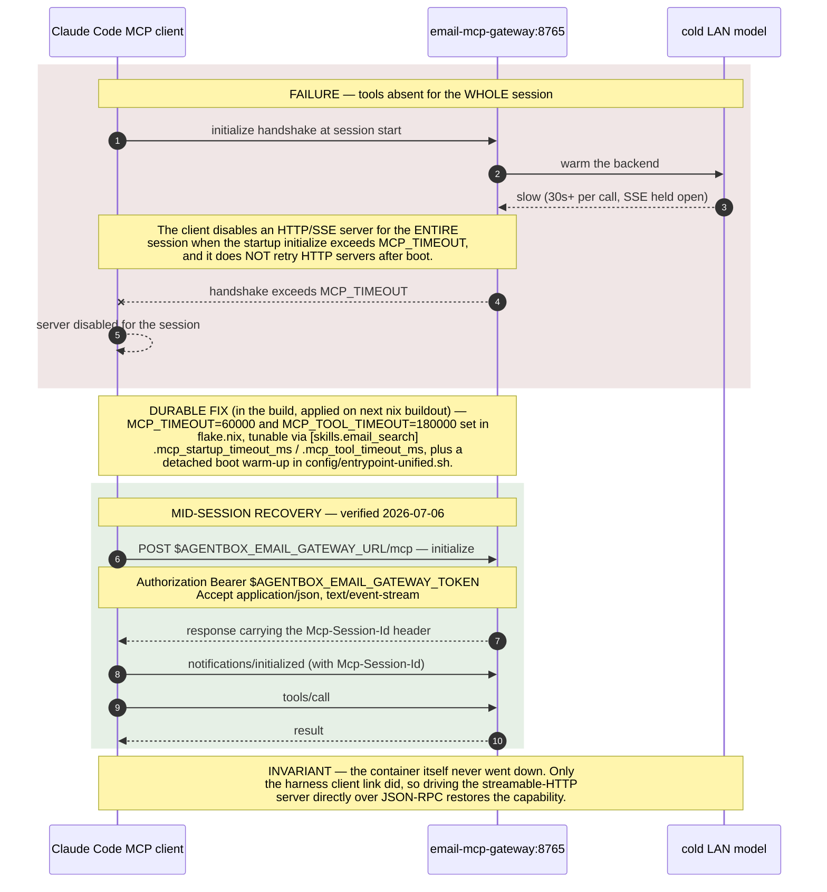

## ES-06.9 Backend-swap runbook — one port, stop-park-promote-start
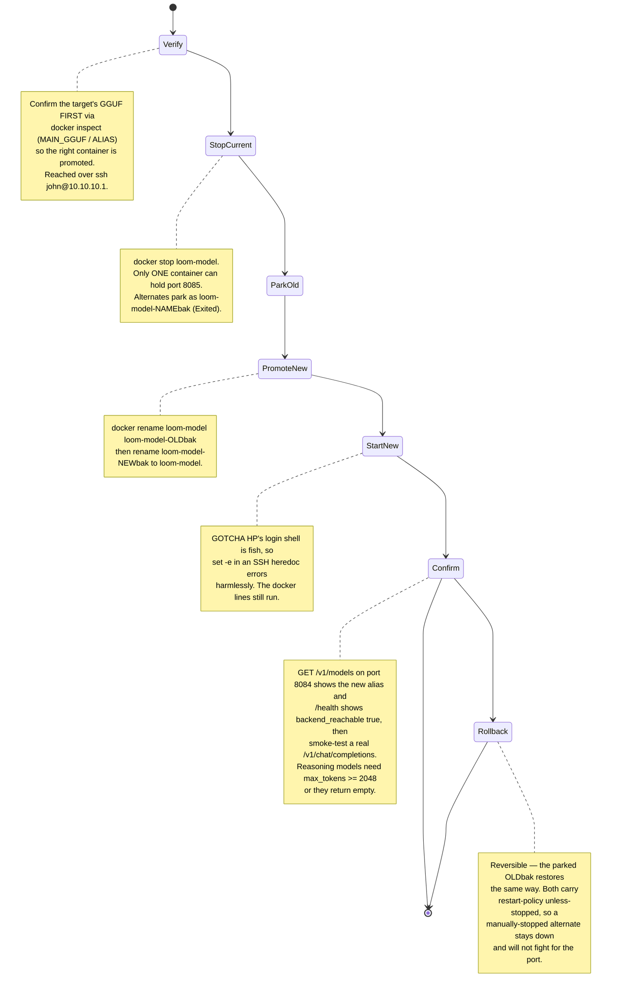

## ES-06.10 Two model-selection planes, and the privacy line between them
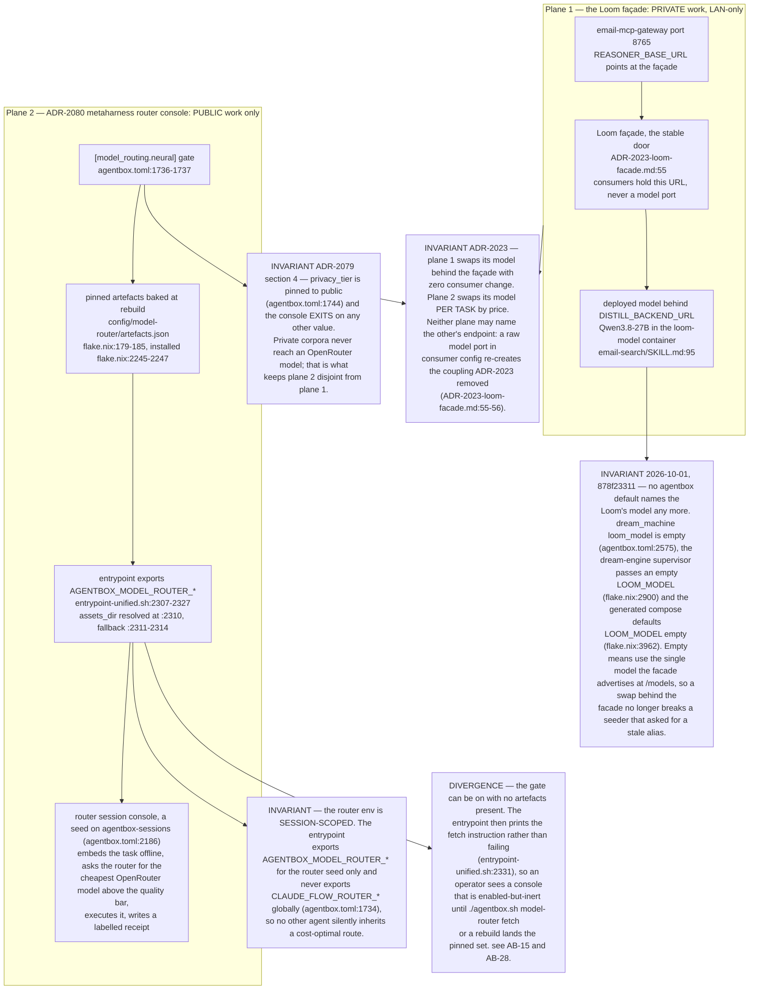

**Resolved:** ADR-2153 is live, so the router console of plane 2 is an ordinary `[[interaction_plane.session_seeds]]` entry (`slug = "router"`, `../project/agentbox/agentbox.toml:2186`) on the owned session plane, not an Agent of Empires session; ADR-2080 (`../project/agentbox/docs/adr/ADR-2080-metaharness-router-console-under-aoe.md`) keeps its scope rules and its AoE-era title (`../project/agentbox/docs/adr/ADR-2153-session-plane-replaces-aoe.md:5-7`, `:82`).

**Tension (ADR-2080 acceptance item 3, recorded 2026-10-30):** the public-only invariant above holds for the console, which exits on any other tier, but the router wrapper pins the tier to `public` before it starts the console, so setting `AGENTBOX_MODEL_ROUTER_PRIVACY_TIER=private` cannot make the wrapper exit non-zero as the acceptance text asks (`../project/agentbox/docs/adr/ADR-2080-metaharness-router-console-under-aoe.md:129-132`). The record's `review_trigger` says items 1, 2 and 4 passed on the running image on 2026-10-30 and leaves item 3 to an owner ruling, so ADR-2080 stays `accepted` / `partial` / `staged` (`../project/agentbox/docs/adr/ADR-2080-metaharness-router-console-under-aoe.md:5-7,13`).

## ES-06.11 One published loom-client — every facade caller, one place that knows the traps
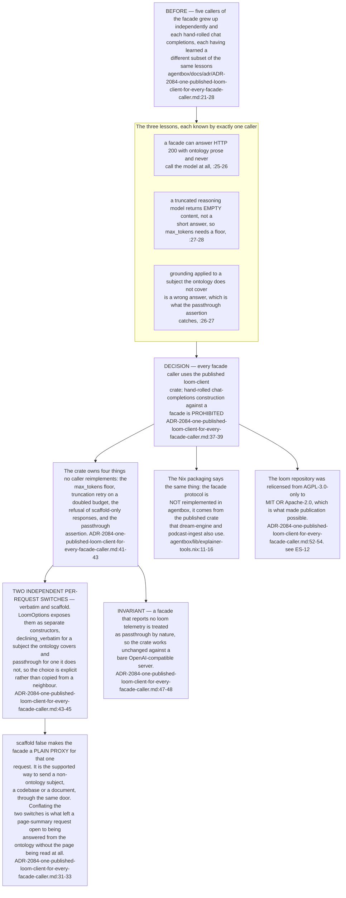
