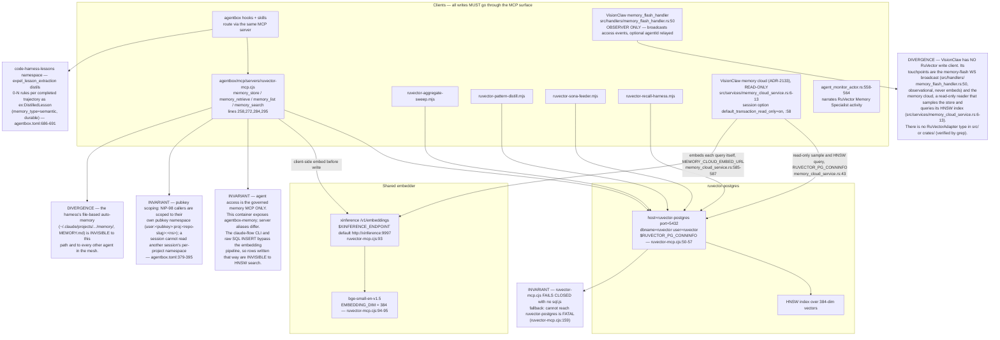
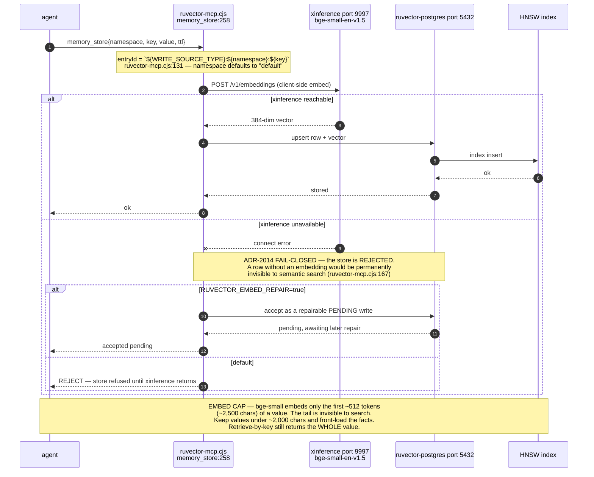
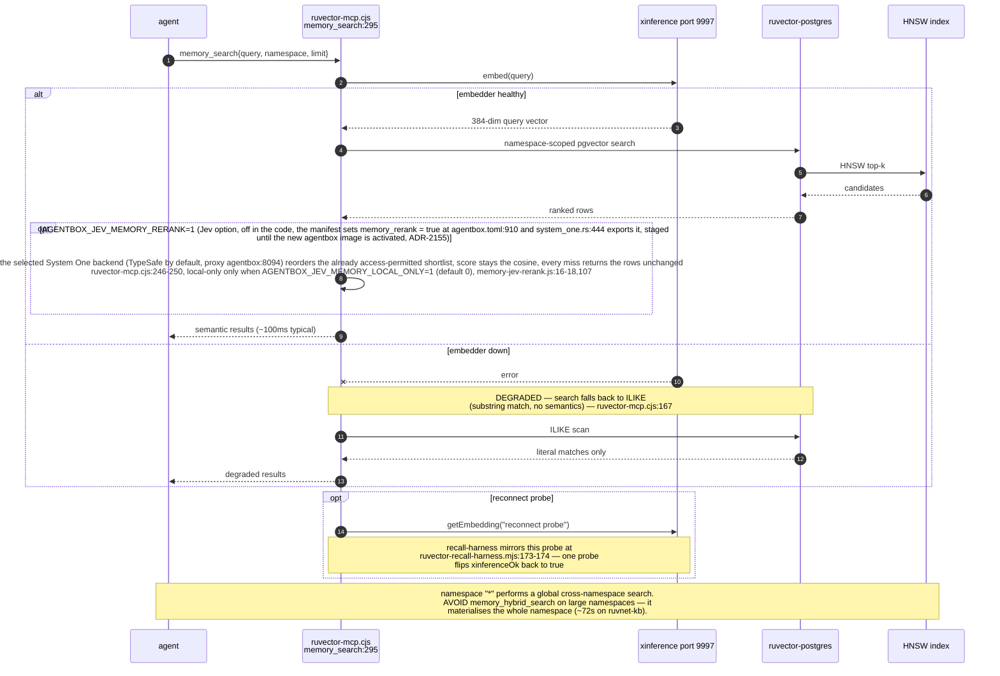
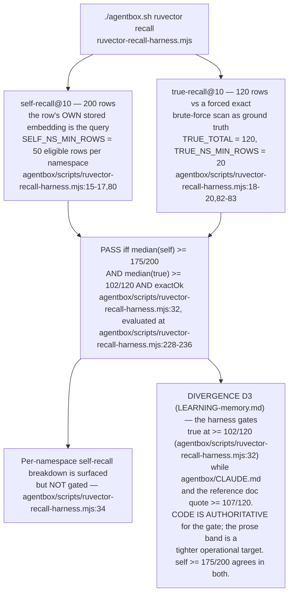
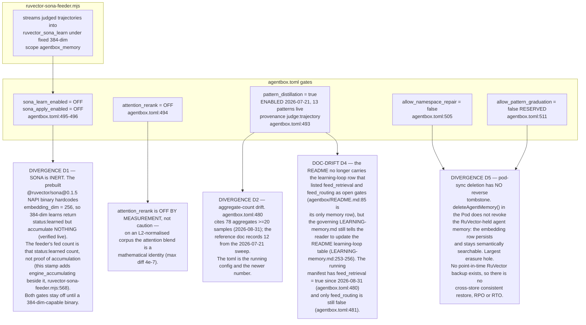
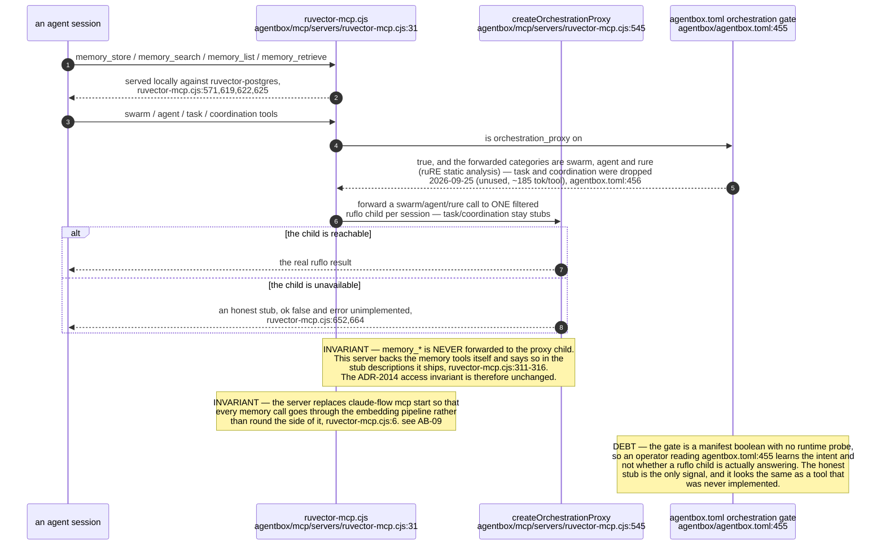

## ES-07.1 Every RuVector client and the one shared embedder

## ES-07.2 memory_store — embed-then-write, fail-closed when the embedder is down

## ES-07.3 memory_search — HNSW semantic path with an ILIKE degradation

**Drift:** the call site still describes the reranker as a LOCAL judge (`../project/agentbox/mcp/servers/ruvector-mcp.cjs:246-247`), but local-only is now an opt-in (`AGENTBOX_JEV_MEMORY_LOCAL_ONLY`, default 0), so once the new image is activated the query and capped value snippets of the shortlist go to the selected backend, cloud TypeSafe by default (`../project/agentbox/mcp/servers/lib/memory-jev-rerank.js:16-18,107`); `[system_one].local_only` is empty (`../project/agentbox/agentbox.toml:895`).

## ES-07.7 Recall gate — the band that must hold before and after any retrieval change

## ES-07.9 Learning loop — the gates that are off, and why

**Drift (resolved at this stamp):** the feeder's `fed` counts calls whose result was `status:"learned"` (`agentbox/scripts/ruvector-sona-feeder.mjs:527-528`), which D1 shows the 256-dim binary also returns for a 384-dim learn it keeps nowhere, so `fed` was never evidence of accumulation. This stamp adds `engine_accumulating` to the `SonaRunCompleted` event, derived from the post-batch `trajectories_buffered + patterns_stored` and null when the stats are unreadable (`agentbox/scripts/ruvector-sona-feeder.mjs:337-341,568`), and rewords the human lines to "accepted by learn ... engine accumulating: yes/no/unknown" (`agentbox/scripts/ruvector-sona-feeder.mjs:647`). `fed` is kept for the cursor and the event contract. Both SONA gates stay off, so the loop's shipped state is unchanged.

**Drift:** the governing LEARNING-memory.md D4 says the README learning-loop table lags the toml (`agentbox/docs/LEARNING-memory.md:253-256`), but the README at this stamp has no such row (`agentbox/README.md:85`).

## Audit qualification — 2026-09-07

The 2026-09-05 Agentbox recall closeout records self 189/200 and true 115/120 after a **serial** rebuild, versus self 151/200 after parallel rebuilding. These are historical receipts, not a fresh benchmark. The local RuVector source contains `hnsw_bulkdelete` and deleted-node flags; neither proves a deployed bulk-delete recall regression. Keep cross-store reverse tombstones (ADR-2060) distinct from index tombstones. No database mutation or reindex was performed. See [audit](../../estate-review/2026-09-07-agentbox-audit.md).

## ES-07.10 The governed server also fronts the orchestration tools, and memory is denied on that side

