## ES-08.1 Four coexisting Solid-pod deployments — topology contrast

```mermaid
flowchart TB
    subgraph VC["VisionClaw process — single binary"]
        FLAG{{"cargo feature #quot;solid-pod-embed#quot;<br/>in default at Cargo.toml:273, declared at Cargo.toml:306 (default ON)"}}
        EMB["solid_proxy_handler.rs<br/>handle_solid_proxy:311"]
        STUB["no routes registered at all<br/>configure_routes twin, solid_proxy_handler.rs:1820-1824"]
        FLAG -->|"feature ON"| EMB
        FLAG -->|"feature OFF"| STUB
    end

    subgraph AB["agentbox container — supervised service"]
        SUP["supervisord [program:solid-pod]<br/>agentbox/flake.nix:2731"]
        SRV["solid-pod-rs-server  port 8484<br/>agentbox/agentbox.toml:539-540"]
        HTTPS["[program:https-bridge]<br/>agentbox/flake.nix:2748"]
        SUP -->|"exec solidPodRsLauncher"| SRV
        HTTPS -->|"TLS terminate to  port 8484"| SRV
    end

    subgraph CF["Cloudflare Tunnel overlay"]
        CFD["cloudflared-pod<br/>agentbox/docker-compose.solid-pods.yml:26-33"]
    end
    CFD -->|"pods-native.dreamlab-ai.com to agentbox port 8484"| SRV

    subgraph LEGACY["JavaScriptSolidServer — DELETED by ADR-2068"]
        JSS["was bin/jss.js  port 3000 at the repo root —<br/>a vendored third-party copy, now removed.<br/>see ES-08.10"]
    end

    MGMT["management-api adapters/pods/local-solid-rs.js<br/>DEFAULT_BASE is loopback port 8484, local-solid-rs.js:25"] -->|"HTTP LDP"| SRV
    CLIENTB["client SolidPodService.ts<br/>SOLID_POD_BASE_URL defaults to /solid, ldpClient.ts:19"] -->|"proxied #quot;/solid/*#quot;"| EMB

    NOTE1["DIVERGENCE: docker-compose.solid-pods.yml is only the Cloudflare<br/>Tunnel sidecar for THIS SAME port 8484 server (deployment 2) - docker-compose.solid-pods.yml:1-7.<br/>It is not a separate multi-user pods deployment. Multi-user pods<br/>(agentbox/docs/user/multi-user-pods.md) is a design scaffold, defaults<br/>off, targets this same server via admin-users.js - see ES-08.5"]
    NOTE2["DIVERGENCE: sources-of-truth conflict (legacy) - Pod claims<br/>write-master for some agent state while Oxigraph, GitHub public::true<br/>and RuVector claim primacy elsewhere per docs/DATA-authority-erasure.md<br/>Known divergences and open items; legacy prose unreconciled, not authority"]
    NOTE3["_solid-http-base.js:11-12 — this base class was renamed from<br/>local-jss.js after the Python/JSS stub was retired 2026-04-25;<br/>wire contract is protocol-level Solid, not JSS-specific"]
```

## ES-08.2 Agent pod write — NIP-98 signing via pod-signer (with unsigned fallback)

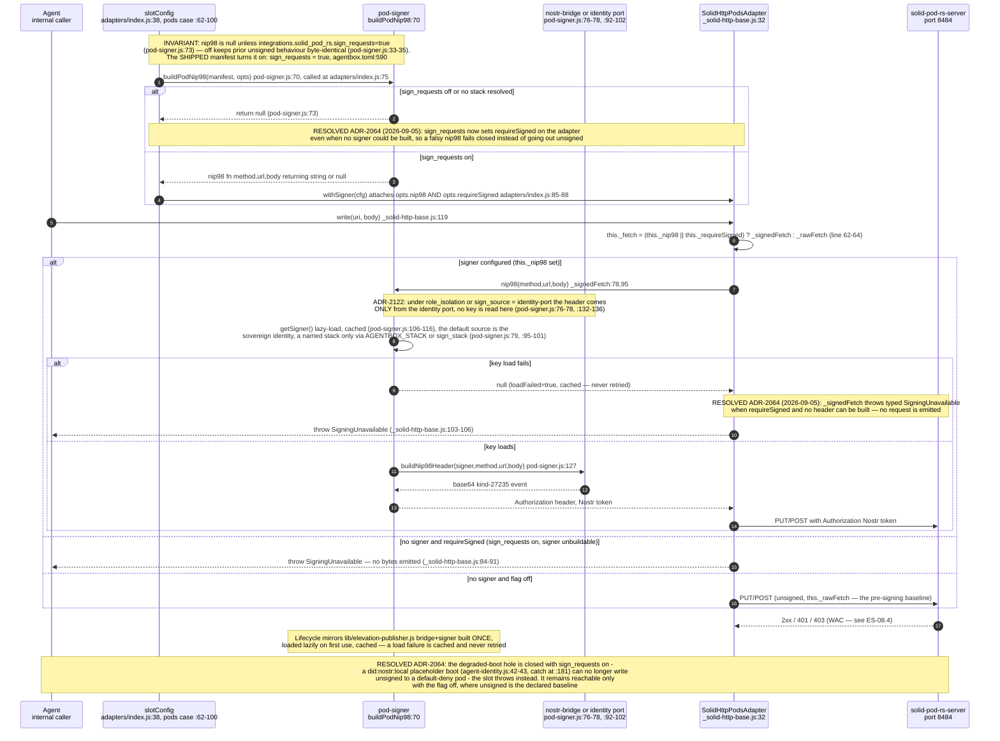

## ES-08.3 User pod write — SolidPodService through ldpClient

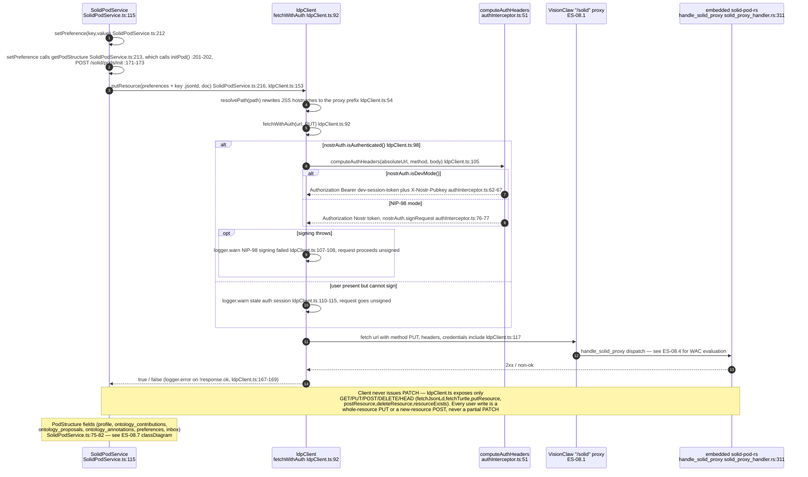

## ES-08.4 WAC-denied read — embedded handle_solid_proxy

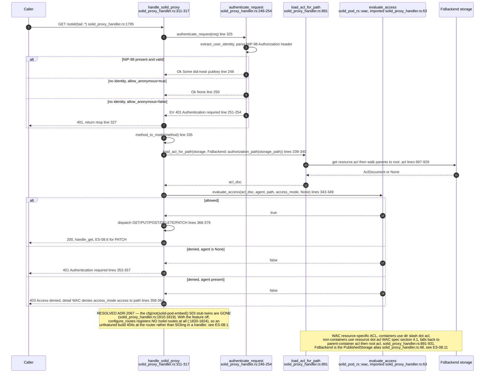

## ES-08.5 Pod provisioning for a new user

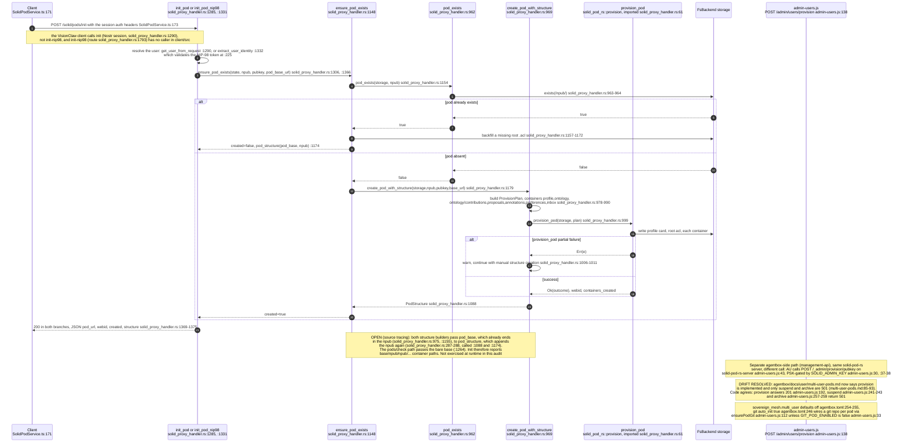

**Open (doubled npub in the init response):** both structure builders pass a `pod_base` that already ends in the npub (`../project/src/handlers/solid_proxy_handler.rs:975`, `:1155`) to `pod_structure`, which appends the npub again (`../project/src/handlers/solid_proxy_handler.rs:287-288`, called at `:1088` and `:1174`), while `pods/check` passes the bare base (`:1264`). The `PodStructure` the client writes preferences under would therefore name `base/npub/npub/...`. Traced in source only and not exercised.

## ES-08.6 PATCH — N3 Patch and SPARQL-Update on an N-Triples graph, JSON Patch only for absent resources

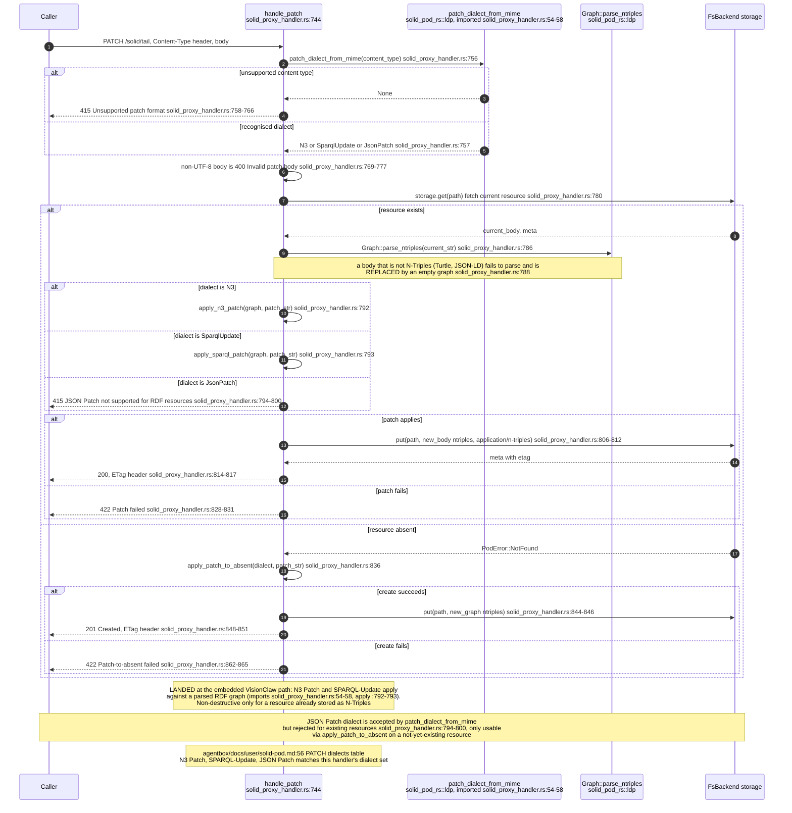

**Tension (PATCH on a non-N-Triples resource):** `Graph::parse_ntriples` returns an error on the first line that is not an N-Triples statement (`../solid-pod-rs/crates/solid-pod-rs/src/ldp.rs:826-837`, read at the `v0.5.0-alpha.21` tag VisionClaw pins), and the handler turns that error into an empty graph (`../project/src/handlers/solid_proxy_handler.rs:786-789`). A PATCH against a Turtle or JSON-LD resource, which is what `putResource` writes by default (`../project/client/src/services/solidPod/ldpClient.ts:153-157`), therefore stores only the patch's own triples as `application/n-triples` (`../project/src/handlers/solid_proxy_handler.rs:805-812`) and drops the previous content. The VisionClaw client never sends PATCH (ES-08.3), so no in-repo caller hits this; any other Solid client could. This was traced in source only and not reproduced. Closing it means refusing the PATCH (409 or 415) when the stored body does not parse, or parsing by the stored content type.

## ES-08.7 Client pod resource model

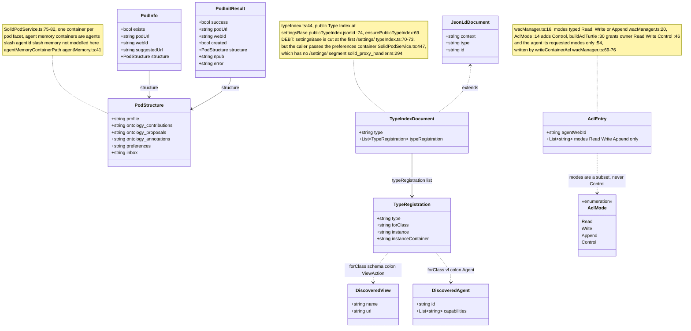

**Debt (public Type Index path):** `ensurePublicTypeIndex` cuts its path at the first `/settings/` (`../project/client/src/services/solidPod/typeIndex.ts:70-73`). Its caller passes the preferences container (`../project/client/src/services/SolidPodService.ts:447`), which never contains that segment (`../project/src/handlers/solid_proxy_handler.rs:294`), so `indexOf` returns -1 and the Type Index lands at a nine-character prefix of the path. Traced in source only.

## ES-08.8 Supervised solid-pod service lifecycle

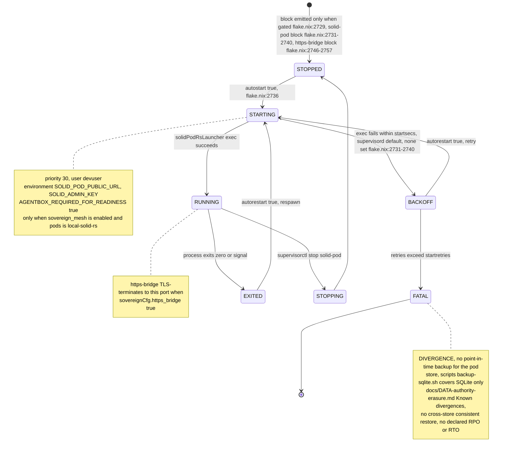

## ES-08.9 deleteAgentMemory tombstone gap

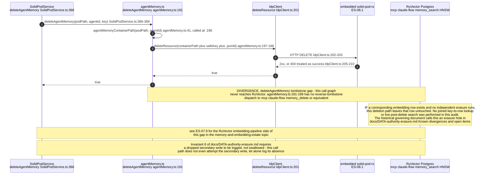

## ES-08.10 JavaScriptSolidServer — legacy JS implementation, REMOVED from the repo

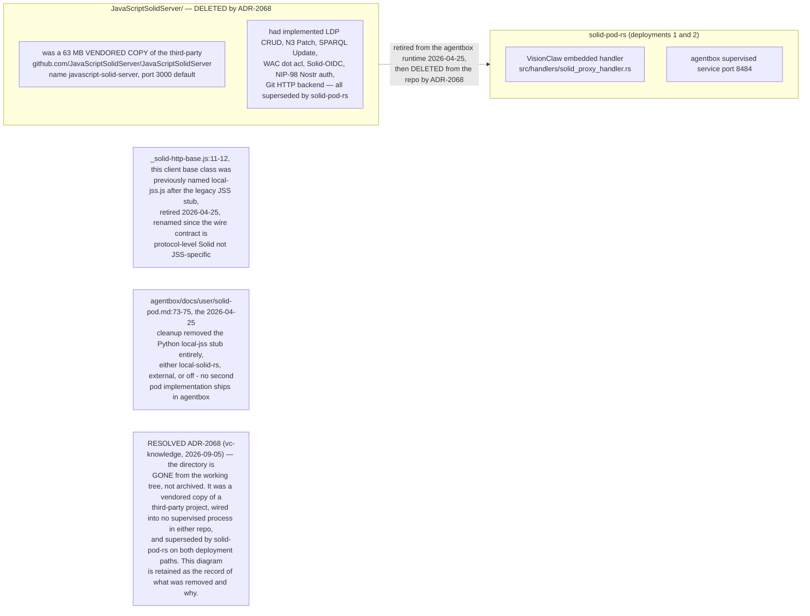

## ES-08.11 ADR-2106 — the embedded pod PULLS the published ontology at boot
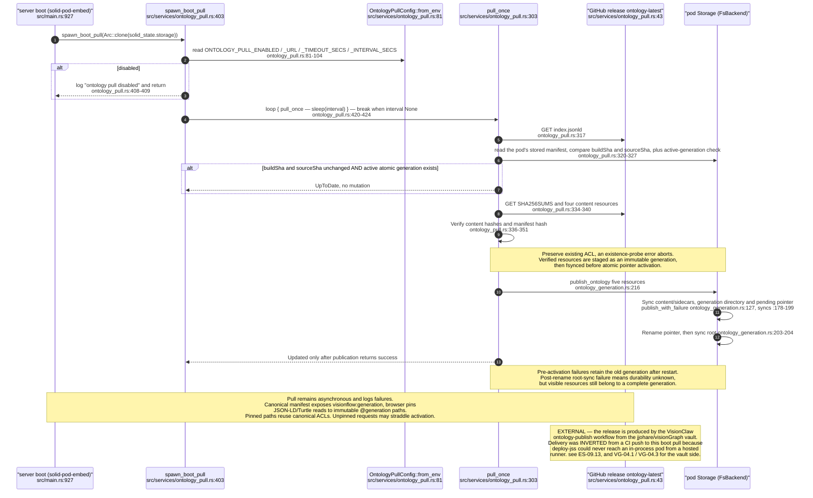

The 2026-09-07 audit distinguishes ES-08.9's missing cross-store erasure dispatch from HNSW index degradation. This source path demonstrates neither bulk vector deletion nor degraded recall. ES-08.11 now documents the implemented generation boundary and pinned browser reads. Old unpinned consumers can still straddle activation; post-rename fsync failure does not imply the old pointer survived. The durable reconciliation journal has no production destructive adapters: subject/authority mappings and live erasure acceptance remain outstanding. See the [federation audit](../../estate-review/2026-09-07-federation-audit.md).

## ES-08.12 PROPOSED — the pod ledger becomes a chain view, and the hand-rolled crypto goes
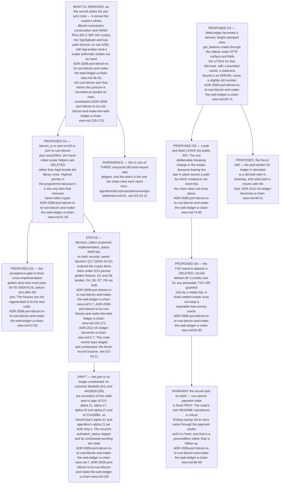

**Drift (ADR-2008 release status):** the record says the port landed on `main` unreleased and keeps `activation_status: staged` (`../solid-pod-rs/crates/solid-pod-rs/docs/adr/ADR-2008-port-bitcoin-tx-to-rust-bitcoin-and-make-the-web-ledger-a-chain-view.md:7`, `:135`). But its D1 and D6 commits (`0befa5b`, `e62d028`) are ancestors of the `v0.5.0-alpha.11`, `v0.5.0-alpha.17`, `v0.5.0-alpha.18` and `v0.5.0-alpha.21` tags and of agentbox's Nix revision `27e18995`, so both VisionClaw's alpha.21 dependency (`../project/Cargo.toml:240`) and the agentbox image ship it. The record lives in solid-pod-rs and was not edited.

## ES-08.13 Forge and mirror in the native pod — compiled in, inert until named (ADR-2145)

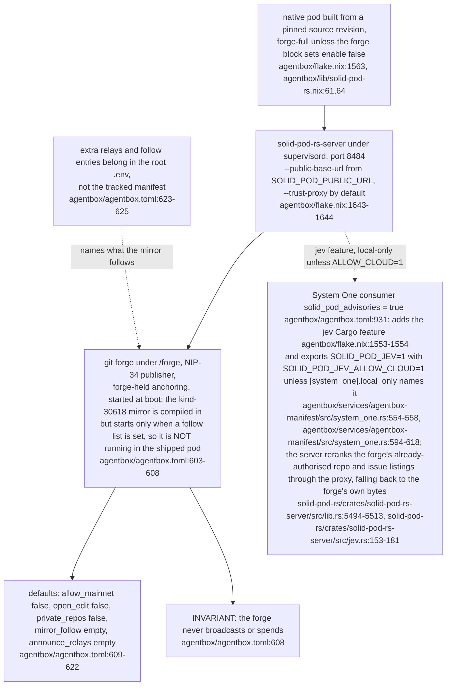

**What it shows:** the native pod of ES-08.1 deployment 2 now carries a git forge that starts with the server and does nothing external until the owner names relays and follow entries. The kind-30618 mirror is compiled in but does not start while the follow list is empty, which is the shipped state: `mirror_config` returns `None` unless at least one relay and one follow entry survive (`../solid-pod-rs/crates/solid-pod-rs-server/src/lib.rs:5321-5342`), and the mirror is only built from that `Some` (`:5382-5389`). These lines are read at the solid-pod-rs audit pin; the image builds the same revision 27e18995 (`../project/agentbox/lib/solid-pod-rs.nix:64`), so the line numbers are the image's too.

**Why it is this way:** VisionFlow ADR-2019 decided that shipped pods run the forge and mirror with open edit, mainnet and any follow list opt-in, and agentbox ADR-2145 compiled it in behind the manifest block rather than a separate service.

**Tension (agentbox ADR-2145 vs BASELINE-container):** the ADR records `implementation_status: complete` and `activation_status: live` (`../project/agentbox/docs/adr/ADR-2145-the-solid-pod-forge-and-mirror-are-compiled-in-and-inert-until-named.md:6-7`), while the baseline still says the native pod is "pinned at `v0.5.0-alpha.17`" and "Staged until the image is rebuilt" (`../project/agentbox/docs/BASELINE-container.md:259`, `:264-265`). VisionFlow's own record for the same decision, ADR-2019, agrees with ADR-2145 on activation: `decision_status: accepted`, `implementation_status: partial`, `activation_status: live` (`docs/adr/ADR-2019-forge-and-mirror-on-in-shipped-pods.md:5-7`). The baseline wording is the one left behind.

**Open (ADR-2019 stays partial):** the 2026-10-30 close-out found `FORGE_MIRROR_FOLLOW` empty in the running pod, so no `mirror on kind-30618` line (`../solid-pod-rs/crates/solid-pod-rs-server/src/lib.rs:5387`) is logged and the shipped follow list (the operator's own key) is not wired. Closing it is an agentbox change to the pod launcher, and the record's `review_trigger` names it as the event that completes ADR-2019 (`docs/adr/ADR-2019-forge-and-mirror-on-in-shipped-pods.md:13`). The running-pod observation is the close-out's; this audit did not inspect the pod.

**Drift:** agentbox's pod guide says the image pins `solid-pod-rs` 0.5.0-alpha.13 (`../project/agentbox/docs/user/solid-pod.md:37`) and the baseline says alpha.17 (`../project/agentbox/docs/BASELINE-container.md:259`), while the Nix derivation pins the 0.5.0-alpha.21 workspace at revision 27e18995 (`../project/agentbox/lib/solid-pod-rs.nix:61`, `:64`), and VisionClaw's embedded dependency is also `0.5.0-alpha.21` (`../project/Cargo.toml:240`). VisionClaw and the agentbox image now share one release, while two agentbox documents still name two others. The cloud opt-in is configured; the server's own header still describes pod metadata as local-only by default and documents the opt-in that lifts it (`../solid-pod-rs/crates/solid-pod-rs-server/src/jev.rs:24-33`).
