## ES-09.1 The host-vs-container build trap — wrong path vs sanctioned path
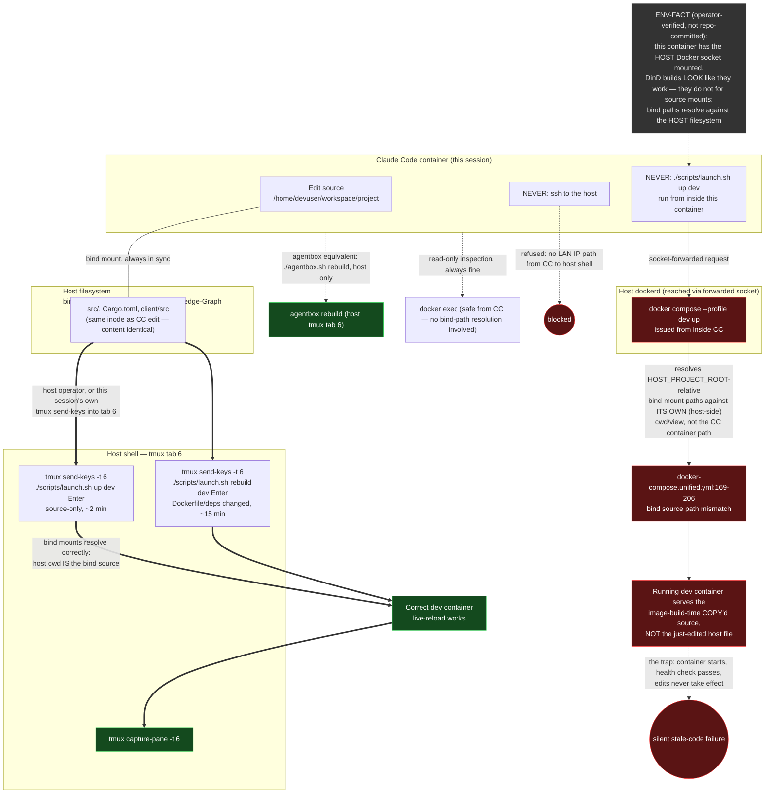

## ES-09.2 Edit-build-verify cycle across the container/host boundary
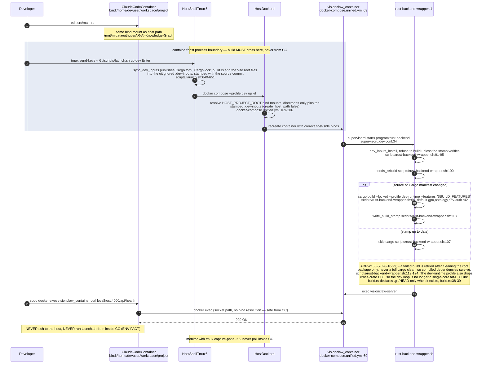

## ES-09.3 Dockerfile.unified — multi-stage build, dev vs prod target divergence
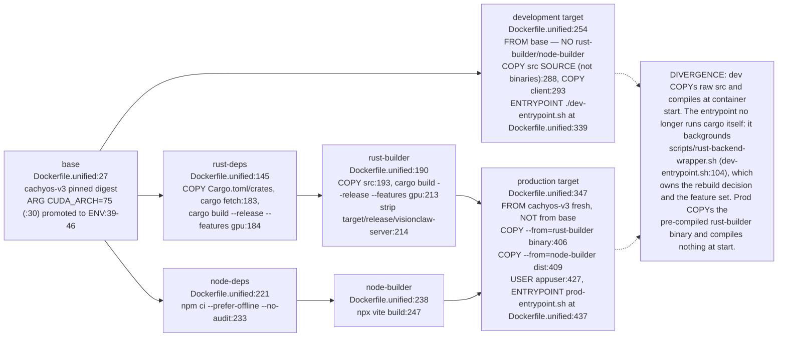

## ES-09.4 Dockerfile.production — cache-optimised 5-stage pipeline
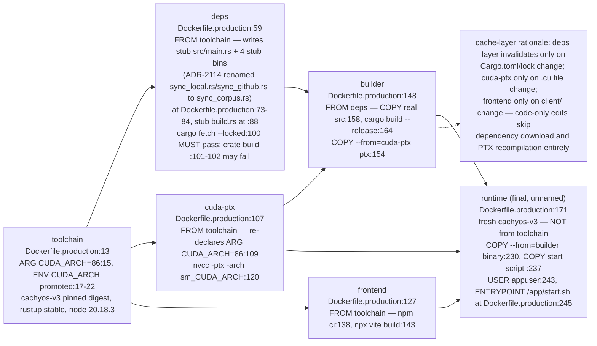

## ES-09.5 CUDA_ARCH ARG-to-ENV promotion, and the ADR-2037 hygiene-stub divergence
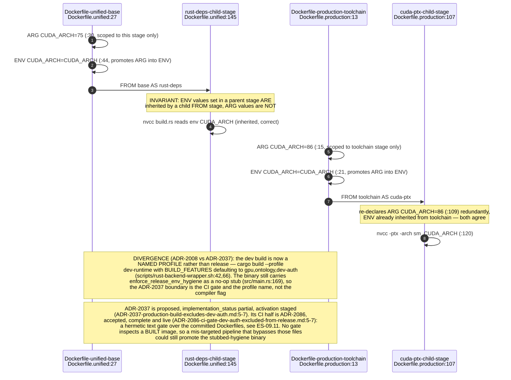

**Open (no gate inspects a built image):** ADR-2037 remains proposed and partial (`../project/docs/adr/ADR-2037-production-build-excludes-dev-auth.md:5-7`). Its CI half, ADR-2086, is live (`../project/docs/adr/ADR-2086-ci-gate-dev-auth-excluded-from-release.md:5-7`), but that gate is a text assertion over the committed Dockerfiles (`../project/.github/workflows/ci.yml:183-188`). A production binary built outside those files, still carrying the hygiene stub (`../project/src/main.rs:169`), would not be caught.

## ES-09.6 supervisord.dev.conf — program set and restart policy
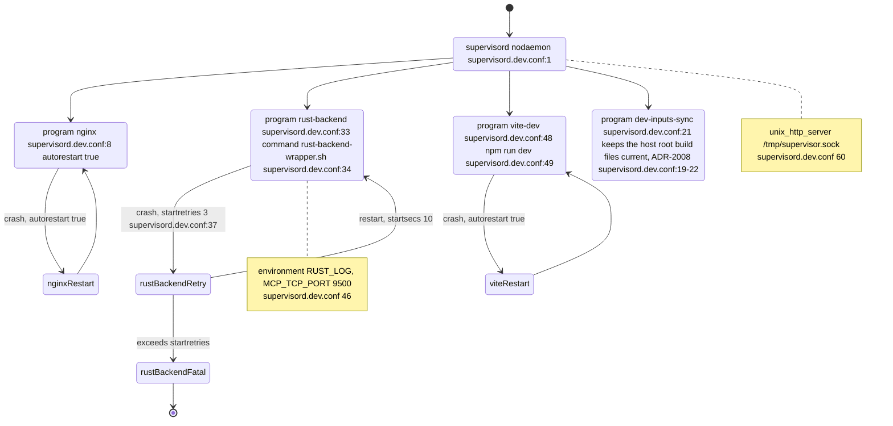

## ES-09.7 supervisord.production.conf — reached only by the Dockerfile.unified production target
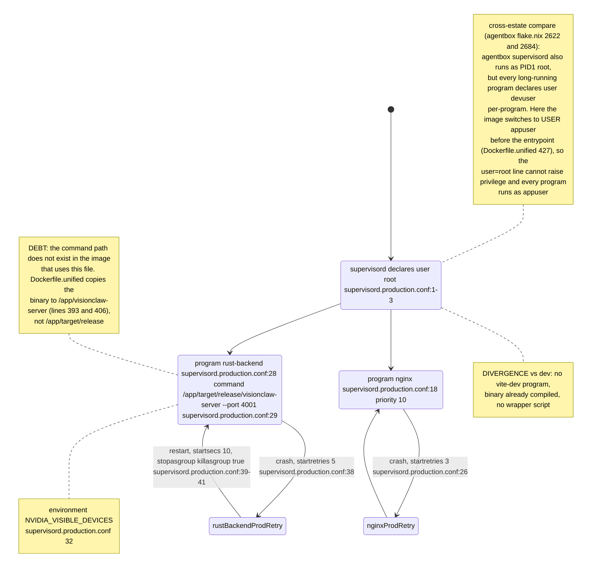

**Divergence (which production path uses this file):** only `Dockerfile.unified`'s `production` target copies this config (`../project/Dockerfile.unified:414`) and execs it (`../project/scripts/prod-entrypoint.sh:23`). The compose `visionclaw-production` service builds `Dockerfile.production` instead (`../project/docker-compose.unified.yml:256-258`), whose entrypoint is `/app/start.sh` (`../project/Dockerfile.production:237`, `:245`). That script starts the backend on port 4001 in the background and runs nginx in the foreground itself, with no supervisord (`../project/scripts/production-startup.sh:38-41`, `:68-70`). From source, nothing on the compose production path restarts a backend that crashes after startup: nginx keeps the container alive, so `restart: unless-stopped` (`../project/docker-compose.unified.yml:323`) does not fire.

**Debt (binary path):** the `rust-backend` program runs `/app/target/release/visionclaw-server` (`../project/supervisord.production.conf:29`), but the image that reads this file puts the binary at `/app/visionclaw-server` (`../project/Dockerfile.unified:406`, with `WORKDIR /app` at `:393`). Traced in source only and not run: from source, the `Dockerfile.unified` production target would fail its backend start. Closing it means pointing the command at `/app/visionclaw-server`, or retiring the target if `Dockerfile.production` is the only production build.

## ES-09.8 Compose profiles — dev, production, tunnel, loom
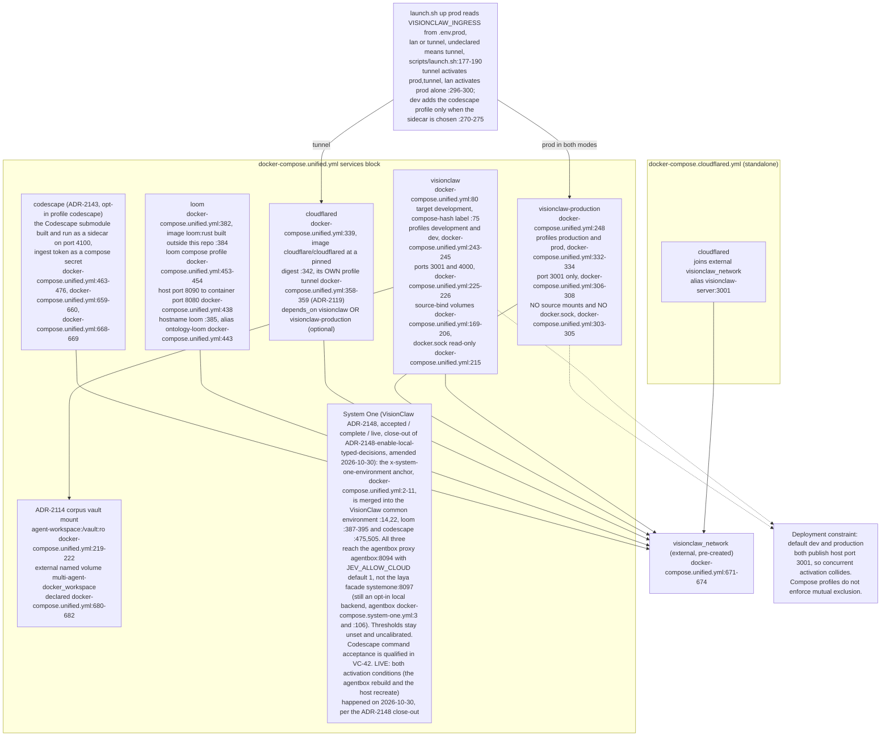

## ES-09.9 nginx route tables — dev vs production upstreams
```mermaid
flowchart LR
    subgraph DEVNGINX["nginx.dev.conf — listen 3001 nginx.dev.conf:56"]
        DUPRUST["upstream rust_backend<br/>127.0.0.1:4000 :44-47"]
        DUPVITE["upstream vite_frontend<br/>127.0.0.1:5173 :49-52"]
        DAPI["^~ /api/ -> rust_backend :108-109"]
        DWSS["/wss, /ws/speech, /ws/mcp-relay -> rust_backend :128, :148, :168"]
        DSOLID["^~ /solid/, ^~ /pods/ -> rust_backend/api/solid/ :209, :235"]
        DHMR["/vite-hmr, /@vite, /node_modules -> vite_frontend :296, :308"]
        DROOT["/ -> vite_frontend (dev server, no static build) :332"]
        DCODESCAPE["^~ /codescape/ -> the codescape sidecar on codescape:4100, resolved lazily<br/>through Docker DNS so nginx starts when it is down (ADR-2143 A4)<br/>nginx.dev.conf:59-98"]
        DXFH["X-Forwarded-Host = http_host, the dialled host:port,<br/>on /api/, /wss and /ws/speech only nginx.dev.conf:112, nginx.dev.conf:134, nginx.dev.conf:154<br/>/solid/ and /pods/ still send host without port nginx.dev.conf:236, nginx.dev.conf:262"]
    end
    subgraph PRODNGINX["nginx.production.conf — listen 3001 :85"]
        PUPRUST["upstream rust_backend<br/>127.0.0.1:4001 max_fails=0 :69-72"]
        PAPI["^~ /api/ -> rust_backend :114-115"]
        PWS["wss / ws/speech / ws/mcp-relay / ws/hybrid-status -> rust_backend :235-236"]
        PSOLID["^~ /solid/, ^~ /pods/ -> rust_backend/api/solid/ :170,215"]
        PSTATIC["/, *.html, *.js/css/png -> static /app/client/dist :271,284,297"]
        PHEALTH["/health, /healthz, /readyz -> rust_backend or static :306,315,321"]
        PXFH["X-Forwarded-Host = http_host on /api/ and the ws routes<br/>nginx.production.conf:126,248<br/>/solid/ and /pods/ send host nginx.production.conf:177,222"]
    end
    LEGACY["nginx.conf (root, listen 4000 nginx.conf:82)<br/>generic template, NOT referenced by any<br/>Dockerfile/compose COPY — kept as reference only"]

    DAPI --> DUPRUST
    DWSS --> DUPRUST
    DSOLID --> DUPRUST
    DHMR --> DUPVITE
    DROOT --> DUPVITE
    PAPI --> PUPRUST
    PWS --> PUPRUST
    PSOLID --> PUPRUST
    PHEALTH --> PUPRUST
    DAPI -.-> DXFH
    PAPI -.-> PXFH
    XFHWHY["2026-10-02 (e7e6b61d8): a NIP-98 u tag signs the URL the client<br/>dialled, port included. nginx Host drops the port, so the backend<br/>rebuilds the URL from X-Forwarded-Proto and X-Forwarded-Host,<br/>auth.rs:170-189"]
    DXFH -.-> XFHWHY
    PXFH -.-> XFHWHY
    XFHOPEN["OPEN: the pod NIP-98 check also rebuilds its URL from<br/>X-Forwarded-Host, solid_proxy_handler.rs:207-222, but the /solid/ and<br/>/pods/ blocks still forward host without the port. Whether a LAN<br/>client signing host:3001 for a pod write is refused is untested."]
    DSOLID -.-> XFHOPEN

    DIVNOTE["DIVERGENCE: dev proxies ALL non-API routes to the<br/>Vite dev server (live HMR); prod serves a static<br/>client/dist build directly from nginx root, only<br/>API/WS routes reach the backend upstream"]
    DROOT -.-> DIVNOTE
    PSTATIC -.-> DIVNOTE

    PRECED["RESOLVED 2026-10-01 (648c9c442) — in nginx a regex location<br/>outranks a plain prefix, so the asset-extension regex<br/>(nginx.dev.conf:342, nginx.production.conf:271) captured any<br/>/solid/, /pods/ or /api/ path ending in .png or .js and sent it to<br/>Vite or the static root. Every backend prefix now carries ^~,<br/>which makes the prefix match final: nginx.dev.conf:108, nginx.dev.conf:229, nginx.dev.conf:255<br/>and nginx.production.conf:114,215 (production /solid/ already had it)."]
    DSOLID -.-> PRECED
    PSOLID -.-> PRECED
```

## ES-09.10 agentbox flake rebuild gate, and the submodule pointer-bump flow
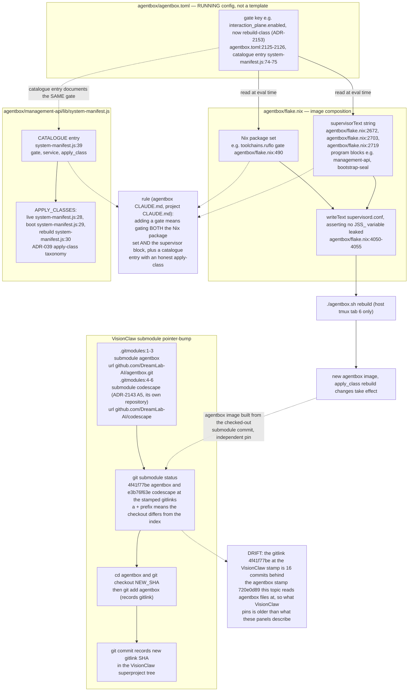

**Drift (submodule pin skew):** `.gitmodules` names the agentbox and codescape submodules (`../project/.gitmodules:1-6`). At the VisionClaw stamp the agentbox gitlink is `4f41f77be`, 16 commits behind the agentbox stamp `720e0d89` that this topic reads agentbox files at. A claim here about agentbox therefore describes a revision newer than the one VisionClaw checks out.

## ES-09.11 VisionClaw ci.yml — Rust CPU/client blocking gates, GPU excluded
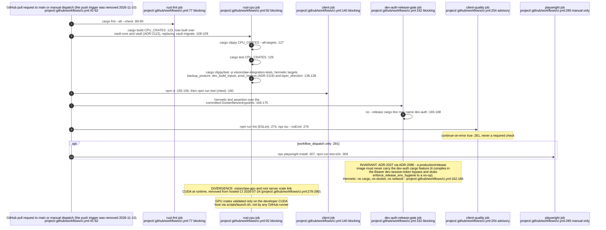

## ES-09.12 VisionClaw docs-ci.yml — ADR ledger gate and documentation quality score
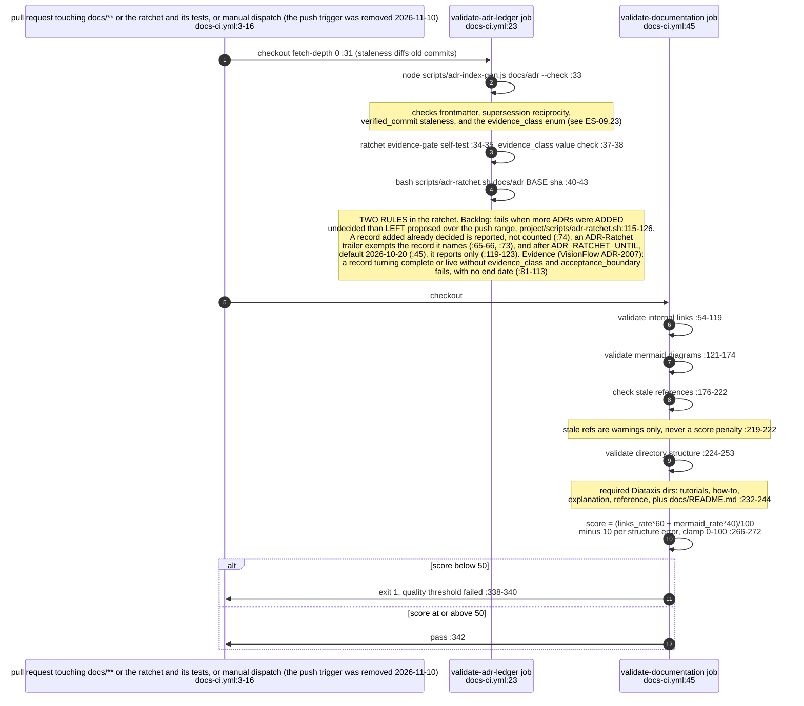

**Open (the backlog rule has lapsed):** `ADR_RATCHET_UNTIL` defaults to 2026-10-20 (`../project/scripts/adr-ratchet.sh:45`), so on any run after that date a push that adds more undecided records than it closes is reported and passes (`../project/scripts/adr-ratchet.sh:119-123`). Only the evidence rule still fails a build. Whether the backlog rule should be extended or retired is the owner's decision; the workflow step's name still describes it as live (`../project/.github/workflows/docs-ci.yml:40`).

## ES-09.13 VisionClaw ontology-publish.yml — vault build now runs in-repo, pull model to pod
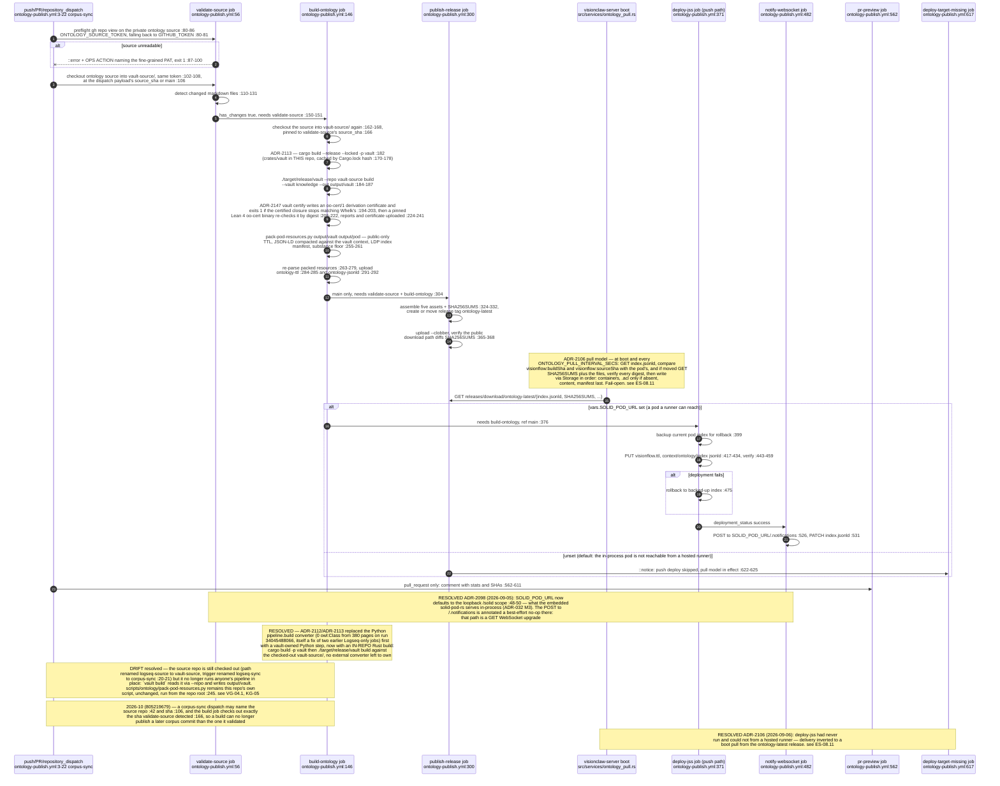

## ES-09.14 VisionClaw xr-godot-ci.yml — gdext + GUT under a GL display, Quest 3 advisory
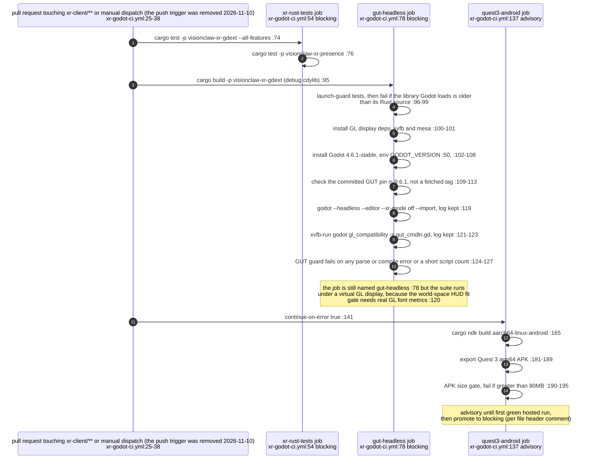

## ES-09.15 agentbox invariants.yml — security invariant gates including loopback-publish
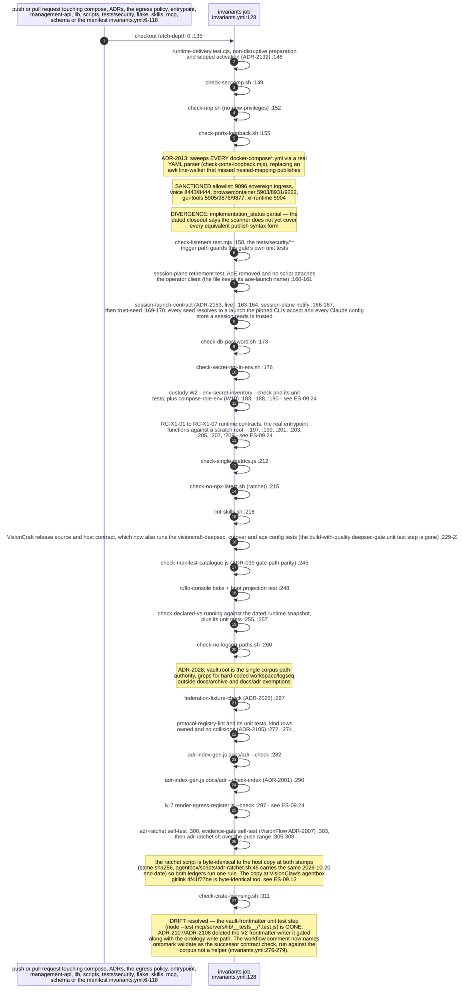

**Open:** ADR-2153 has replaced Agent of Empires and is live, with implementation still recorded partial (`../project/agentbox/docs/adr/ADR-2153-session-plane-replaces-aoe.md:5-7`): the supervisor runs `[program:agentbox-sessions]` and no longer `aoe serve` (`../project/agentbox/flake.nix:2963`), and the invariants job runs the contract and notify steps (`../project/agentbox/.github/workflows/invariants.yml:163-167`) while the surviving regression test keeps its `aoe-launch` filename (`../project/agentbox/.github/workflows/invariants.yml:160-161`).

## ES-09.16 agentbox contract-tests.yml — adapter contract suites
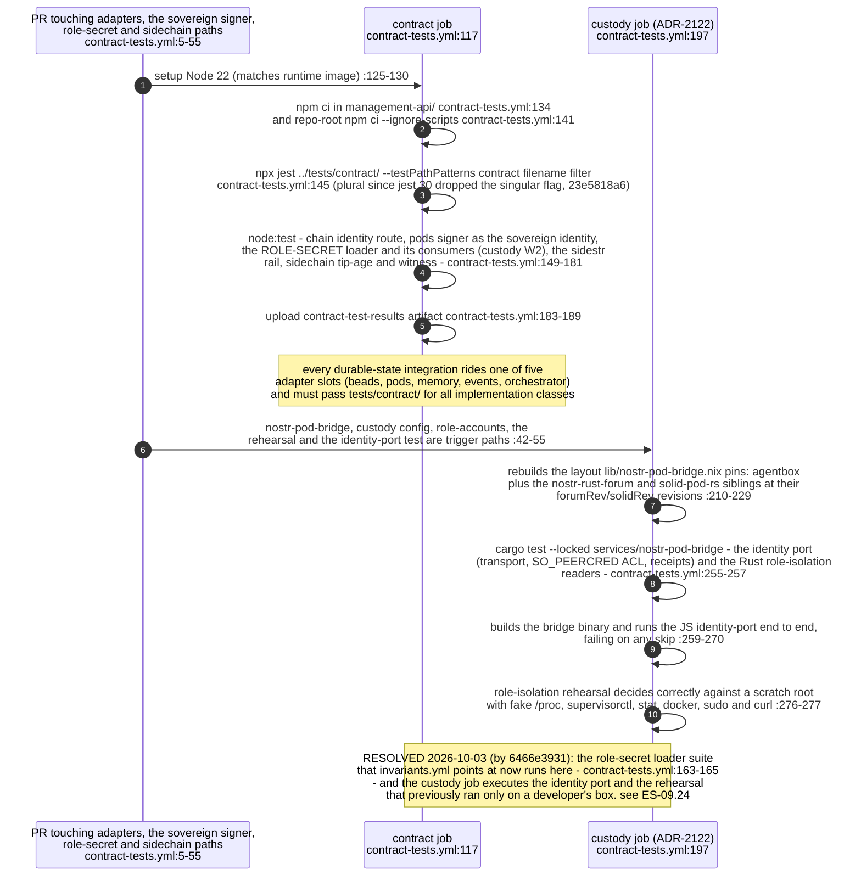

## ES-09.17 agentbox manifest-validate.yml — config validator and TUI round-trip
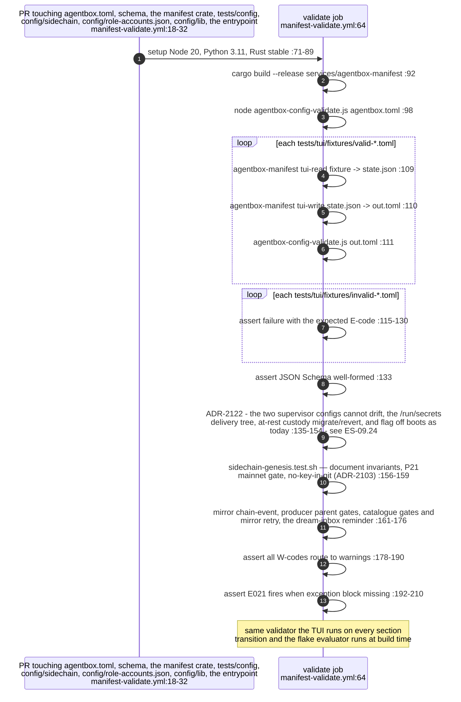

## ES-09.18 agentbox ci.yml aggregate gate, and the structurally-identical workflow family
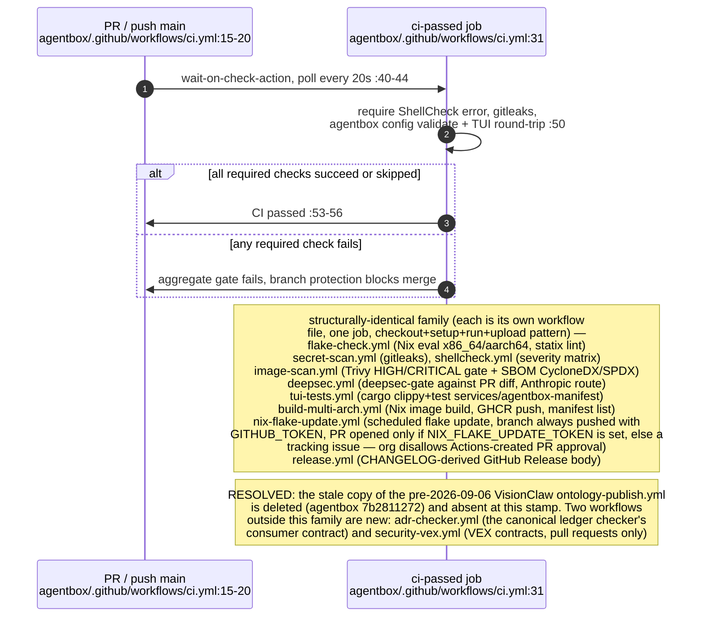

## ES-09.19 End-to-end artefact flow — source to running container
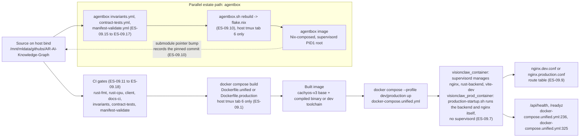

## ES-09.20 The compile-time submodule input — why the dev image mounts agentbox/schema
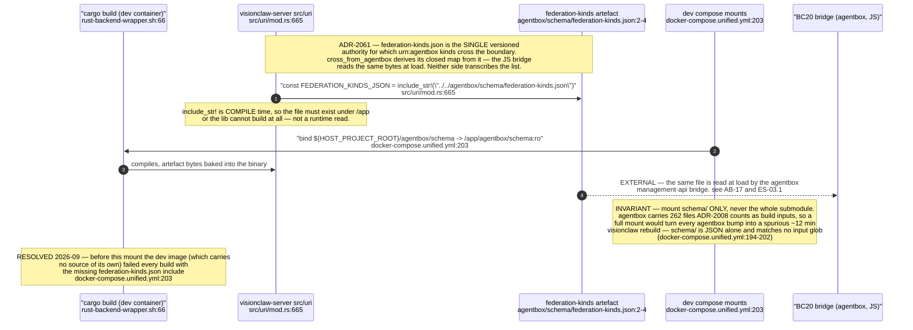

## ES-09.21 scripts/launch.sh — env-file resolution and the two divergent code paths
```mermaid
flowchart TB
    START["launch.sh main()<br/>scripts/launch.sh:1555<br/>PROJECT_ROOT = dirname SCRIPT_DIR :15"]

    subgraph SANCTIONED["Sanctioned path — up / rebuild dev|prod"]
        LOADENV["load_env_config<br/>looks for .env.$ENVIRONMENT :193-194"]
        INGR["prod: resolve_prod_ingress reads VISIONCLAW_INGRESS,<br/>lan or tunnel, anything else exits :200, function :177-190"]
        PRODREQ["production: .env.prod REQUIRED<br/>refuses four forbidden dev settings :205-210<br/>demands concrete values :225-232, the tunnel token only<br/>for tunnel, CORS_ALLOWED_ORIGINS for lan :215-223<br/>hard error if absent :241-244"]
        DEVFALL["dev: falls back to plain .env :246-251<br/>hard error if neither exists :253-254"]
        HPR["HOST_PROJECT_ROOT export :360, :368, :376<br/>— the DinD path translation the schema<br/>mount in ES-09.20 depends on"]
    end

    subgraph LEGACY["rebuild_agent_container — legacy MAD path"]
        CD["cd $PROJECT_ROOT/multi-agent-docker :1021"]
        MK[".env absent -> cp env.example .env :1026-1029<br/>then blocks on an interactive read :1031"]
    end

    START --> LOADENV
    LOADENV --> INGR --> PRODREQ
    LOADENV --> DEVFALL
    LOADENV --> HPR
    START -->|"launch.sh rebuild-agent, scripts/launch.sh:1632-1636"| CD --> MK

    FIX["RESOLVED 2026-09-06 — the auto-create branch tested for a dotted<br/>.env.example that has never existed in the tree, so it always fell<br/>through to the error exit. It now copies env.example, the template<br/>that actually ships (scripts/launch.sh:1026-1029, env.example)."]
    DIV["DIVERGENCE — multi-agent-docker/ is not present in this checkout,<br/>so rebuild_agent_container cds into a missing directory before it<br/>reaches the fixed branch. The repaired .env creation is correct but<br/>currently unreachable; the MAD stack is the deprecated predecessor<br/>whose only surviving trace is the mad-workspace volume. see ES-01.4"]
    INV["INVARIANT ADR-2027 — profile selection is env-file driven, and the<br/>production branch fails closed: a missing or dev-contaminated<br/>.env.prod aborts the launch rather than defaulting. see ES-10"]

    MK --> FIX
    CD --> DIV
    PRODREQ --> INV
```

## ES-09.22 The agentbox invariants gate grew six checks, and each one names the record it enforces
```mermaid
flowchart TB
    TRIG["push or PR touching compose, ADRs, entrypoint, management-api,<br/>lib, scripts, tests/security, flake.nix, skills, mcp, schema<br/>or the manifest<br/>agentbox/.github/workflows/invariants.yml:6-118"]
    JOB["the single invariants job<br/>agentbox/.github/workflows/invariants.yml:128"]
    TRIG --> JOB

    subgraph SKILLS["Skill-estate gates — required before a rebuild"]
        S1["lint-skills.sh, the structure gate<br/>agentbox/.github/workflows/invariants.yml:218"]
        S2["skill-count-check, the SINGLE count authority<br/>agentbox/.github/workflows/invariants.yml:219-220"]
        S3["gen-routing-table --check, routing-table freshness<br/>generated from frontmatter<br/>agentbox/.github/workflows/invariants.yml:222"]
    end
    JOB --> SKILLS

    subgraph CONTRACT["Contract gates"]
        C1["research-gates tests, the deep-research quote, citation<br/>and independence contract<br/>agentbox/.github/workflows/invariants.yml:241-242"]
        C2["check-manifest-catalogue, ADR-039 gate-path parity<br/>agentbox/.github/workflows/invariants.yml:245"]
        C3["federation-fixture-check, the cross-repo identifier<br/>contract from the agentbox side<br/>agentbox/.github/workflows/invariants.yml:266-267"]
    end
    JOB --> CONTRACT

    DEBT["DEBT the workflow records against itself — skill-count-check was<br/>RED and UNWIRED, and the federation fixture check was governed by<br/>a record but never run by anything, found in a script audit. The<br/>fixture's whole point is that both repositories assert the SAME<br/>table rather than two tables that happen to agree, which an<br/>ungated check cannot deliver.<br/>agentbox/.github/workflows/invariants.yml:219,<br/>agentbox/.github/workflows/invariants.yml:262-265"]
    S2 --> DEBT
    C3 --> DEBT

    CAT["INVARIANT ADR-039 — a new manifest gate must arrive with a<br/>CATALOGUE entry carrying an honest apply class, and the parity<br/>check above is what enforces it. Recent module entries: Claude Code<br/>permissions (ADR-2116) and instruction tiers (ADR-2118) and the<br/>collaboration floor (ADR-2144) at boot, claude-cred-sync at<br/>rebuild, skill-router-cascade (ADR-2095) and<br/>routing-teacher-labels (ADR-2110, proposed) at boot, vault-cli<br/>(ADR-2107/2108) at rebuild<br/>agentbox/management-api/lib/system-manifest.js:256, :262, :265, :268, :351, :354, :409"]
    HONEST["2026-10-02 — two entries show the honesty rule working. jev-compaction<br/>moved from boot to REBUILD when factrail landed (ADR-2121), because<br/>the binary and plugin are now gated in flake.nix,<br/>agentbox/management-api/lib/system-manifest.js:271-272. A new sidechain<br/>entry is rebuild-class with three gates,<br/>agentbox/management-api/lib/system-manifest.js:388-389, and stateOf<br/>lets a false parent gate dominate its child gates,<br/>agentbox/management-api/lib/system-manifest.js:462-464. 2026-10-29: interaction-plane moved from boot to REBUILD with ADR-2153,<br/>agentbox/management-api/lib/system-manifest.js:74-76, and nineteen System One consumer entries arrived,<br/>sixteen boot and three rebuild (solid pod, ontomark, vault rank), agentbox/management-api/lib/system-manifest.js:291-347. 2026-10-30: system-one-network arrived at BOOT,<br/>agentbox/management-api/lib/system-manifest.js:280-282. 2026-10-03: the<br/>role-isolation entry first arrived at BOOT, because both supervisor configs<br/>ship in every image; it is now rebuild-class, because the devuser sudo route is<br/>removed at build, agentbox/management-api/lib/system-manifest.js:97-99"]
    CAT --> HONEST
    C2 --> CAT

    CLASS["A boot-class entry is projected by the entrypoint, so a flip takes effect<br/>on the next container restart with no image rebuild. A rebuild-class entry,<br/>such as claude-cred-sync or vault-cli above, needs ./agentbox.sh rebuild.<br/>The three classes are defined at system-manifest.js:28-30."]
    CAT --> CLASS
```

## ES-09.23 The host ADR ledger gates its own staleness, and the gate is opt-in per record
```mermaid
sequenceDiagram
    autonumber
    participant CI as docs-ci workflow<br/>project/.github/workflows/docs-ci.yml:33
    participant GEN as adr-index-gen check<br/>project/scripts/adr-index-gen.js:186
    participant REC as one ADR record's frontmatter
    participant GIT as git

    CI->>GEN: node scripts/adr-index-gen.js docs/adr --check
    GEN->>REC: does it declare verified_paths
    alt no verified_paths
        REC-->>GEN: nothing to check, the loop continues, project/scripts/adr-index-gen.js:207
        Note over GEN: The staleness gate is OPT-IN per record. The abbreviated-SHA<br/>warning fires only for a record that HAS verified_paths,<br/>project/scripts/adr-index-gen.js:204-206, so a record without them gets no nudge
    else verified_paths declared
        REC-->>GEN: verified_commit plus the governed paths
        GEN->>GIT: does the commit exist, and is it an ancestor of HEAD
        alt either answer is no
            GIT-->>GEN: no
            GEN-->>CI: fail, project/scripts/adr-index-gen.js:210-213
        else both yes
            GEN->>GIT: diff those paths from the commit to HEAD
            alt anything changed
                GIT-->>GEN: a non-empty path list
                GEN-->>CI: STALE, re-verify and bump verified_commit,<br/>project/scripts/adr-index-gen.js:217-218
            else nothing changed
                GIT-->>GEN: empty
                GEN-->>CI: the claim still holds
            end
        end
    end

    Note over GEN,CI: DEBT (historical) — at visionclaw f223bbd40 FIFTEEN host records failed this<br/>gate, each naming the governed path that moved under it. This audit did not<br/>re-run the gate at the stamp, so the current count is not known,<br/>project/scripts/adr-index-gen.js:217-218.
    Note over CI: INVARIANT — the gate is wired into the docs workflow rather than<br/>left to a habit: invalid frontmatter, asymmetric supersession<br/>edges and stale verification claims all fail the build,<br/>project/.github/workflows/docs-ci.yml:33. see VF-01
    Note over CI: SECOND AND THIRD LEDGER GATES — the same job runs the ratchet's<br/>evidence-gate self-tests and then the ratchet itself, project/.github/workflows/docs-ci.yml:34-43.<br/>Staleness asks whether a claim still holds, the ratchet asks whether the<br/>proposed backlog grew, project/scripts/adr-ratchet.sh:115-126, and whether a<br/>closing record carries its evidence, project/scripts/adr-ratchet.sh:81-113. see ES-09.12
    Note over REC: Presence of verified_paths is what ARMS the gate, which is why<br/>a record can be honestly unverified without failing CI,<br/>project/scripts/adr-index-gen.js:207. A proposed or rejected record may also<br/>leave verified_commit empty, project/scripts/adr-index-gen.js:118-121.
```

**Drift (comment vs code):** the block comment says records without `verified_paths` "only get a soft nudge toward full 40-char SHAs" (`../project/scripts/adr-index-gen.js:190-191`), but the nudge is guarded on `verified_paths` being a non-empty list (`../project/scripts/adr-index-gen.js:204`), and those records skip the block at `:207`. A record with no `verified_paths` therefore gets no message at all. Either the comment or the guard should change; source tracing alone cannot say which one the authors meant.

## ES-09.24 Custody X-1 step 1 in agentbox CI — what is gated, and the two suites nothing runs

```mermaid
flowchart TB
    subgraph INV["invariants.yml, every push touching scripts, lib, the entrypoint or the egress policy"]
        I1["env-secret-inventory --check: every env name the boot path and the<br/>role-secret consumers read sits in exactly one class, names only<br/>agentbox/.github/workflows/invariants.yml:182-183"]
        I2["its unit tests, compose-role-env W10, then the RC-X1-01..07<br/>runtime contracts - the real entrypoint functions against a<br/>scratch root, no Docker, no root<br/>agentbox/.github/workflows/invariants.yml:187-209"]
        I3["N-7: the SECURITY-profiles egress table must match egress-policy.json,<br/>and an unmarked gap fails - agentbox/.github/workflows/invariants.yml:296-297"]
    end
    subgraph MV["manifest-validate.yml, on the role table, config/lib or the entrypoint"]
        M1["the two supervisor configs cannot drift: only role programs' user=<br/>and environment= differ - agentbox/.github/workflows/manifest-validate.yml:135-140"]
        M2["/run/secrets delivery builds the right owner and mode tree, chown stubbed,<br/>plus at-rest custody migrate/revert - agentbox/.github/workflows/manifest-validate.yml:142-151"]
        M3["with role_isolation off the boot is today's<br/>agentbox/.github/workflows/manifest-validate.yml:153-154"]
    end
    subgraph TUI["tui-tests.yml, on services/agentbox-manifest and services/agentbox-sessions"]
        T1["cargo test agentbox-manifest, which carries the role_accounts unit tests<br/>agentbox/.github/workflows/tui-tests.yml:77"]
        T2["NEW with ADR-2153: clippy and cargo test agentbox-sessions on a private tmux server,<br/>then the Node/Rust launch-contract parity<br/>agentbox/.github/workflows/tui-tests.yml:105-122"]
        T3["NEW 2026-10-30: the tab0-bridge follows the session plane, readiness against a fake daemon on a unix socket<br/>agentbox/.github/workflows/tui-tests.yml:124-147"]
        T1 --> T2
        T2 --> T3
    end
    subgraph CT["contract-tests.yml custody job, NEW 2026-10 for ADR-2122"]
        C1["cargo test nostr-pod-bridge: the identity port's transport, SO_PEERCRED<br/>ACL and receipts, and the Rust role-isolation readers<br/>agentbox/.github/workflows/contract-tests.yml:255-257"]
        C2["identity port end to end, JS client against the built bridge binary,<br/>a skip fails the job - agentbox/.github/workflows/contract-tests.yml:265-270"]
        C3["role-isolation rehearsal decides correctly against a scratch root<br/>agentbox/.github/workflows/contract-tests.yml:276-277"]
        C1 --> C2
    end
    subgraph BC["browsercontainer.yml, for W9"]
        B1["best-effort fetch of the pinned Podkey artefact, continue-on-error<br/>agentbox/.github/workflows/browsercontainer.yml:50-54"]
        B2["fetch-podkey pin, sha256 and content, launch flags, podkey-ctl<br/>load-once, the profile volume - agentbox/.github/workflows/browsercontainer.yml:56-66"]
        B1 --> B2
    end
    subgraph NONE["Custody tests no workflow runs at this revision"]
        N1["the G-5 dual-admit key-split suite<br/>agentbox/tests/sovereign/g5-key-split.node-test.js:3"]
        N2["the baked-producer test, the producer runs the bake<br/>agentbox/tests/config/sidechain-producer-baked.test.sh:2"]
    end
    INV ~~~ MV
    MV ~~~ TUI
    TUI ~~~ CT
    CT ~~~ BC
    BC ~~~ NONE
    NONE --> D["RESIDUAL DEBT: the G-5 dual-admit and the baked-producer bake have<br/>no CI step; everything else custody needs - the port's uid admission,<br/>the role-only reads, PATH and the one-shot Stage B - is now executed<br/>by invariants and the custody job"]
```

**Debt (custody tests vs CI), RESOLVED at agentbox 6466e3931 except two suites:** through 2026-10-03 only the env-class inventory, RC-X1-06, the supervisor-drift, delivery and flag-off boot tests, the manifest crate's unit tests and the browsercontainer tests were wired. Now the RC-X1-01..07 runtime contracts run in invariants (`../project/agentbox/.github/workflows/invariants.yml:196-209`), and a `custody` job in contract-tests builds the bridge and runs the identity port's Rust and JS suites plus the rehearsal, failing on skips (`../project/agentbox/.github/workflows/contract-tests.yml:255-277`). The G-5 dual-admit key-split suite (`../project/agentbox/tests/sovereign/g5-key-split.node-test.js:3`) and the baked-producer test (`../project/agentbox/tests/config/sidechain-producer-baked.test.sh:2`) still have no step.

**Drift (invariants.yml comment vs contract-tests.yml), RESOLVED:** the invariants job's env-secret-inventory label used to claim the role-secret loader "runs in contract-tests" with no such step existing — the workflow now records that honestly (`../project/agentbox/.github/workflows/invariants.yml:184-186`), and the step it names is real: contract-tests runs the loader and its consumers (`../project/agentbox/.github/workflows/contract-tests.yml:163-165`).


**Drift (31 October audit):** Unset thresholds do not imply that every consumer accepts nothing. Codescape accepts an offered view command at confidence exactly one; see [VC-42](../visionclaw/42-codescape-command-policy-and-runtime-artefacts.md). The deployment topology retains its historical pins.
