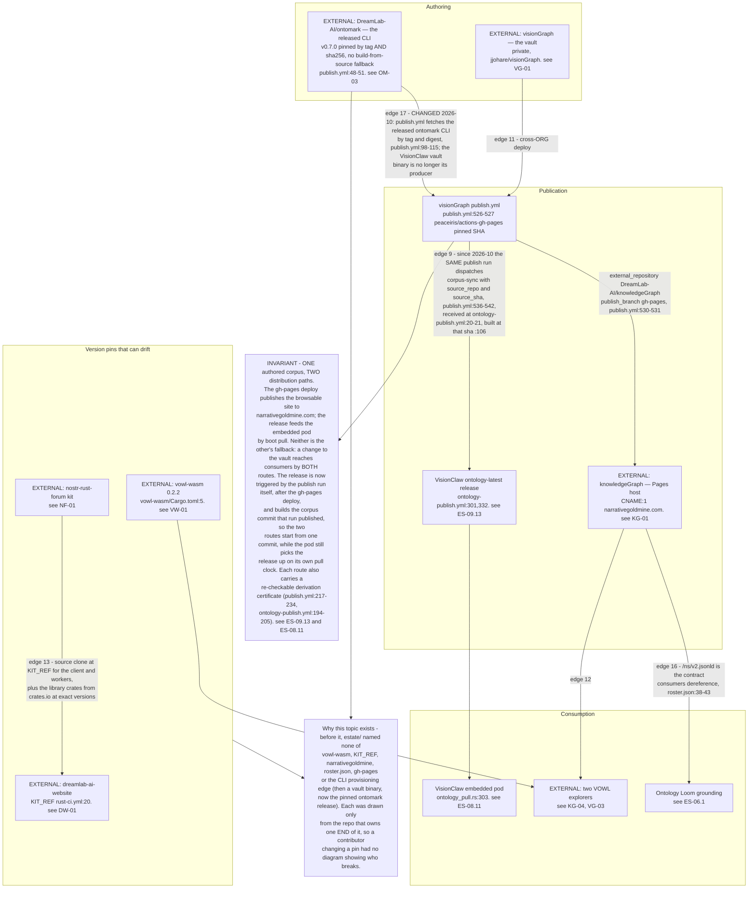
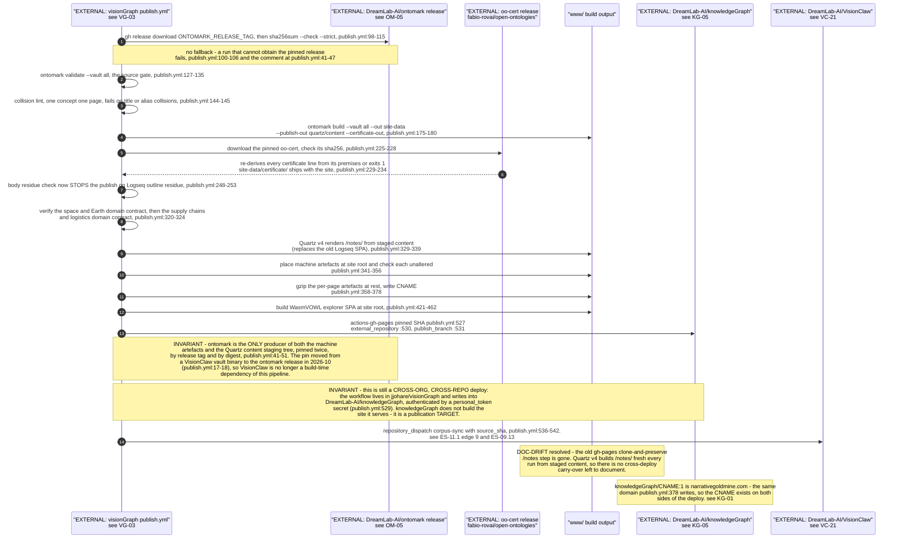
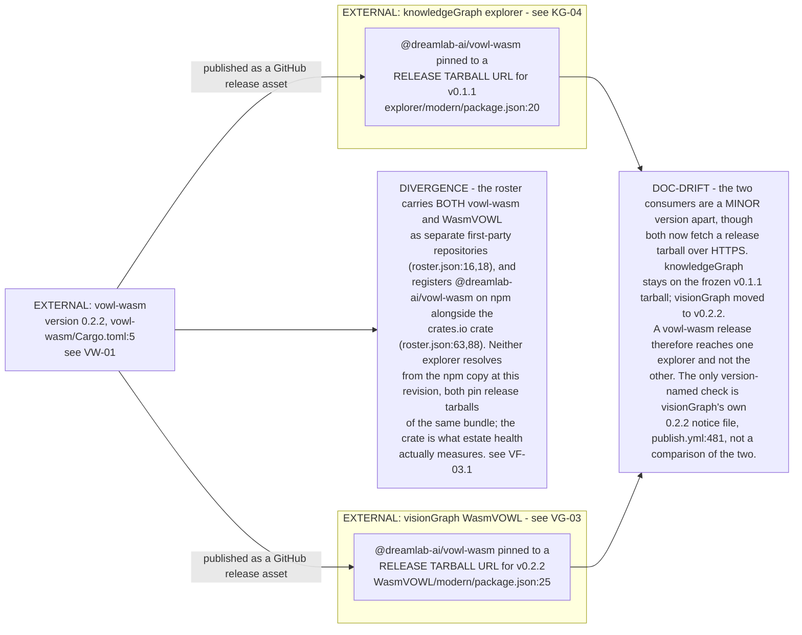
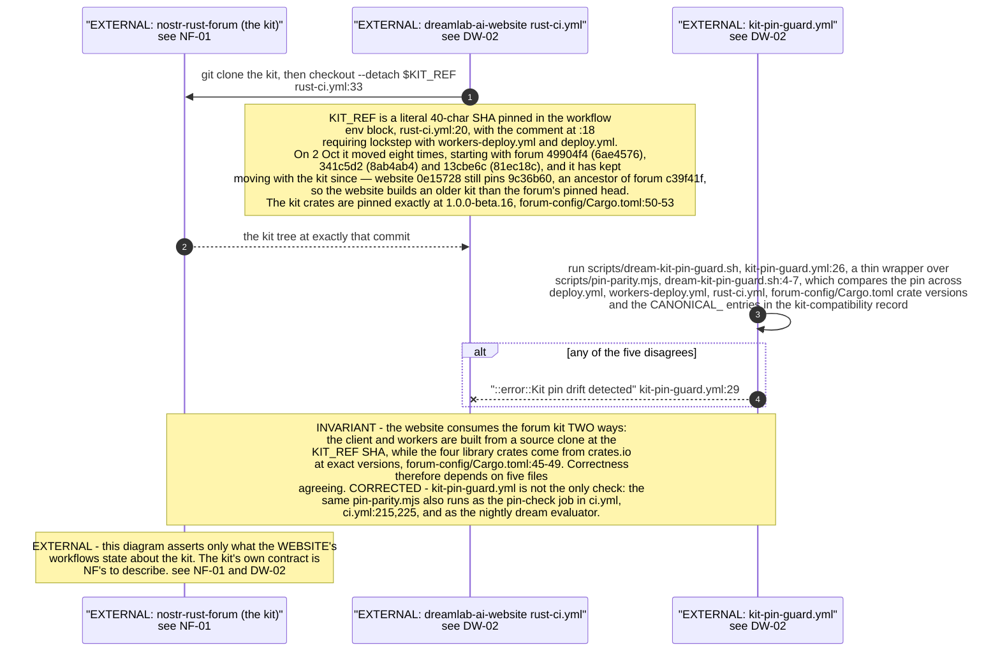
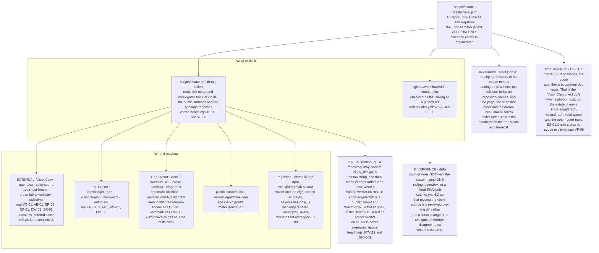

## ES-11.1 The publishing axis — six cross-repo edges, each previously drawn from one side only

## ES-11.2 Edge 11 - visionGraph publishes into another org's repo, now via a pinned ontomark release, a certificate re-check and Quartz notes

## ES-11.3 Edge 12 - two VOWL explorers, two divergent bundle pins

## ES-11.4 Edge 13 - the forum kit pin, and the gate that keeps five files in lockstep

**Drift (corrected 2026-11-02):** ES-11.4 said `kit-pin-guard.yml` was the only check on the five pin sites. At website `0e15728` that workflow only runs `scripts/dream-kit-pin-guard.sh` (`../dreamlab-ai-website/.github/workflows/kit-pin-guard.yml:26`), a wrapper whose logic lives in `scripts/pin-parity.mjs`. The same script runs as the `pin-check` job (`../dreamlab-ai-website/.github/workflows/ci.yml:215,225`) and in the dream cycle (`../dreamlab-ai-website/scripts/dream-kit-pin-guard.sh:4-7`). In ES-11.1 the ontomark pin read v0.6.0. visionGraph `556a015` pins v0.7.0 with a new digest (`../visionGraph/.github/workflows/publish.yml:49-51`).

## ES-11.5 Edges 14 and 15 - the roster is the estate's only enumeration, and what reads it

