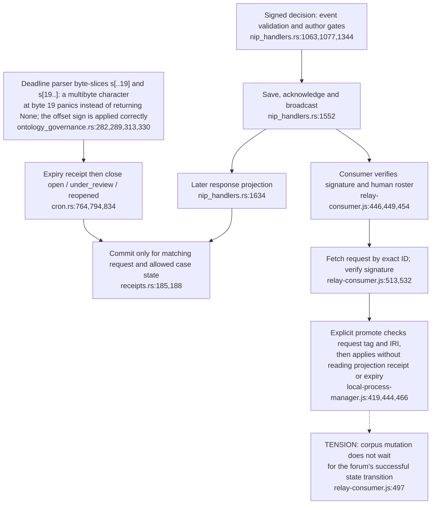
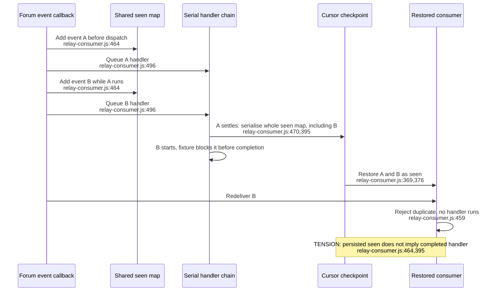

## For developers

A stored decision, a projected case transition and an applied corpus change have separate receipts. This topic follows the crossings where they can disagree, then follows the consumer's restart checkpoint. [Signed local fixtures](../../estate-review/2026-10-31-governance-ingress.md) exercise Agentbox ingress and the installed CLI; deployed relay, D1 and browser behaviour remain outside those fixtures.

## For the business

A human decision needs both a reliable effect and a reliable record. A deadline on the review case does not protect the corpus if its writer ignores that deadline. A delivery checkpoint must also distinguish completed work from a decision still waiting to finish, so restarting a service does not silently suppress it.

## ES-13.1 Storage broadcast, projection and mutation are separate boundaries

**What it shows.** Projection failure can coexist with a stored, broadcast decision. The consumer's independent path does not turn a closed forum row into a mutation veto. The parser adds a separate malformed-input risk.

**Why it is this way.** ADR-2013 implements expiry as a case transition. Agentbox ADR-2109 applies the human event directly. The audit verifies the consumer gap with signed expired-proposal fixtures, while the whole deployed crossing remains untested. **Tension:** the Agentbox apply path has no expiry or projection input. The orchestrator checks the request's `d` tag and IRI, then calls `applyOntologyDecision` (`../project/agentbox/management-api/adapters/orchestrator/local-process-manager.js:444,449,466`), and no non-test agentbox source reads `stale_after`. A decision the forum has already closed as expired is still applied. **Debt:** `parse_rfc3339_utc` checks the byte length, then indexes the string with `s[..19]` and `&s[19..]` (`../nostr-rust-forum/crates/nostr-bbs-core/src/ontology_governance.rs:284,289,313`). A `stale_after` value whose 20th byte falls inside a multibyte UTF-8 character panics on the relay's proposal admission path (`../nostr-rust-forum/crates/nostr-bbs-relay-worker/src/relay_do/nip_handlers.rs:417`), where the doc comment promises `None` for anything the parser will not vouch for (`../nostr-rust-forum/crates/nostr-bbs-core/src/ontology_governance.rs:246-250`). `s.get(..19)` would close it. This is source reading only: no panic was reproduced.

## ES-13.2 A checkpoint can include a later unfinished decision

**What it shows.** The checkpoint records shared receipt state, not just completed work. A deterministic snapshot/restore fixture reproduced suppression of B before its original handler completed.

**Why it is this way.** The consumer serialises handlers to avoid concurrent Git index operations, but marks delivery in a shared map before that serial boundary. Its completion callback persists all deliveries. Governance records remain on disk, but omit the original signature; recovery by another reconciler was not demonstrated. **Drift:** the comment above `settle` says a crash mid-apply leaves the decision re-deliverable (`../project/agentbox/mcp/nostr-bridge/relay-consumer.js:466-469`). That holds only for the event whose handler is running when the process stops. A later event already added to `seen` (`../project/agentbox/mcp/nostr-bridge/relay-consumer.js:464`) is persisted by the earlier event's `settle` (`../project/agentbox/mcp/nostr-bridge/relay-consumer.js:473,395`) and is lost on restart.
