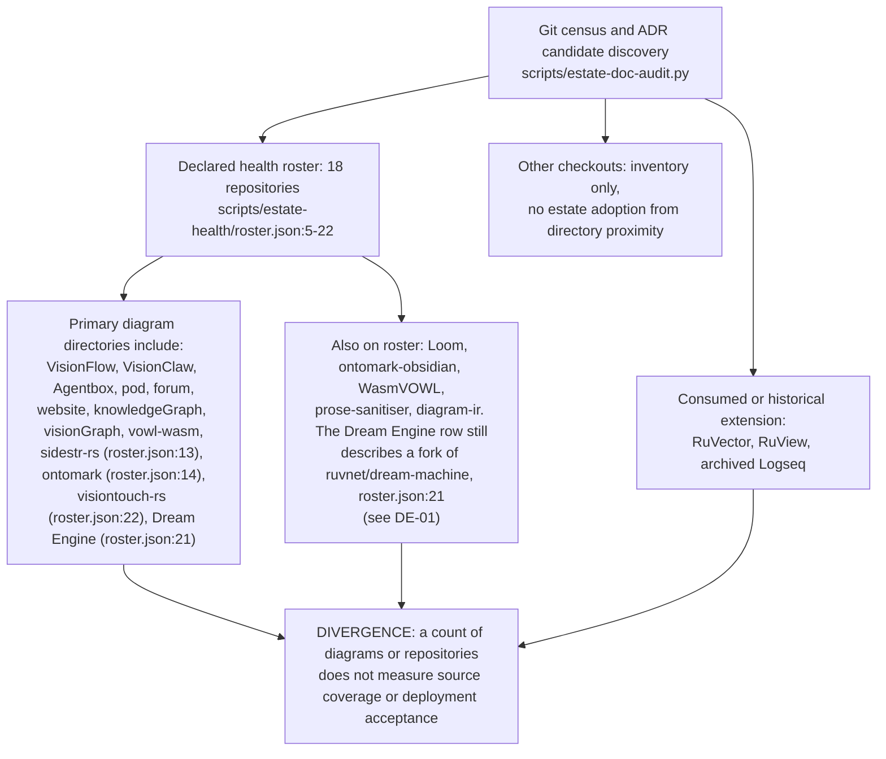
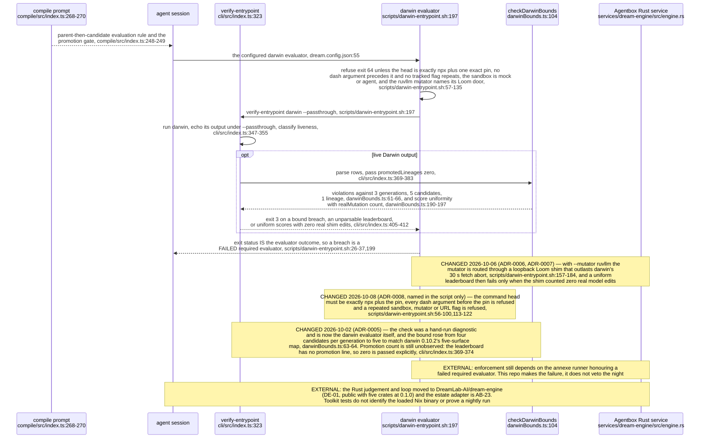
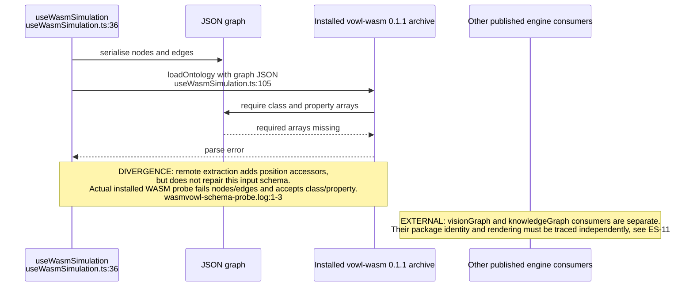
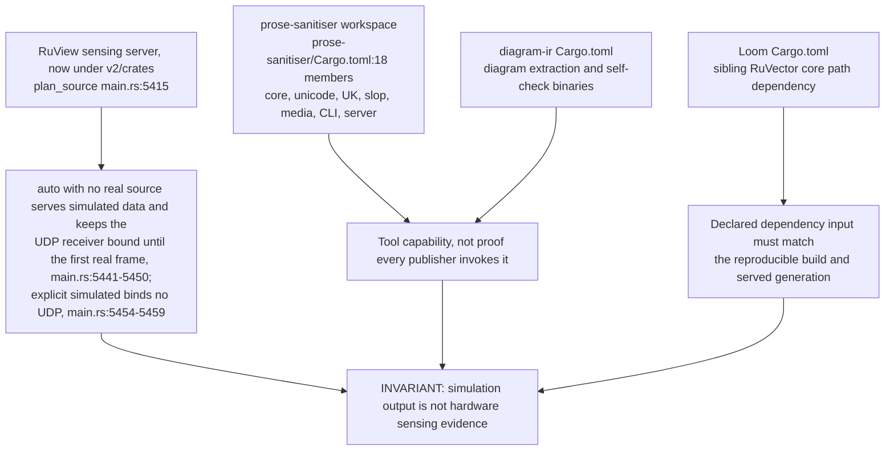
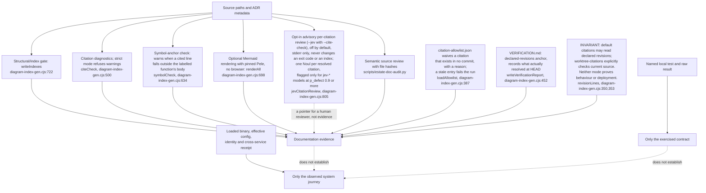

## ES-90.1 Three scopes — health roster, source review and workspace neighbours

## ES-90.2 Archived TypeScript fork: compiler, diagnostic and runtime are separate paths

**Drift:** the toolkit this diagram traces is no longer the estate's dream engine. The previous TypeScript fork is renamed DreamLab-AI/dream-machine and archived, and the slug DreamLab-AI/dream-engine now belongs to the Rust repository that holds the extracted judgement and loop crates (mapped in DE-01; its workspace declares dream-core and dream-cli at 0.4.0, `../dream-engine/Cargo.toml:11`, with dream-gate at 0.3.0, `../dream-engine/crates/dream-gate/Cargo.toml:3`; the agentbox adapter pins `dream-core =0.4.0` and `dream-gate =0.3.0`, `../project/agentbox/services/dream-engine/Cargo.toml:26-27`). The Darwin path drawn above is not carried into it: the Rust core keeps only a readiness refusal for a darwin entrypoint run without a sandbox flag, a safety check that appends a problem to the admission report and mutates nothing (`../dream-engine/crates/dream-core/src/readiness.rs:228-232`). The estate adapter is AB-23.

**Drift:** `darwin-entrypoint.sh` cites ADR-0008 for the exact `npx <pin>` head rule (`../dream-machine/scripts/darwin-entrypoint.sh:36,113`) while the archived repository's decision records stop at ADR-0007 (`../dream-machine/docs/adrs/ADR-0007-darwin-mutator-loom-shim.md:1`); the toolkit paths above were re-read at `b77093e`, where only the entrypoint script among them had changed since `6426583`.

## ES-90.3 WasmVOWL demo is a separate consumer from the published engine

## ES-90.4 Tool packages and sensing remain distinct acceptance surfaces

## ES-90.5 Evidence types do not imply one another

