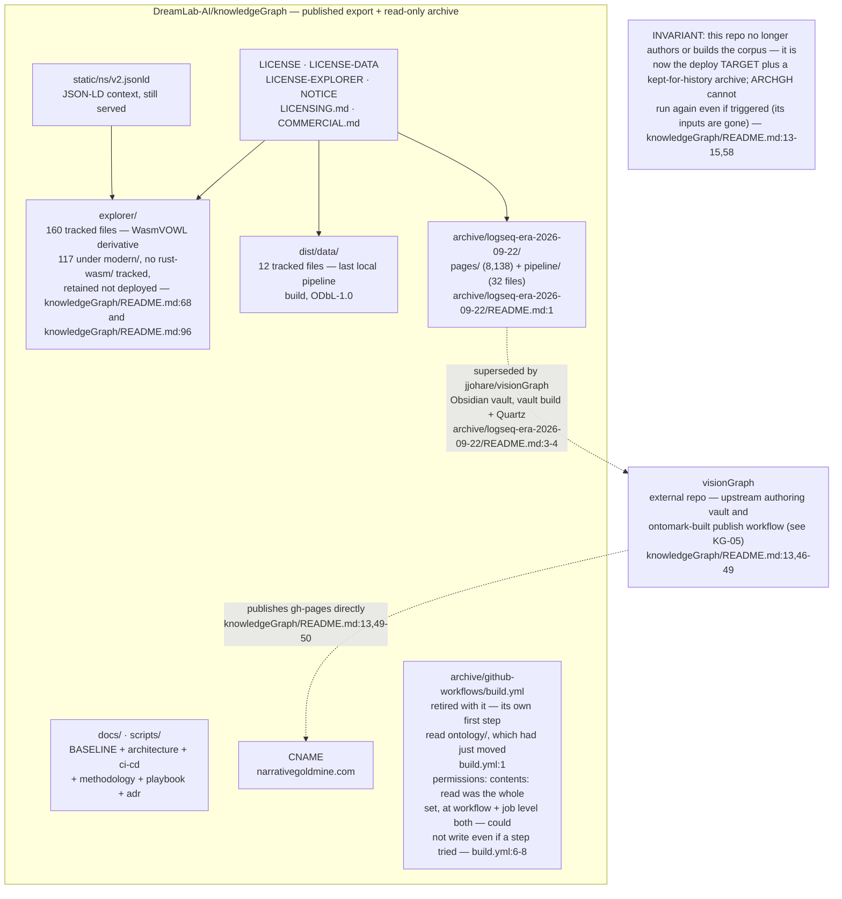
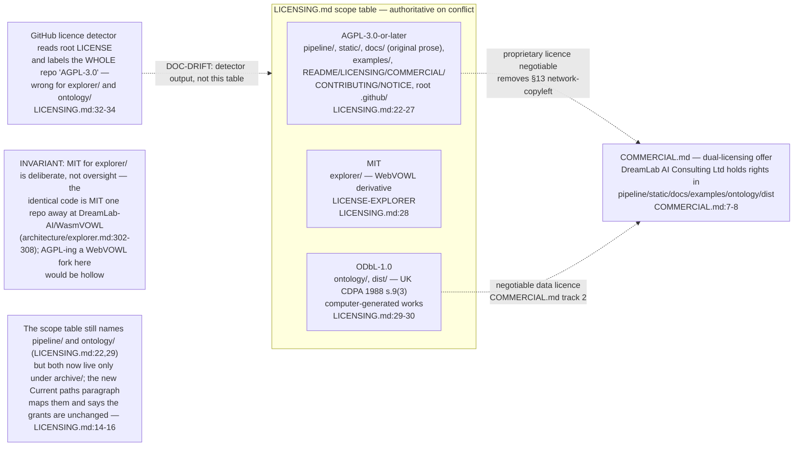

## KG-01.1 Repository composition — a published corpus, a retired local pipeline, a live viewer

## KG-01.2 Licensing scope — three licences, one repository, one governing file

**Drift:** `LICENSING.md` describes `explorer/` as having a `rust-wasm/` subtree (`../knowledgeGraph/LICENSING.md:60`) and its scope table still lists `pipeline/` and `ontology/` at their pre-archive paths (`../knowledgeGraph/LICENSING.md:22`), while the tree tracks no `explorer/rust-wasm/` and keeps the corpus and pipeline only under `archive/logseq-era-2026-09-22/` (`../knowledgeGraph/README.md:64`); the paragraph added on 21 October 2026 maps the moved paths but leaves the table and the explorer description as written (`../knowledgeGraph/LICENSING.md:14-16`).
