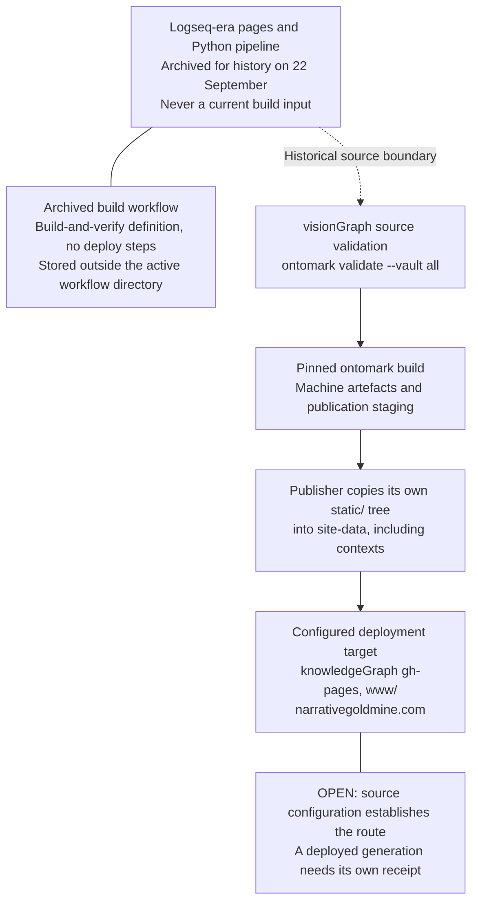
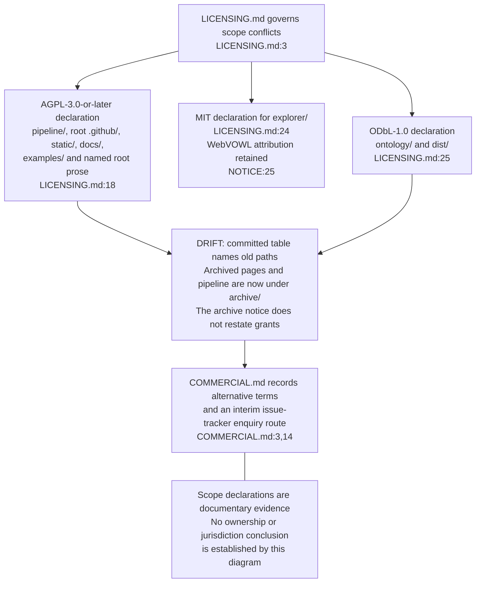

## For developers

Separate the retained main-branch source from the configured publisher and deployment branch; the [dated review](../../estate-review/2026-11-01-knowledgegraph-consumers-and-archive.md) records the tree census and committed licence-path drift.

## For the business

A reader can identify which component a licence statement covers without treating the repository's root licence as a grant over every asset; this map records repository declarations, not an independent determination of ownership or enforceability.

## KG-01.1 Retained source and configured publication

**What it shows:** The archived source and workflow are separate from the current publisher's validation, build and deploy configuration.
**Why it is this way:** The archive notice records the authoring migration; the active workflow identifies the producer and destination without proving a particular deployment succeeded.

## KG-01.2 Recorded grants and the unresolved archive-path mapping

**What it shows:** Three documented licence scopes coexist, but the committed table has not mapped the moved archive paths.
**Why it is this way:** The repository retained its historical licence documents through the migration; the audit preserves their declarations and records the path gap without silently importing an uncommitted correction.
