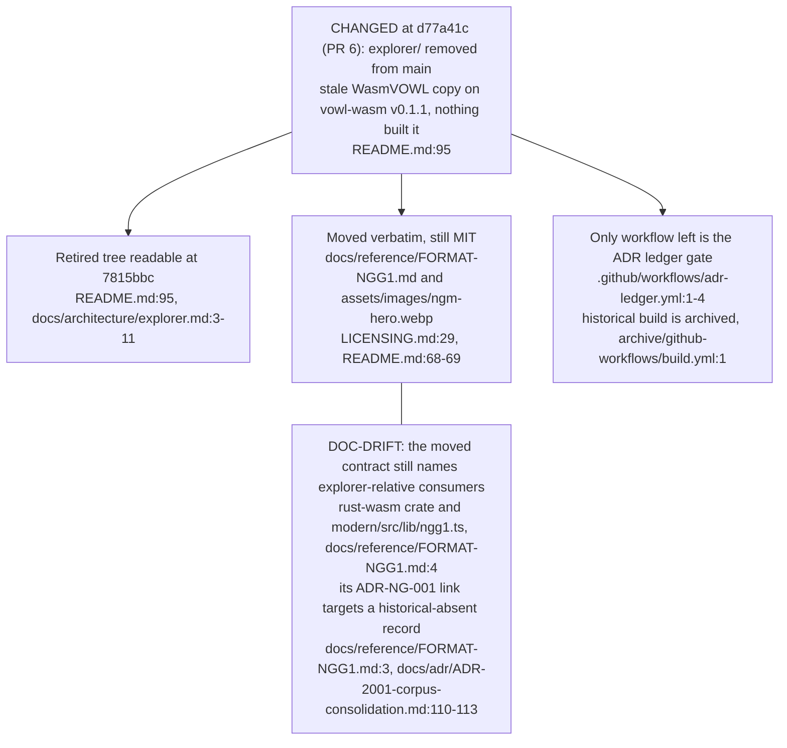
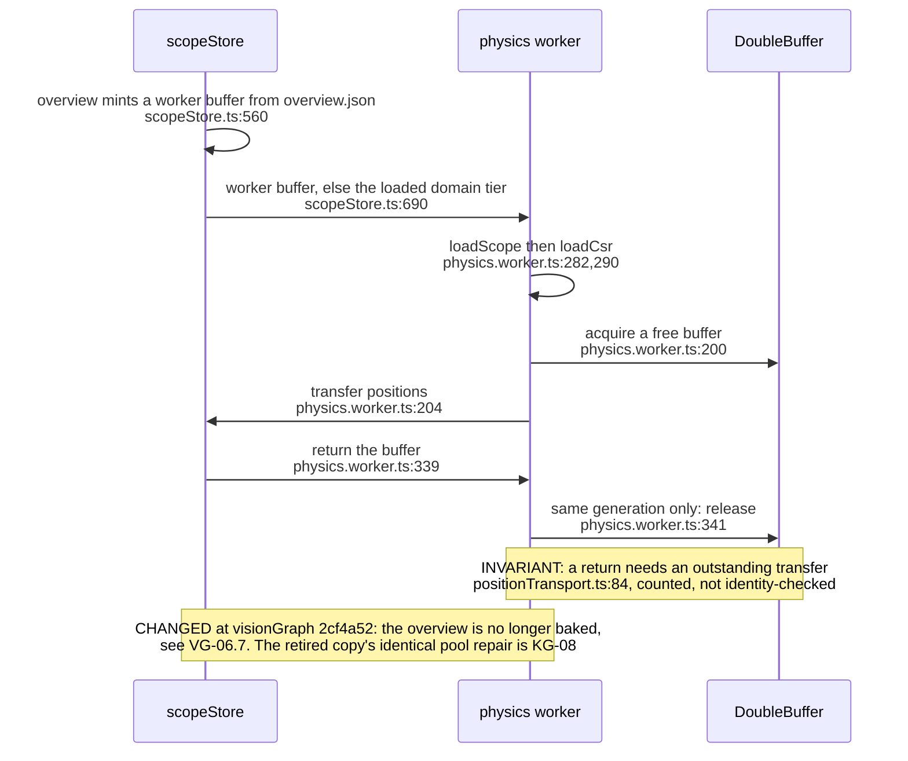
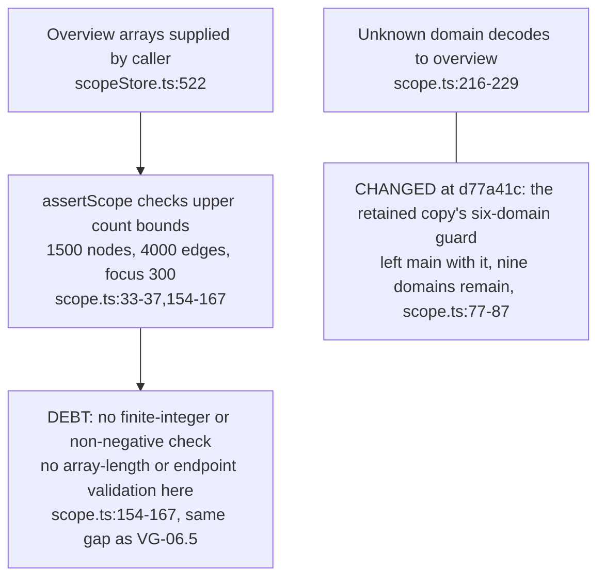
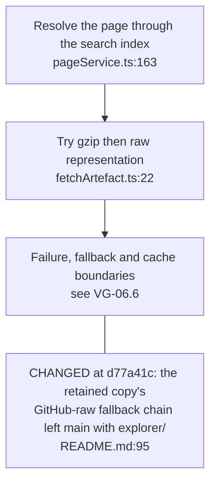
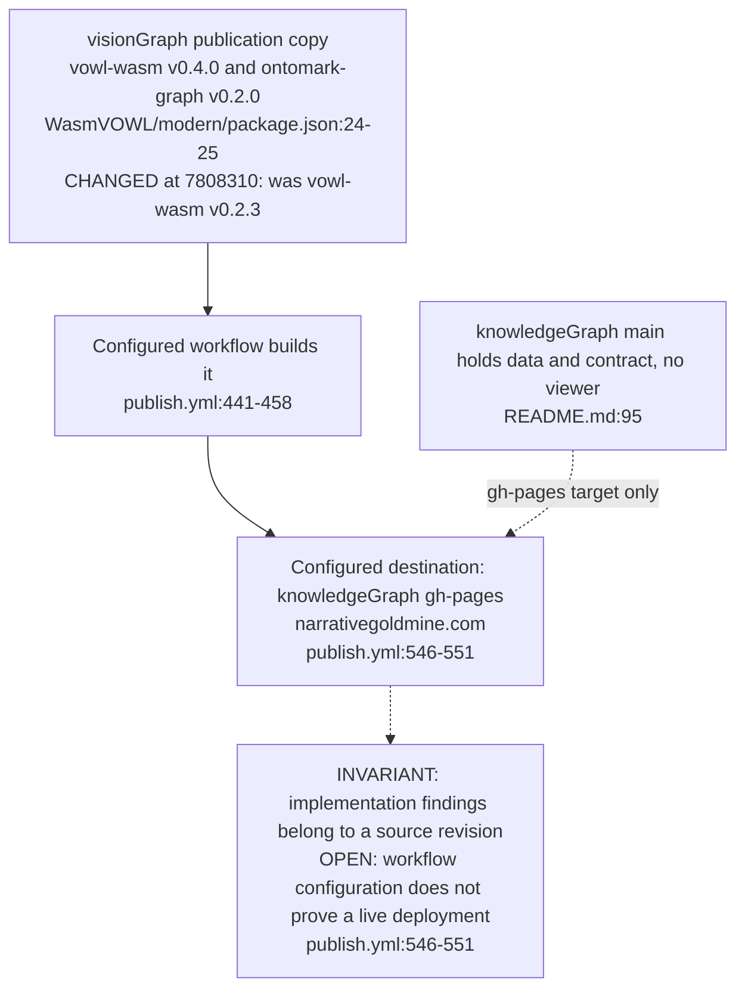

**Retirement note — 2026-11-23:** knowledgeGraph PR 6 (`d77a41c`) removed the retained `explorer/` copy from main. Every panel below is redrawn at `22c9bb8`; the retired tree's findings stay readable at `7815bbc` in this topic's git history and in [KG-08](08-transfer-pool-repair.md).

## For developers

Nothing in knowledgeGraph builds a viewer any more. What stayed is the committed NGG1 tier data and its contract, now at docs/reference/FORMAT-NGG1.md; the only explorer source is visionGraph's publishing copy (VG-06), which this topic follows for scope, transfer and page boundaries.

## For the business

The public graph at narrativegoldmine.com/graph/ is built from one source tree only, so there is no second, stale copy to confuse with it. Findings about the old copy no longer describe anything on main.

## KG-04.1 What PR 6 removed, moved and kept

**What it shows:** the retirement is a removal plus two moves; the architecture document keeps its old body behind a dated banner rather than being rewritten.
**Why it is this way:** the PR's stated reason is that nothing here built or deployed the copy (`README.md:95`); historical records keep their `explorer/` paths and resolve at `7815bbc`.

## KG-04.2 Tier and transfer flow — now only in the visionGraph copy

**What it shows:** the transfer contract this topic used to trace in the retained copy now exists only in the visionGraph tree, and the overview joins it.
**Why it is this way:** with the copy gone, the pool and overview behaviour that the public site depends on are the visionGraph ones; KG-08 keeps the retired repair at its own stamp.

## KG-04.3 Scope contract — count ceilings after selection

**What it shows:** the guard that survives is the visionGraph one; it carries the same upper-bound-only limits the retained copy had.
**Why it is this way:** builders bound displayed detail; stronger data-shape guarantees still have to come from another boundary.

## KG-04.4 Page content — the surviving fetch path

**What it shows:** page prose reaches readers only through the visionGraph reader; its debts are recorded once, in VG-06.6.
**Why it is this way:** keeping one reader removes the duplicated fallback rules this panel used to contrast.

## KG-04.6 Configured publisher builds the only viewer tree

**What it shows:** the inspected publisher builds the visionGraph tree into knowledgeGraph's gh-pages; there is no longer a second tree to distinguish.
**Why it is this way:** knowledgeGraph ADR-2001 requires an identified consumer build; the retirement makes that identity unambiguous without proving which revision is served.
