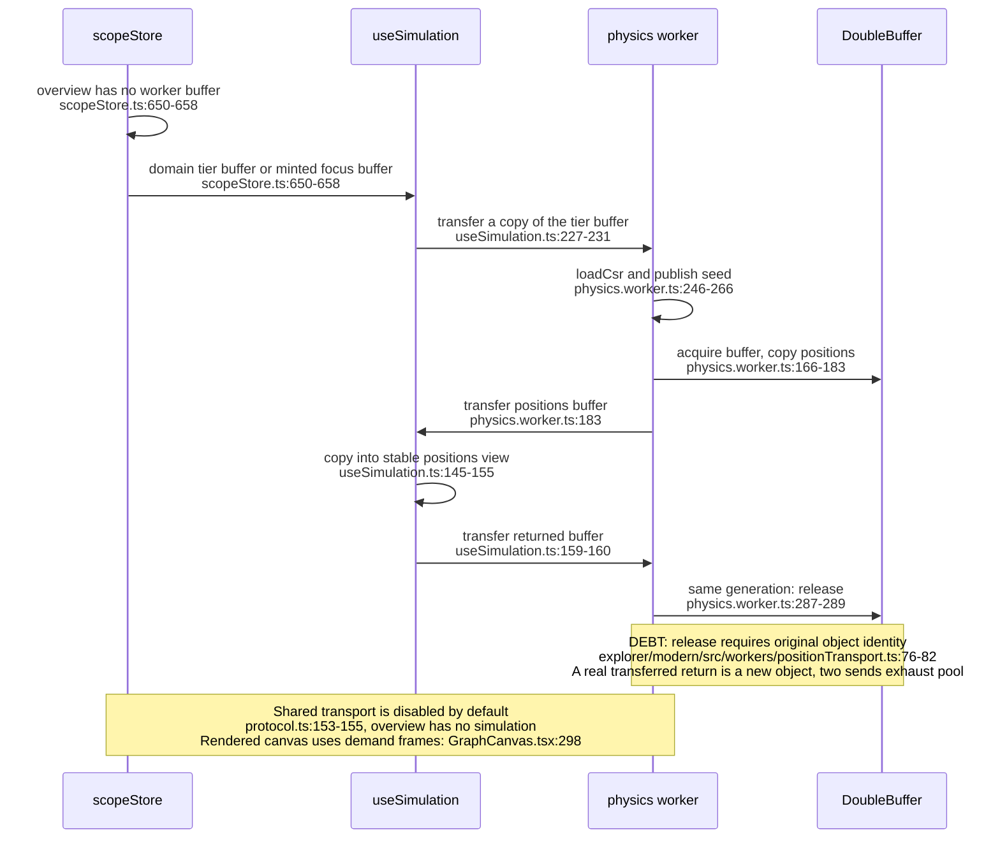
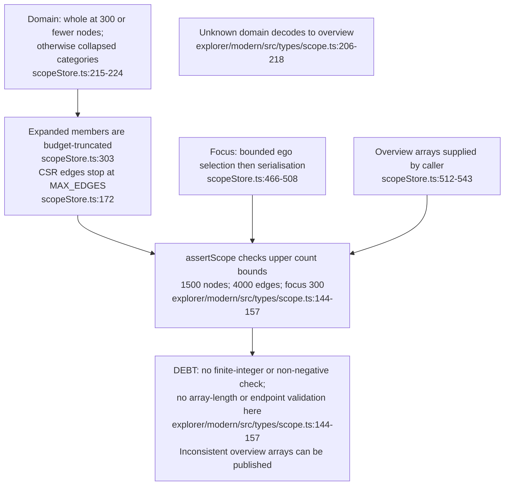
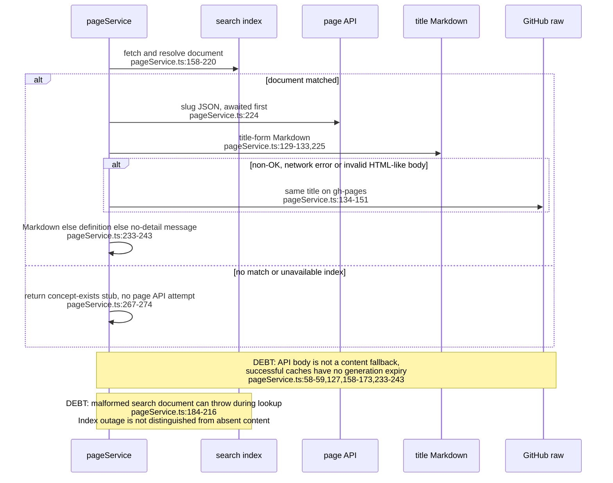
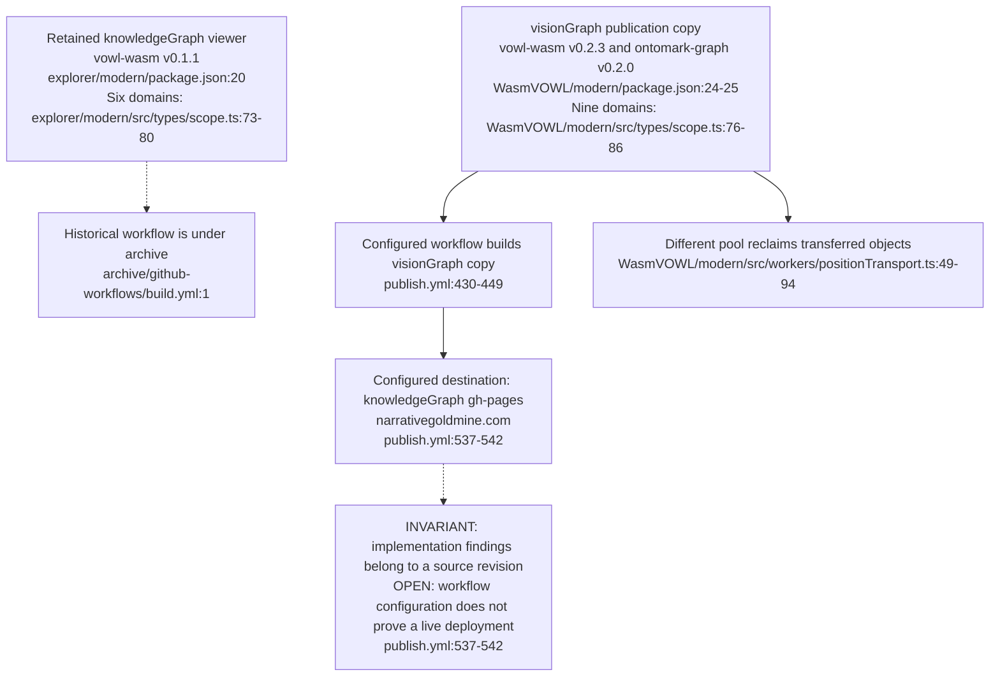

**Repair note — 2026-11-03:** selected counterexamples below have a [scoped successor verification](08-transfer-pool-repair.md). This historical topic retains its declared source revision; the successor states the repaired contracts and acceptance boundaries.

## For developers

This topic distinguishes the retained knowledgeGraph viewer from visionGraph's configured publication copy. Follow the scope, transfer and page-content boundaries before reusing it; [the dated assessment](../../estate-review/2026-11-01-knowledgegraph-explorer-contracts.md) records probes and the knowledgeGraph ADR-2001 section dispositions.

## For the business

A successful viewer build does not establish a working browsing journey. The retained viewer can stop receiving positions and can describe an unavailable page as an unfinished concept; the configured publishing copy has a different buffer pool, so those results cannot be generalised to the public site.

## KG-04.1 Retained viewer topology and legacy routing

```mermaid
flowchart TB
    ROUTER["Lazy routes: home, page, graph, search, data, about<br/>router.tsx:35-41"]
    GP["GraphPage imports the graph route<br/>router.tsx:37"]
    WORKER["Worker creates NggExplorer<br/>physics.worker.ts:235-242"]
    WASM["External vowl-wasm v0.1.1 release tarball<br/>explorer/modern/package.json:20"]
    OLD["Legacy ontology path redirects to graph<br/>query string preserved; path nodeId dropped<br/>router.tsx:48-50,87-88"]
    ROUTER --> GP --> WORKER --> WASM
    ROUTER --> OLD
    DRIFT["DRIFT: architecture still names an in-tree Rust crate<br/>docs/architecture/explorer.md:10<br/>ADR-2001 retains historical-absent decision lineage<br/>docs/adr/ADR-2001-corpus-consolidation.md:112"]
    WASM -.-> DRIFT
```

**What it shows:** The retained SPA loads the graph through a lazy route and an external WASM package. The legacy redirect preserves query parameters but does not translate the path's node identity.

**Why it is this way:** knowledgeGraph ADR-2001 preserves missing historical decisions as absent rather than inventing authority; the package pin is the current dependency evidence.

## KG-04.2 Tier and transfer flow — overview is baked

**What it shows:** Worker positions cross a transfer boundary; the retained pool rejects the returned objects. A Node MessageChannel probe reproduces exhaustion, while the visionGraph counterpart reclaims four successive transfers.

**Why it is this way:** The worker uses two reusable buffers to bound allocation; its object-identity ownership check conflicts with actual transfer semantics. This is a source and transport finding, not a deployed-browser measurement.

## KG-04.3 Scope contract — count ceilings after selection

**What it shows:** Selection can truncate before the guard runs. Upper count limits are enforced, but the guard alone does not establish a structurally valid render model.

**Why it is this way:** The builders bound displayed detail to keep scopes manageable; stronger data-shape guarantees must come from another boundary and are not supplied by this assertion.

## KG-04.4 Page content — failure, fallback and cache boundaries

**What it shows:** Page metadata and prose are fetched sequentially after index resolution. External fallback applies beyond 404, and successful responses remain cached for the module lifetime.

**Why it is this way:** The reader combines structured metadata with cleaned Markdown. Its fallback paths favour displaying something, but do not preserve the distinction between missing content and failed retrieval.

## KG-04.6 Configured publisher uses a different viewer tree

**What it shows:** The inspected publisher chooses the visionGraph tree, whose dependencies, domains and pool differ from this retained viewer. The diagram establishes configured provenance, not the currently served site revision.

**Why it is this way:** knowledgeGraph ADR-2001 requires an identified consumer build. Repository names and a shared public destination do not make the two source trees interchangeable.
