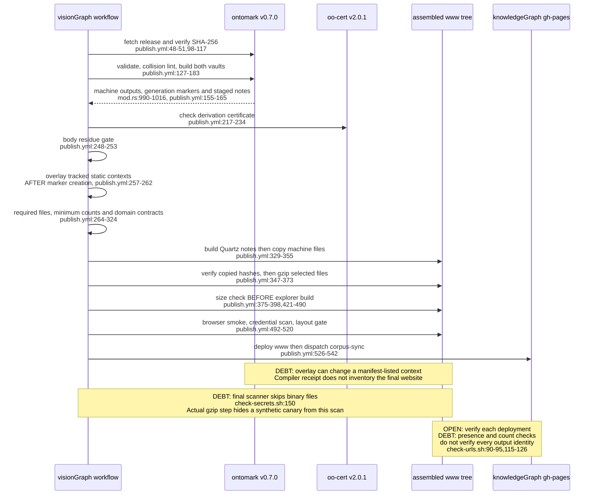
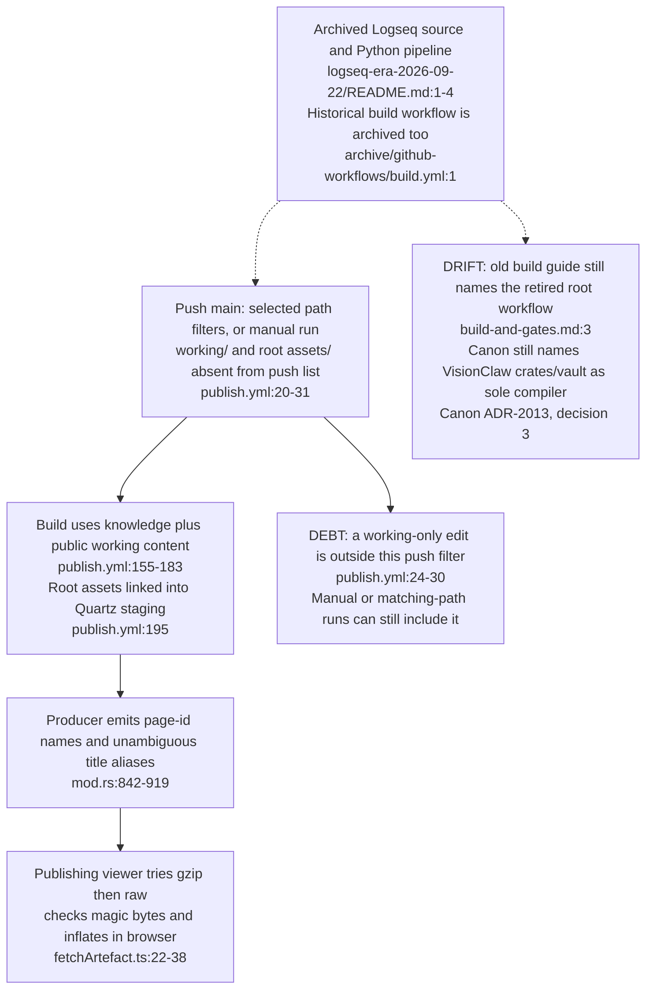

## For developers

Follow the assembled publication tree through compression and final checks, rather than treating an earlier copy hash as a final receipt. [The assessment](../../estate-review/2026-11-01-knowledgegraph-publication-gates.md) records executable gate probes and decision dispositions.

## For the business

The publisher combines graph data, readable notes and an explorer. Its checks provide useful safeguards, but some inspect only file presence or counts; a successful step is not proof that every intended page and byte reached the site.

## KG-05.3 Configured publication flow and gate boundaries

**What it shows:** The configured producer is pinned by tag and digest, but publication continues to transform its outputs after the copy check. The final scan and layout gate have narrower coverage than their broad descriptions suggest.

**Why it is this way:** ADR-2013 establishes one governed corpus; the workflow separates compiler data, Quartz notes and the SPA. These stages have distinct evidence boundaries.

## KG-05.5 Archive, trigger scope and consumer representations

**What it shows:** The archived pipeline is a historical implementation. Current publication includes sources outside the workflow's push filter and serves compressed representations to a viewer that knows how to inflate them.

**Why it is this way:** The compiler owns machine content, while the browser adapts the stored representation. Neither that adapter nor a later manual run makes omitted push triggers or external-reader compatibility implicit guarantees.
