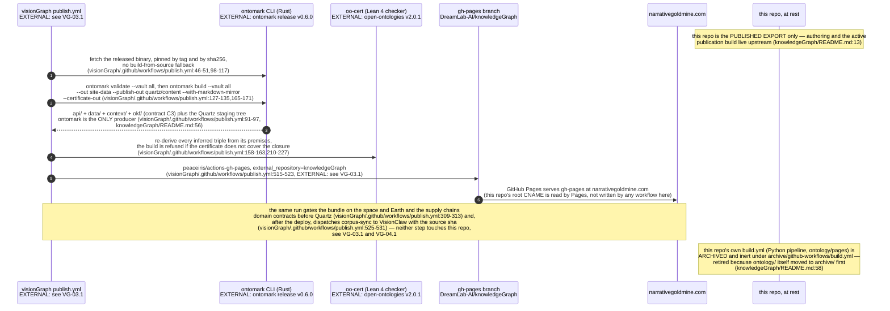
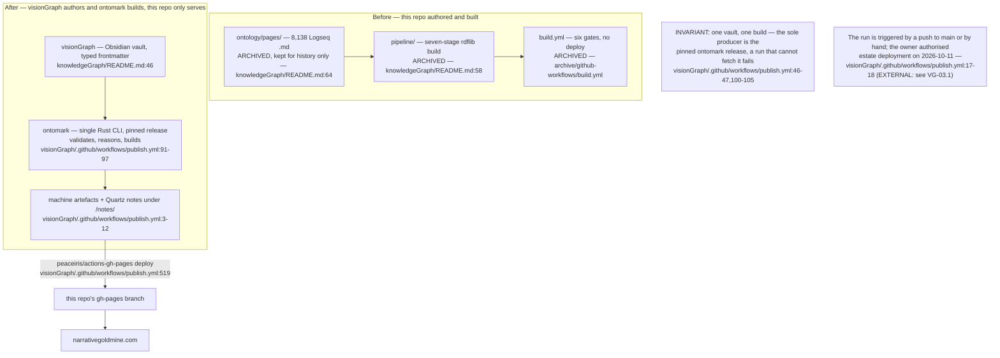

## KG-05.3 Publication topology — this repo is a pure published export, visionGraph's publish.yml is the sole builder

- **DIVERGENCE:** the governing doc (`build-and-gates.md:1-3`) still describes `build.yml` as this repo's active "reproducible half" running six gates; the workflow it names has been moved to `archive/github-workflows/` and no longer runs — the doc has not been updated to match the retirement.
- **Tension (ADR-2013 vs publish.yml):** ADR-2013 names `VisionClaw/crates/vault` as the only implementation that parses, reasons over or builds the corpus (`docs/adr/ADR-2013-sovereign-corpus-is-ecosystem-canon.md:52-53`), while the sole producer in the workflow is now the released `ontomark` CLI, which replaced the `vault` build with the same verbs and outputs (`../visionGraph/.github/workflows/publish.yml:91-97`); the ADR is `accepted`, `partial`, `staged` and its review trigger names a second build.

## KG-05.5 Sovereignty transition — from active builder to published export

- This repo's published artefact is served from `gh-pages`; nothing here computes it any more, and the committed `dist/data/` snapshot is the 7 August 2026 generation, not the served one (`../knowledgeGraph/README.md:87`).
- **Drift:** this topic's earlier text read "Agents never push to visionGraph main — publish.yml runs only on the owner's push or by hand"; the workflow header now says it runs on a push to `main` or by hand, with estate deployment authorised during the ontomark resumption (`../visionGraph/.github/workflows/publish.yml:17-18`).

Audit qualification — 2026-09-07: earlier evidence in this topic predates the 2026-09-23 retirement of `build.yml` and no longer describes the live system; superseded by the sovereignty transition above. See the [federation audit](../../estate-review/2026-09-07-federation-audit.md) for the historical record.
