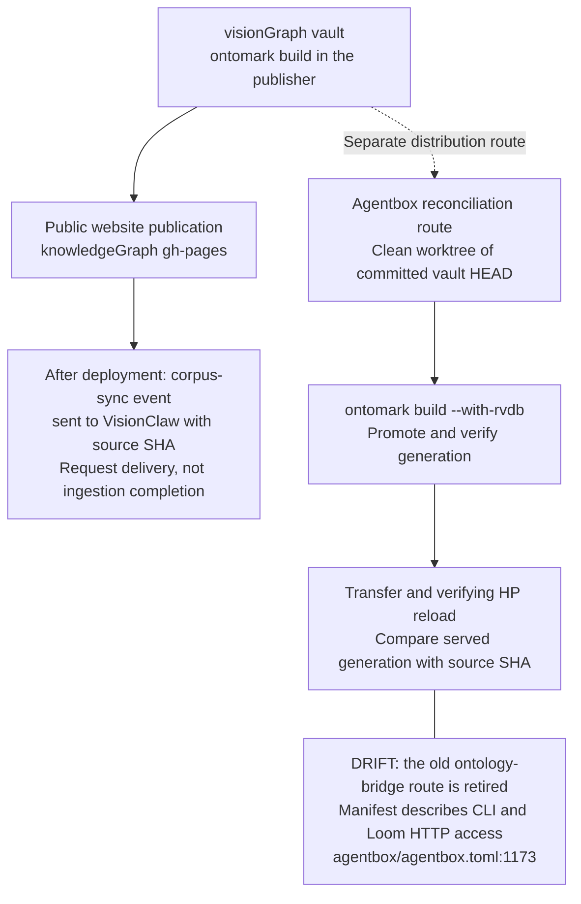
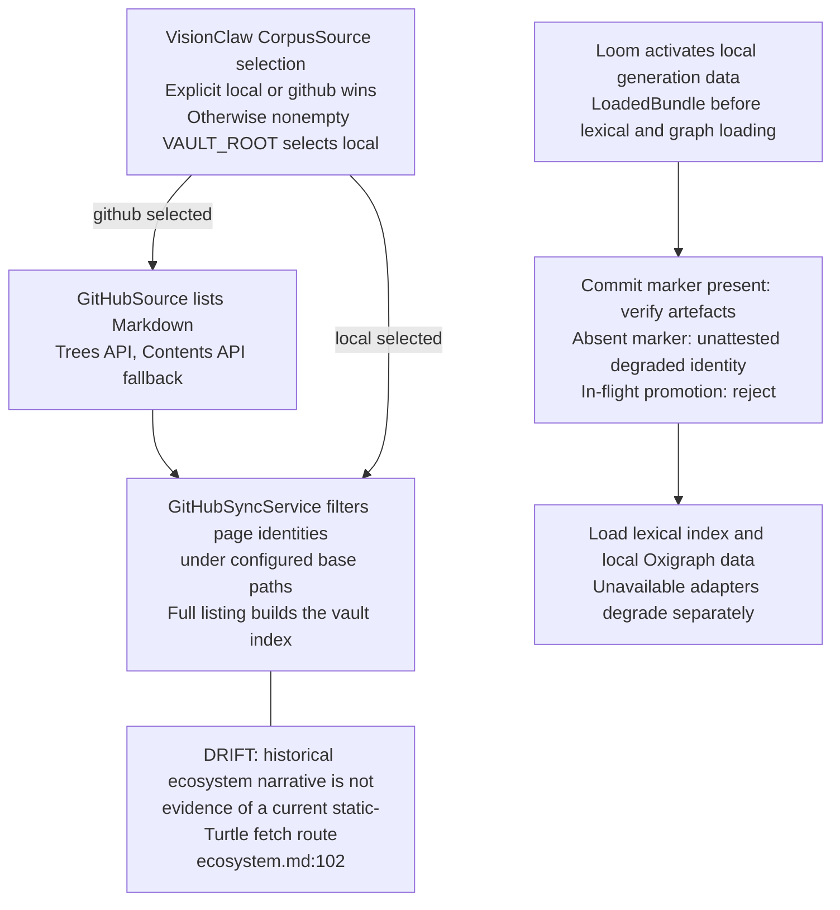
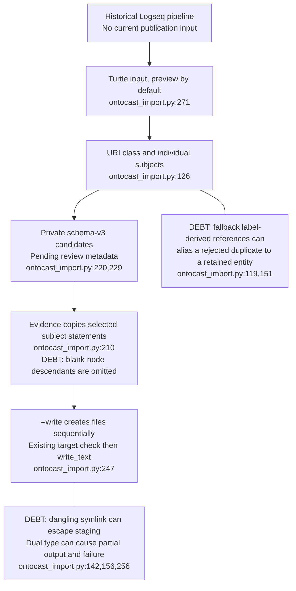

## For developers

Trace the public export, Markdown consumer and Loom generation independently; [the source review and four archive probes](../../estate-review/2026-11-01-knowledgegraph-consumers-and-archive.md) replace the historical ecosystem transcription with bounded implementation evidence.

## For the business

A successful website publication does not prove that a graph consumer has refreshed or that an agent serves the same generation; those outcomes need separate receipts, and the old extraction adapter remains historical code.

## KG-06.1 Publication and generation distribution

**What it shows:** Public publication and agent grounding have distinct build, delivery and completion boundaries.
**Why it is this way:** The publisher emits a refresh request, while the agentbox reconciler separately builds a committed snapshot and checks Loom's served generation; neither route establishes the other's success.

## KG-06.2 Two consumers with different input contracts

**What it shows:** VisionClaw ingests pages through its source port; Loom loads its own generation and adapters, with explicit degradation cases.
**Why it is this way:** Current entry points supersede the old documentation-only claim that agent grounding always reads VisionClaw's reasoned graph; this panel does not claim to enumerate every optional RDF importer.

## KG-06.4 Archived OntoCast adapter and its evidence limits

**What it shows:** Private defaults and review metadata survive, but evidence completeness, collision identity and filesystem confinement have reproduced limits.
**Why it is this way:** The archived adapter selects subjects and serialises their immediate statements; its checks are narrower than the integration document's losslessness and never-overwrite wording, as the retained synthetic probes demonstrate.
