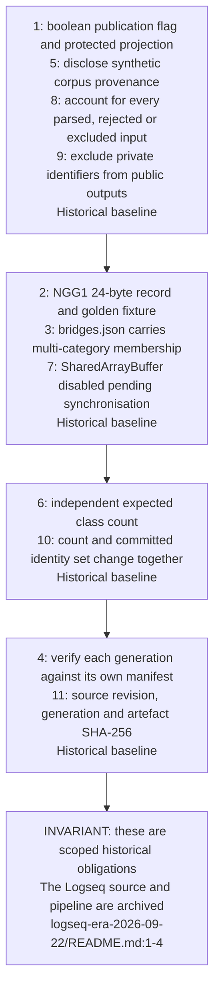
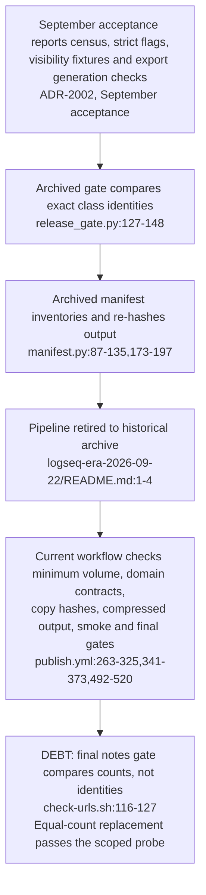
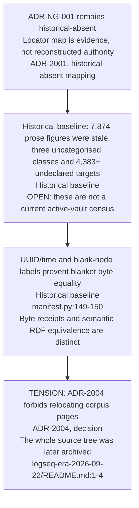
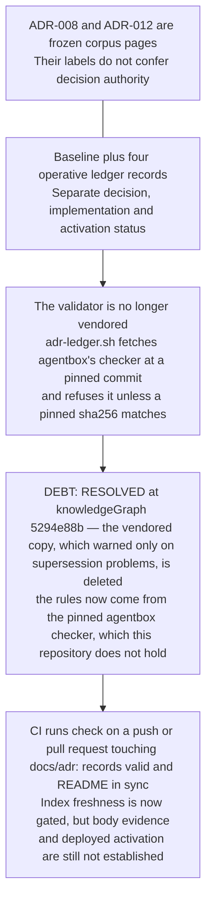

## For developers

These eleven rules belong to the historical baseline and its archived implementation. [The dated review](../../estate-review/2026-11-01-knowledgegraph-publication-gates.md) assesses all three panels and knowledgeGraph ADR-2002, ADR-2003 and ADR-2004 without treating their live status fields as fresh runtime evidence.

## For the business

Archiving a publisher does not remove the need to preserve identity, visibility and provenance. Those promises need acceptance evidence for the replacement publication path; historical test counts cannot supply it.

## KG-07.1 Eleven historical obligations, grouped by concern

**What it shows:** All eleven baseline obligations remain visible, with explicit historical scope. The diagram does not claim current enforcement of every obligation by the replacement publisher.

**Why it is this way:** The archive marker retires the implementation; the ADRs preserve its decisions and dated acceptance history. Scope must be stated separately from those status fields.

## KG-07.2 Historical closeout is not successor acceptance

**What it shows:** The archived identity set and generation verifier are distinct from the current workflow's checks. A notes-page count can agree even when the intended page is absent.

**Why it is this way:** The successor has a different assembly path. Retirement neither proves that all previous obligations transferred nor makes their unresolved acceptance conditions moot.

**Open (ADR-2002 reconciliation, 2026-11-02 and 2026-11-03):** at the previous stamp (`4809ea97`) ADR-2002 carried a reconciliation entry and a repair entry about a retained legacy explorer. Neither is on the pushed main at `5294e88b`: ADR-2002 there goes from its heading to its Context with no explorer decision (`../knowledgeGraph/docs/adr/ADR-2002-corpus-is-the-ontology.md:18-20`), and the retained explorer still pins the vowl-wasm v0.1.1 tarball (`../knowledgeGraph/explorer/modern/package.json:20`) with a DoubleBuffer that releases only buffers it owns by object identity (`../knowledgeGraph/explorer/modern/src/workers/positionTransport.ts:81-86`). The choice between retiring that explorer and a tested consumer upgrade is therefore recorded nowhere on the pushed main.

## KG-07.3 Historical gaps and continuing decision tensions

**What it shows:** Historical counts and missing lineage stay dated; a later whole-tree archive conflicts with an unqualified forever-in-place reading of ADR-2004. The section does not declare old corpus defects present in the current vault.

**Why it is this way:** A migration needs explicit succession and identity evidence. Comparing raw RDF triple strings is insufficient when blank-node identifiers change; the byte manifest answers a different question.

## KG-07.4 Decision inventory and the validator boundary

**What it shows:** Decision authority comes from the operative ledger, while the generator establishes a limited metadata contract; the [inventory and eight probes](../../estate-review/2026-11-01-knowledgegraph-inventory-and-live-receipt.md) make that limit reproducible.

**Why it is this way:** The preamble separates corpus content from governance. Required-field validation helps maintain the ledger, but cannot substitute for section review, source verification or a consumer's activation receipt.
