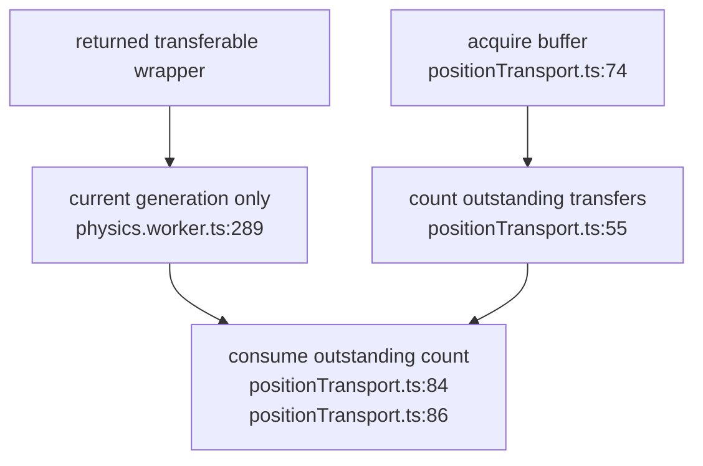

## For developers

This scoped successor covers KG-04.2 in the retained modern explorer. It does not declare this explorer the canonical publisher; visionGraph retains that role.

## For the business

The retained explorer can reclaim buffers returned through a real worker transfer instead of exhausting its two-buffer pool.

## KG-08.1 Count transfers rather than retaining object identity

**What it shows:** transferred buffers return as new JavaScript wrappers, so pool accounting uses the number of outstanding transfers. **Why it is this way:** object identity does not survive structured cloning. The existing worker generation guard continues to reject returns from an earlier graph. **Invariant:** a return requires an outstanding transfer (`positionTransport.ts:84`).
