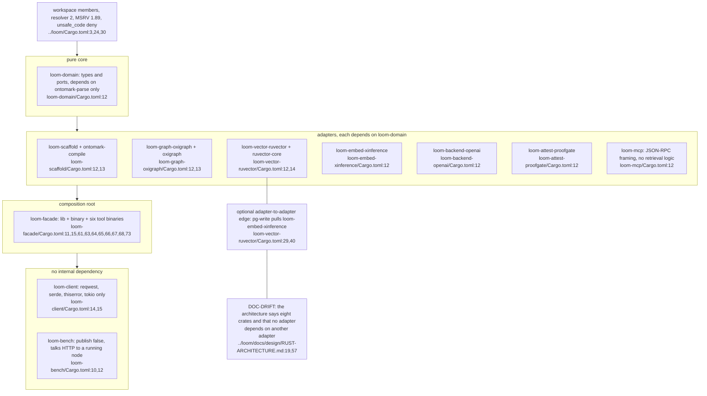
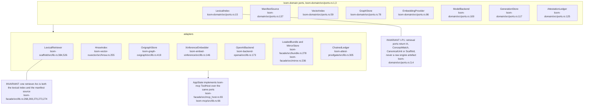
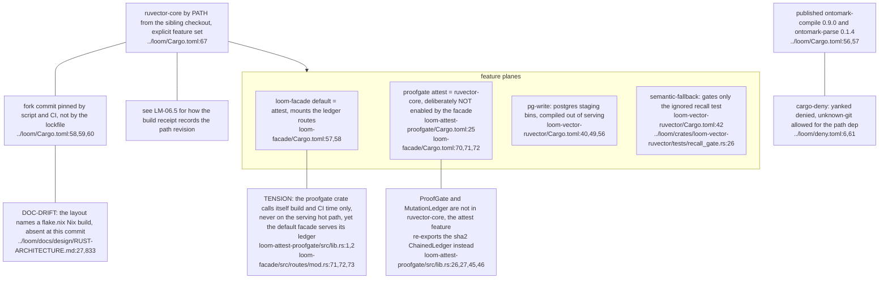
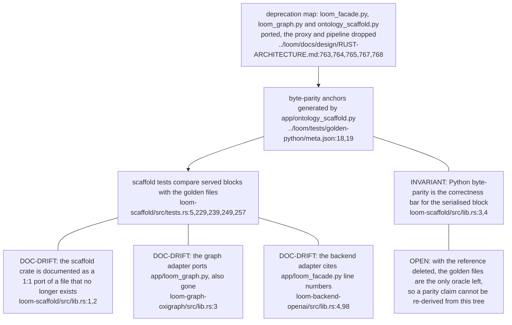

## LM-01.1 Eleven workspace members and their internal dependency edges

**What it shows.** The ring holds for the default build; the one adapter-to-adapter edge exists only under `pg-write`. `loom-client` and `loom-bench` sit outside the ring and reach a node over HTTP.

## LM-01.2 Ports and the one concrete adapter bound to each

**What it shows.** Every external system is behind a trait so the router can be exercised in memory; `GenerationStore` has two implementations because the loaded identity and the disk view are kept apart (see LM-02.4).

## LM-01.3 External pins and the feature planes

**What it shows.** Two upstream inputs decide what the binary contains: a sibling RuVector checkout identified only by script, and two published Ontomark crates. Feature flags separate the serving binary from build-time and evaluation code.

## LM-01.4 The retired Python reference that the Rust port still names

**What it shows.** The parity comments are history, not live cross-references: `app/` now holds only `mirror.sh`. The frozen golden fixtures are what keep the port honest.
