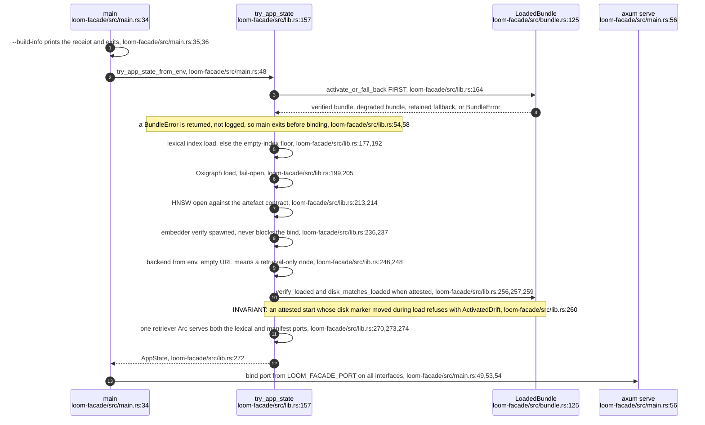
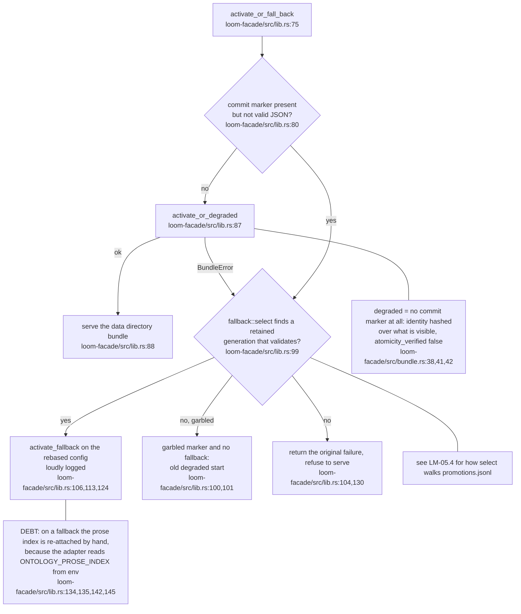
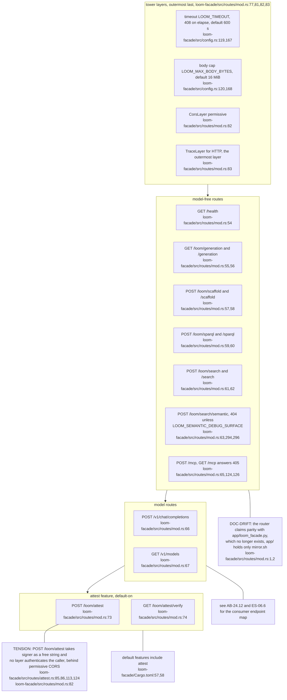
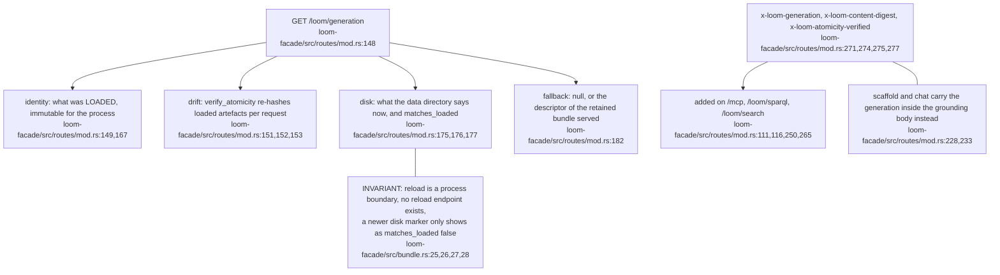
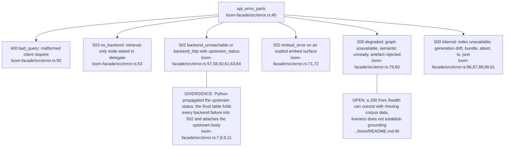
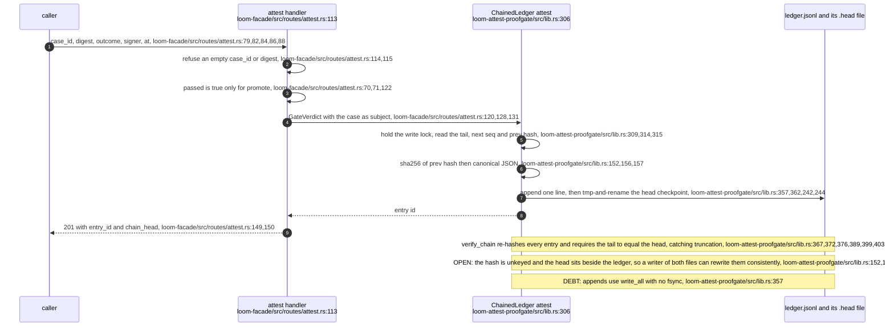
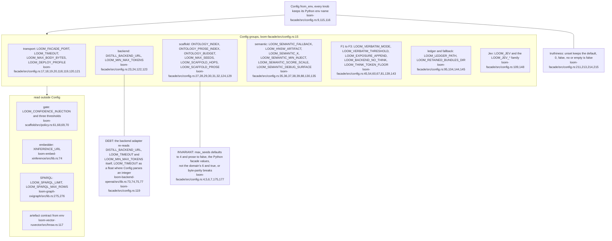

## LM-02.1 Process start: activation first and fatal, every accelerator fail-open

**What it shows.** Only bundle activation can stop the process; a missing graph, vector index, embedder or backend degrades. The default port is 8080 (`loom-facade/src/config.rs:166`); Profile A overrides it (see LM-06.3).

## LM-02.2 Activation outcomes and the start-up fallback branch

**What it shows.** A fallback is never silent: it is logged at warn and reported as `status: fallback` on `/health` (`loom-facade/src/routes/health.rs:171,172`). A garbled marker with no usable fallback keeps the pre-closeout degraded start rather than refusing.

## LM-02.3 The route table and the tower layers

**What it shows.** Every path keeps a bare alias for parity with the retired Python façade. The README's endpoint table (`../loom/README.md:67`) lists the same surface without the aliases or the semantic debug route.

## LM-02.4 What each route reports about the generation it served

**What it shows.** Loaded identity, disk identity and integrity are three separate fields, so a promoted-but-not-restarted node is visible rather than mistaken for a serving change. LM-05.3 shows the reload tick that reads exactly this report.

## LM-02.5 Error to HTTP status: the lexical floor fails hard, accelerators degrade

**What it shows.** The table encodes ADR-135's rule that a missing accelerator is never a client error. The chat path wraps backend failures with the grounding contract before this table is reached (see LM-04.1).

## LM-02.6 The governance ledger behind POST /loom/attest

**What it shows.** The ledger records who admitted what after the decision was made elsewhere; it is not an approval step (`loom-facade/src/routes/attest.rs:8,10,11`). Both profiles move it off the read-only data mount onto a named volume (`../loom/deploy/compose.profile-a.yml:27,98`).

## LM-02.7 The configuration surface: one Config read once from env, plus adapter-local reads

**What it shows.** Most behaviour is set by environment at start and fixed for the process; nothing is reloaded. The gate thresholds and the adapter endpoints live outside `Config`, so `/health` and `--build-info` are the places to read what a node actually resolved (`loom-facade/src/main.rs:20`).
