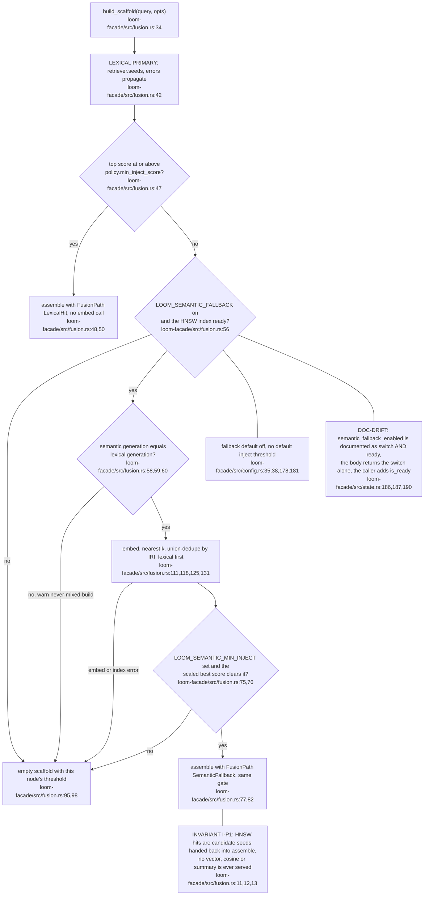
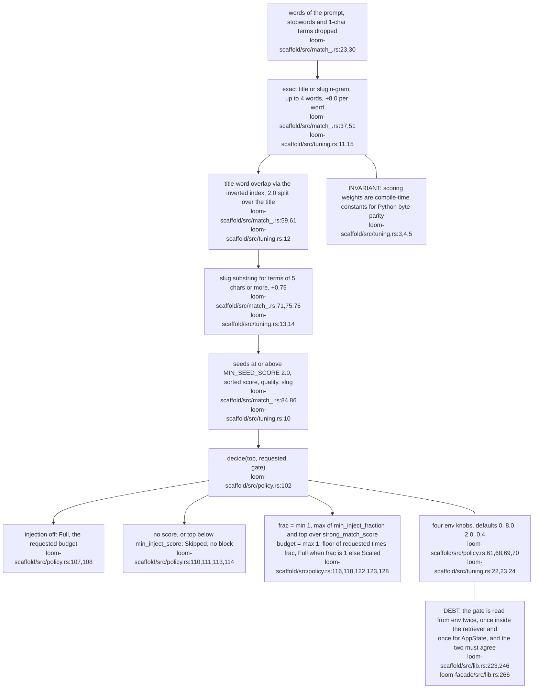
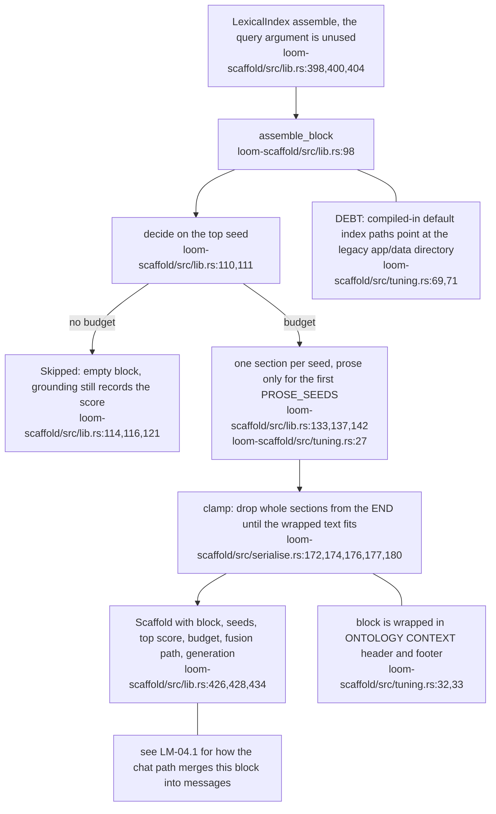
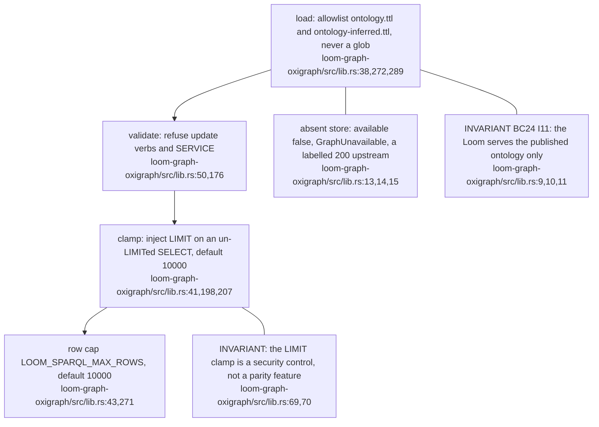
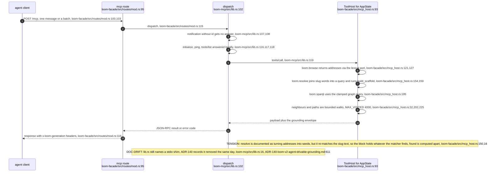
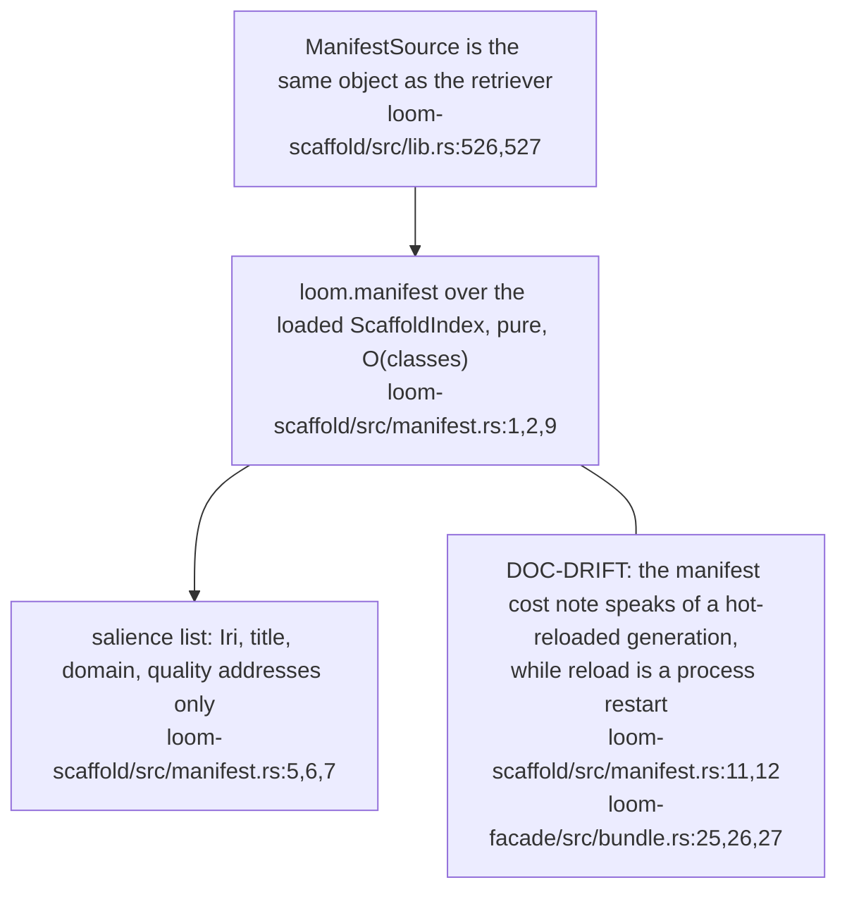

## LM-03.1 The fusion pipeline: lexical first, semantic only on a miss, one gate for both

**What it shows.** An accelerator failure degrades to no-match instead of an error; only the lexical floor can fail the request (`loom-facade/src/fusion.rs:17,19,20`). With the default thresholds the semantic branch is reachable only when no lexical seed survives.

## LM-03.2 The lexical matcher and the gate arithmetic

**What it shows.** Confidence is a lexical additive score, not a probability: one exact single-word title hit scores 8.0, which is also the strong-match default. The gate only ever shrinks or withholds the requested budget.

## LM-03.3 Assembling the served block: sections, prose for the top two, clamp from the end

**What it shows.** Seeds are kept whole or dropped; the clamp never truncates mid-section, so the lowest-ranked seeds go first. The facade overrides the default paths from `ONTOLOGY_INDEX` (`loom-facade/src/config.rs:124,172`).

## LM-03.4 SPARQL and label search: the read-only clamp over the published graph

**What it shows.** The graph is in-memory, read-only and loaded from exactly two files; both `/loom/sparql` and the MCP `loom.sparql` tool reach the same `GraphStore::query` (`loom-facade/src/routes/mod.rs:249`, `loom-facade/src/mcp_host.rs:195`).

## LM-03.5 The MCP plane: one JSON-RPC adapter, the facade as tool host

**What it shows.** The adapter crate holds framing and schemas only (`loom-mcp/src/lib.rs:3,4,5`); all retrieval goes through the facade's ports, so the agentic plane cannot acquire its own policy. See AB-24.12 for the consumer side.

## LM-03.6 The session manifest: statements about the corpus, never content

**What it shows.** An agent learns what the corpus covers before fetching; the content itself still comes only through `loom.resolve` and the gate.
