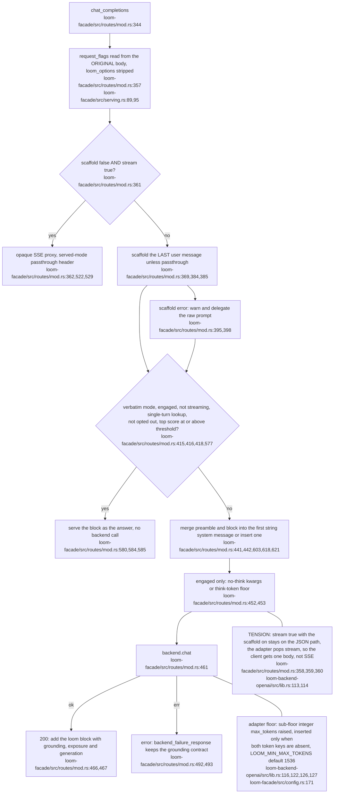
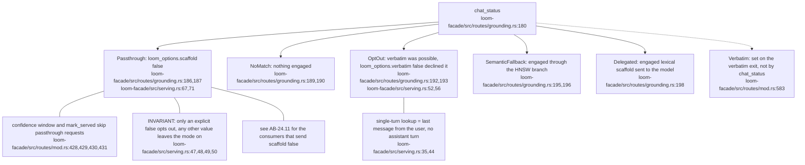
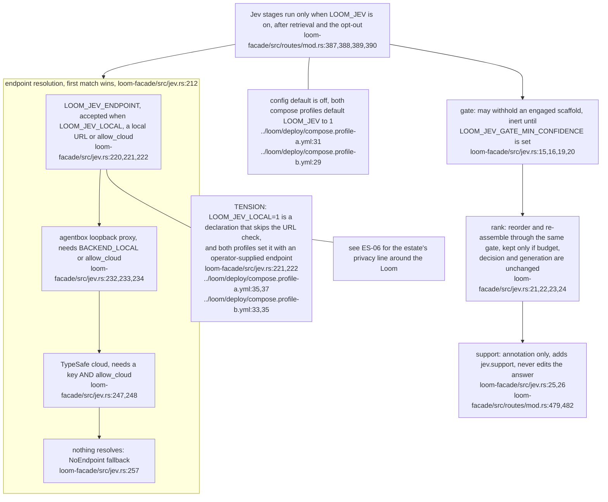
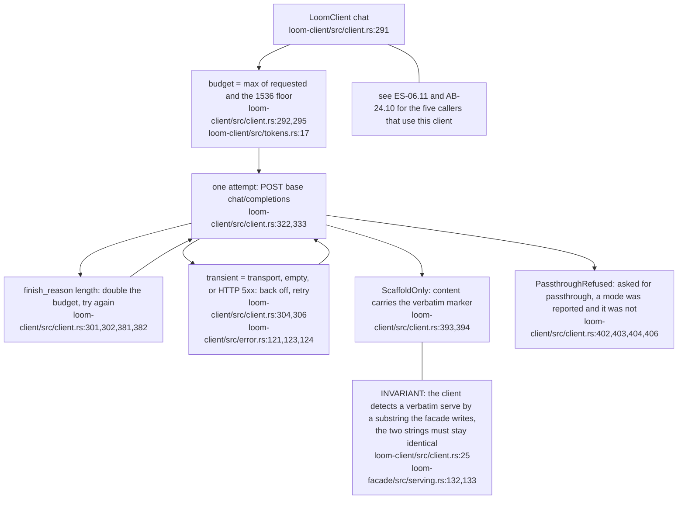

## LM-04.1 One handler, four exits: streaming passthrough, verbatim, delegate, backend failure

**What it shows.** Passthrough is decided before retrieval, and verbatim before any model call. The F1, F2 and F3 switches are all off by default (`loom-facade/src/config.rs:184,186,187,188`); Profile A turns F1 and F3 on (LM-06.3).

## LM-04.2 What the grounding status says, and the per-request switches behind it

**What it shows.** The status separates "the corpus had nothing", "the caller declined" and "the model answered over a scaffold", which a bare 200 cannot. The README states passthrough reports `corpus_backed: false` (`../loom/README.md:65`).

## LM-04.3 The Jev option: three stages that can only withhold, reorder or annotate

**What it shows.** Every Jev failure collapses to a named fallback and the request continues unchanged (`loom-facade/src/jev.rs:6,7,8`). The data boundary is local-only by default (`loom-facade/src/jev.rs:30,31,32`), but the local check can be declared rather than proven.

## LM-04.4 The published client: retries worth making, and failures that look like success

**What it shows.** A verbatim serve, a truncated reasoning answer and a silently scaffolded passthrough each return HTTP 200; the client turns each into a typed error or a retry instead (`loom-client/src/client.rs:300,308,314`).
