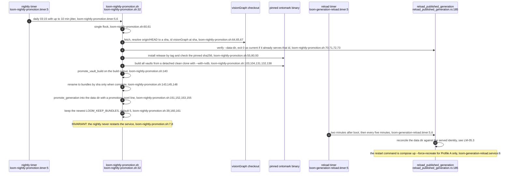
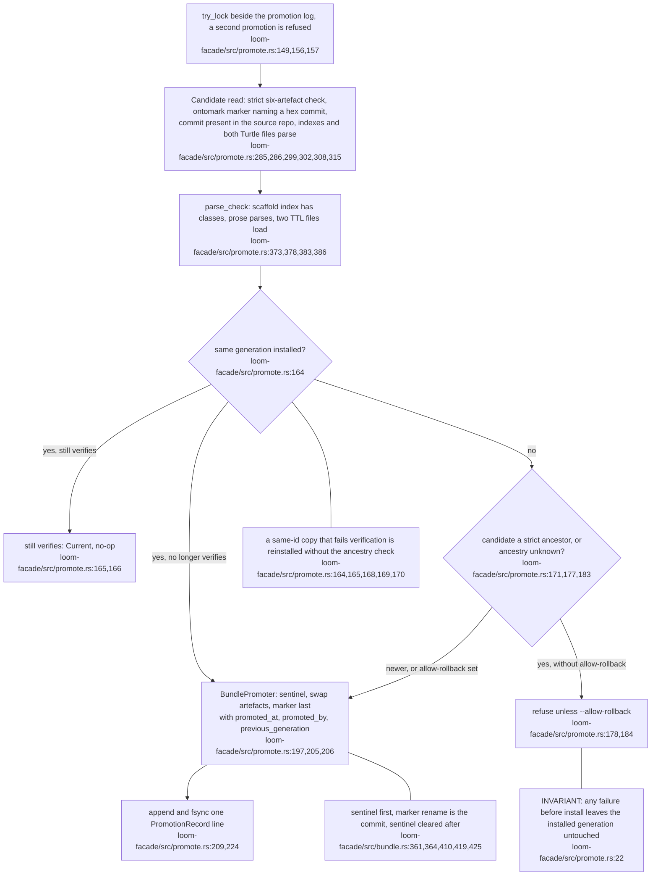
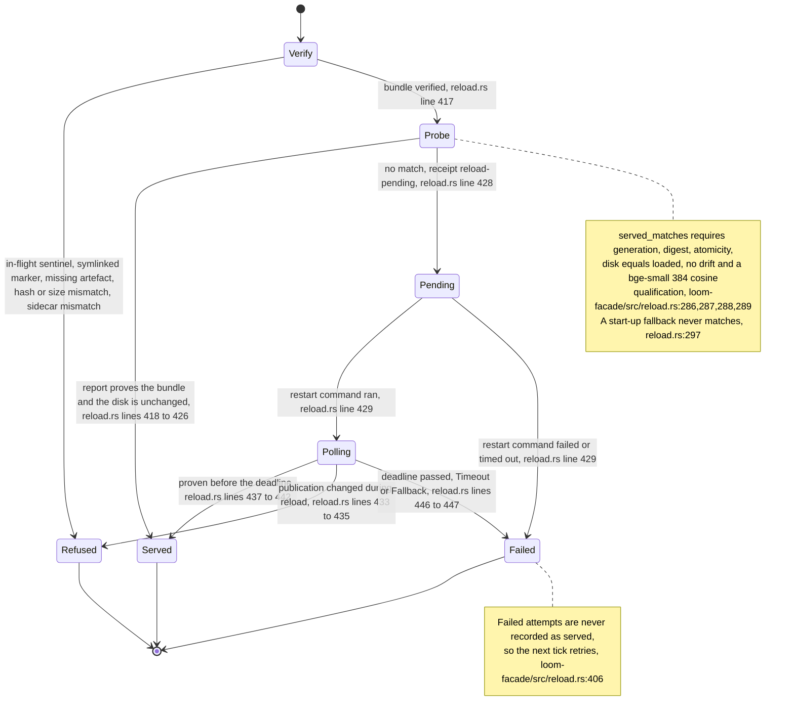
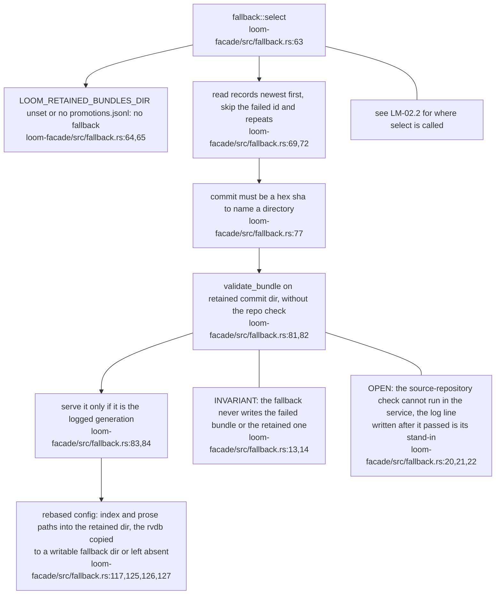
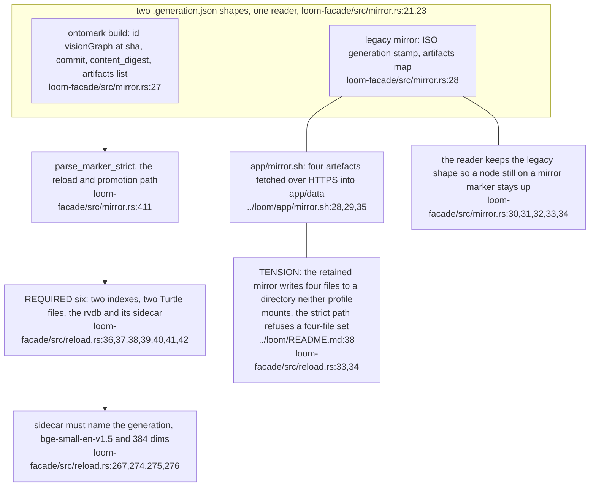
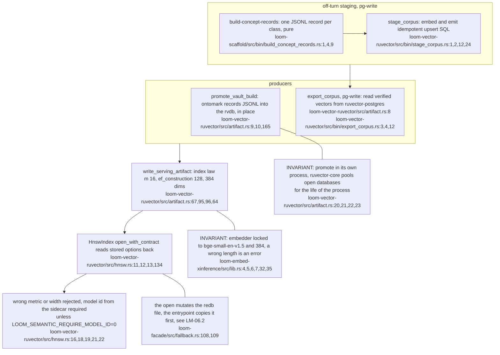

## LM-05.1 Two timers, one direction: build and install nightly, restart on the reload tick

**What it shows.** Installation and activation are decoupled: the nightly can only put a validated bundle on disk, and only the reload tick restarts the container. The release pin is a tag plus digest (`../loom/deploy/ontomark-release.env:3,5`).

## LM-05.2 promote_generation: lock, validate, compare, install, log

**What it shows.** A generation id does not order, so "older" means git ancestry in the source repository; when ancestry cannot be shown the step refuses rather than guesses (`loom-facade/src/promote.rs:28,29,30`).

## LM-05.3 The reload tick as a state machine

**What it shows.** The receipt says `served` only after the restarted process reports the exact bundle, and the disk is re-verified around every probe. The Rust binary replaces the Python reloader byte-for-byte on the receipt (`loom-facade/src/reload.rs:7,8`).

## LM-05.4 Start-up fallback: walk the promotion log newest first

**What it shows.** Fallback trusts only bundles the promotion log names and that still validate, and it reports itself on every serving surface. Opening the semantic artefact mutates it, so the retained copy is never opened in place (`loom-facade/src/fallback.rs:108,109,110`).

## LM-05.5 What counts as a complete bundle: two marker shapes, six artefacts

**What it shows.** The tolerant reader serves either shape; anything that promotes or reloads uses the strict reader and the six-artefact list. The README records the first served ontomark bundle, on 12 October 2026 (`../loom/README.md:158`).

## LM-05.6 The semantic artefact: two producers, one writer, a contract at open

**What it shows.** Readiness means the artefact passed its contract, not merely that it opened; the fallback stays off in both profiles until the recall bench clears. See ES-12.1 for what that bench has measured.
