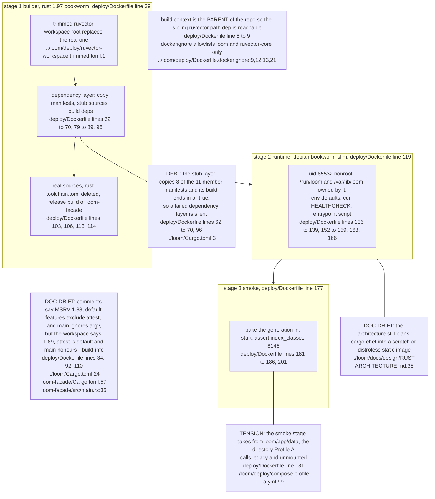
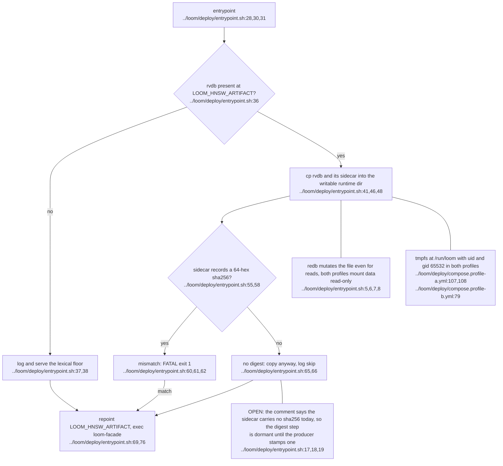
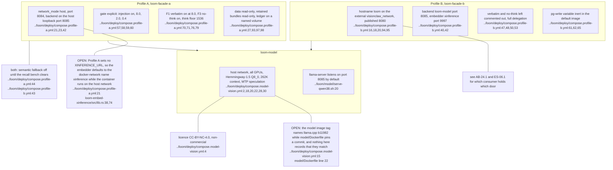
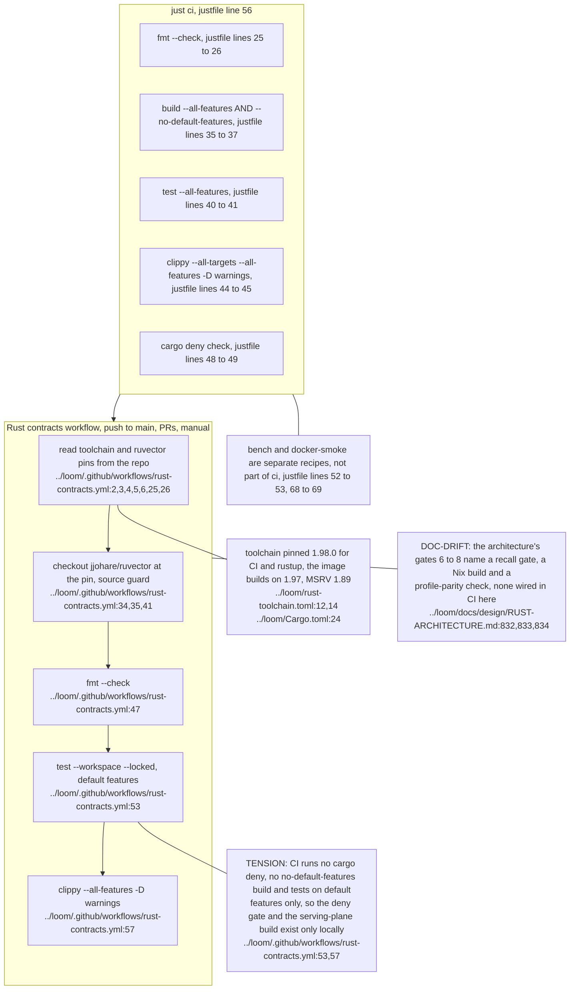
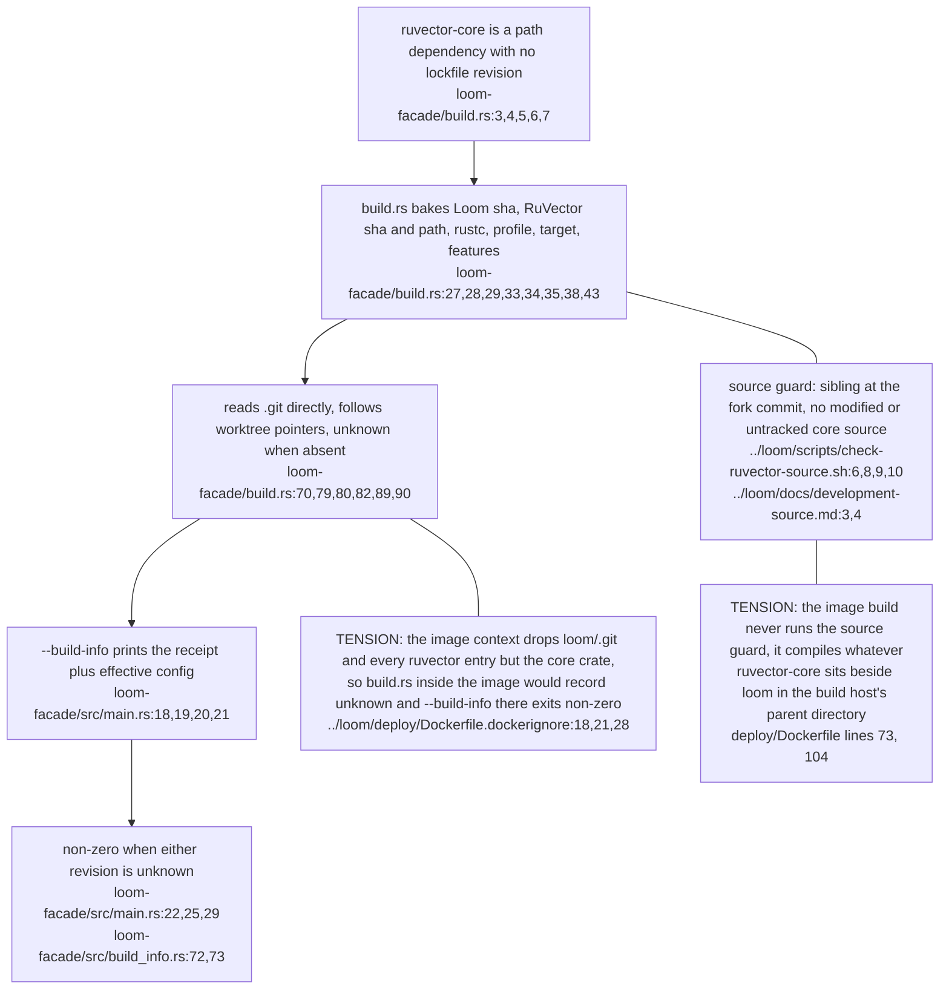

## LM-06.1 The image: parent-directory context, three stages, a baked smoke test

**What it shows.** RocksDB under Oxigraph and the entrypoint's need for a shell forced a glibc Debian runtime instead of the static image the design planned (deploy/Dockerfile lines 18 to 26). The smoke test's class count is a literal, so it pins one corpus size.

## LM-06.2 The entrypoint: copy the rvdb off the read-only mount before the binary opens it

**What it shows.** The mitigation sits at the container level because opening the artefact rewrites it. Every other artefact is read straight from the read-only mount (`../loom/deploy/entrypoint.sh:22,23`).

## LM-06.3 Three compose files: the colocated reference, the network sidecar and the model

**What it shows.** A is the GPU-colocated reference with every findings-driven switch on; B is the in-network door that keeps plain delegation. The model is a separate compose project, so a model swap never touches either Loom container.

## LM-06.4 What "green" means: just ci against the hosted workflow

**What it shows.** The workflow takes its versions from in-repo files, so local and hosted runs read the same pins. It covers a subset of the local bar (justfile and Dockerfile citations are line references the checker cannot see, derived by hand).

## LM-06.5 Release identity: a Loom sha alone does not identify the build

**What it shows.** The receipt is the reproducibility artefact ADR-137 asked for, and it refuses to pretend when a revision is missing. The guard protects CI and developer builds; the container path has neither the guard nor the git metadata the receipt needs.
