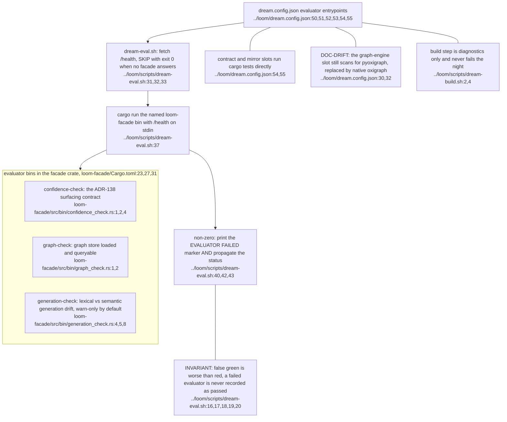
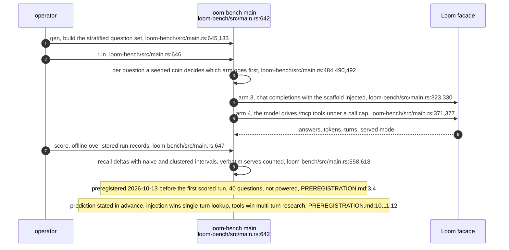
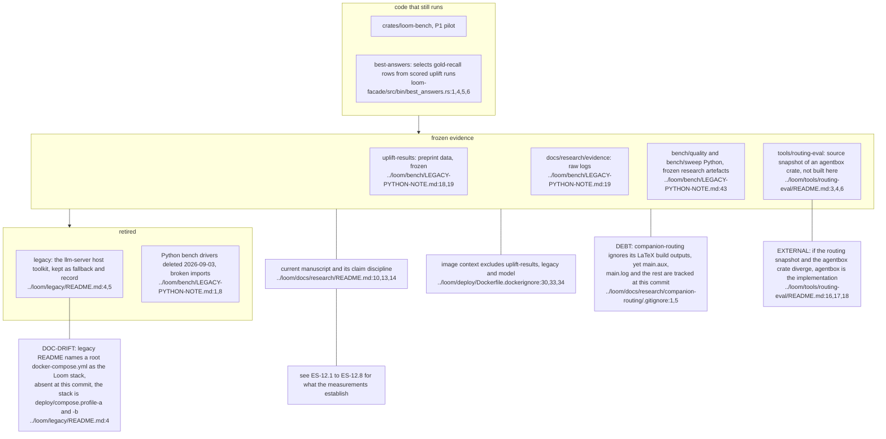

## LM-07.1 Dream-cycle evaluators: a /health payload piped into typed checkers

**What it shows.** The evaluators read a payload rather than a URL so nothing needs quoting across the remote shell boundary (`loom-facade/src/bin/confidence_check.rs:4,5,6,7`). An unreachable facade is a skip, a red checker is red.

## LM-07.2 loom-bench: two serving regimes of one corpus through one door

**What it shows.** Scoring is deterministic and offline so the preregistered rule can be re-run on stored records (`loom-bench/src/lib.rs:5,6`). See ES-12.8 for where this pilot sits relative to PRD-028.

## LM-07.3 The tracked research data surface, directory by directory

**What it shows.** Most of the repository's JSON and JSONL is frozen evidence for published numbers, not serving input, and the image build excludes `uplift-results/`. Only `loom-bench` and `best-answers` remain as live code beside it.
