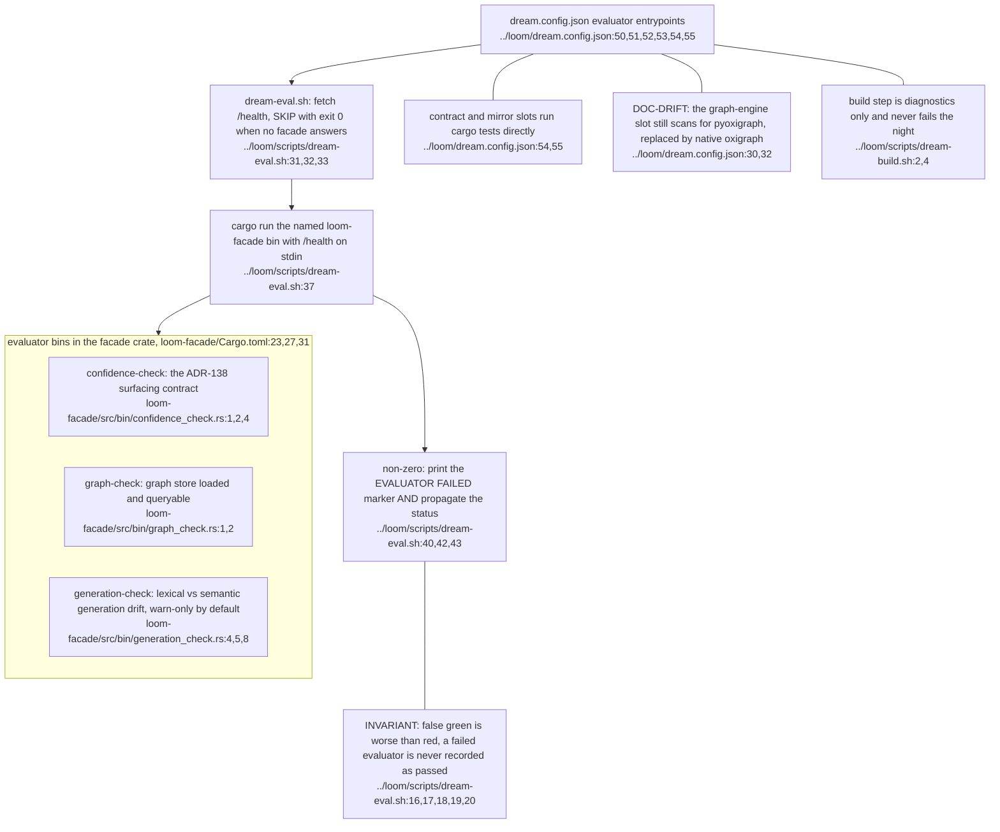
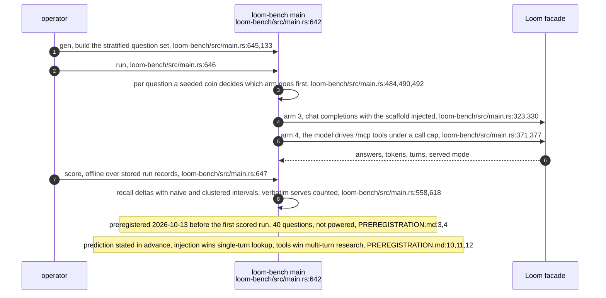
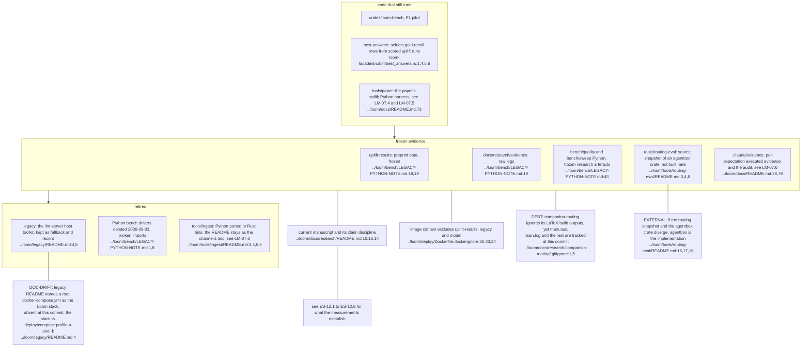
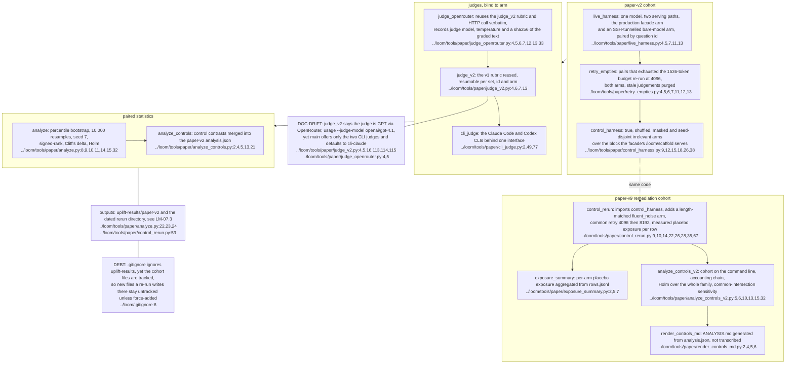
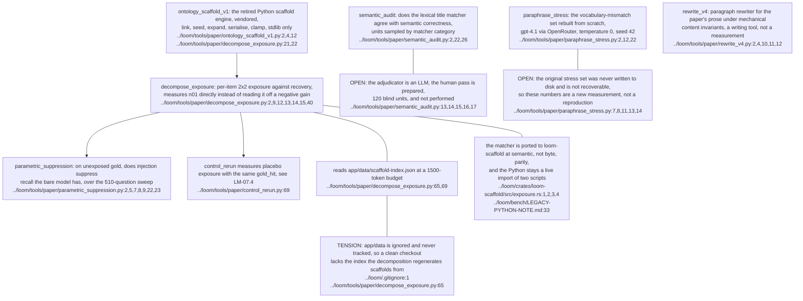
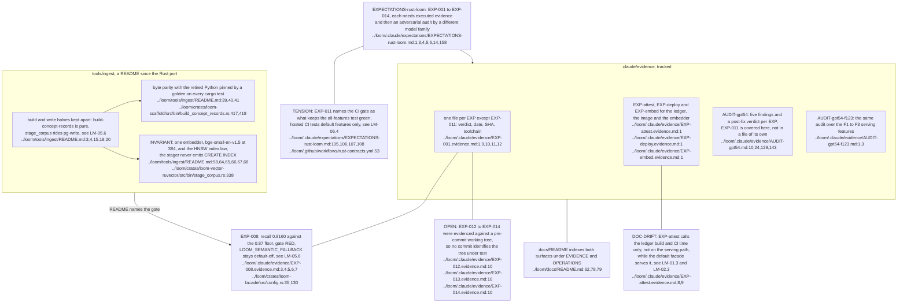

## LM-07.1 Dream-cycle evaluators: a /health payload piped into typed checkers

**What it shows.** The evaluators read a payload rather than a URL so nothing needs quoting across the remote shell boundary (`loom-facade/src/bin/confidence_check.rs:4,5,6,7`). An unreachable facade is a skip, a red checker is red.

## LM-07.2 loom-bench: two serving regimes of one corpus through one door

**What it shows.** Scoring is deterministic and offline so the preregistered rule can be re-run on stored records (`loom-bench/src/lib.rs:5,6`). See ES-12.8 for where this pilot sits relative to PRD-028.

## LM-07.3 The tracked research data surface, directory by directory

**What it shows.** Most of the repository's JSON and JSONL is frozen evidence for published numbers, not serving input, and the image build excludes `uplift-results/`. The live code beside it is `loom-bench`, `best-answers` and the Python paper harness in `tools/paper/`, which writes into that same tree.

## LM-07.4 The paper harness: paired live arms, negative controls, cross-family judges, paired statistics

**What it shows.** The published uplift numbers come from a stdlib Python pipeline beside the Rust workspace, not from `loom-bench`. The v9 cohort re-runs the controls by importing the original harness rather than forking it, so the two cohorts share the scaffold fetch, shuffle, mask and donor search (`tools/paper/control_rerun.py:9,10,11,12`).

## LM-07.5 The post-hoc analyses: exposure decomposition, suppression, semantic audit, paraphrase stress

**What it shows.** The decomposition and suppression analyses regenerate scaffolds with the git-recovered Python engine, not the Rust facade, so they reproduce the v1 sweep's configuration byte for byte (`tools/paper/decompose_exposure.py:21,22,23,24,25`). Two of the analyses say outright that their adjudicator or their data is new rather than the paper's original.

## LM-07.6 The committed proof surfaces: expectations, executed evidence, the audit, the ingest channel's doc

**What it shows.** The repository carries its own proof trail: a contract per expectation, raw executed evidence per contract, and a cross-family audit that recorded where its first verdicts were refuted (`.claude/evidence/AUDIT-gpt54.md:136,138,139,140`). The ingest README points at the same RED gate the evidence records (`tools/ingest/README.md:82,83`).
