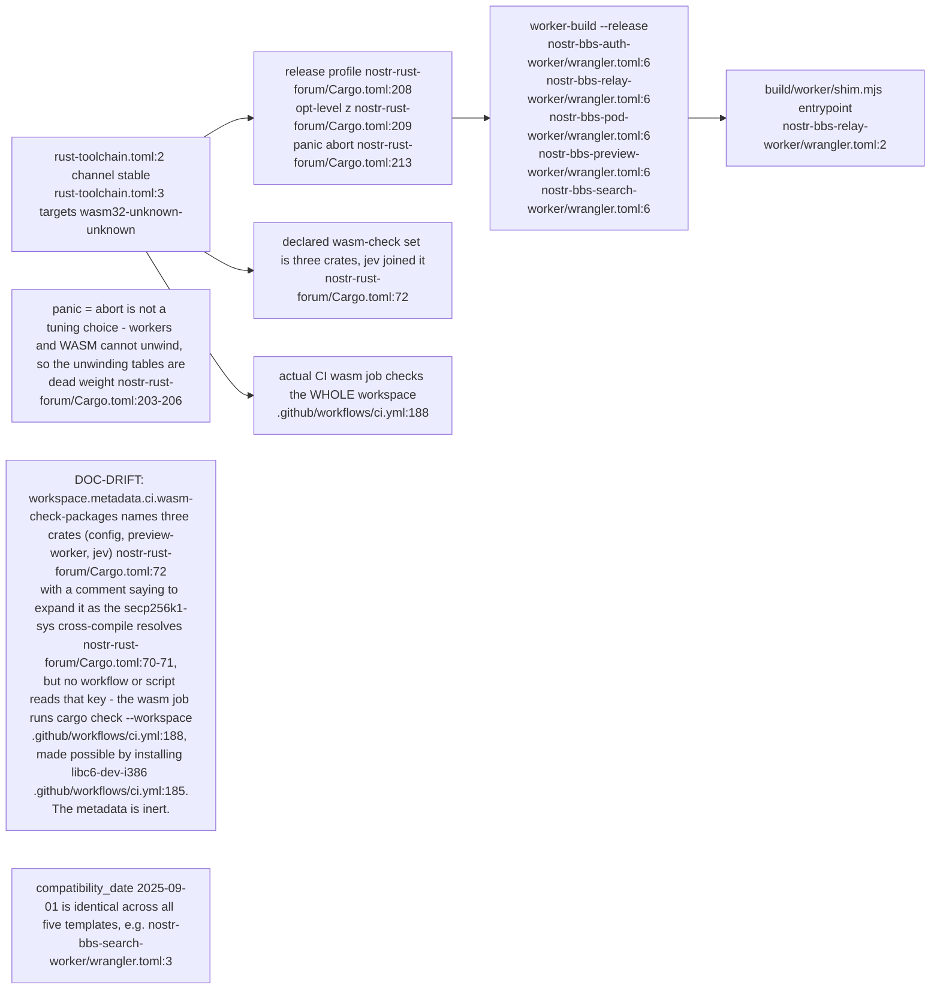
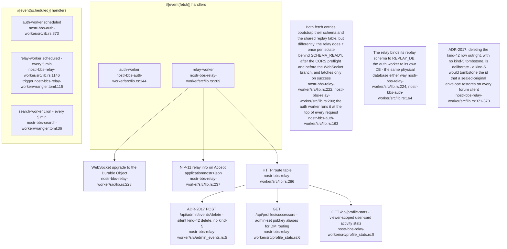
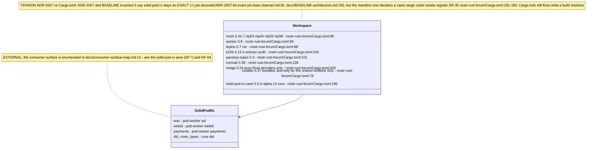
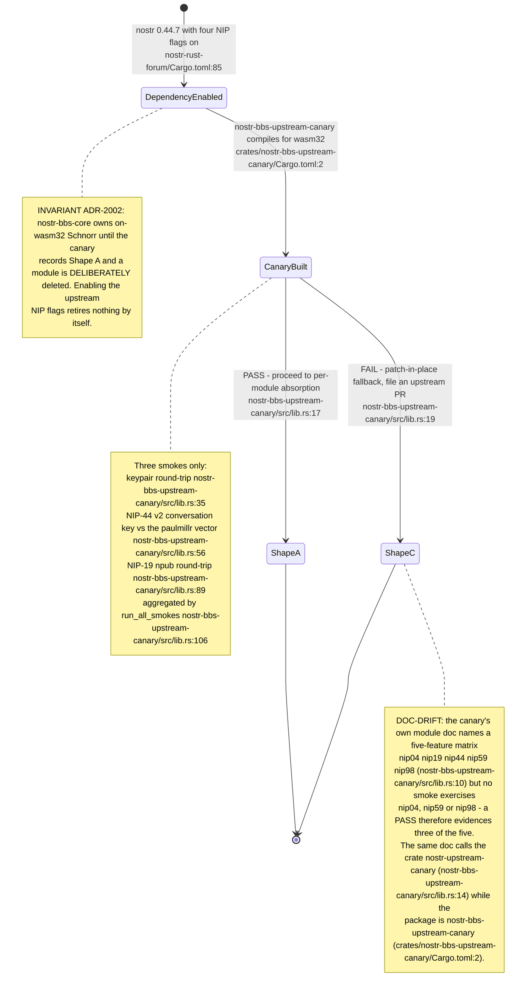
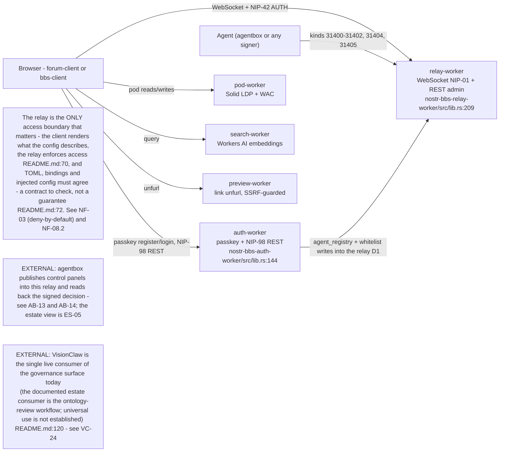

## NF-01.1 Twenty crates in four layers

```mermaid
flowchart TB
    subgraph found["Foundation"]
        CORE["nostr-bbs-core<br/>nostr-rust-forum/Cargo.toml:5 - protocol, keys, signer, NIP-04/19/44/59/98, governance"]
    end
    subgraph libs["Config, federation and shared utilities"]
        CFG["nostr-bbs-config nostr-rust-forum/Cargo.toml:8"]
        MESH["nostr-bbs-mesh nostr-rust-forum/Cargo.toml:9"]
        SKILL["nostr-bbs-setup-skill nostr-rust-forum/Cargo.toml:12"]
        RATE["nostr-bbs-rate-limit nostr-rust-forum/Cargo.toml:15"]
        JEV["nostr-bbs-jev nostr-rust-forum/Cargo.toml:18 - opt-in Jev typed-decision adapter, publish = false nostr-bbs-jev/Cargo.toml:4"]
        ASCII["nostr-bbs-ascii nostr-rust-forum/Cargo.toml:22"]
    end
    subgraph workers["Cloudflare Worker reference implementations"]
        AUTH["nostr-bbs-auth-worker nostr-rust-forum/Cargo.toml:25"]
        POD["nostr-bbs-pod-worker nostr-rust-forum/Cargo.toml:26"]
        PREV["nostr-bbs-preview-worker nostr-rust-forum/Cargo.toml:27"]
        RELAY["nostr-bbs-relay-worker nostr-rust-forum/Cargo.toml:28"]
        SEARCH["nostr-bbs-search-worker nostr-rust-forum/Cargo.toml:29"]
    end
    subgraph clients["Leptos CSR browser clients"]
        FC["nostr-bbs-forum-client nostr-rust-forum/Cargo.toml:32"]
        BBS["nostr-bbs-bbs-client nostr-rust-forum/Cargo.toml:35 - served at /community/bbs/"]
    end
    ZM["nostr-bbs-zone-migrate nostr-rust-forum/Cargo.toml:51 - operator CLI, native-only binary, ADR-2017 sealed-original migration"]
    PK["heads-up poker - pure engine + native house seat<br/>nostr-bbs-poker nostr-rust-forum/Cargo.toml:33<br/>nostr-bbs-poker-citizen nostr-rust-forum/Cargo.toml:36"]
    SA["nostr-bbs-sidestr-admin nostr-rust-forum/Cargo.toml:40 - operator CLI for the pinned sidestr chains"]
    GP["nostr-bbs-governance-probe nostr-rust-forum/Cargo.toml:55 - ADR-2011 M4 probe suite, one receipt per probe"]
    CANARY["nostr-bbs-upstream-canary nostr-rust-forum/Cargo.toml:60 - validation only, linked into no binary"]

    AUTH --> CORE
    POD --> CORE
    RELAY --> CORE
    SEARCH --> CORE
    PREV --> CORE
    FC --> CORE
    BBS --> CORE
    ZM --> CORE
    PK --> CORE
    SA --> CORE
    GP --> CORE
    CFG --> RELAY
    CFG --> FC
    JEV --> RELAY
    RATE --> AUTH
    RATE --> RELAY
    ASCII --> PREV
    ASCII --> BBS
    MESH -.->|"README.md:60 dotted, configured peer routing<br/>relay-worker depends on it nostr-bbs-relay-worker/Cargo.toml:27"| RELAY

    N1["resolver 2, edition 2021, rust-version 1.85 nostr-rust-forum/Cargo.toml:2 nostr-rust-forum/Cargo.toml:67"]
    N2["DIVERGENCE: the kit publishes on one beta channel but its path-dep versions are not one set - core beta.18<br/>nostr-rust-forum/Cargo.toml:188, config, mesh, rate-limit and jev beta.16 nostr-rust-forum/Cargo.toml:189-192,<br/>poker beta.15 nostr-rust-forum/Cargo.toml:194, ascii still beta.10 nostr-rust-forum/Cargo.toml:193;<br/>core declares beta.18 crates/nostr-bbs-core/Cargo.toml:3 and ascii beta.10 crates/nostr-bbs-ascii/Cargo.toml:3"]
    N3["DOC-DRIFT ADR-2007 / BASELINE known-divergence: the Cargo.toml comment above the path deps still<br/>says published to crates.io as 1.0.0-beta.3 while the tree is on beta.18 nostr-rust-forum/Cargo.toml:187"]
    N4["nostr-bbs-zone-migrate is library-plus-native-binary only, so it still passes the wasm32 workspace<br/>check nostr-rust-forum/Cargo.toml:49-51; seals plaintext channel history into sealed-original<br/>envelopes, verifies, then purges the plaintext crates/nostr-bbs-zone-migrate/Cargo.toml:5"]
```

**Drift:** the README draws the mesh as a dotted "configured peer routing" edge into the relay (`../nostr-rust-forum/README.md:60`), yet the relay-worker declares a normal path dependency on `nostr-bbs-mesh` with a `src/mesh.rs` wiring note (`../nostr-rust-forum/crates/nostr-bbs-relay-worker/Cargo.toml:27`).

**Open:** does the "room" deployment profile (ADR-2029, proposed, no implementation) or the NIP-17/NIP-171 interop work change the crate set? The README places that implementation on the unmerged `feat/upgrade-phase-0-1` branch (`../nostr-rust-forum/README.md:124`) and `docs/BASELINE-architecture.md` records the profile as "proposed, not implemented" (`../nostr-rust-forum/docs/BASELINE-architecture.md:271`).

## NF-01.2 Build matrix — one target, one release profile

## NF-01.3 Worker entry points and their triggers

## NF-01.4 Pinned dependency spine

## NF-01.5 Upstream `nostr` absorption — canary-first, nothing deleted

## NF-01.6 Where each Worker sits in a request

