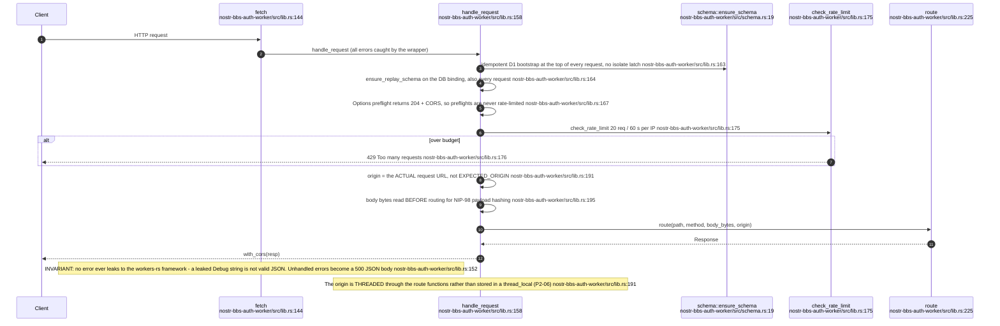
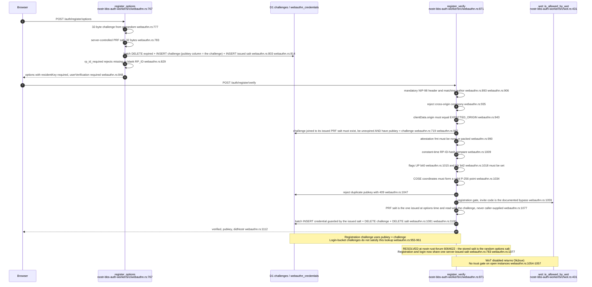
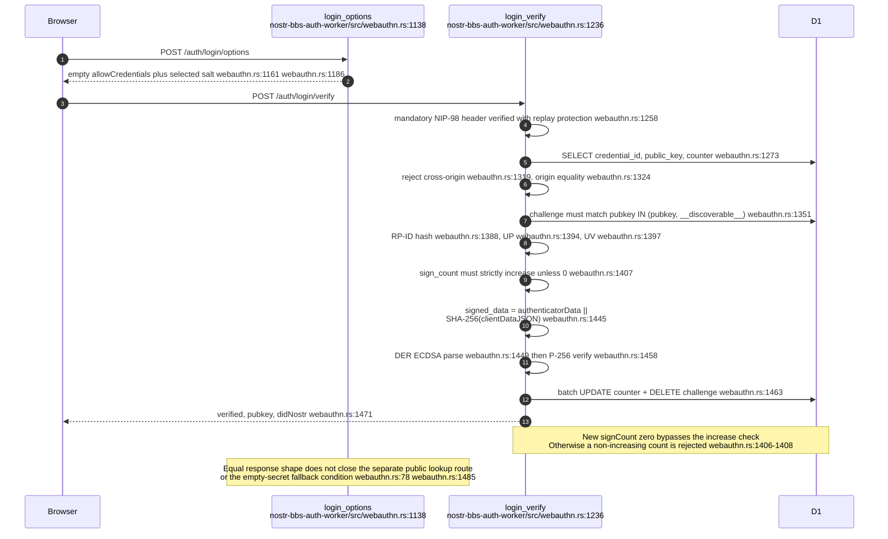
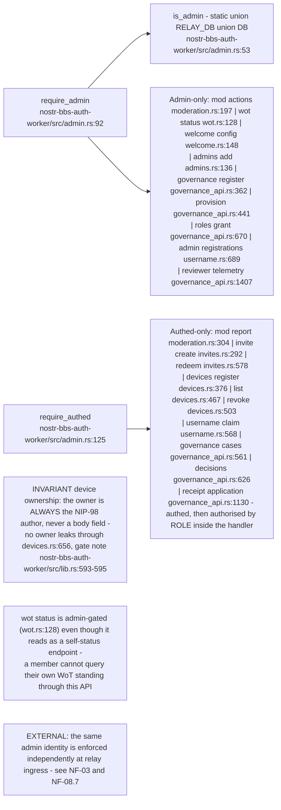
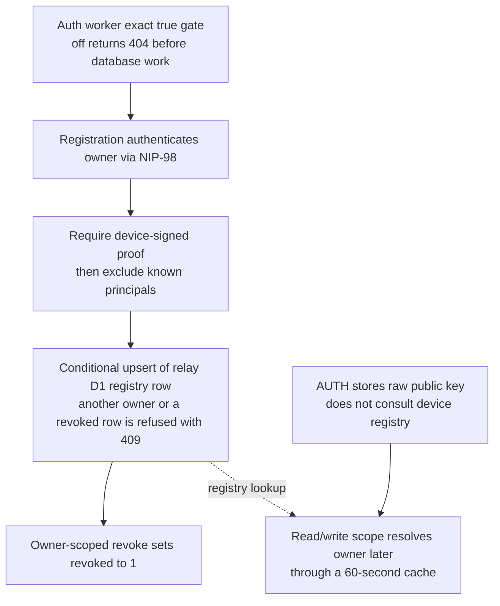
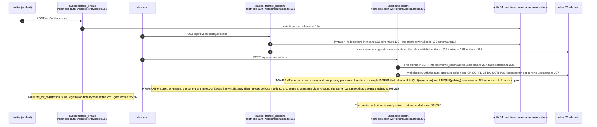
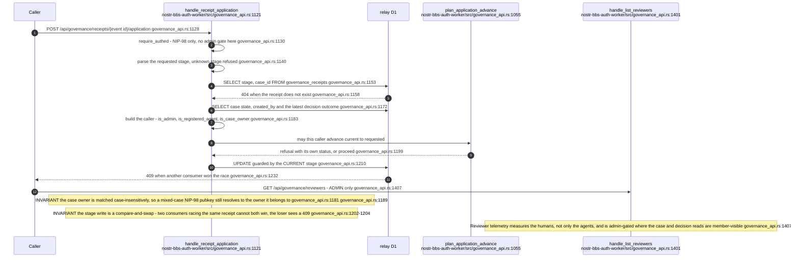

## NF-02.1 Request entry — bootstrap, rate limit, body pre-read, dispatch

## NF-02.2 Route table — public, sprint-API and legacy tiers

```mermaid
flowchart TB
    subgraph pub["Public - no auth"]
        DID["GET /.well-known/did/nostr/{pk}.json<br/>nostr-bbs-auth-worker/src/lib.rs:234 to did::handle_did_document nostr-bbs-auth-worker/src/did.rs:23<br/>rendering delegates to nostr_bbs_core::did, canonical Multikey doc carries no alsoKnownAs did.rs:8,89,90<br/>the route holds only the D1 identifier, so publicKeyMultibase is the fe70102 even-y form, did-nostr#145 did.rs:18"]
        HEALTH["GET /health nostr-bbs-auth-worker/src/lib.rs:241"]
        REGO["POST /auth/register/options nostr-bbs-auth-worker/src/lib.rs:254"]
        REGV["POST /auth/register/verify nostr-bbs-auth-worker/src/lib.rs:259"]
        LOGO["POST /auth/login/options nostr-bbs-auth-worker/src/lib.rs:265"]
        LOGV["POST /auth/login/verify nostr-bbs-auth-worker/src/lib.rs:270"]
        LOOKUP["POST /auth/lookup nostr-bbs-auth-worker/src/lib.rs:275"]
        UCHECK["GET /api/username/check nostr-bbs-auth-worker/src/lib.rs:622"]
        URESOLVE["GET /api/username/resolve nostr-bbs-auth-worker/src/lib.rs:627<br/>resolve D1 is the trust root, federated pod probe only on miss in Federated mode username.rs:844,829,812"]
        IPREV["GET /api/invites/{code} preview nostr-bbs-auth-worker/src/lib.rs:443"]
    end
    subgraph sprint["route_sprint_api - each handler does its own NIP-98 + gate"]
        MOD["mod: ban mute warn unban unmute nostr-bbs-auth-worker/src/lib.rs:376 | report nostr-bbs-auth-worker/src/lib.rs:384 | actions nostr-bbs-auth-worker/src/lib.rs:388 | reports nostr-bbs-auth-worker/src/lib.rs:392 | reports/{id}/action nostr-bbs-auth-worker/src/lib.rs:397"]
        WOT["wot: status nostr-bbs-auth-worker/src/lib.rs:414 | set-referente nostr-bbs-auth-worker/src/lib.rs:418 | refresh nostr-bbs-auth-worker/src/lib.rs:422 | override add/remove nostr-bbs-auth-worker/src/lib.rs:426"]
        INV["invites: create nostr-bbs-auth-worker/src/lib.rs:434 | mine nostr-bbs-auth-worker/src/lib.rs:438 | revoke + redeem nostr-bbs-auth-worker/src/lib.rs:443"]
        WEL["welcome: config nostr-bbs-auth-worker/src/lib.rs:472 | configure nostr-bbs-auth-worker/src/lib.rs:476 | set-bot-key nostr-bbs-auth-worker/src/lib.rs:480 | test nostr-bbs-auth-worker/src/lib.rs:484<br/>set-bot-key nsec is sealed with ChaCha20-Poly1305 under WELCOME_MASTER_KEY crypto.rs:77,97"]
        ADM["admins: list nostr-bbs-auth-worker/src/lib.rs:490 | add nostr-bbs-auth-worker/src/lib.rs:494 | remove nostr-bbs-auth-worker/src/lib.rs:498 | delete-member nostr-bbs-auth-worker/src/lib.rs:504"]
        GOV["governance: agents nostr-bbs-auth-worker/src/lib.rs:510 register nostr-bbs-auth-worker/src/lib.rs:514 provision nostr-bbs-auth-worker/src/lib.rs:519 revoke nostr-bbs-auth-worker/src/lib.rs:524 | cases nostr-bbs-auth-worker/src/lib.rs:529 :533 | decisions nostr-bbs-auth-worker/src/lib.rs:555 | roles grant nostr-bbs-auth-worker/src/lib.rs:559 revoke nostr-bbs-auth-worker/src/lib.rs:563 list nostr-bbs-auth-worker/src/lib.rs:588 | receipt application nostr-bbs-auth-worker/src/lib.rs:568 | reviewers nostr-bbs-auth-worker/src/lib.rs:584 | OPT-IN POST cases/{id}/rationale-check, routed only while JEV_RATIONALE_CHECK is on nostr-bbs-auth-worker/src/lib.rs:542, handler nostr-bbs-auth-worker/src/rationale_check.rs:257"]
        DEV["devices: list nostr-bbs-auth-worker/src/lib.rs:596 | register nostr-bbs-auth-worker/src/lib.rs:600 | revoke nostr-bbs-auth-worker/src/lib.rs:604"]
        NAME["username: claim nostr-bbs-auth-worker/src/lib.rs:631 | release nostr-bbs-auth-worker/src/lib.rs:635 | profile/real-name nostr-bbs-auth-worker/src/lib.rs:642 :646 | admin/registrations nostr-bbs-auth-worker/src/lib.rs:651, dismiss nostr-bbs-auth-worker/src/lib.rs:656"]
        NIP1984["GET /api/moderation/reports nostr-bbs-auth-worker/src/lib.rs:610"]
        NPOD["POST /api/native-pod/provision nostr-bbs-auth-worker/src/lib.rs:616"]
    end
    subgraph legacy["Legacy /api/ tier - central NIP-98 verify"]
        PROF["GET /api/profile nostr-bbs-auth-worker/src/lib.rs:334 to pod::handle_profile nostr-bbs-auth-worker/src/pod.rs:9"]
    end

    DID ~~~ HEALTH ~~~ REGO ~~~ REGV ~~~ LOGO ~~~ LOGV ~~~ LOOKUP ~~~ UCHECK ~~~ URESOLVE ~~~ IPREV
    MOD ~~~ WOT ~~~ INV ~~~ WEL ~~~ ADM ~~~ GOV ~~~ DEV ~~~ NAME ~~~ NIP1984 ~~~ NPOD

    ENTRY["route nostr-bbs-auth-worker/src/lib.rs:225"] --> pub
    ENTRY --> sprint
    ENTRY -->|"falls through when route_sprint_api returns None nostr-bbs-auth-worker/src/lib.rs:288"| legacy
    legacy -->|"no match"| NF["404 Not found nostr-bbs-auth-worker/src/lib.rs:349"]

    N1["Sprint handlers are dispatched BEFORE the legacy verify branch because they run their own<br/>require_admin / require_authed gates nostr-bbs-auth-worker/src/lib.rs:280-288"]
    N2["ANOMALY O11 (recorded live by an earlier review, not re-run here): /api/native-pod/provision nostr-bbs-auth-worker/src/lib.rs:616 requires NATIVE_POD_URL and the<br/>NATIVE_POD_ADMIN_KEY secret; both are placeholders in the template nostr-bbs-auth-worker/wrangler.toml:66"]
```

**Invariant:** `SESSIONS` (the rate limiter's `rl:{ip}:{bucket}` keys) and `KV` (the admin pubkey cache) bind the same KV namespace id, so the admin cache key must never start with `rl:` (`../nostr-rust-forum/crates/nostr-bbs-auth-worker/src/admins.rs:347`, `../nostr-rust-forum/crates/nostr-bbs-auth-worker/wrangler.toml:22-25`).

**Open:** the rationale-check route and its flag `JEV_RATIONALE_CHECK` are off in the library but ON in the committed auth template, `JEV_RATIONALE_CHECK = "1"` (`../nostr-rust-forum/crates/nostr-bbs-auth-worker/wrangler.toml:53`; flag name `../nostr-rust-forum/crates/nostr-bbs-auth-worker/src/rationale_check.rs:36`); the check is advisory and, since the 2026-10-30 pin, cloud by default: locality is the operator's own `JEV_RATIONALE_CHECK_LOCAL_ONLY` switch (`../nostr-rust-forum/crates/nostr-bbs-auth-worker/src/rationale_check.rs:38`, read at `../nostr-rust-forum/crates/nostr-bbs-auth-worker/src/rationale_check.rs:303`), default off, so the proxy or TypeSafe with `TYPESAFE_API_KEY` may answer; setting it to `1` makes the route report unavailable until a deployment supplies a sovereign endpoint (`../nostr-rust-forum/crates/nostr-bbs-auth-worker/wrangler.toml:54-58`).

## NF-02.3 Passkey registration — the full verify chain

## NF-02.4 Passkey login — assertion verification and clone detection

[The passkey contract review](../../estate-review/2026-11-01-forum-passkey-contracts.md) qualifies NF-02.3/4: at its stamp both clients omitted the required registration header and the issued and stored salts differed; both are repaired at 6064622 (both clients sign register/verify with NIP-98, `../nostr-rust-forum/crates/nostr-bbs-forum-client/src/auth/passkey.rs:182`, `../nostr-rust-forum/crates/nostr-bbs-bbs-client/src/passkey.rs:356`, and the stored salt is the issued one, `../nostr-rust-forum/crates/nostr-bbs-auth-worker/src/webauthn.rs:1077`); lookup remains public, and challenge reads are separate from unconditional consumption. NF-23 records the probes and parser limits. These worker sequences show handler order, not a successfully completed client ceremony.

## NF-02.5 NIP-98 gate and the single-use replay store

```mermaid
sequenceDiagram
    autonumber
    participant H as Route handler
    participant A as auth::verify_nip98_replay<br/>nostr-bbs-auth-worker/src/auth.rs:15
    participant RLC as nostr_bbs_rate_limit::verify_nip98<br/>nostr-bbs-rate-limit/src/replay.rs:148, re-exported nostr-bbs-rate-limit/src/lib.rs:21
    participant D1 as nostr-bbs-auth D1 (binding DB)

    H->>A: header, canonical URL, method, body bytes
    A->>RLC: delegate with REPLAY_DB = "DB" nostr-bbs-auth-worker/src/auth.rs:11
    RLC->>RLC: core verify_token_full - Schnorr, URL, method, payload hash, created_at window - BEFORE any replay write nostr-bbs-core/src/nip98.rs:576
    RLC->>D1: then seen_or_record, an atomic INSERT OR IGNORE on the replay row nostr-bbs-core/src/nip98.rs:585 nostr-bbs-rate-limit/src/replay.rs:13
    alt row already present
        D1-->>H: replay rejected
    end
    RLC-->>H: Nip98Token { pubkey, .. }

    Note over A: INVARIANT: every worker binds its replay store to the SAME database (nostr-bbs-auth) so cross-worker replay is detected nostr-bbs-auth-worker/src/auth.rs:9-11 - the auth template's DB id nostr-bbs-auth-worker/wrangler.toml:11 is the id the relay, pod and search templates give REPLAY_DB - see NF-08.4
    Note over D1: OPEN: RESOLVED at nostr-rust-forum 6064622 - when D1 returns no write metadata the store returns an error, so the replay check fails closed on that path nostr-bbs-rate-limit/src/replay.rs:40-43 nostr-bbs-rate-limit/src/replay.rs:47-55
    Note over H: canonical_url composes the ACTUAL origin with the path so a workers.dev token verifies against a custom-domain deployment nostr-bbs-auth-worker/src/lib.rs:313
    Note over RLC: EXTERNAL: agentbox terminates NIP-98 at its own proxy with an independent single-use cache - see AB-10
```

**Open:** RESOLVED at nostr-rust-forum 6064622 — the D1 replay store no longer answers first-seen when D1 returns no write metadata: absent metadata is an error (`../nostr-rust-forum/crates/nostr-bbs-rate-limit/src/replay.rs:40-43`) and so is an omitted changed-row count (`../nostr-rust-forum/crates/nostr-bbs-rate-limit/src/replay.rs:47-55`), which the verifier surfaces as a replay-backend error rather than a pass (`../nostr-rust-forum/crates/nostr-bbs-core/src/nip98.rs:585-588`; the trait contract is `true` on first observation, `../nostr-rust-forum/crates/nostr-bbs-core/src/nip98.rs:94-96`). The full signature, URL, method, payload and freshness check still runs first (`../nostr-rust-forum/crates/nostr-bbs-core/src/nip98.rs:576`).

## NF-02.6 The two gates every sprint handler chooses between

## NF-02.7 Device-key registry — independent gates and delayed revocation

[ADR-2004 review and NF-20](../../estate-review/2026-11-01-forum-device-keys.md) distinguish exact worker gating from client interoperability and revocation acceptance. The 2026-11-02 forum-workers review ([report](../../estate-review/2026-11-02-forum-workers-auth-relay-pod.md)) re-assessed every NF-02 panel at `c39f41f`.

## NF-02.8 Membership creation paths — invite redemption and username claim

## NF-02.10 Application receipts — who may say what became of a decision

**Drift:** the compare-and-swap comment names the guard `stage = ?5` (`../nostr-rust-forum/crates/nostr-bbs-auth-worker/src/governance_api.rs:1202`), but in the statement `?5` is the event id and the stage guard is `?6` (`../nostr-rust-forum/crates/nostr-bbs-auth-worker/src/governance_api.rs:1210`). The behaviour matches the invariant; only the comment is stale.
