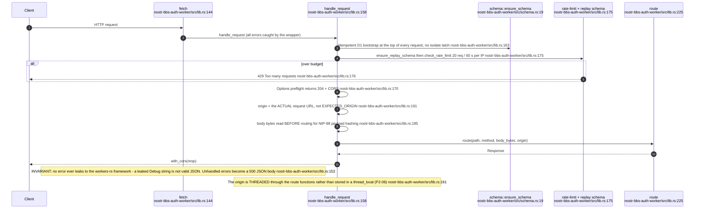
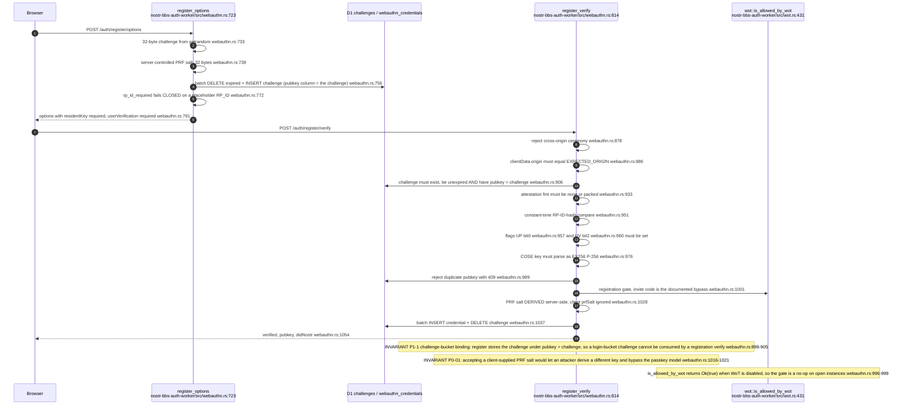
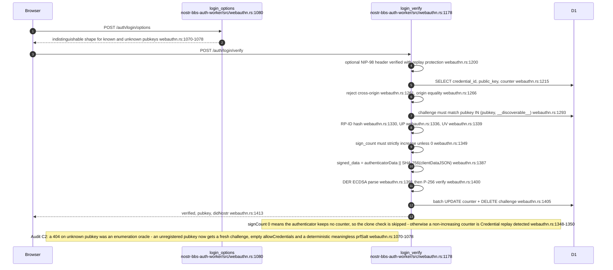
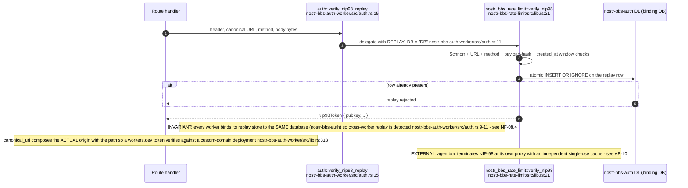
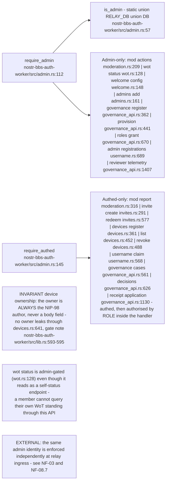
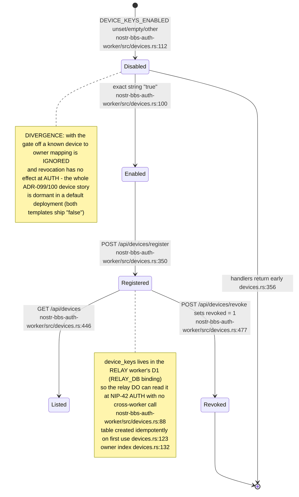
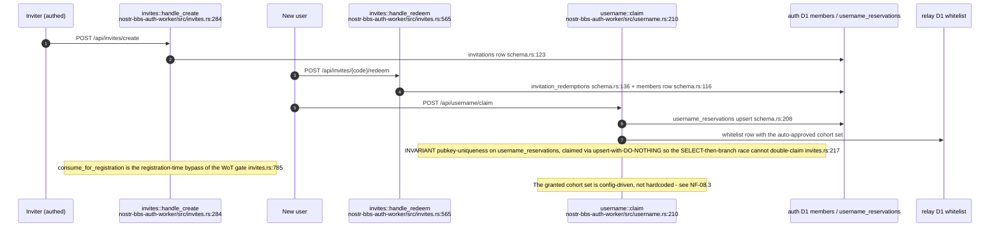
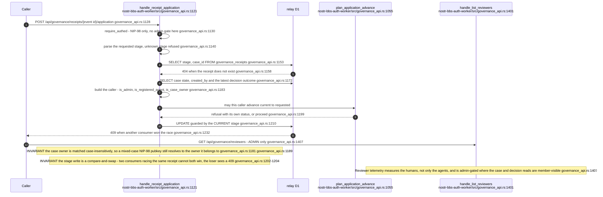

## NF-02.1 Request entry — bootstrap, rate limit, body pre-read, dispatch

## NF-02.2 Route table — public, sprint-API and legacy tiers

```mermaid
flowchart TB
    subgraph pub["Public - no auth"]
        DID["GET /.well-known/did/nostr/{pk}.json<br/>nostr-bbs-auth-worker/src/lib.rs:234 to did::handle_did_document nostr-bbs-auth-worker/src/did.rs:23<br/>rendering delegates to nostr_bbs_core::did, canonical Multikey doc carries no alsoKnownAs did.rs:8,89,90<br/>the route holds only the D1 identifier, so publicKeyMultibase is the fe70102 even-y form, did-nostr#145 did.rs:18"]
        HEALTH["GET /health nostr-bbs-auth-worker/src/lib.rs:241"]
        REGO["POST /auth/register/options nostr-bbs-auth-worker/src/lib.rs:254"]
        REGV["POST /auth/register/verify nostr-bbs-auth-worker/src/lib.rs:259"]
        LOGO["POST /auth/login/options nostr-bbs-auth-worker/src/lib.rs:265"]
        LOGV["POST /auth/login/verify nostr-bbs-auth-worker/src/lib.rs:270"]
        LOOKUP["POST /auth/lookup nostr-bbs-auth-worker/src/lib.rs:275"]
        UCHECK["GET /api/username/check nostr-bbs-auth-worker/src/lib.rs:622"]
        URESOLVE["GET /api/username/resolve nostr-bbs-auth-worker/src/lib.rs:627<br/>resolve D1 is the trust root, federated pod probe only on miss in Federated mode username.rs:844,829,812"]
        IPREV["GET /api/invites/{code} preview nostr-bbs-auth-worker/src/lib.rs:443"]
    end
    subgraph sprint["route_sprint_api - each handler does its own NIP-98 + gate"]
        MOD["mod: ban mute warn unban unmute nostr-bbs-auth-worker/src/lib.rs:376 | report nostr-bbs-auth-worker/src/lib.rs:384 | actions nostr-bbs-auth-worker/src/lib.rs:388 | reports nostr-bbs-auth-worker/src/lib.rs:392 | reports/{id}/action nostr-bbs-auth-worker/src/lib.rs:397"]
        WOT["wot: status nostr-bbs-auth-worker/src/lib.rs:414 | set-referente nostr-bbs-auth-worker/src/lib.rs:418 | refresh nostr-bbs-auth-worker/src/lib.rs:422 | override add/remove nostr-bbs-auth-worker/src/lib.rs:426"]
        INV["invites: create nostr-bbs-auth-worker/src/lib.rs:434 | mine nostr-bbs-auth-worker/src/lib.rs:438 | revoke + redeem nostr-bbs-auth-worker/src/lib.rs:443"]
        WEL["welcome: config nostr-bbs-auth-worker/src/lib.rs:472 | configure nostr-bbs-auth-worker/src/lib.rs:476 | set-bot-key nostr-bbs-auth-worker/src/lib.rs:480 | test nostr-bbs-auth-worker/src/lib.rs:484<br/>set-bot-key nsec is sealed with ChaCha20-Poly1305 under WELCOME_MASTER_KEY crypto.rs:77,97"]
        ADM["admins: list nostr-bbs-auth-worker/src/lib.rs:490 | add nostr-bbs-auth-worker/src/lib.rs:494 | remove nostr-bbs-auth-worker/src/lib.rs:498 | delete-member nostr-bbs-auth-worker/src/lib.rs:504"]
        GOV["governance: agents nostr-bbs-auth-worker/src/lib.rs:510 register nostr-bbs-auth-worker/src/lib.rs:514 provision nostr-bbs-auth-worker/src/lib.rs:519 revoke nostr-bbs-auth-worker/src/lib.rs:524 | cases nostr-bbs-auth-worker/src/lib.rs:529 :533 | decisions nostr-bbs-auth-worker/src/lib.rs:555 | roles grant nostr-bbs-auth-worker/src/lib.rs:559 revoke nostr-bbs-auth-worker/src/lib.rs:563 list nostr-bbs-auth-worker/src/lib.rs:588 | receipt application nostr-bbs-auth-worker/src/lib.rs:568 | reviewers nostr-bbs-auth-worker/src/lib.rs:584 | OPT-IN POST cases/{id}/rationale-check, routed only while JEV_RATIONALE_CHECK is on nostr-bbs-auth-worker/src/lib.rs:542, handler nostr-bbs-auth-worker/src/rationale_check.rs:255"]
        DEV["devices: list nostr-bbs-auth-worker/src/lib.rs:596 | register nostr-bbs-auth-worker/src/lib.rs:600 | revoke nostr-bbs-auth-worker/src/lib.rs:604"]
        NAME["username: claim nostr-bbs-auth-worker/src/lib.rs:631 | release nostr-bbs-auth-worker/src/lib.rs:635 | profile/real-name nostr-bbs-auth-worker/src/lib.rs:642 :646 | admin/registrations nostr-bbs-auth-worker/src/lib.rs:651, dismiss nostr-bbs-auth-worker/src/lib.rs:656"]
        NIP1984["GET /api/moderation/reports nostr-bbs-auth-worker/src/lib.rs:610"]
        NPOD["POST /api/native-pod/provision nostr-bbs-auth-worker/src/lib.rs:616"]
    end
    subgraph legacy["Legacy /api/ tier - central NIP-98 verify"]
        PROF["GET /api/profile nostr-bbs-auth-worker/src/lib.rs:334 to pod::handle_profile nostr-bbs-auth-worker/src/pod.rs:9"]
    end

    DID ~~~ HEALTH ~~~ REGO ~~~ REGV ~~~ LOGO ~~~ LOGV ~~~ LOOKUP ~~~ UCHECK ~~~ URESOLVE ~~~ IPREV
    MOD ~~~ WOT ~~~ INV ~~~ WEL ~~~ ADM ~~~ GOV ~~~ DEV ~~~ NAME ~~~ NIP1984 ~~~ NPOD

    ENTRY["route nostr-bbs-auth-worker/src/lib.rs:225"] --> pub
    ENTRY --> sprint
    ENTRY -->|"falls through when route_sprint_api returns None nostr-bbs-auth-worker/src/lib.rs:288"| legacy
    legacy -->|"no match"| NF["404 Not found nostr-bbs-auth-worker/src/lib.rs:349"]

    N1["Sprint handlers are dispatched BEFORE the legacy verify branch because they run their own<br/>require_admin / require_authed gates nostr-bbs-auth-worker/src/lib.rs:280-288"]
    N2["ANOMALY O11 confirmed live: /api/native-pod/provision nostr-bbs-auth-worker/src/lib.rs:616 requires NATIVE_POD_URL and the<br/>NATIVE_POD_ADMIN_KEY secret; both are placeholders in the template nostr-bbs-auth-worker/wrangler.toml:66"]
```

**Invariant:** `SESSIONS` (the rate limiter's `rl:{ip}:{bucket}` keys) and `KV` (the admin pubkey cache) bind the same KV namespace id, so the admin cache key must never start with `rl:` (`../nostr-rust-forum/crates/nostr-bbs-auth-worker/src/admins.rs:372`, `../nostr-rust-forum/crates/nostr-bbs-auth-worker/wrangler.toml:22-25`).

**Open:** the rationale-check route and its flag `JEV_RATIONALE_CHECK` are off in the library but ON in the committed auth template, `JEV_RATIONALE_CHECK = "1"` (`../nostr-rust-forum/crates/nostr-bbs-auth-worker/wrangler.toml:53`; flag name `../nostr-rust-forum/crates/nostr-bbs-auth-worker/src/rationale_check.rs:36`); the check is advisory and, since the 2026-10-30 pin, cloud by default: locality is the operator's own `JEV_RATIONALE_CHECK_LOCAL_ONLY` switch (`../nostr-rust-forum/crates/nostr-bbs-auth-worker/src/rationale_check.rs:38`, read at `../nostr-rust-forum/crates/nostr-bbs-auth-worker/src/rationale_check.rs:301`), default off, so the proxy or TypeSafe with `TYPESAFE_API_KEY` may answer; setting it to `1` makes the route report unavailable until a deployment supplies a sovereign endpoint (`../nostr-rust-forum/crates/nostr-bbs-auth-worker/wrangler.toml:54-58`).

## NF-02.3 Passkey registration — the full verify chain

## NF-02.4 Passkey login — assertion verification and clone detection

## NF-02.5 NIP-98 gate and the single-use replay store

## NF-02.6 The two gates every sprint handler chooses between

## NF-02.7 Device-key registry — default-off, dual-worker gate, relay-owned table

## NF-02.8 Membership creation paths — invite redemption and username claim

## NF-02.10 Application receipts — who may say what became of a decision

