## NF-03.1 Worker entry — three doors into the relay

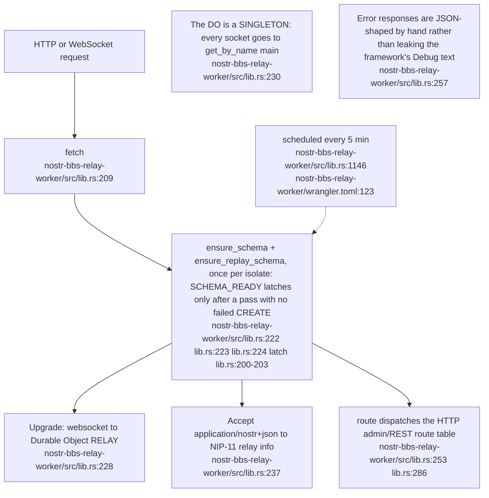

## NF-03.2 NIP-42 AUTH — the verdict table

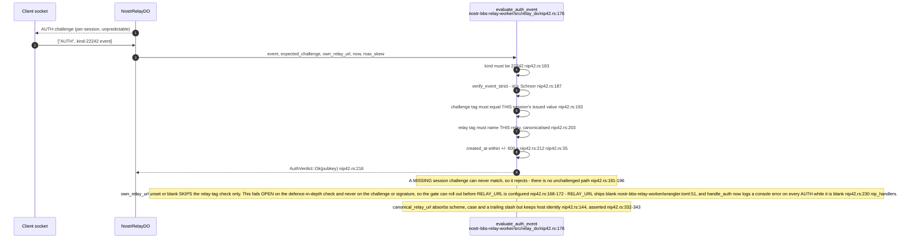

## NF-03.3 AUTH_MODE — the write gate and the protected-read set

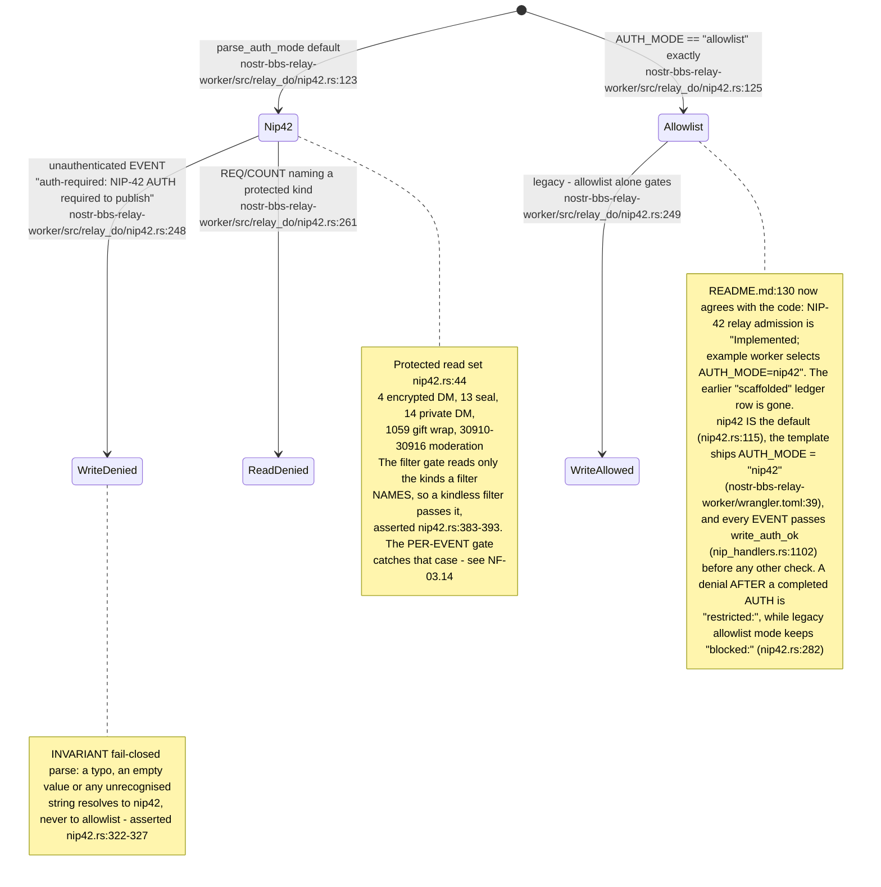

## NF-03.4 EVENT admission pipeline — every gate, in order

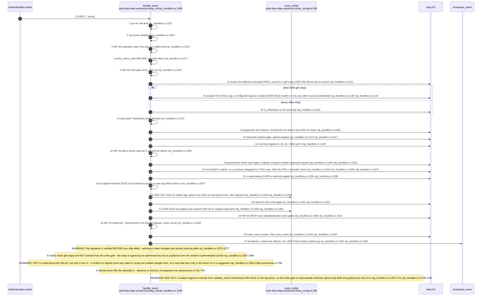

## NF-03.5 Gift-wrap admission — recipient-keyed, never author-keyed

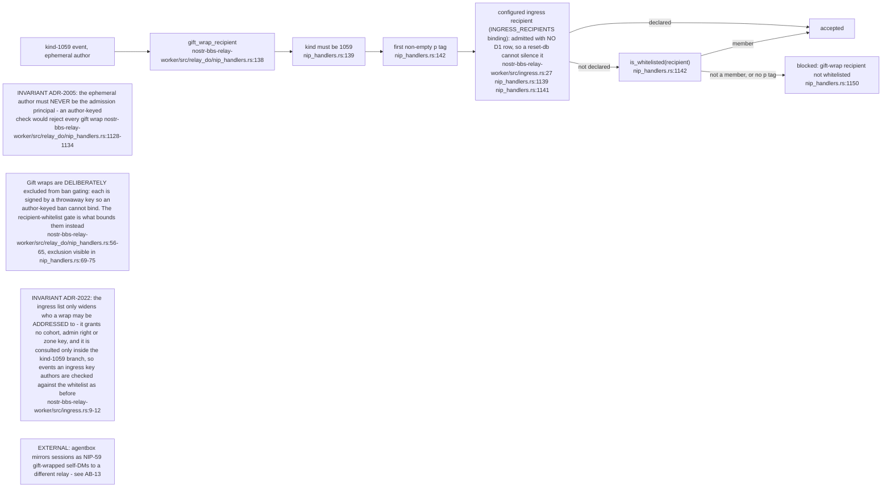

## NF-03.6 Ban gating — which kinds a banned author may not publish

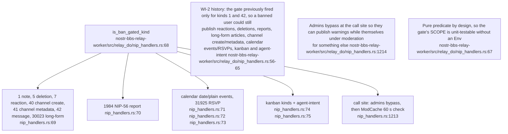

## NF-03.7 Trust-level gates on the admission path

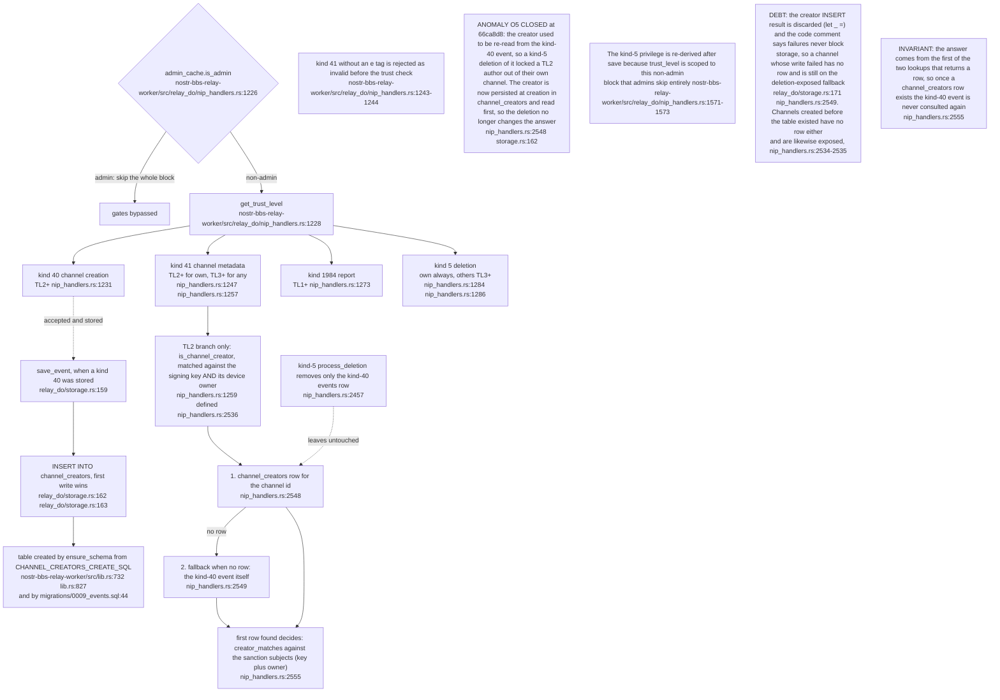

## NF-03.8 The trust ladder — promotion, hysteresis, and what is never demoted

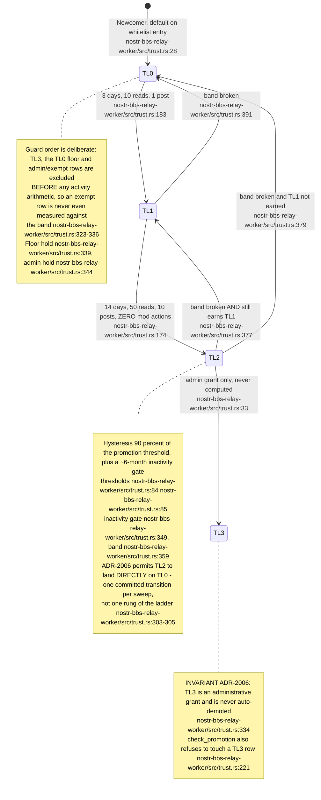

## NF-03.9 Why a demotion did NOT happen — the named hold reasons

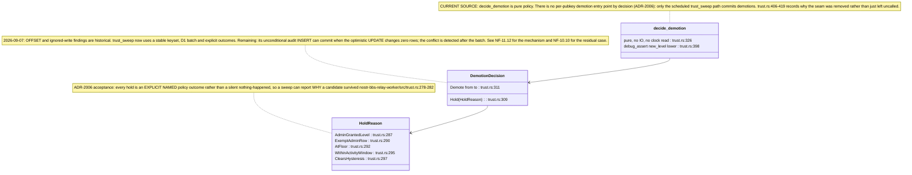

## NF-03.10 Post-save effects — activity coalescing, moderation mirror, governance projection

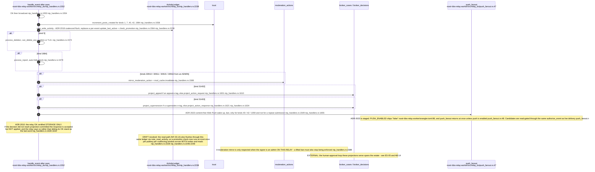

**Tension (ADR-2010 vs code):** ADR-2010 records `decision_status: proposed`, `implementation_status: partial`, `activation_status: staged` (`../nostr-rust-forum/docs/adr/ADR-2010-durable-governance-outcome-receipts.md:5-7`), yet `handle_event` runs all three receipt-bearing projections (appeal, supersession, first-order response) unconditionally after every stored governance event (`nostr-bbs-relay-worker/src/relay_do/nip_handlers.rs:1601`, `nostr-bbs-relay-worker/src/relay_do/nip_handlers.rs:1621`, `nostr-bbs-relay-worker/src/relay_do/nip_handlers.rs:1634`).

## NF-03.11 Structural validation limits

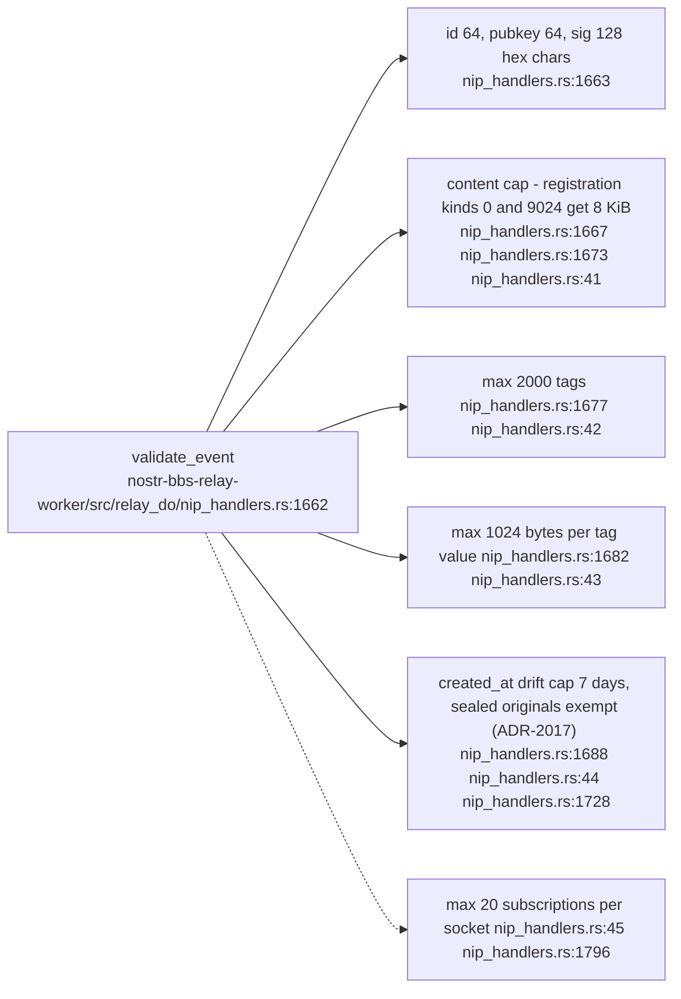

## NF-03.12 Zone enforcement on writes — sealed originals, encrypted-zone ciphertext, plain writes

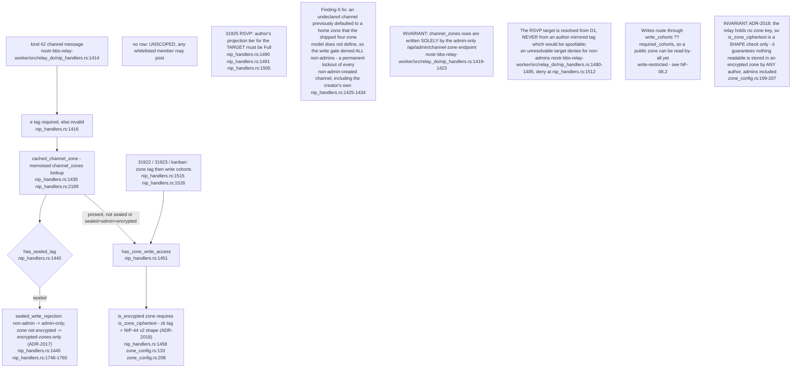

## NF-03.13 Mesh federation — configured, gated, and not actually wired

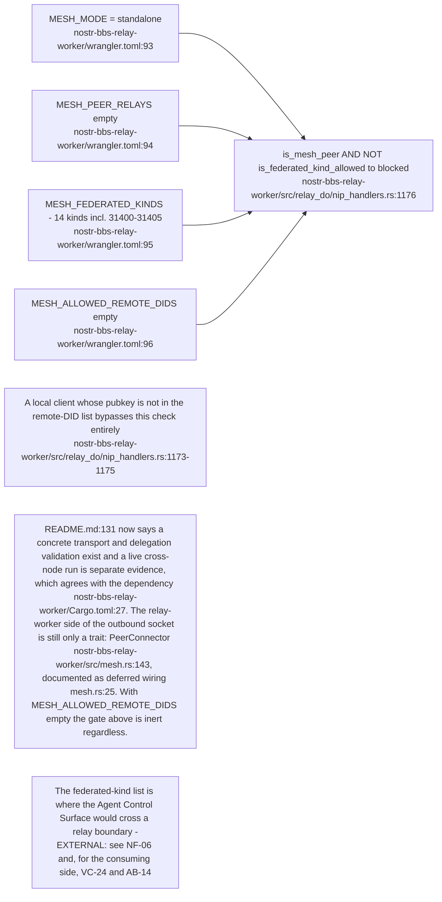

## NF-03.14 Protected reads — the filter gate, viewer-context caching, and the per-event gate

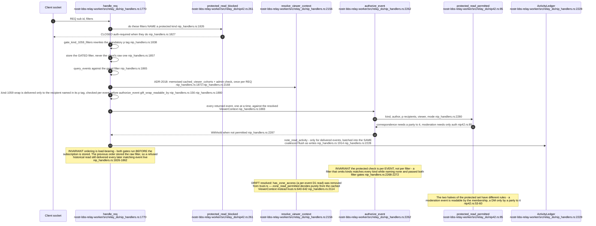
