## NF-05.1 Forum client boot and the FORUM_BASE discipline

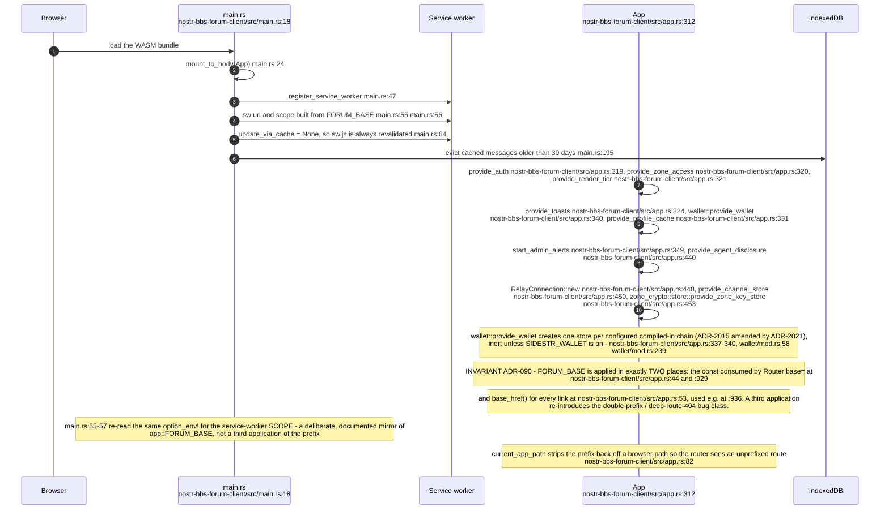

**Debt:** the mobile bottom nav strips the prefix with its own `option_env!("FORUM_BASE")` read (`../nostr-rust-forum/crates/nostr-bbs-forum-client/src/components/mobile_bottom_nav.rs:30`) instead of calling `current_app_path` (`../nostr-rust-forum/crates/nostr-bbs-forum-client/src/app.rs:82`). This is not a third *application* of the prefix, so the ADR-090 invariant above holds. It is a second hand-written copy of the stripping rule, though, and it can drift from `utils::paths::app_path`. Closing it means routing the nav through `current_app_path`.

## NF-05.2 Route table

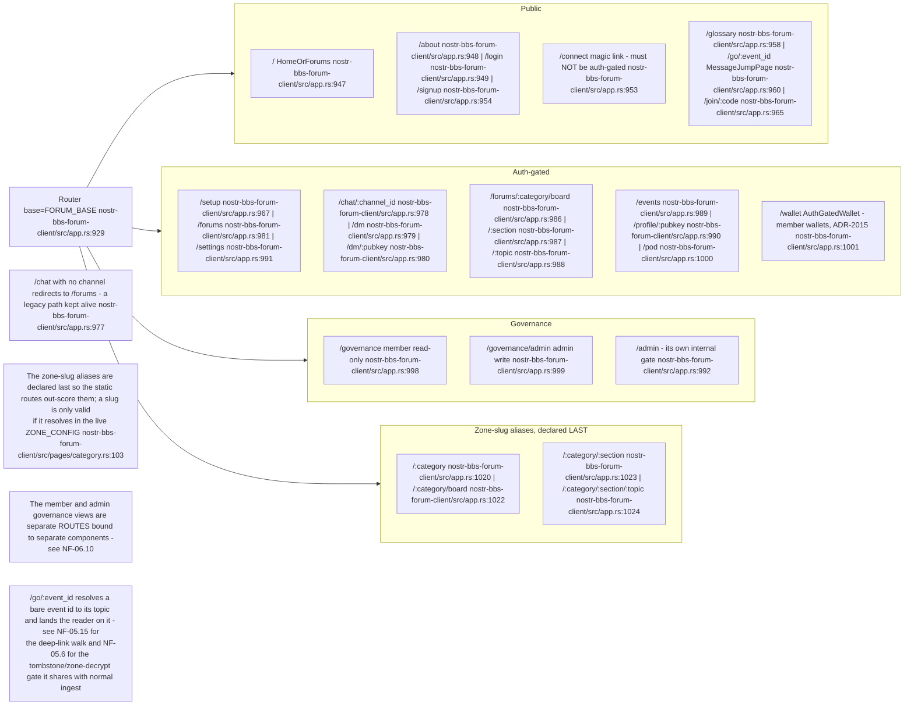

## NF-05.3 Passkey identity — register, log in, derive

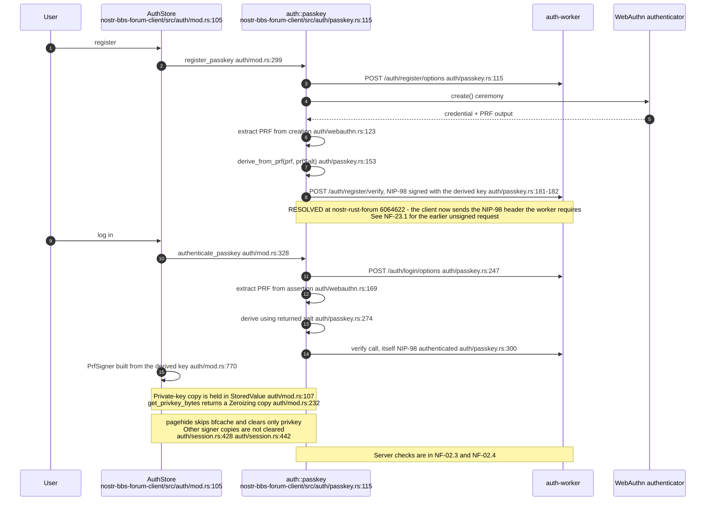

[NF-23 and its report](../../estate-review/2026-11-01-forum-passkey-contracts.md) qualify this sequence. At the report's stamp the worker stored a different PRF salt from creation; that is resolved at 6064622, where the worker stores the salt it issued (`../nostr-rust-forum/crates/nostr-bbs-auth-worker/src/webauthn.rs:1077`). Creation requires PRF evaluation immediately, and the hybrid guard tries an attestation-only method on an assertion. Real authenticator and cross-browser acceptance remain open.

## NF-05.4 Three identity backends behind one signing seam

## NF-05.5 Relay transport — frames in and out

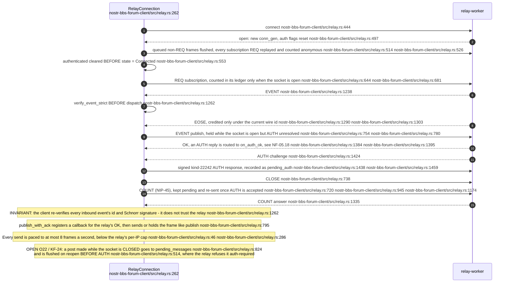

## NF-05.6 Derived, never accumulated — the counting invariant

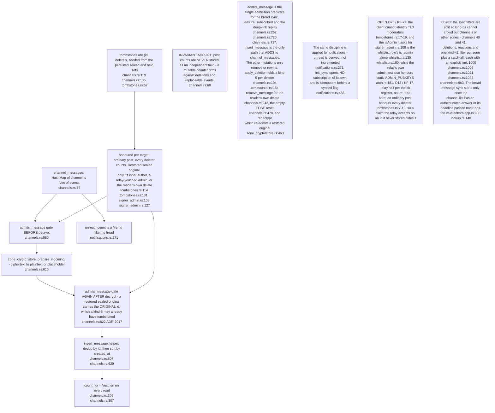

## NF-05.7 Config projection into the browser

## NF-05.8 Signup — generated key, recovery sheet and asynchronous provisioning

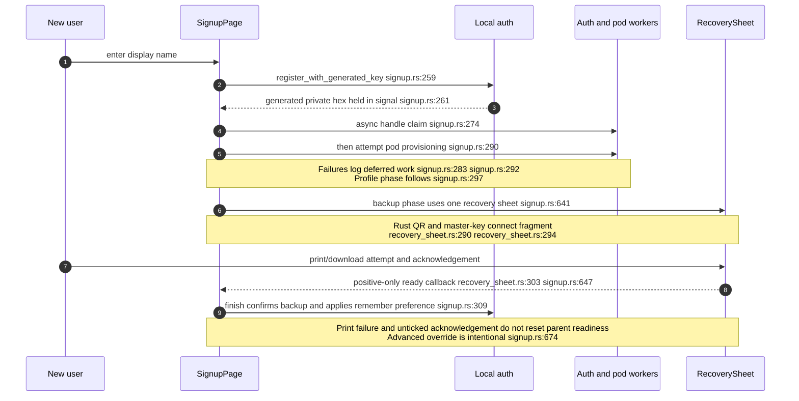

[The recovery review](../../estate-review/2026-11-01-forum-recovery-and-connect.md) and NF-22 distinguish attempted output, local import and relay acceptance. This signup path generates a local key; it is not the passkey ceremony in NF-05.3. The downloaded HTML interpolates unescaped display text and differs from the screen's optional device/sweep sections. Fragment-only navigation excludes the key from the HTTP request, but does not prove WASM-only custody or successful history clearing.

**Invariant:** Settings never publishes a kind-0 over a profile it has not loaded: the save merges only the fields it manages into the member's hydrated kind-0, keeps every other field, and refuses while the existing event is still being fetched, because kind-0 is replaceable and an absent field is lost for good (`../nostr-rust-forum/crates/nostr-bbs-forum-client/src/pages/settings.rs:1850`, `../nostr-rust-forum/crates/nostr-bbs-forum-client/src/pages/settings.rs:1907`). SVG avatars are refused, since the pod serves stored bytes with the declared type (`../nostr-rust-forum/crates/nostr-bbs-forum-client/src/pages/settings.rs:1988`).

## NF-05.9 Direct messages — two wraps per message, and why history exists

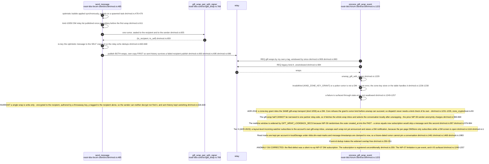

**Open:** ADR-2027 (NIP-17 overlay) is accepted, partly implemented and inactive, and ADR-2028 (NIP-171 key plane, superseding ADR-2026) is proposed and inactive (`../nostr-rust-forum/docs/adr/ADR-2027-nip17-overlay-for-nostr-chat-interop.md:6`, `../nostr-rust-forum/docs/adr/ADR-2028-zones-adopt-nip171-key-plane.md:5`, `:7`). Both implementations reached main with the upgrade-branch merge a80c572 and stay dormant: the extended DM path (reply and imeta rumors, multi-relay delivery) runs only with `RECIPIENT_KEYS_ENABLED` (`../nostr-rust-forum/crates/nostr-bbs-forum-client/src/dm/mod.rs:560`, `:1637-1638`), and the owner activation workflows are still missing ([NF-28](28-nip171-owner-recovery-and-ticket-contracts.md)), so neither is drawn as live here.

## NF-05.10 Feature surfaces the forum client calls out to

```mermaid
flowchart LR
    THREAD["thread reply - kind 42 e-tagging the topic root<br/>nostr-bbs-forum-client/src/pages/thread.rs:1023<br/>edit/delete via kind 5 thread.rs:1091"]
    CHAN["channel message - kind 42<br/>nostr-bbs-forum-client/src/pages/channel.rs:835"]
    EVENTS["calendar - kind 31923 events, 31925 RSVPs<br/>nostr-bbs-forum-client/src/pages/events.rs:137 events.rs:195"]
    SEARCH["global search - kind-40 channel names over the relay<br/>global_search.rs:467 plus NIP-50 text search over kind-42<br/>global_search.rs:725-760, worker as semantic layer/fallback<br/>global_search.rs:360. A hit links to /go/:event_id, not /chat/:channel - see NF-05.2 and NF-05.15"]
    BADGE["agent disclosure over public HTTP GET<br/>nostr-bbs-forum-client/src/components/agent_badge.rs:317"]
    GIT["pod git control panel - _git/status :213 stage :272 unstage :310<br/>discard :359 commit :385 diff :434 log :466<br/>nostr-bbs-forum-client/src/components/git_panel.rs:213"]
    POD["pod browser - {POD_API}/pods/{pubkey} and /HEAD<br/>nostr-bbs-forum-client/src/pages/pod_browser.rs:513 pod_browser.rs:582<br/>OPEN O26 / KF-28: mesh and pod cards print the raw probe error under Details<br/>pod_browser.rs:1045 pod_browser.rs:1058 pod_browser.rs:1181"]
    ADMINT["admin actions - POST /api/admin/suspend :269 and /api/admin/silence :701, NIP-98 signed<br/>nostr-bbs-forum-client/src/admin/user_table.rs:269"]

    N1["DOC-DRIFT consumer-surface-map: the map lists the git panel as calling /.well-known/apps, but the<br/>client fetches and PUTs /apps/manifest.json instead - git_panel.rs:893 and git_panel.rs:946; no<br/>.well-known path exists anywhere in the crate"]
    N2["Calendar: only 31923 (time-based) and 31925 (RSVP) are used client-side. Kind 31922 (date-based),<br/>which the relay ban-gates and zone-gates, has no client surface - see NF-03.6 and NF-03.12"]
    N3["DRIFT resolved: the worker's index was fed only by an admin-gated ingest call, so a member's own<br/>post was unfindable by non-admins. The relay now answers text search directly (NIP-50, matched<br/>case-insensitively against every post's content) and is authoritative; the worker is consulted only<br/>in semantic mode or when the relay returns nothing global_search.rs:336-360"]
    N4["A zone-encrypted post is never a search result either way: the relay match is on ciphertext, which<br/>relay_text_search discards client-side global_search.rs:735-742, and the semantic index is fed only<br/>public content - see NF-07.4"]
```

## NF-05.11 Retro BBS client — session adoption and key custody

Custody and boot-routing correction: [current ADR-2008 review](../../estate-review/2026-11-01-forum-bbs-signer.md). That review was narrow; the whole topic was re-read and restamped at nostr-rust-forum c39f41f on 2026-11-02 ([audit](../../estate-review/2026-11-02-forum-clients-agents-search.md)).

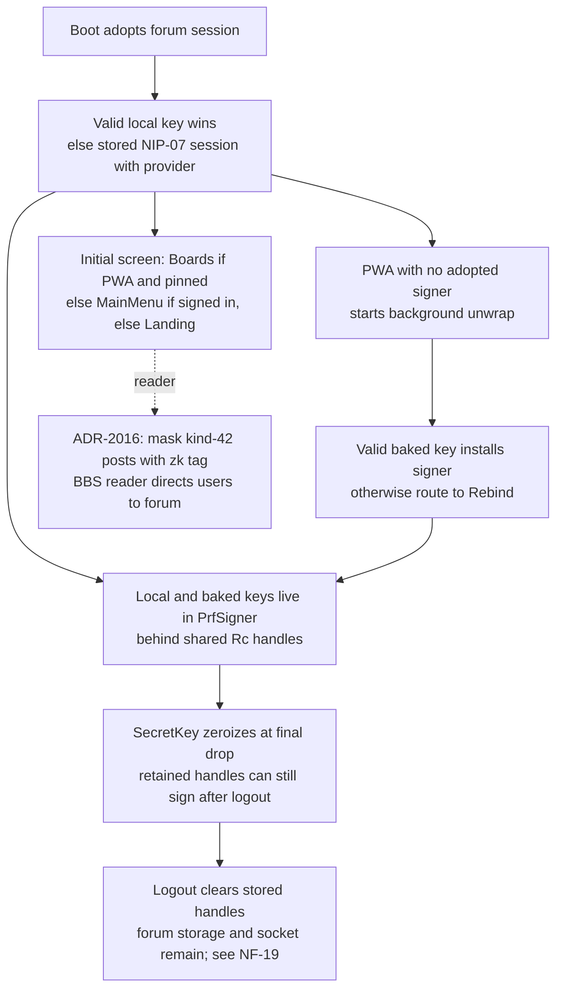

## NF-05.12 BBS screen machine and its own surfaces

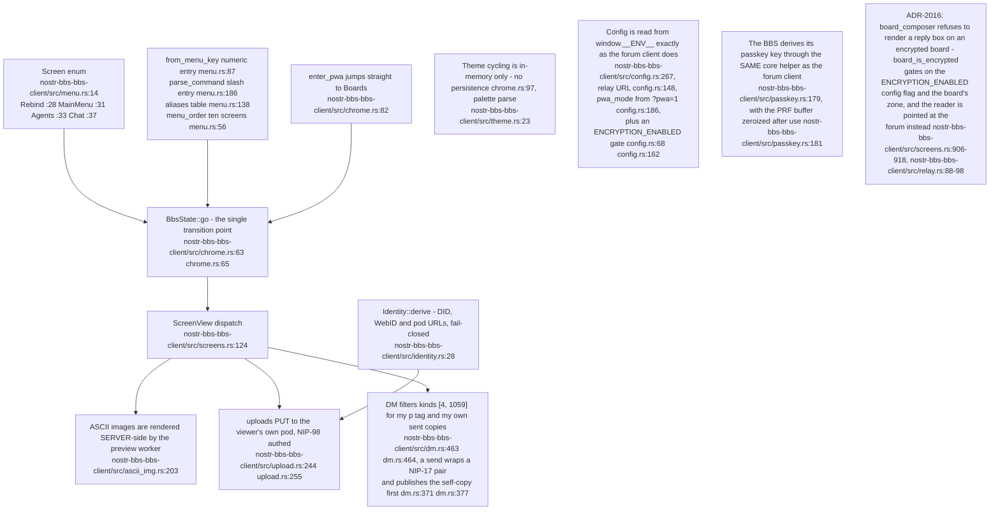

## NF-05.13 Notification ingress — why a reply addressed to you is not burned

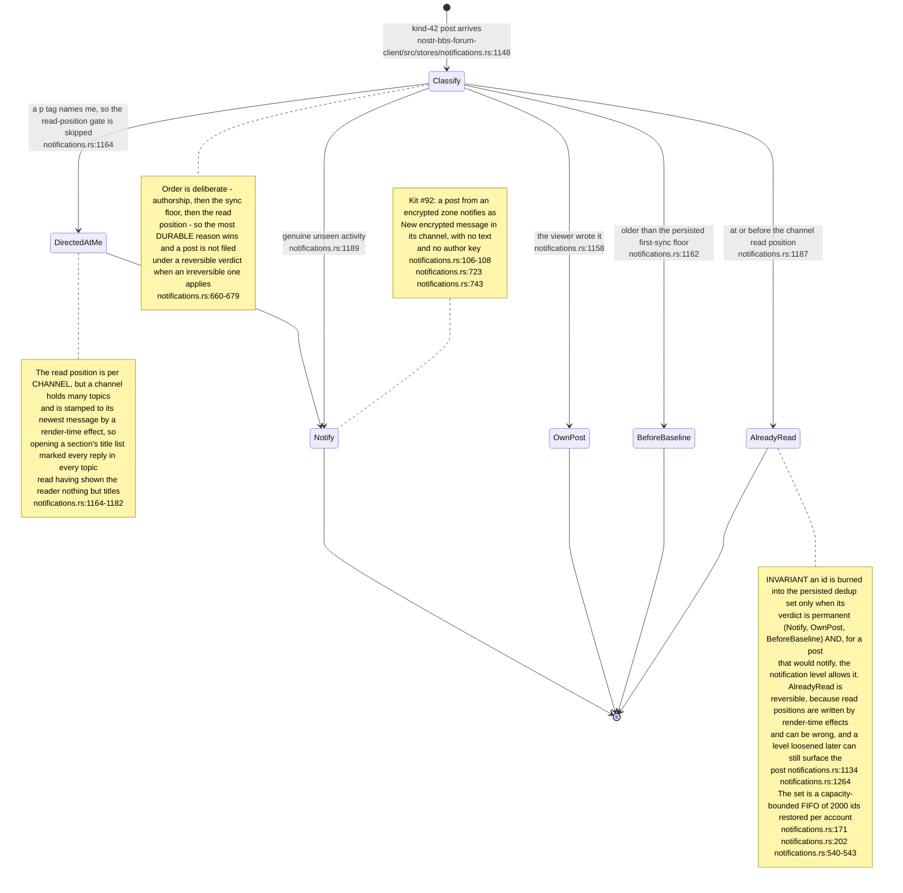

## NF-05.14 Search from the client — relay text search first, the worker as semantic layer

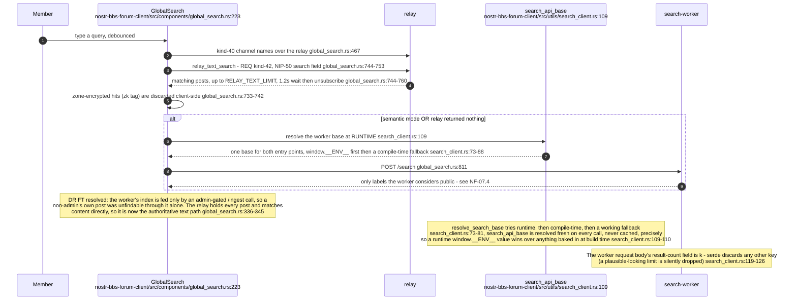

## NF-05.15 Message deep-link — /go/:event_id resolves a bare id to a reader position

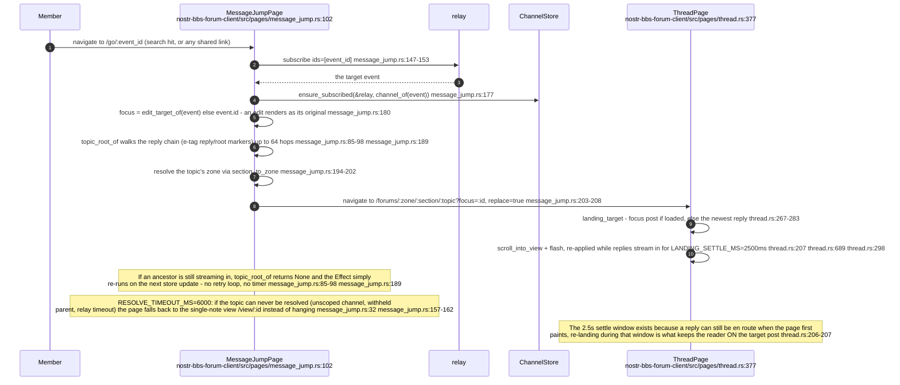

## NF-05.16 Zone encryption depends on resolved policy and locally held keys

[The zone-key audit](../../estate-review/2026-11-01-forum-zone-key-distribution.md) separates tested crypto/planning behaviour from browser-only lifecycle findings. NF-27 expands rotation, delivery and recovery.

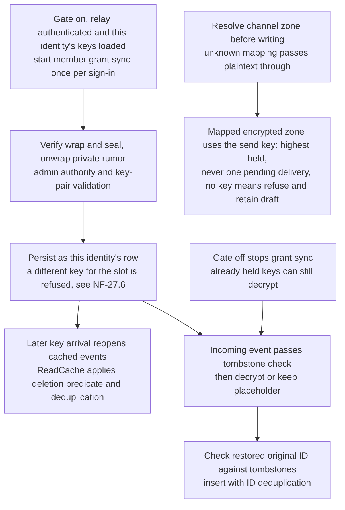

## NF-05.17 Web Push in the client — default off, staged, content-free

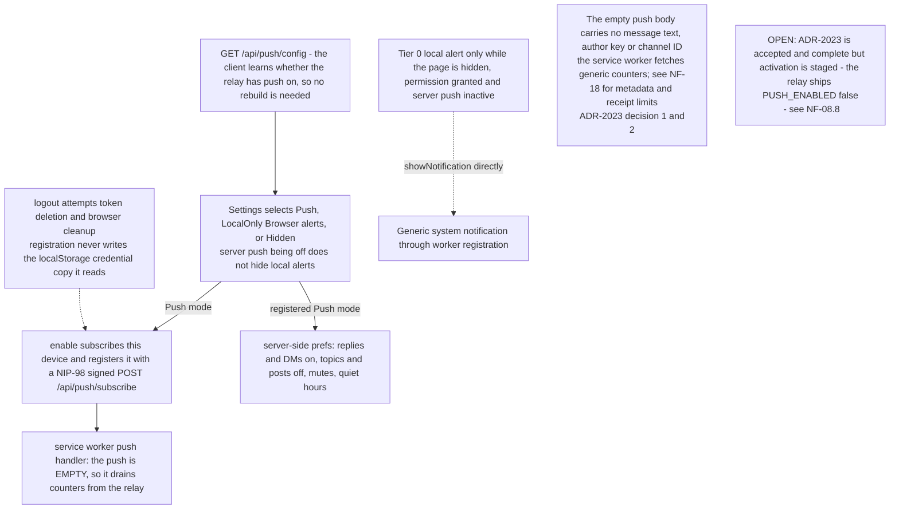

**What it shows.** How the browser side of ADR-2023 works: the client asks the relay whether push is on, subscribes the device with a signed request, and from then on an empty push wakes the service worker, which drains content-free counters. Where server push is off, Tier 0 raises generic system notifications from the page. Logout cleanup is best effort, and its missing credential copy is documented in [the push audit](../../estate-review/2026-11-01-forum-web-push.md).

**Why it is this way.** Push payloads transit Google, Apple and Mozilla, and the service worker has no access to the page’s localStorage or sessionStorage, so ADR-2023 chose payload-less push with a bearer-token drain instead of RFC 8291 encryption (`../nostr-rust-forum/docs/adr/ADR-2023-content-free-web-push-for-pwa-alerts.md:34-35`, `../nostr-rust-forum/docs/adr/ADR-2023-content-free-web-push-for-pwa-alerts.md:38-39`).

**Open:** ADR-2023 records `activation_status: staged` (no live Cloudflare deploy, push-service round trip or iOS device run was verified), and the shipped relay template leaves `PUSH_ENABLED = "false"` (`../nostr-rust-forum/docs/adr/ADR-2023-content-free-web-push-for-pwa-alerts.md:7`, `../nostr-rust-forum/crates/nostr-bbs-relay-worker/wrangler.toml:86`).

## NF-05.18 NIP-42 AUTH acceptance, held writes and the per-subscription REQ ledger (kit #91)

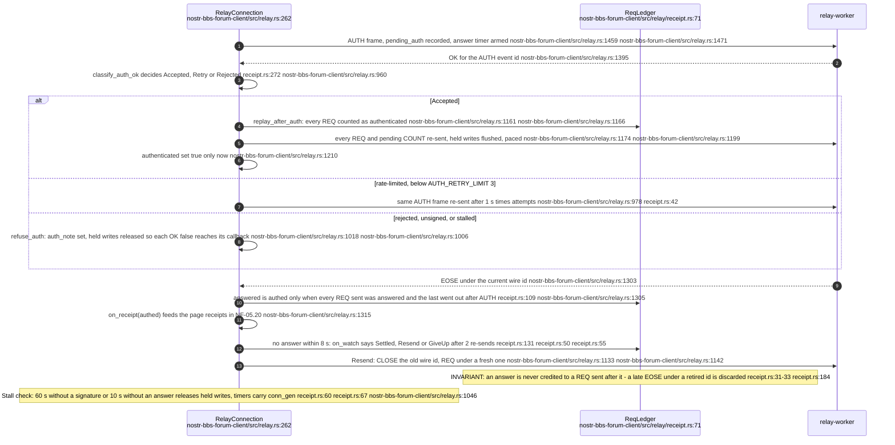

**What it shows.** Before kit #91 the `authenticated` signal meant only "AUTH frame sent", so a REQ answered anonymously could be taken for the member view. Now the relay's `OK true` is the trigger, and the ledger tells the page whether an EOSE is the authenticated answer.

## NF-05.19 Incremental kind-5 deletion sync (kit #93)

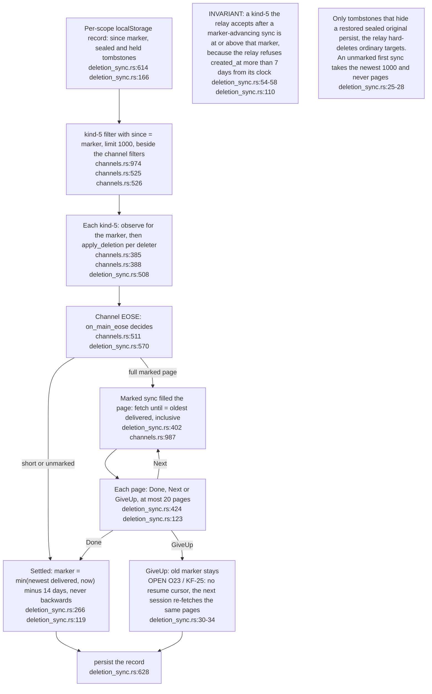

## NF-05.20 Page lookup states: loading, found, not found, timed out (kit #91)

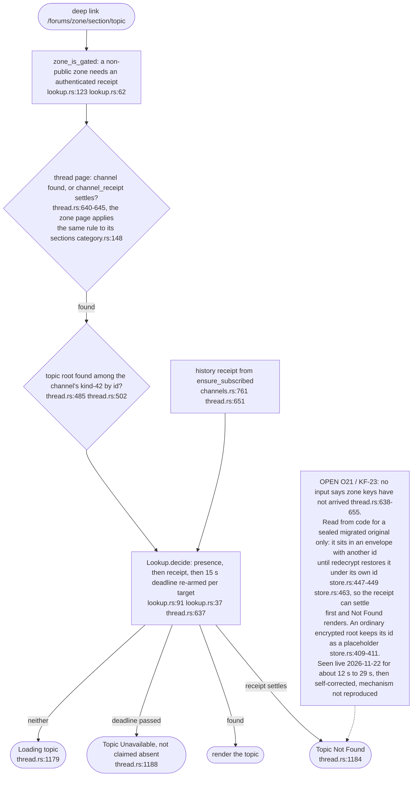

**What it shows.** Kit #91 replaced "not found as soon as loading clears" with a decision that waits for the subscription that would carry the topic. The O21 window remains open in code at this stamp; kit PR #95 is not merged and nothing here describes a fix.
