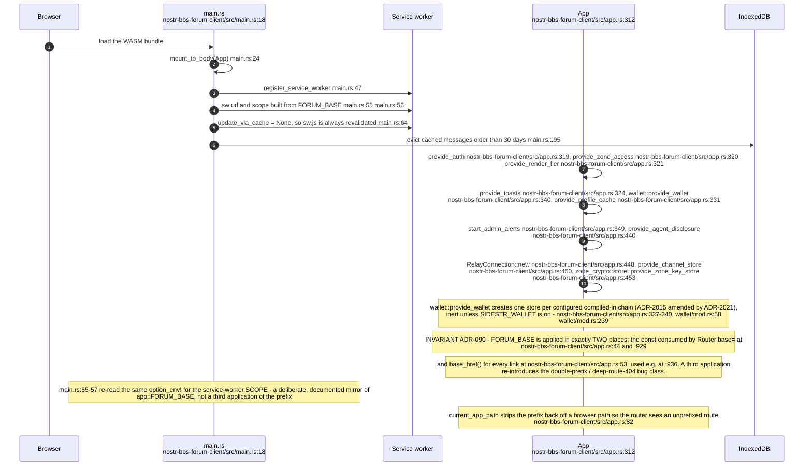
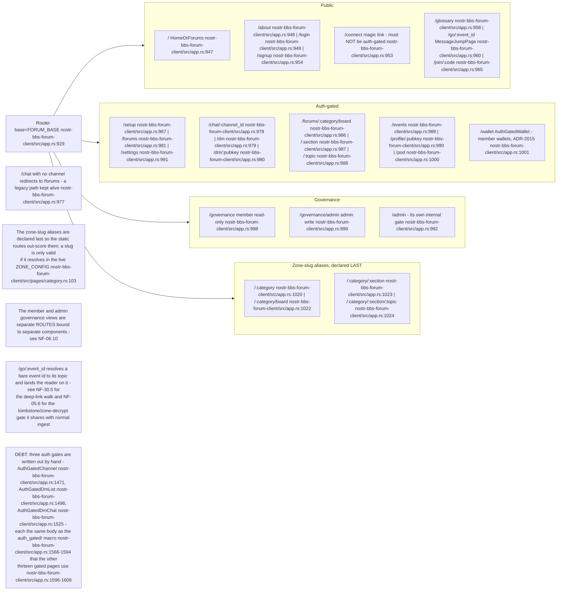
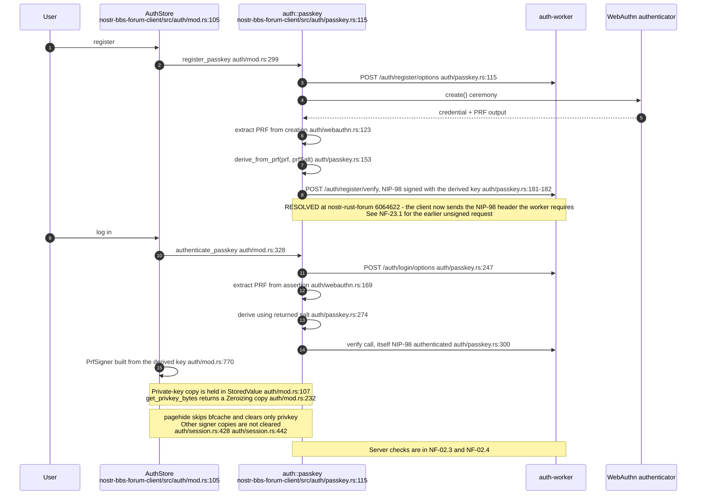
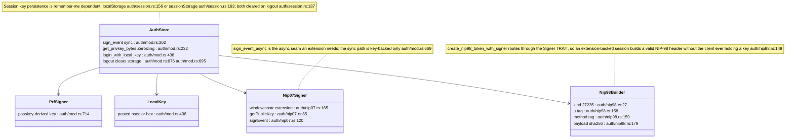
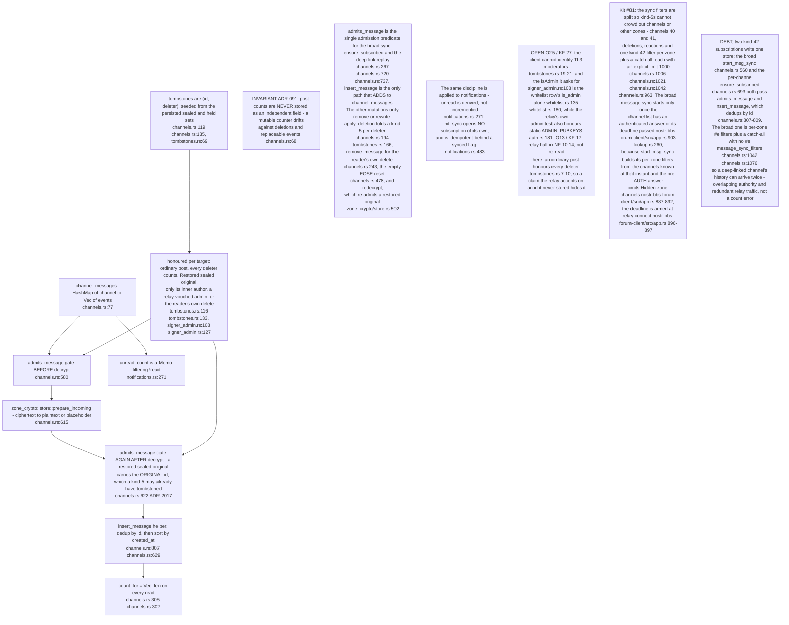
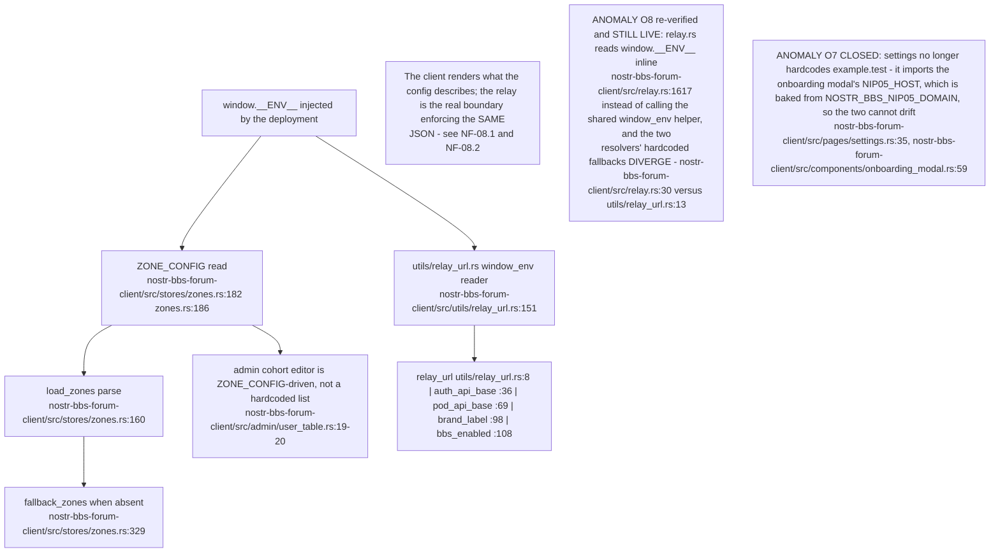
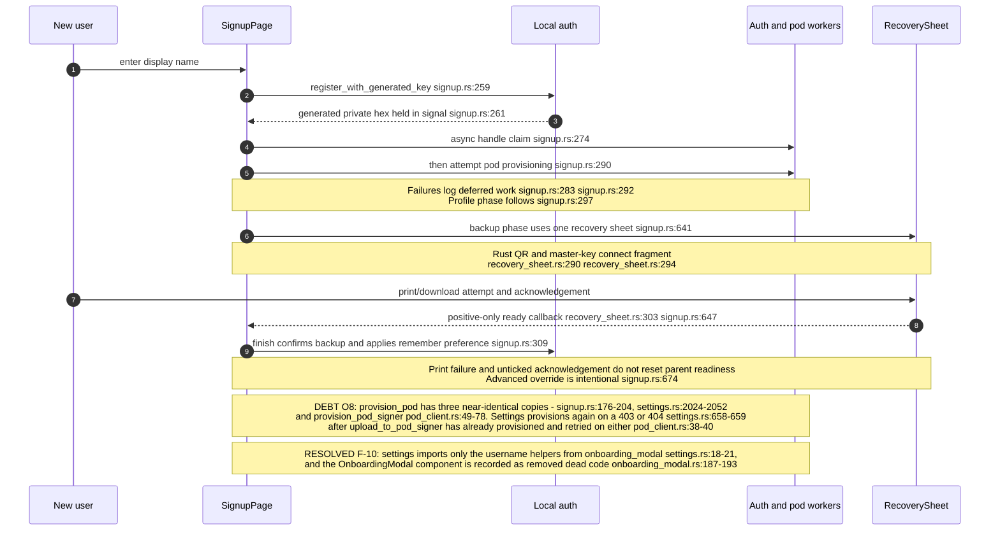

Split 2026-11-23: NF-05.9, NF-05.10, NF-05.13 to NF-05.15 and NF-05.18 to NF-05.20 moved to [NF-30](30-client-messaging-search-notifications-and-sync.md) as NF-30.1 to NF-30.8; NF-05.11, NF-05.12, NF-05.16 and NF-05.17 moved to [NF-31](31-retro-bbs-client-zone-encryption-and-web-push.md) as NF-31.1 to NF-31.4. The old IDs resolve through the aliases declared there.

## NF-05.1 Forum client boot and the FORUM_BASE discipline

**Debt:** the mobile bottom nav strips the prefix with its own `option_env!("FORUM_BASE")` read (`../nostr-rust-forum/crates/nostr-bbs-forum-client/src/components/mobile_bottom_nav.rs:30`) instead of calling `current_app_path` (`../nostr-rust-forum/crates/nostr-bbs-forum-client/src/app.rs:82`). This is not a third *application* of the prefix, so the ADR-090 invariant above holds. It is a second hand-written copy of the stripping rule, though, and it can drift from `utils::paths::app_path`. Closing it means routing the nav through `current_app_path`.

## NF-05.2 Route table

## NF-05.3 Passkey identity — register, log in, derive

[NF-23 and its report](../../estate-review/2026-11-01-forum-passkey-contracts.md) qualify this sequence. At the report's stamp the worker stored a different PRF salt from creation; that is resolved at 6064622, where the worker stores the salt it issued (`../nostr-rust-forum/crates/nostr-bbs-auth-worker/src/webauthn.rs:1077`). Creation requires PRF evaluation immediately, and the hybrid guard tries an attestation-only method on an assertion. Real authenticator and cross-browser acceptance remain open.

## NF-05.4 Three identity backends behind one signing seam

## NF-05.5 Relay transport — frames in and out

## NF-05.6 Derived, never accumulated — the counting invariant

## NF-05.7 Config projection into the browser

## NF-05.8 Signup — generated key, recovery sheet and asynchronous provisioning

[The recovery review](../../estate-review/2026-11-01-forum-recovery-and-connect.md) and NF-22 distinguish attempted output, local import and relay acceptance. This signup path generates a local key; it is not the passkey ceremony in NF-05.3. The downloaded HTML interpolates unescaped display text and differs from the screen's optional device/sweep sections. Fragment-only navigation excludes the key from the HTTP request, but does not prove WASM-only custody or successful history clearing.

**Invariant:** Settings never publishes a kind-0 over a profile it has not loaded: the save merges only the fields it manages into the member's hydrated kind-0, keeps every other field, and refuses while the existing event is still being fetched, because kind-0 is replaceable and an absent field is lost for good (`../nostr-rust-forum/crates/nostr-bbs-forum-client/src/pages/settings.rs:1850`, `../nostr-rust-forum/crates/nostr-bbs-forum-client/src/pages/settings.rs:1907`). SVG avatars are refused, since the pod serves stored bytes with the declared type (`../nostr-rust-forum/crates/nostr-bbs-forum-client/src/pages/settings.rs:1988`).
