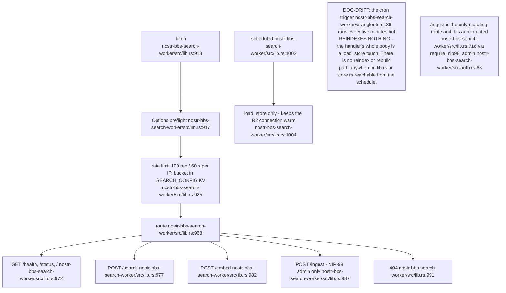
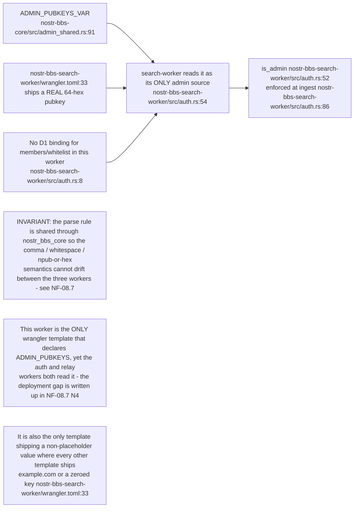
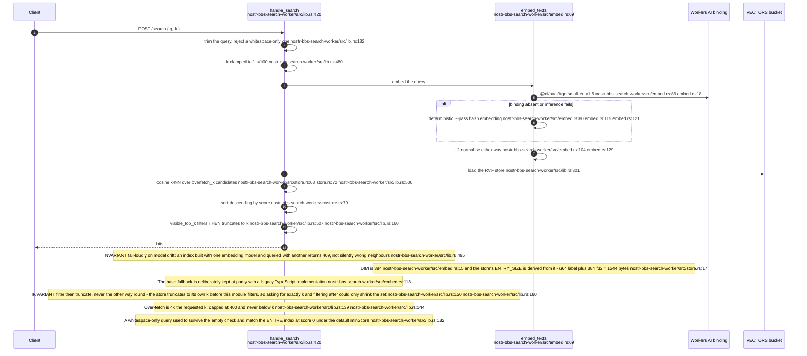
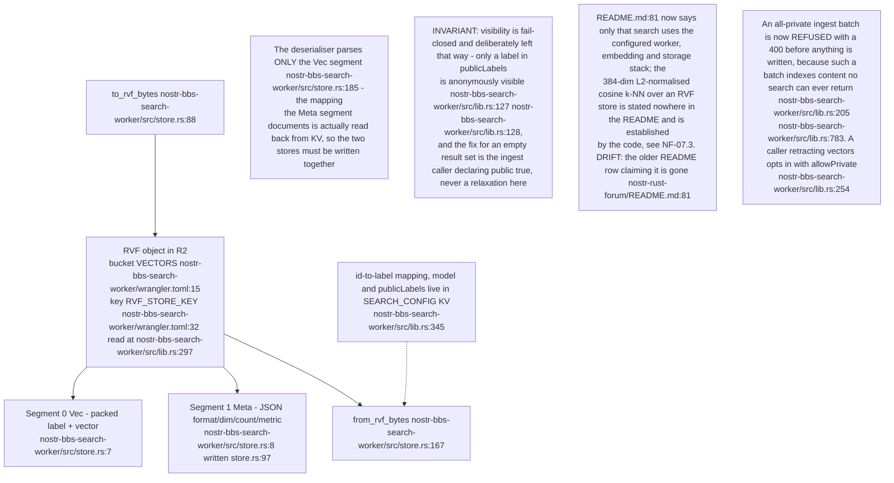
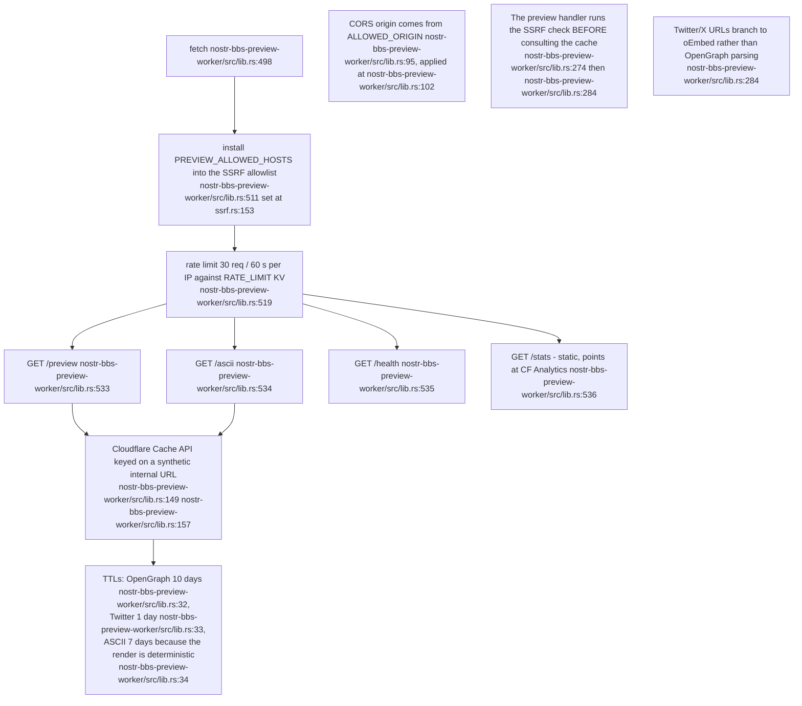
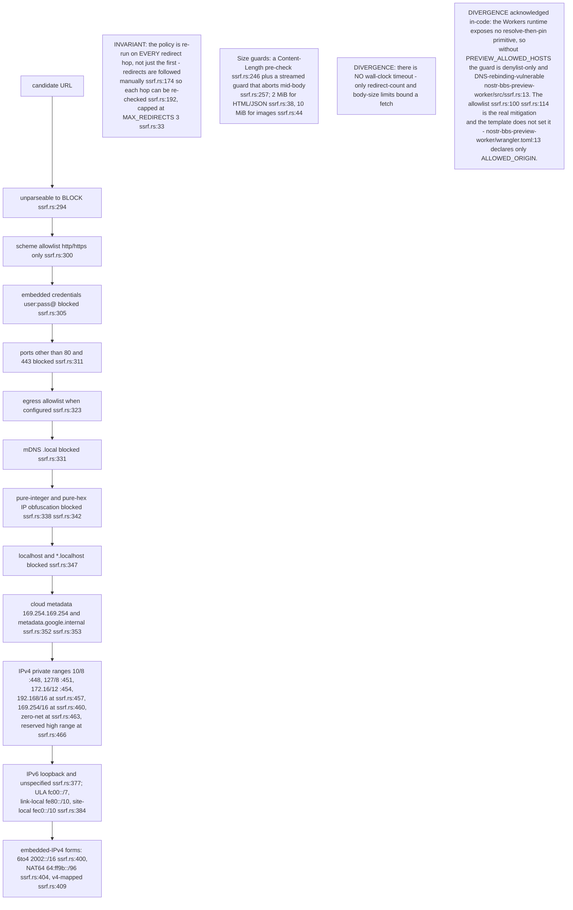
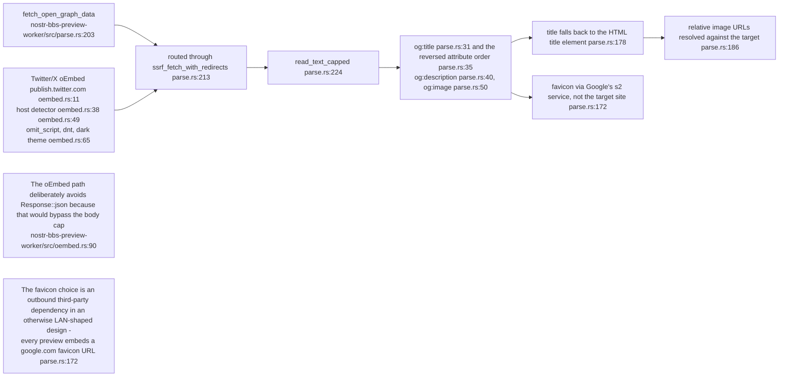
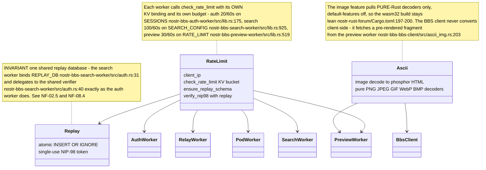
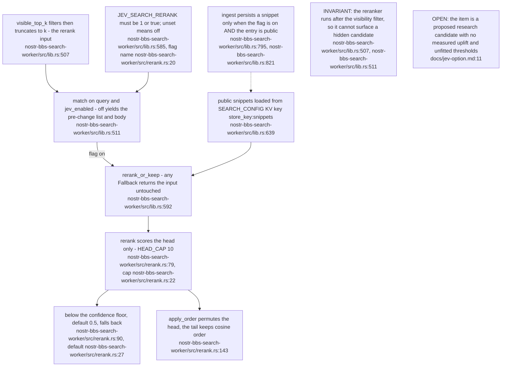

## NF-07.1 search-worker — routes and gates

## NF-07.2 The third admin authority — static-only, and the only real key in a template

## NF-07.3 Semantic search — embeddings and the RVF store

## NF-07.4 RVF format and where the pieces live

## NF-07.5 preview-worker — routes, caching and origin policy

## NF-07.6 The SSRF guard — every blocked class

## NF-07.7 Unfurl extraction

## NF-07.8 Shared utilities every worker links

## NF-07.9 The opt-in Jev rerank — off by default, can only permute what search already shows

**What it shows.** The one optional step added to `POST /search`: when `JEV_SEARCH_RERANK` is on, the first ten already-visible hits are re-ordered by a remote typed-decision (Jev) score, and the response gains a `jev` object; any failure returns the pre-change list byte-for-byte.

**Why it is this way.** The option is declared in `docs/jev-option.md` rather than an ADR: every Jev item is "off by default" with nothing leaving the Worker, and falls back on any failure (`../nostr-rust-forum/docs/jev-option.md:4`). No search `wrangler.toml` variable sets the flag, so the shipped state is off (`../nostr-rust-forum/crates/nostr-bbs-search-worker/src/lib.rs:585`). With the flag on, the query text and up to ten public snippets leave the Worker (`../nostr-rust-forum/docs/jev-option.md:35`).

**Open:** nothing records any measured uplift from the rerank, and its confidence floor is an unfitted default (`../nostr-rust-forum/docs/jev-option.md:11`, `../nostr-rust-forum/crates/nostr-bbs-search-worker/src/rerank.rs:27`).
