## NF-08.1 forum.toml — the single source of access truth and its projection

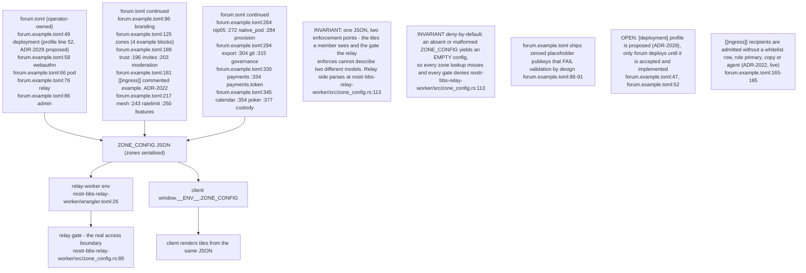

**Open:** `profile` in `[deployment]` selects a `"forum"` or `"room"` wire shape for the life of the deployment, but ADR-2029 is proposed with implementation none and the example file says only `"forum"` deploys until it is accepted (`../nostr-rust-forum/forum.example.toml:47`, `../nostr-rust-forum/docs/adr/ADR-2029-room-profile-deployment-type.md:5`); its dependencies ADR-2027 (accepted, partial, inactive) and ADR-2028 (proposed, header still `implementation_status: none`) are likewise not live. **Drift:** ADR-2028's header is behind the code: its zone group binding and epoch uniqueness (decisions 4, 6 and 8) are on main behind `ZONE_GROUPS_ENABLED`, off by default (`../nostr-rust-forum/crates/nostr-bbs-relay-worker/src/zone_groups.rs:1-4`, NF-08.9).

## NF-08.2 Zone visibility and the read/write gate lattice

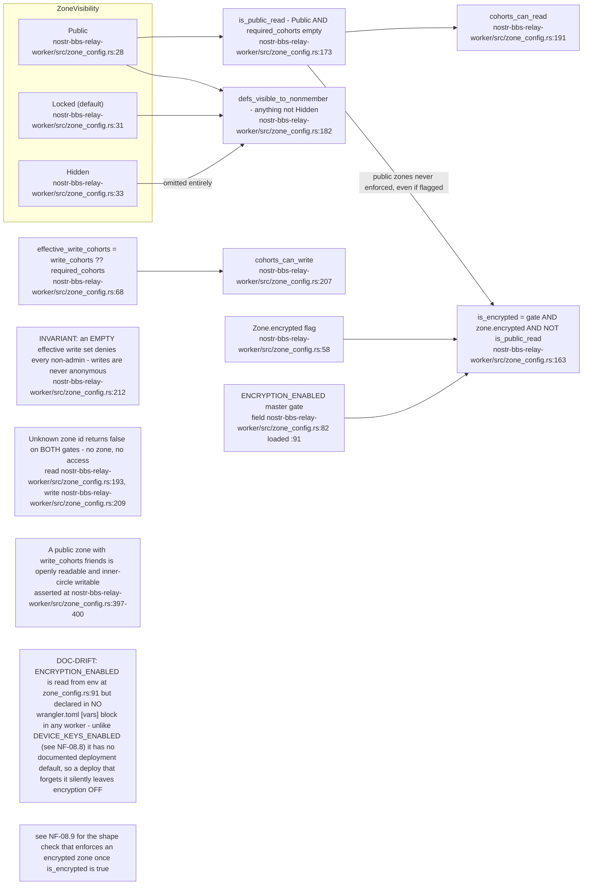

## NF-08.3 Auto-approval of a new joiner — config-driven cohort grant

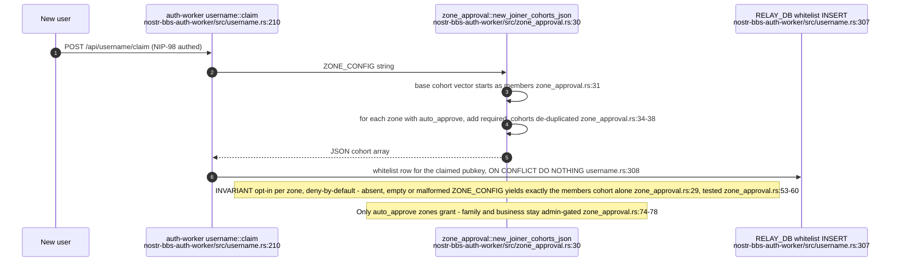

## NF-08.4 Persistent stores — which worker binds which D1, KV and R2

```mermaid
flowchart TB
    subgraph d1["D1 databases"]
        AUTHDB["nostr-bbs-auth<br/>auth-worker DB nostr-bbs-auth-worker/wrangler.toml:9"]
        RELDB["nostr-bbs-relay<br/>relay-worker DB nostr-bbs-relay-worker/wrangler.toml:99"]
    end
    subgraph kv["KV namespaces"]
        SESS["SESSIONS nostr-bbs-auth-worker/wrangler.toml:27"]
        PODMETA["POD_META nostr-bbs-pod-worker/wrangler.toml:16"]
        RL["RATE_LIMIT nostr-bbs-preview-worker/wrangler.toml:9"]
        SCFG["SEARCH_CONFIG nostr-bbs-search-worker/wrangler.toml:19"]
        KVALIAS["KV - same physical id as SESSIONS nostr-bbs-auth-worker/wrangler.toml:43"]
    end
    subgraph r2["R2 buckets"]
        PODS["nostr-bbs-pods nostr-bbs-pod-worker/wrangler.toml:10"]
        VECS["nostr-bbs-vectors nostr-bbs-search-worker/wrangler.toml:15"]
    end
    subgraph do["Durable Object"]
        RELAYDO["RELAY class NostrRelayDO<br/>nostr-bbs-relay-worker/wrangler.toml:115 sqlite class :120"]
    end

    AUTHW["auth-worker"] --> AUTHDB
    AUTHW -->|"RELAY_DB nostr-bbs-auth-worker/wrangler.toml:18"| RELDB
    AUTHW --> SESS
    AUTHW --> KVALIAS
    AUTHW -->|"POD_META backwards-compat reads nostr-bbs-auth-worker/wrangler.toml:34"| PODMETA
    AUTHW -->|"PODS nostr-bbs-auth-worker/wrangler.toml:47"| PODS
    RELAYW["relay-worker"] --> RELDB
    RELAYW -->|"REPLAY_DB points at nostr-bbs-auth nostr-bbs-relay-worker/wrangler.toml:110"| AUTHDB
    RELAYW --> RELAYDO
    PODW["pod-worker"] --> PODS
    PODW --> PODMETA
    PODW -->|"REPLAY_DB nostr-bbs-pod-worker/wrangler.toml:25"| AUTHDB
    PODW -->|"RELAY_DB admin reads nostr-bbs-pod-worker/wrangler.toml:32, zero id :34"| RELDB
    SEARCHW["search-worker"] --> VECS
    SEARCHW --> SCFG
    SEARCHW -->|"REPLAY_DB nostr-bbs-search-worker/wrangler.toml:25"| AUTHDB
    PREVW["preview-worker"] --> RL

    N1["INVARIANT: NIP-98 replay lives in ONE database - relay, pod and search bind REPLAY_DB, and auth uses DB, all to<br/>nostr-bbs-auth so cross-worker replay is detected nostr-bbs-relay-worker/wrangler.toml:104-111<br/>auth DB is nostr-bbs-auth nostr-bbs-auth-worker/wrangler.toml:9-10. The preview worker binds no replay store."]
    N2["ANOMALY O11 now DOCUMENTED, not removed: KV and SESSIONS are still the SAME physical namespace id<br/>nostr-bbs-auth-worker/wrangler.toml:28 and :44; the template says the key prefixes are disjoint<br/>nostr-bbs-auth-worker/wrangler.toml:22-25 and a unit test pins the admin cache key outside the rl: prefix<br/>nostr-bbs-auth-worker/src/admins.rs:347"]
    N3["The auth-worker RELAY_DB database_id is a ZERO placeholder that every deployment must override<br/>nostr-bbs-auth-worker/wrangler.toml:20 - shipped unusable on purpose"]
    N5["DRIFT: the pod template's older comment says admin checks use members.is_admin or whitelist.is_admin<br/>through REPLAY_DB nostr-bbs-pod-worker/wrangler.toml:19-20, the newer one beside the RELAY_DB block says<br/>the relay whitelist only nostr-bbs-pod-worker/wrangler.toml:29-30, and the code reads RELAY_DB only<br/>nostr-bbs-pod-worker/src/lib.rs:2022 - see NF-08.7"]
    N4["PROPOSED AND PARKED: ADR-2012 demotes the pod-worker payment D1 from ledger to a height-stamped<br/>derived view over the sidestr chain, with a staleness bound that is an error<br/>ADR-2012-d1-ledger-becomes-a-chain-view.md:48-51. Status proposed, implementation partial, inactive<br/>ADR-2012-d1-ledger-becomes-a-chain-view.md:5-7, parked at P3 ADR-2012-d1-ledger-becomes-a-chain-view.md:165.<br/>The chain view is not built, so this store map is unchanged - see NF-04.11"]
```

## NF-08.5 Table map — who creates each table and who reads it

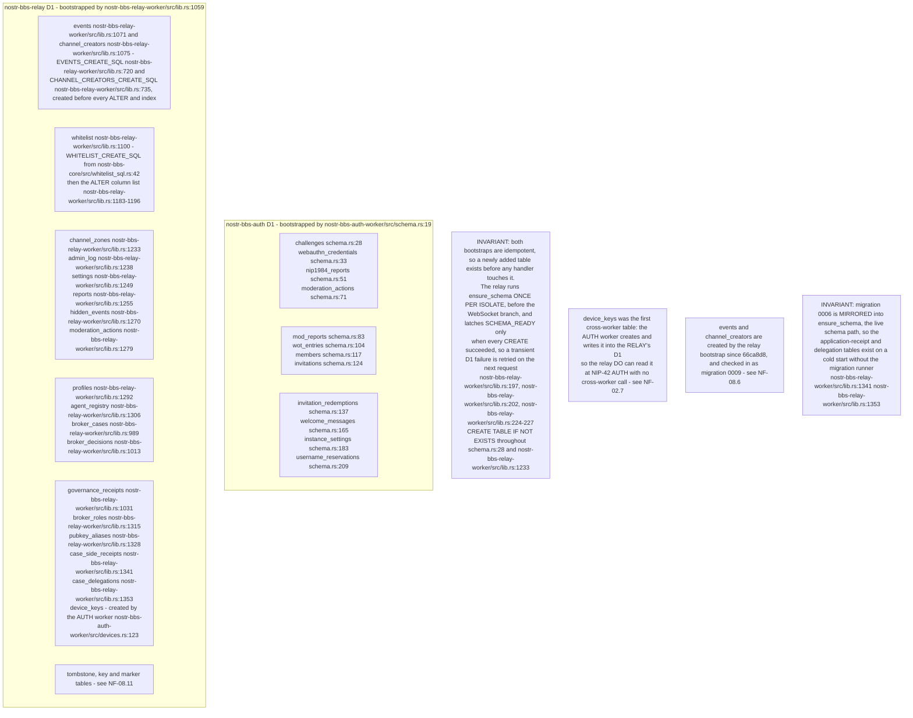

Both workers bootstrap idempotently — the auth worker at
`nostr-bbs-auth-worker/src/schema.rs:19`, the relay at `nostr-bbs-relay-worker/src/lib.rs:1059`, which returns whether every load-bearing CREATE succeeded and is latched once per isolate (`nostr-bbs-relay-worker/src/lib.rs:224-227`). Earlier the DO and `scheduled` paths never bootstrapped, so a WebSocket-only isolate could miss the schema; the call now precedes the WebSocket branch (`nostr-bbs-relay-worker/src/lib.rs:230-231`). When `PUSH_ENABLED` is true the bootstrap also creates the Web Push tables (ADR-2023), and a default deploy pays nothing (`nostr-bbs-relay-worker/src/lib.rs:1106-1108`); `recipient_keys` and `zone_epoch_keys` follow the same flag-gated pattern (`nostr-bbs-relay-worker/src/lib.rs:1120-1158`). The NIP-09 tombstone tables are created on every deploy, and two one-time passes then backfill them from stored kind-5s and re-key plain replaceable addresses, each guarded by a `settings` marker (`nostr-bbs-relay-worker/src/lib.rs:1423-1424`).

## NF-08.6 Where the relay's load-bearing tables come from

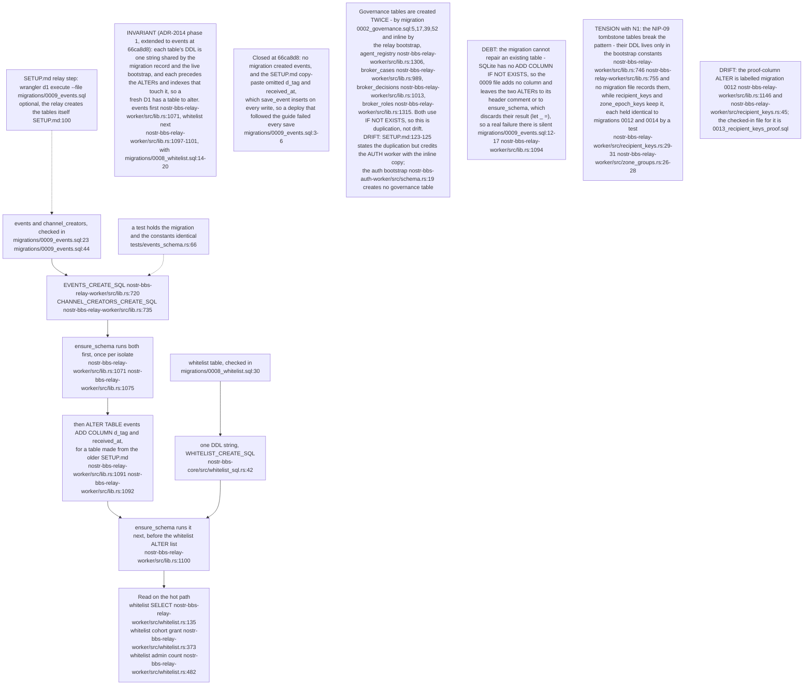

**What it shows.** Until 66ca8d8 no code in the repository created `events`: the
bootstrap only indexed it and the operator copied seven columns out of
`SETUP.md`. The relay now creates `events` and `channel_creators` first in
`ensure_schema` (`nostr-bbs-relay-worker/src/lib.rs:1071`), from constants a
test holds identical to `migrations/0009_events.sql` (`tests/events_schema.rs:66`),
and then adds the two missing columns to an older table
(`nostr-bbs-relay-worker/src/lib.rs:1091`). The whitelist follows the same
shape from 1a26e51 (`migrations/0008_whitelist.sql:30`).

**Why it is this way.** ADR-2014 phase 1 checked the whitelist in because
admission reads `expires_at`, which no DDL created at all
(`migrations/0008_whitelist.sql:5-8`); 66ca8d8 applies the same pattern to the
table every write depends on.

**Debt:** the migration is not a complete record of a deployed schema, because
the two column additions are a hand-applied comment in the file
(`migrations/0009_events.sql:12-17`) and a bootstrap loop that discards its
result (`nostr-bbs-relay-worker/src/lib.rs:1094`).

**Drift:** `SETUP.md:123-125` credits the auth worker with the inline governance tables; only the relay bootstrap creates them (N3).

## NF-08.7 Admin authority — three sources, four resolvers, and where they differ

```mermaid
flowchart TB
    CANON["Canonical algorithm and SQL constants<br/>nostr-bbs-core/src/admin_shared.rs:91 ADMIN_PUBKEYS_VAR<br/>nostr-bbs-core/src/admin_shared.rs:109 is_static_admin"]
    S1["1. Static set - ADMIN_PUBKEYS env var"]
    S2["2. RELAY_DB whitelist.is_admin<br/>nostr-bbs-core/src/admin_shared.rs:72"]
    S3["3. auth DB members.is_admin - still defined, no longer consulted by either resolver<br/>nostr-bbs-core/src/admin_shared.rs:76"]
    AUTHIS["auth-worker is_admin - union of static and RELAY_DB only<br/>nostr-bbs-auth-worker/src/admin.rs:53<br/>static nostr-bbs-auth-worker/src/admin.rs:63<br/>RELAY_DB nostr-bbs-auth-worker/src/admin.rs:72"]
    RELIS["relay-worker query_is_admin<br/>nostr-bbs-relay-worker/src/auth.rs:181<br/>static nostr-bbs-relay-worker/src/auth.rs:185<br/>whitelist nostr-bbs-relay-worker/src/auth.rs:194"]

    PODIS["pod-worker is_admin_user - RELAY_DB whitelist.is_admin ONLY, no static set<br/>nostr-bbs-pod-worker/src/lib.rs:2016, read nostr-bbs-pod-worker/src/lib.rs:2022"]
    CHK["GET check-whitelist isAdmin - whitelist row only<br/>nostr-bbs-relay-worker/src/whitelist.rs:135, reply nostr-bbs-relay-worker/src/whitelist.rs:180"]

    CANON --> S1 & S2 & S3
    S1 & S2 --> AUTHIS
    S1 & S2 --> RELIS
    SRCHIS["search-worker - static ADMIN_PUBKEYS ONLY, no D1 - see NF-07.2"]
    S2 --> PODIS
    S1 --> SRCHIS
    S2 --> CHK

    N1["Auth lower-cases at resolver entry nostr-bbs-auth-worker/src/admin.rs:58<br/>Relay query binds its supplied pubkey nostr-bbs-relay-worker/src/auth.rs:195"]
    N2["RESOLVED at nostr-rust-forum 6064622: the auth resolver no longer falls through to auth members<br/>False after the static set and RELAY_DB grant nothing nostr-bbs-auth-worker/src/admin.rs:85"]
    N3["CLOSED at 66ca8d8: the relay used to query members in its OWN D1 where no migration or bootstrap creates<br/>that table, so the branch failed on every call and the error was swallowed. The query is removed, and relay<br/>authority is ADMIN_PUBKEYS union whitelist.is_admin only nostr-bbs-relay-worker/src/auth.rs:185 nostr-bbs-relay-worker/src/auth.rs:194"]
    N3B["DRIFT: the doc comment on query_is_admin still names members - its Task #7 paragraph says the relay<br/>whitelist/members tables may carry no is_admin row, below a paragraph saying the relay no longer queries it<br/>nostr-bbs-relay-worker/src/auth.rs:174 nostr-bbs-relay-worker/src/auth.rs:164"]
    N3C["REVOCATION GAP: RESOLVED at nostr-rust-forum 6064622 - relay set-admin changes only whitelist nostr-bbs-relay-worker/src/whitelist.rs:450<br/>a retained auth members grant no longer confers authority nostr-bbs-auth-worker/src/admin.rs:72"]
    N6["TENSION, kit O25 / KF-27: a static ADMIN_PUBKEYS admin is an admin to the relay, auth and search workers but not to the<br/>pod worker PODIS, a whitelist-only admin is not one to search, and check-whitelist reports isAdmin false for them, which is what the client reads to honour a<br/>restored sealed original's tombstone - see NF-08.10"]
    N4["DOC-DRIFT: ADMIN_PUBKEYS is DECLARED in exactly one wrangler template - the search worker,<br/>nostr-bbs-search-worker/wrangler.toml:41 - yet is read by the auth worker (admin.rs:63) and the relay<br/>(auth.rs:185). The relay template asserts the opposite: there is no ADMIN_PUBKEYS reader in src/<br/>nostr-bbs-relay-worker/wrangler.toml:18-21. SETUP.md:147-151 never lists it either."]
    N5["Consequence of N4: a by-the-book deployment has NO static admin bootstrap on relay or auth,<br/>and the search worker ships a REAL non-placeholder pubkey as its default admin<br/>nostr-bbs-search-worker/wrangler.toml:41 - the only non-generic value in any template."]
```

The [1 November membership review](../../estate-review/2026-11-01-forum-membership-lifecycle.md) corrects only the normalisation, error-fallback and revocation claims in NF-08.7. The [2 November review](../../estate-review/2026-11-02-forum-config-ci-invariants.md) re-read every citation in this topic, the template and bootstrap notes included, at the declared revision.

## NF-08.8 Cross-worker feature gates that must be set in lockstep

```mermaid
flowchart LR
    DKA["auth-worker DEVICE_KEYS_ENABLED=false<br/>nostr-bbs-auth-worker/wrangler.toml:69"]
    DKR["relay-worker DEVICE_KEYS_ENABLED=false<br/>nostr-bbs-relay-worker/wrangler.toml:29"]
    DKC["client window.__ENV__ third setting<br/>SETUP.md:171-174"]
    GATEFN["auth gate reads its OWN binding<br/>nostr-bbs-auth-worker/src/devices.rs:100"]
    SHARED["shared parse rule only<br/>nostr-bbs-core feature_gate"]
    AM["AUTH_MODE=nip42 default<br/>nostr-bbs-relay-worker/wrangler.toml:39"]
    MESH["MESH_MODE=standalone<br/>nostr-bbs-relay-worker/wrangler.toml:93"]
    ESC["ESCALATION_DEFAULT_TIER=medium<br/>nostr-bbs-relay-worker/wrangler.toml:61"]
    CAL["CALIBRATION_SELECTION_KEY - a SECRET, deliberately NOT a plaintext var<br/>nostr-bbs-relay-worker/wrangler.toml:64-67"]

    DKA --> GATEFN --> SHARED
    DKR --> SHARED
    %% Source: ../nostr-rust-forum/crates/nostr-bbs-forum-client/src/utils/devices.rs:111
    CLIENTPARSE["Client uses its own loose parser<br/>boolean true or normalised true / 1"]
    DKC --> CLIENTPARSE

    N1["INVARIANT ADR-2004: each worker reads its own binding and decides ALONE - no cross-worker call.<br/>Only the parse rule is shared, so the two cannot drift on what true means<br/>nostr-bbs-auth-worker/src/devices.rs:100-107, relay delegates at nostr-bbs-relay-worker/src/relay_do/nip_handlers.rs:1003"]
    N2["INVARIANT: enables on the EXACT string true; unset, empty, padded, TRUE or 1 is off<br/>rule nostr-bbs-core/src/feature_gate.rs:65, asserted nostr-bbs-auth-worker/src/devices.rs:988"]
    N3["AUTH_MODE: anything other than allowlist resolves to the secure nip42 default<br/>nostr-bbs-relay-worker/wrangler.toml:37-39 - see NF-03"]
    N4["ESCALATION_DEFAULT_TIER is a declared SCAFFOLD - the authoritative risk-tier schema is owned by<br/>agentbox, EXTERNAL: see AB-14 and AB-15; an unrecognised tier folds to medium<br/>nostr-bbs-relay-worker/wrangler.toml:54-61"]
    N5["INVARIANT: calibration sampling is HMAC over a key the agent cannot read. The request id is the<br/>31402 d tag, which the agent chooses, so the key secrecy is the only thing stopping it grinding tags<br/>until it finds one sampling never selects nostr-bbs-relay-worker/wrangler.toml:69-74 - see NF-12"]
    N6["Unset, the relay STILL samples and logs a warning on every projection - silently disabling<br/>oversight is treated as the worse failure nostr-bbs-relay-worker/wrangler.toml:76-79"]
    PUSH["relay-worker PUSH_ENABLED=false, ADR-2023 content-free Web Push, off by default<br/>nostr-bbs-relay-worker/wrangler.toml:86 with VAPID_PUBLIC_KEY nostr-bbs-relay-worker/wrangler.toml:87 and PUSH_MAX_FANOUT nostr-bbs-relay-worker/wrangler.toml:90"]
    RURL["RELAY_URL is blank by default and required in nip42 mode: blank now FAILS CLOSED, refusing every<br/>authenticated write, and logs an error on every AUTH nostr-bbs-relay-worker/wrangler.toml:42-47<br/>RELAY_URL_ALIASES adds extra hostnames nostr-bbs-relay-worker/wrangler.toml:51 - see NF-12"]
    N8["All three templates now ship System One advisory flags ON (relay JEV_TRIAGE=1 nostr-bbs-relay-worker/wrangler.toml:11, search JEV_SEARCH_RERANK=1 nostr-bbs-search-worker/wrangler.toml:32, auth JEV_RATIONALE_CHECK=1 nostr-bbs-auth-worker/wrangler.toml:53) pointing at TypeSafe jev-latest (nostr-bbs-relay-worker/wrangler.toml:12-13); TYPESAFE_API_KEY is a Worker secret named at :14 and never a plaintext var, and the auth worker declares no endpoint, so it resolves to TypeSafe through the same secret and stays private only when JEV_RATIONALE_CHECK_LOCAL_ONLY=1 (nostr-bbs-auth-worker/wrangler.toml:54-58)"]
    N9["TENSION: the workers enable only on exact true nostr-bbs-core/src/feature_gate.rs:65, but the client lower-cases<br/>and also accepts 1 - an operator who sets 1 in all three places gets a client that registers device keys<br/>and workers that 404 the device routes. Client parser: CLIENTPARSE above"]
    CLIENTPARSE -.- N9
    RKA["auth-worker RECIPIENT_KEYS_ENABLED=false<br/>nostr-bbs-auth-worker/wrangler.toml:70, exact true nostr-bbs-auth-worker/src/recipient_keys.rs:71"]
    RKR["relay-worker RECIPIENT_KEYS_ENABLED and ZONE_GROUPS_ENABLED, exact true<br/>nostr-bbs-relay-worker/src/recipient_keys.rs:70 nostr-bbs-relay-worker/src/zone_groups.rs:47<br/>declared in NO relay template"]
    RKT["recipient_keys table: created by the RELAY only when its flag is on<br/>nostr-bbs-relay-worker/src/lib.rs:1129-1139, written by the AUTH routes via RELAY_DB<br/>nostr-bbs-auth-worker/src/recipient_keys.rs:570"]
    RKA --> RKT
    RKR --> RKT
    N10["TENSION: a third lockstep pair with no shared parse crate and no relay default - auth on with the relay off<br/>serves registration routes over a table the relay never created, and the relay gift-wrap gate stays on its old rule.<br/>Unlike DEVICE_KEYS_ENABLED N1, the relay template does not declare either flag"]
    RKT -.- N10
    N7["A second lockstep gate, ENCRYPTION_ENABLED, follows the same own-binding pattern across relay<br/>and clients but is undeclared in every wrangler.toml - see NF-08.2"]
```

**Tension:** the client accepts `1` for `DEVICE_KEYS_ENABLED` (`../nostr-rust-forum/crates/nostr-bbs-forum-client/src/utils/devices.rs:111`) while both workers need exact `true` (N9).

## NF-08.9 Encrypted-zone write enforcement — shape check, not decryption

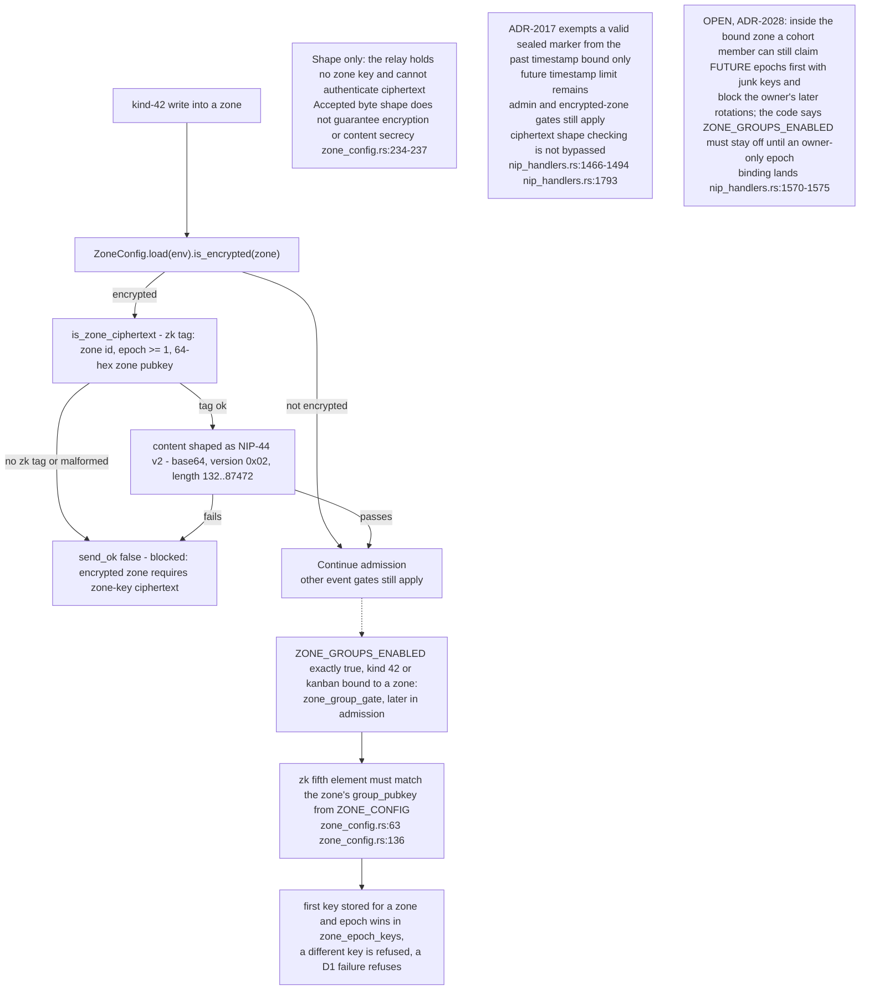

## NF-08.10 Who writes and who clears the NIP-09 tombstone tables

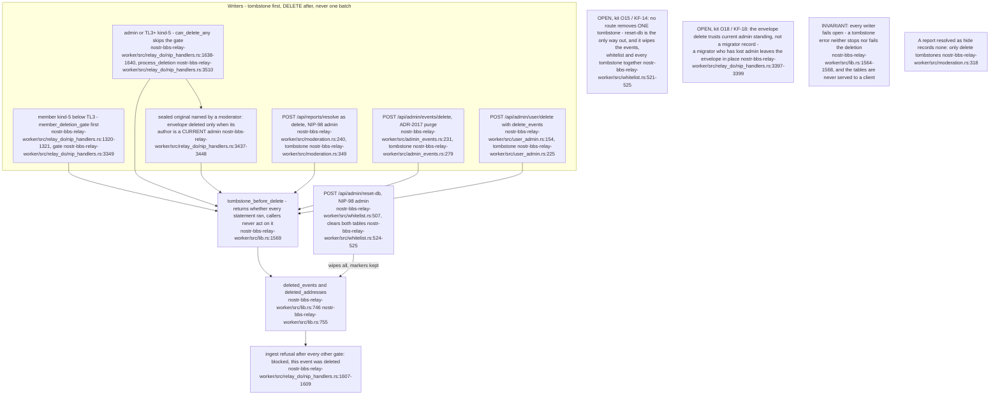

Admin authority for every writer above is `require_nip98_admin` (the relay resolver of NF-08.7), except the kind-5 path, which trusts the trust ladder: TL3+ deletes anyone's events without being an admin (`../nostr-rust-forum/crates/nostr-bbs-relay-worker/src/relay_do/nip_handlers.rs:1638-1640`). The ingest refusal fails open when its lookup fails, and the purge of a user by `pubkey` leaves device-key and gift-wrap rows untombstoned (kit O17 / KF-16, see NF-25.5).

## NF-08.11 Relay tables added for deletion and key registration — migration-less or flag-gated

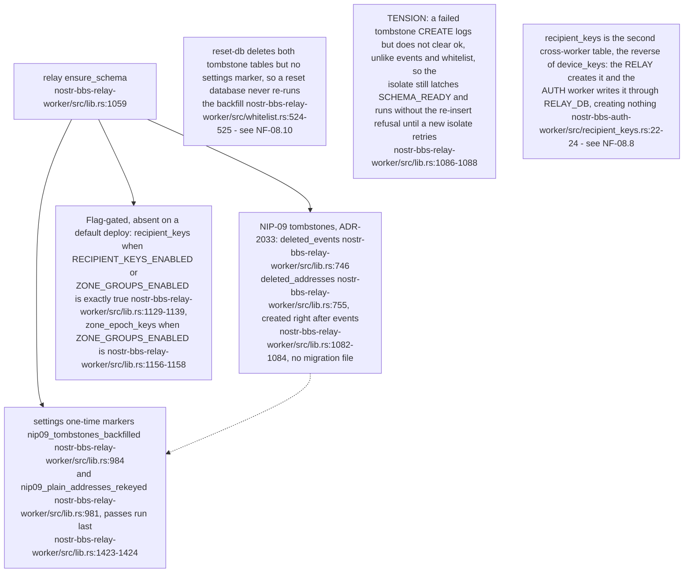
