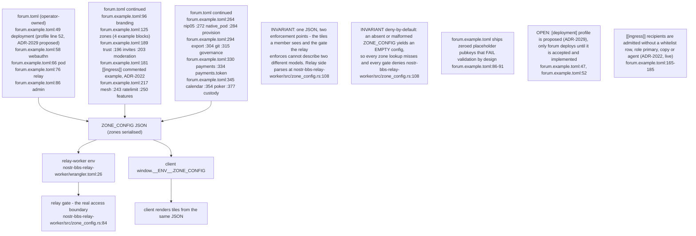
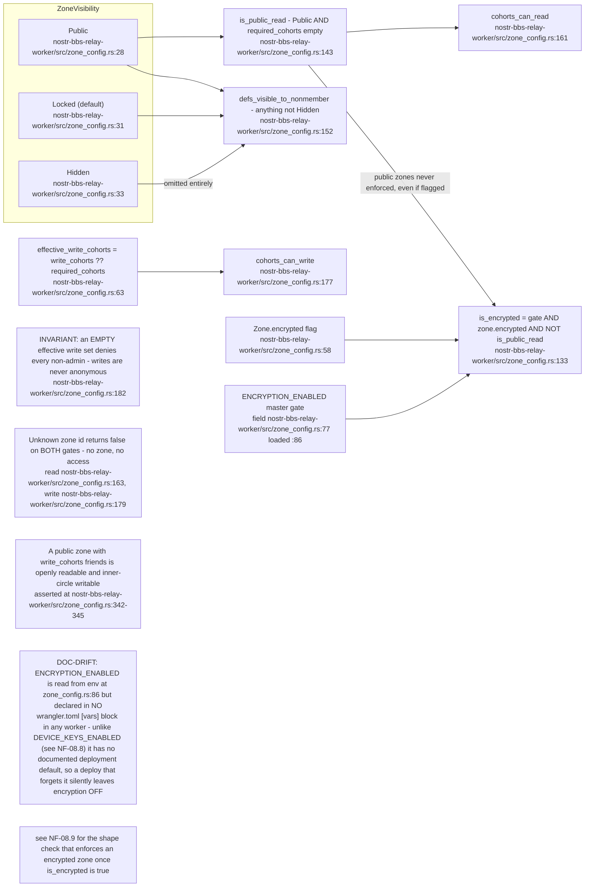
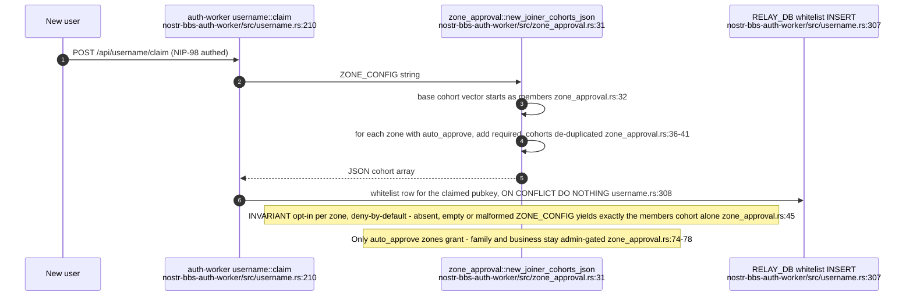
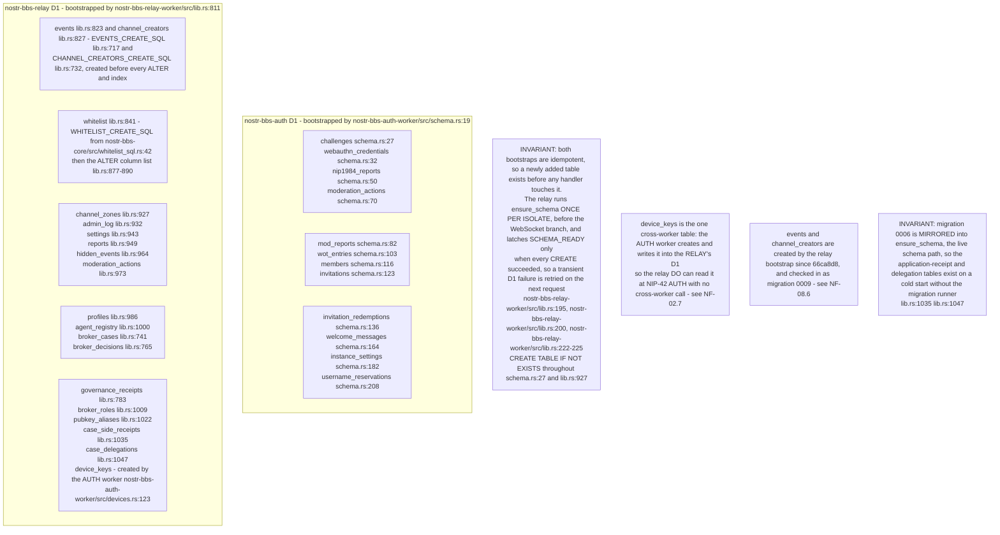
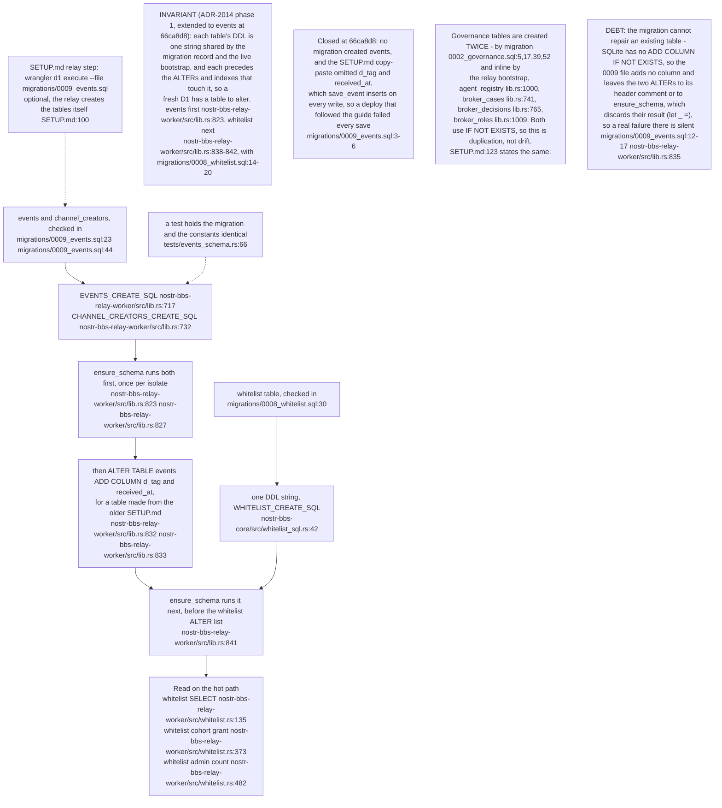
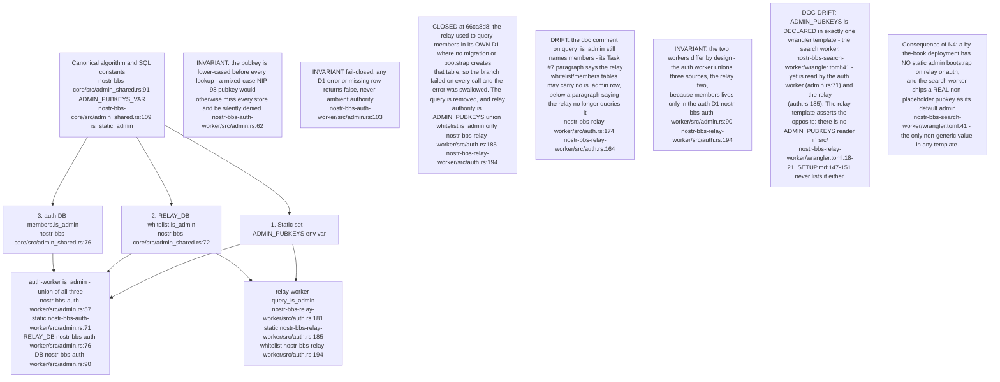
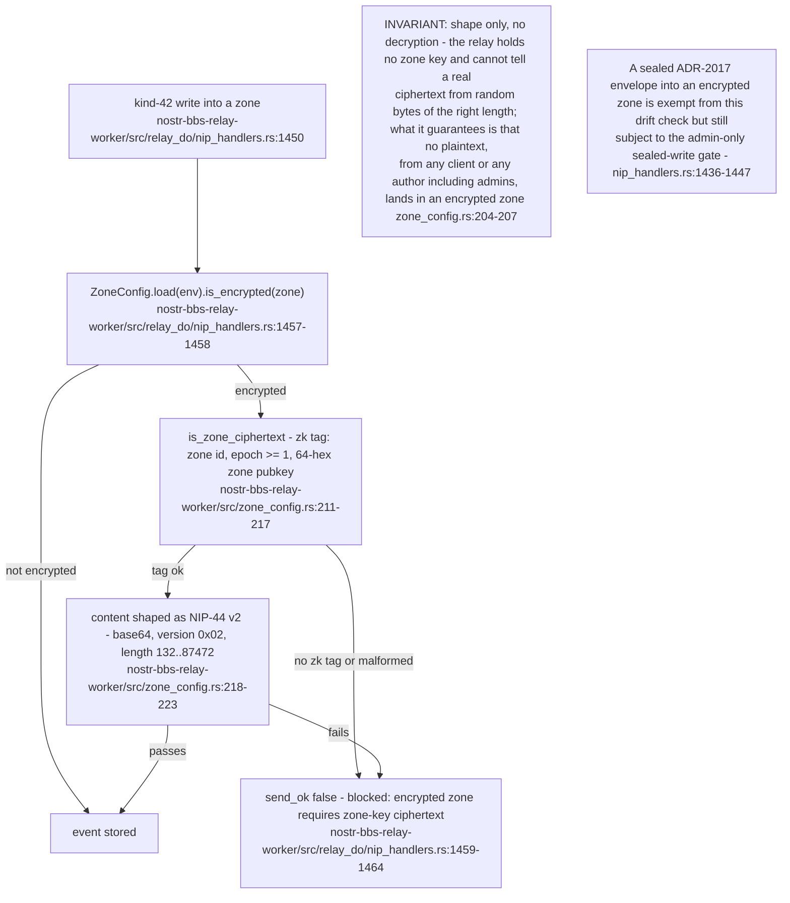

## NF-08.1 forum.toml — the single source of access truth and its projection

**Open:** `profile` in `[deployment]` selects a `"forum"` or `"room"` wire shape for the life of the deployment, but ADR-2029 is proposed with implementation none and the example file says only `"forum"` deploys until it is accepted (`../nostr-rust-forum/forum.example.toml:47`, `../nostr-rust-forum/docs/adr/ADR-2029-room-profile-deployment-type.md:5`); its dependencies ADR-2027 (accepted, partial, inactive) and ADR-2028 (proposed) are likewise not live.

## NF-08.2 Zone visibility and the read/write gate lattice

## NF-08.3 Auto-approval of a new joiner — config-driven cohort grant

## NF-08.4 Persistent stores — which worker binds which D1, KV and R2

```mermaid
flowchart TB
    subgraph d1["D1 databases"]
        AUTHDB["nostr-bbs-auth<br/>auth-worker DB nostr-bbs-auth-worker/wrangler.toml:9"]
        RELDB["nostr-bbs-relay<br/>relay-worker DB nostr-bbs-relay-worker/wrangler.toml:99"]
    end
    subgraph kv["KV namespaces"]
        SESS["SESSIONS nostr-bbs-auth-worker/wrangler.toml:27"]
        PODMETA["POD_META nostr-bbs-pod-worker/wrangler.toml:16"]
        RL["RATE_LIMIT nostr-bbs-preview-worker/wrangler.toml:9"]
        SCFG["SEARCH_CONFIG nostr-bbs-search-worker/wrangler.toml:19"]
        KVALIAS["KV - same physical id as SESSIONS nostr-bbs-auth-worker/wrangler.toml:43"]
    end
    subgraph r2["R2 buckets"]
        PODS["nostr-bbs-pods nostr-bbs-pod-worker/wrangler.toml:10"]
        VECS["nostr-bbs-vectors nostr-bbs-search-worker/wrangler.toml:15"]
    end
    subgraph do["Durable Object"]
        RELAYDO["RELAY class NostrRelayDO<br/>nostr-bbs-relay-worker/wrangler.toml:115 sqlite class :120"]
    end

    AUTHW["auth-worker"] --> AUTHDB
    AUTHW -->|"RELAY_DB nostr-bbs-auth-worker/wrangler.toml:18"| RELDB
    AUTHW --> SESS
    AUTHW --> KVALIAS
    AUTHW -->|"POD_META backwards-compat reads nostr-bbs-auth-worker/wrangler.toml:34"| PODMETA
    AUTHW -->|"PODS nostr-bbs-auth-worker/wrangler.toml:47"| PODS
    RELAYW["relay-worker"] --> RELDB
    RELAYW -->|"REPLAY_DB points at nostr-bbs-auth nostr-bbs-relay-worker/wrangler.toml:110"| AUTHDB
    RELAYW --> RELAYDO
    PODW["pod-worker"] --> PODS
    PODW --> PODMETA
    PODW -->|"REPLAY_DB nostr-bbs-pod-worker/wrangler.toml:25"| AUTHDB
    SEARCHW["search-worker"] --> VECS
    SEARCHW --> SCFG
    SEARCHW -->|"REPLAY_DB nostr-bbs-search-worker/wrangler.toml:25"| AUTHDB
    PREVW["preview-worker"] --> RL

    N1["INVARIANT: NIP-98 replay lives in ONE database - every worker binds REPLAY_DB (or DB) to<br/>nostr-bbs-auth so cross-worker replay is detected nostr-bbs-relay-worker/wrangler.toml:104-111"]
    N2["ANOMALY O11 now DOCUMENTED, not removed: KV and SESSIONS are still the SAME physical namespace id<br/>nostr-bbs-auth-worker/wrangler.toml:28 and :44; the template says the key prefixes are disjoint<br/>nostr-bbs-auth-worker/wrangler.toml:22-25 and a unit test pins the admin cache key outside the rl: prefix<br/>nostr-bbs-auth-worker/src/admins.rs:372"]
    N3["The auth-worker RELAY_DB database_id is a ZERO placeholder that every deployment must override<br/>nostr-bbs-auth-worker/wrangler.toml:20 - shipped unusable on purpose"]
    N4["PROPOSED, NOT BUILT: ADR-2012 demotes the pod-worker payment D1 from ledger to a height-stamped<br/>derived view over the sidestr chain, with a staleness bound that is an error<br/>ADR-2012-d1-ledger-becomes-a-chain-view.md:5-6 ADR-2012-d1-ledger-becomes-a-chain-view.md:37-41.<br/>Nothing in this store map changes until it is built - see NF-04.11"]
```

## NF-08.5 Table map — who creates each table and who reads it

Both workers bootstrap idempotently — the auth worker at
`nostr-bbs-auth-worker/src/schema.rs:19`, the relay at `nostr-bbs-relay-worker/src/lib.rs:811`, which now returns whether every CREATE succeeded and is latched once per isolate (`nostr-bbs-relay-worker/src/lib.rs:222-225`). Earlier the DO and `scheduled` paths never bootstrapped, so a WebSocket-only isolate could miss the schema; the call now precedes the WebSocket branch (`nostr-bbs-relay-worker/src/lib.rs:228-229`). When `PUSH_ENABLED` is true the bootstrap also creates the Web Push tables (ADR-2023), and a default deploy pays nothing (`nostr-bbs-relay-worker/src/lib.rs:849`).

## NF-08.6 Where the relay's load-bearing tables come from

**What it shows.** Until 66ca8d8 no code in the repository created `events`: the
bootstrap only indexed it and the operator copied seven columns out of
`SETUP.md`. The relay now creates `events` and `channel_creators` first in
`ensure_schema` (`nostr-bbs-relay-worker/src/lib.rs:823`), from constants a
test holds identical to `migrations/0009_events.sql` (`tests/events_schema.rs:66`),
and then adds the two missing columns to an older table
(`nostr-bbs-relay-worker/src/lib.rs:832`). The whitelist follows the same
shape from 1a26e51 (`migrations/0008_whitelist.sql:30`).

**Why it is this way.** ADR-2014 phase 1 checked the whitelist in because
admission reads `expires_at`, which no DDL created at all
(`migrations/0008_whitelist.sql:5-8`); 66ca8d8 applies the same pattern to the
table every write depends on.

**Debt:** the migration is not a complete record of a deployed schema, because
the two column additions are a hand-applied comment in the file
(`migrations/0009_events.sql:12-17`) and a bootstrap loop that discards its
result (`nostr-bbs-relay-worker/src/lib.rs:835`).

## NF-08.7 Admin authority — three sources, two unions, and where they differ

## NF-08.8 Cross-worker feature gates that must be set in lockstep

```mermaid
flowchart LR
    DKA["auth-worker DEVICE_KEYS_ENABLED=false<br/>nostr-bbs-auth-worker/wrangler.toml:69"]
    DKR["relay-worker DEVICE_KEYS_ENABLED=false<br/>nostr-bbs-relay-worker/wrangler.toml:29"]
    DKC["client window.__ENV__ third setting<br/>SETUP.md:171-174"]
    GATEFN["auth gate reads its OWN binding<br/>nostr-bbs-auth-worker/src/devices.rs:100"]
    SHARED["shared parse rule only<br/>nostr-bbs-core feature_gate"]
    AM["AUTH_MODE=nip42 default<br/>nostr-bbs-relay-worker/wrangler.toml:39"]
    MESH["MESH_MODE=standalone<br/>nostr-bbs-relay-worker/wrangler.toml:93"]
    ESC["ESCALATION_DEFAULT_TIER=medium<br/>nostr-bbs-relay-worker/wrangler.toml:61"]
    CAL["CALIBRATION_SELECTION_KEY - a SECRET, deliberately NOT a plaintext var<br/>nostr-bbs-relay-worker/wrangler.toml:64-67"]

    DKA --> GATEFN --> SHARED
    DKR --> SHARED
    DKC --> SHARED

    N1["INVARIANT ADR-2004: each worker reads its own binding and decides ALONE - no cross-worker call.<br/>Only the parse rule is shared, so the two cannot drift on what true means<br/>nostr-bbs-auth-worker/src/devices.rs:100-107"]
    N2["INVARIANT: enables on the EXACT string true; unset, empty or anything else is off<br/>nostr-bbs-auth-worker/src/devices.rs:112, asserted nostr-bbs-auth-worker/src/devices.rs:974"]
    N3["AUTH_MODE: anything other than allowlist resolves to the secure nip42 default<br/>nostr-bbs-relay-worker/wrangler.toml:37-39 - see NF-03"]
    N4["ESCALATION_DEFAULT_TIER is a declared SCAFFOLD - the authoritative risk-tier schema is owned by<br/>agentbox, EXTERNAL: see AB-14 and AB-15; an unrecognised tier folds to medium<br/>nostr-bbs-relay-worker/wrangler.toml:54-61"]
    N5["INVARIANT: calibration sampling is HMAC over a key the agent cannot read. The request id is the<br/>31402 d tag, which the agent chooses, so the key secrecy is the only thing stopping it grinding tags<br/>until it finds one sampling never selects nostr-bbs-relay-worker/wrangler.toml:69-74 - see NF-12"]
    N6["Unset, the relay STILL samples and logs a warning on every projection - silently disabling<br/>oversight is treated as the worse failure nostr-bbs-relay-worker/wrangler.toml:76-79"]
    PUSH["relay-worker PUSH_ENABLED=false, ADR-2023 content-free Web Push, off by default<br/>nostr-bbs-relay-worker/wrangler.toml:86 with VAPID_PUBLIC_KEY nostr-bbs-relay-worker/wrangler.toml:87 and PUSH_MAX_FANOUT nostr-bbs-relay-worker/wrangler.toml:90"]
    RURL["RELAY_URL is blank by default, and required in nip42 mode: blank logs a console error on every AUTH<br/>nostr-bbs-relay-worker/wrangler.toml:48-51"]
    N8["All three templates now ship System One advisory flags ON (relay JEV_TRIAGE=1 nostr-bbs-relay-worker/wrangler.toml:11, search JEV_SEARCH_RERANK=1 nostr-bbs-search-worker/wrangler.toml:32, auth JEV_RATIONALE_CHECK=1 nostr-bbs-auth-worker/wrangler.toml:53) pointing at TypeSafe jev-latest (nostr-bbs-relay-worker/wrangler.toml:12-13); TYPESAFE_API_KEY is a Worker secret named at :14 and never a plaintext var, and the auth worker declares no endpoint, so it resolves to TypeSafe through the same secret and stays private only when JEV_RATIONALE_CHECK_LOCAL_ONLY=1 (nostr-bbs-auth-worker/wrangler.toml:54-58)"]
    N7["A second lockstep gate, ENCRYPTION_ENABLED, follows the same own-binding pattern across relay<br/>and clients but is undeclared in every wrangler.toml - see NF-08.2"]
```

## NF-08.9 Encrypted-zone write enforcement — shape check, not decryption

